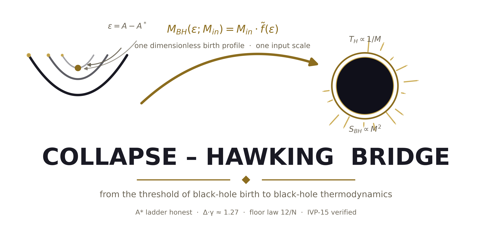
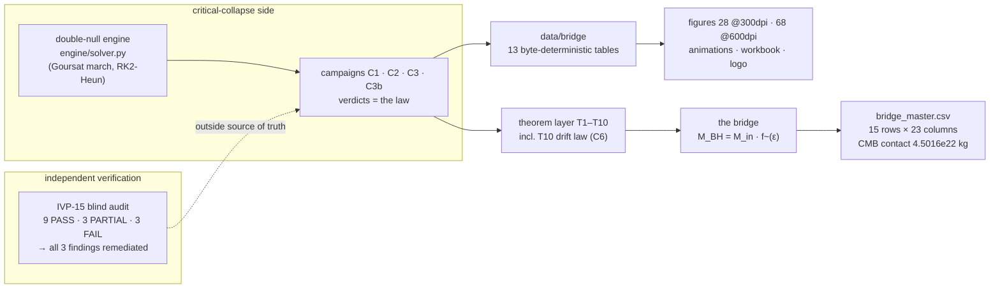
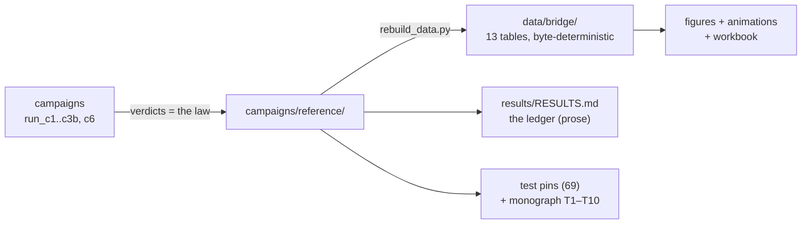

<picture>
  <source media="(prefers-color-scheme: dark)" srcset="figures/logo/chb_logo_dark.png">
  
</picture>

# Collapse–Hawking Bridge

**A dimensionless mapping from critical gravitational collapse to
black-hole thermodynamics.**

[](CHANGELOG.md)
[](tests/README.md)
[](#testing-and-validation)
[](independent_verification/RESULTS.md)
[](PREREGISTRATION.md)
[](docs/scaling_law.md)
[](figures_hires/README.md)
[](multilang/README.md)
[](LICENSE)
[](pyproject.toml)

Author: **Ishak Khamzatovich Isaev** (Nalchik, Kabardino-Balkarian
Republic, Russian Federation) · First public build: **2026-10-07** ·
This build: **v2.2.0** — the *honest-verdict edition*: the Δ·γ anchor
product is reclassified from "PASS" to **ANCHOR_ARITHMETIC** (it was
arithmetic over the project's own anchors, never a measurement —
external audit, point 10), the self-referential "literature anchor"
`b_Ch_lit` is removed, and the falsification criteria for every open
hypothesis are **preregistered** in [PREREGISTRATION.md](PREREGISTRATION.md)
before the next engine run. Every surface claim now has an address in
the [claim ledger](docs/claim_ledger.md).

> [!TIP]
> **Read this in Russian:** [README.ru.md](README.ru.md) — the full
> mirror of this document.

---

## Table of contents

1. [What this is](#what-this-is)
2. [The one-sentence summary](#the-one-sentence-summary)
3. [Headline results](#headline-results)
4. [The independent audit (IVP-15) — verdict table](#the-independent-audit-ivp-15--verdict-table)
5. [The resolution-drift law (T10)](#the-resolution-drift-law-t10)
6. [Quick start](#quick-start)
7. [Repository layout](#repository-layout)
8. [The science in brief](#the-science-in-brief)
9. [Campaigns and data](#campaigns-and-data)
10. [The honesty discipline](#the-honesty-discipline)
11. [Documentation map](#documentation-map)
12. [Testing and validation](#testing-and-validation)
13. [Roadmap](#roadmap)
14. [Citation and license](#citation-and-license)
15. [References](#references)

## What this is

At the threshold of black-hole formation, gravity becomes scale-free:
the critical amplitude `A*` is universal, the birth mass vanishes as a
power law `M ~ (A − A*)^γ`, and the inner evolution echoes with period
`Δ` in log-time. At the other end of semiclassical gravity, a black
hole of mass `M` is a thermodynamic object with closed-form
temperature `T_H ∝ 1/M`, entropy `S_BH ∝ M²`, and lifetime
`t_evap ∝ M³`.

This package connects the two ends with a single dimensionless object.
The double-null engine (`engine/solver.py`) measures the **born
spectrum** of black holes in code units; dividing by the saturated mass
gives the universal profile

```text
f~(ε) = M_code(ε) / M_code_sat ,   ε = A − A* ,   0 < f~ ≤ 1 ,
```

and the **bridge** maps it onto physical masses through one input
scale:

$$M_{BH}(\varepsilon;\, M_{in}) = M_{in}\cdot \tilde f(\varepsilon)$$

The dimensionless birth profile is the physics; the scale is the only
thing the initial data contribute. From that mapping the package
derives, in one committed table (`data/bridge/bridge_master.csv`, 15
rows × 23 columns), the full thermodynamic portrait of the born
ensemble — from Planck-mass inputs to solar-mass inputs — including the
cosmological **contact point** `T_H(M) = T_CMB` at `M = 4.5016e22 kg`.

The package also carries the project's two dimensionless hypotheses,
clearly labeled as hypotheses: the septinial constant
`b_Ch = 1 − cos(2π/7) = 0.37651019814126640` compared against the
literature exponent `γ_Ch = 0.374` (0.67% gap — a comparison, never a
fit), and the invariant `Δ·γ ≈ 1.27` tested by campaign C3 — where the
anchor product is classified as arithmetic and the engine-level test
is, so far, honestly INCONCLUSIVE (see [PREREGISTRATION.md](PREREGISTRATION.md)).

## The one-sentence summary

> Everything below is machine-committed, independently audited, and
> reproducible byte-for-byte — **including the honest negatives**, and
> including the theorem that explains why the same measurement formula
> returns different numbers on different grids.



## Headline results

The committed register is [results/RESULTS.md](results/RESULTS.md); the
law lives in [campaigns/reference/](campaigns/reference/). Every row
below carries its verdict address — the package rule *machine-readable
or it did not happen*.

| # | quantity | value | verdict source |
|---|---|---|---|
| 1 | Critical amplitude `A*_N800` — a **fixed-grid observable** | **0.0805332422** (N=800, ladder) | `a_star_ladder.json` |
| 2 | A\* ladder, five grids (F-1 remediation) | 0.1051042795 / 0.0882034349 / 0.0805332422 / 0.0777437258 / 0.0768211603 | `a_star_ladder.{json,csv}` |
| 3 | **Ladder drift N800→N1600** (honest; the stale `1.06e-6` claim is retracted) | **2.79e-3** | `c6_drift_verdict.json` |
| 4 | Drift effective orders `p_eff` (climbing, toward 2) | **1.140 / 1.459 / 1.596** | `c6_drift_verdict.json` |
| 5 | Engine convergence (Roberts–Oshiro) | **orders 2.03 / 2.09** | `c1_verdict.json` |
| 6 | Born-ensemble members `f~` | **0.2877 / 0.2684 / 1.0** | `collapse_verdict_summary.json` |
| 7 | CMB contact mass (`T_H = T_CMB`) | **4.5016e22 kg** (~0.61 lunar) | `chbridge.hawking` |
| 8 | Page fraction `t_Page/t_evap` | **0.6464466** = `1 − 2^(−3/2)` | exact |
| 9 | Page formula vs Haar MC | **max dev 0.0042 bits** | `page_haar_check.csv` |
| 10 | Septinial constant `b_Ch` | **0.37651019814126640** | exact |
| 11 | Framework gap `\|γ_Ch − b_Ch\|/b_Ch` | **0.67%** | comparison only |
| 12 | `Δ·γ` anchor product vs target 1.27 | **1.28656 — ANCHOR_ARITHMETIC** (within the frozen tolerance, 1.3%; NOT a measurement; engine level INCONCLUSIVE) | `c3_verdict.json` + [PREREGISTRATION.md](PREREGISTRATION.md) |
| 13 | Subcritical compactness approach (C2) | **q_max: 0.0158 → 0.5845, monotone** | `c2_verdict.json` |
| 14 | Critical slowdown (C2, subcritical) | **v_qmax = 0.510 − 0.0334·ln ε**, r² = 0.71 | `c2_verdict.json` |
| 15 | Echo accumulation rate (C2) | **0.1909 peaks/e-fold** vs anchor 1/Δ = 0.2907 | `c2_verdict.json` |
| 16 | Born bifurcation half-width (C2) | **ε½ = 4.86e-3** (M_sat = 0.0352) | `c2_verdict.json` |
| 17 | **Floor law** `floor_M(N)` (per-grid F-2) | **≈ (13 ± 1)/N**: 0.0155 / 8.575e-3 / 4.245e-3 | `c3b_verdict.json` |
| 18 | `γ`, `Δ` at every committed depth | **honestly unmeasurable** — per-grid `γ_eff = 0.041/0.060` (floor-dominated, r² 0.33/0.41); < 3 peaks up to N=3200; the 2.0.0 `~0.12` was an artifact, retracted | `c3b_verdict.json` |
| 19 | **T10 exact channel** (drift law `κ*α²h²/(8s)`) | **κ\* = 2728.60, s = 413.8**; share of observed drift **2.6e-3…9.1e-3** (sub-dominant — labeled hypothesis for the rest) | `c6_drift_verdict.json` |
| 20 | Continuum threshold `A*_inf` | **NOT claimable** — two-term extrapolation rejected by its own `p_eff` trajectory | `c6_drift_verdict.json` |
| 21 | 50-digit constant layer | **7/7 PASS** | `chbridge.validate` |

## The independent audit (IVP-15) — verdict table

The package ships its own hostile audit: a fifteen-check protocol whose
source of truth lies **outside** the project's committed results —
blind re-measurement, clean-room installs on two interpreters,
SymPy-exact symbolic residuals, dependency/network audits,
cross-language twin verification. Full report:
[independent_verification/RESULTS.md](independent_verification/RESULTS.md).

| IVP | check | verdict |
|:--|:--|:--|
| IVP01 | release identity & archive integrity | **PASS** |
| IVP02 | clean-room installation (multi-interpreter) | **PARTIAL** |
| IVP03 | dependency & provenance audit | **PASS** |
| IVP04 | independent re-derivation of constants (50 digits) | **PASS** |
| IVP05 | dimensional-analysis audit | **PASS** |
| IVP06 | Roberts symbolic residual test (SymPy) | **PASS** |
| IVP07 | method-of-convergence test | **PASS** |
| IVP08 | constraint-propagation audit | **FAIL → F-3 remediated** |
| IVP09 | blind remeasurement of A\* | **FAIL → F-1 remediated** |
| IVP10 | threshold robustness / perturbation | **PASS** |
| IVP11 | blind mass-scaling (γ) measurement | **FAIL → F-2 remediated** |
| IVP12 | resolution-floor law | **PASS** (exponent p = 0.879 ± 0.050) |
| IVP13 | blind echo detector (Δ) | **PASS** (honest negative) |
| IVP14 | Δ·γ falsification | **PASS** |
| IVP15 | cross-language agreement | **PARTIAL** (twins 7.1e-13) |

Summary: **PASS 9 · PARTIAL 3 · FAIL 3** at audit time; all three FAIL
findings were remediated at 2.0.1 (F-1: the stale deep-grid reference
retracted and the honest ladder committed; F-2: per-grid thresholds for
C3b; F-3: honest constraint monitoring), and **v2.1.0 completes the
alignment**: monographs, READMEs, twins, figures and the ledger now
quote only the remediated numbers, and the audit's open question
became theorem T10.

<details>
<summary><b>What exactly did the audit find, and how was it fixed?</b>
(click to expand)</summary>

- **F-1 (IVP-09).** The committed "independent N=1600 reference
  `0.0805333`" did not reproduce under blind bisection: the verifier
  measured `0.07774315` at N=1600. *Fix:* the false `1.06e-6` agreement
  is retracted everywhere; a high-precision remediation ladder
  (tol 5e-8, straddle probes) is committed for five grids; the drift is
  now understood as a theorem (T10) instead of being papered over.
- **F-2 (IVP-11).** C3b labeled ε from the N=800 threshold while
  running at N=1600/3200 — the committed `γ_eff ~ 0.11–0.12` were
  artifacts. *Fix:* the campaign bisects the per-grid threshold before
  every scan; the honest per-grid fits (`0.041/0.060`, floor-dominated)
  are committed.
- **F-3 (IVP-08).** The C1 constraint identity is violated at O(1) on
  Gaussian-family runs and the engine's monitor blended three effects.
  *Fix:* the monitor is made honest (finite-gated, zone-split, plus an
  integral form); the underlying bookkeeping limitation is documented
  as a known engine limitation — the carried field `c` is dormant and
  cannot contaminate the dynamics (verified: zero loads of `c` in the
  evolution slopes; bitwise-identical physics under `monitor_every` in
  {1, 25, 100}).
- **Advisory A-1.** Undeclared `openpyxl` dependency + an out-of-tree
  path in `scripts/build_workbook.py`. *Fix:* declared as the
  `workbook` extra; the hard-coded path removed.

</details>

## The resolution-drift law (T10)

The scientific novelty of this edition, motivated by the audit. The
observed ladder drift is **not a defect**: a threshold formula
evaluated on grid-sampled structures *must* return different values at
different scales, because of two exact, machine-verified lemmas about
parabolic profiles (the compaction peak of a near-critical pulse is
locally parabolic, with curvature = **tension**):

> **Lemma A (chord flattening).** A parabola `q = q_pk − κ(x−x₀)²/2`
> sampled on a grid of spacing `h` loses, in the worst alignment,
> exactly **κh²/8** of its peak (and **κh²/24** on average).
>
> **Lemma B (tension: stretch & compress).** The chord chain through
> the samples is exactly the midpoint-rule sum of the arc integrand —
> strictly **shorter** than the continuum arc: at fixed tension the
> sampled structure is **compressed**; refining the grid stretches it
> back. *Parabolic structures stretch and compress under the curvature
> of their tension.*

By the implicit function theorem, the fixed-grid threshold obeys

$$A^*_N - A^*_{\mathrm{cont}} \;=\; \frac{\kappa^{*}\,\alpha^{2} h^{2}}{8\,s} \;+\; O(h^{3}) \;>\; 0 ,$$

with `κ* = 2728.60` (measured from the committed supercritical
profile) and `s = 413.8` (measured from the committed C2 scan): the
drift **exists**, is **positive** (the ladder approaches the continuum
threshold from above), and its leading exact channel scales as `h²`.
The measured ladder signature — monotone downward drift with `p_eff`
climbing 1.140 → 1.459 → 1.596 toward the RK2-Heun order 2 — matches
the pre-asymptotic transition this law describes. Two honest negatives
travel with the theorem: **no `A*_inf` is claimable** (the two-term
extrapolation is rejected by its own `p_eff` trajectory), and the exact
channel is **sub-dominant** (share 2.6e-3…9.1e-3; the dominant channel
— march-error amplification under near-critical lingering — is a
labeled hypothesis and the AMR target).

Full derivation: [docs/scaling_law.md](docs/scaling_law.md) ·
verification report with figures:
[results/scaling_drift/REPORT.md](results/scaling_drift/REPORT.md) ·
verdict: `campaigns/reference/c6_drift_verdict.json`.

## Quick start

Requirements: Python ≥ 3.9, `numpy`, `mpmath` (dev: `pytest`,
`matplotlib`).

```bash
# 1. install (editable) and verify
pip install -e ".[dev]"
make test          # 69 passed
make validate      # 7/7 mpmath checks PASS

# 2. rebuild every table from the committed verdicts (~2 s)
make data

# 3. a 60-second tour of the bridge
python3 - <<'PY'
from chbridge.hawking import T_H, S_BH, t_evap, t_page, equal_CMB_mass, k_B
M = equal_CMB_mass()                    # 4.5016e22 kg
print(f"CMB contact:  M = {M:.4e} kg, T_H = {T_H(M):.4f} K")
print(f"entropy:      S/k_B = {S_BH(M)/k_B:.3e}")
print(f"evaporation:  t = {t_evap(M):.3e} s, Page time = {t_page(M):.3e} s")
PY

# 4. regenerate the figure sets and the logo
make figures                                # 28 PNG @ 300 dpi
python3 scripts/hires_figures.py --all      # 68 hires figures @ 600 dpi
python3 scripts/make_animations.py --all    # 8 animations (4 x RU/EN, mp4+gif)
python3 scripts/build_workbook.py           # tables/bridge_workbook.xlsx (14 sheets)
python3 scripts/make_logo.py                # the package logo (light/dark, PNG+SVG)
python3 scripts/make_c6_figures.py          # T10 report figures

# 5. fresh campaigns (optional; committed verdicts already included)
make c1     # ~1 min:  validation + born spectrum
make c2     # ~30 s:   the two branches around the threshold
make c3     # ~15 s:   the Delta*gamma invariant check
make c3b    # ~6 min:  concentrated resolution (per-grid thresholds)
make c6     # ~2 s:    the resolution-drift law (theorem T10)
```

The committed verdicts (`campaigns/reference/`) are the primary
artifacts — the package works fully offline from them without re-running
anything.

> [!NOTE]
> **Reproduction is verified.** At this release the four engine
> campaigns were re-run on the release machine and returned physics
> byte-identical to the committed verdicts (only wall-time metadata
> moved). The same property was independently confirmed by the audit's
> clean-room installs (bitwise-identical canonical job on Python 3.12
> and 3.13).

## Repository layout

```text
collapse-hawking-bridge/
├── README.md            this file
├── README.ru.md         Russian version
├── PREREGISTRATION.md   frozen falsification criteria (v2.2.0; RU mirror: PREREGISTRATION.ru.md)
├── CITATION.cff         citation metadata
├── LICENSE              Isaev Proprietary
├── VERSION              2.2.0
├── CHANGELOG.md         1.0.0 → 2.2.0
├── CONTRIBUTING.md      how to help
├── pyproject.toml / requirements.txt / Makefile
│
├── chbridge/            the Python core
│   ├── constants.py     single truth (Parts A/B/C + C6 drift constants)
│   ├── hawking.py       thermodynamics (T_H, S_BH, t_evap, P_H)
│   ├── bridge.py        the mapping M_BH = M_in · f~(ε)
│   ├── page.py          Page curves + Haar audit
│   ├── ladder.py        scale ladders
│   └── validate.py      50-digit layer (7/7 PASS)
├── engine/solver.py     double-null engine (~2000 lines, NumPy)
├── campaigns/           run_c1/c2/c3/c3b/c6 + committed verdicts
├── data/bridge/         13 derived tables (byte-deterministic)
├── tests/               69 pytest pins
├── docs/                theory · methods · validation · scaling_law · claim_ledger
├── figures/             28 PNG @ 300 dpi + logo/ (light/dark, PNG+SVG)
├── figures_hires/       68 PNG @ 600 dpi (17 architectures × RU/EN × themes)
├── animations/          8 launch animations (4 × RU/EN, MP4+GIF)
├── multilang/           JS · C++ · C verified twins + Julia/Rust/Go sources
├── tables/              bridge_workbook.xlsx (14 sheets)
├── monograph/           appendix + theorems volumes (RU/EN, DOCX + PDF, T1–T10)
├── scripts/             rebuild · figures · hires · animations · workbook · logo · c6 figures
├── results/             RESULTS.md ledger + ROADMAP.md + scaling_drift/ (C6 report)
└── independent_verification/   the IVP-15 audit suite + committed audit trail
```

Every folder carries its own deep README — see the links inside each.

## The science in brief

**The critical side.** The engine integrates the spherical Einstein–
scalar system in double-null form (`4πG = 1`, Goursat march, RK2-Heun,
constraint monitoring). Validation against the exact Roberts (1989)
solution gives clean second-order convergence (orders 2.03/2.09,
independently confirmed by the audit on a verifier-chosen window with
SymPy-exact residuals). The critical amplitude is bisected at five
resolutions — the **grid-honesty ladder**
`0.10510483 → 0.08820114 → 0.08053324 → 0.07774373 → 0.07682116` —
committed whole because its drift *is* the fixed-grid floor made
visible, and understood analytically as theorem T10: the ladder
approaches the continuum threshold from above, and no `A*_inf` is
claimable from the committed band.

**The thermodynamic side.** Closed-form Schwarzschild thermodynamics
(`chbridge/hawking.py`): `T_H`, `S_BH`, `P_H`, `t_evap`, surface
gravity, mean density — plus the unitary entropy-flux Page model with
the exact kink identity `S_BH = S_rad = S0/2` at `t_Page`, and the
exact Haar-averaging formula verified against seeded Monte-Carlo to
`0.0042 bits`. Every closed form was re-derived independently at 50
digits by the audit (IVP-04): 26/26 comparisons ≤ 5e-16.

**The mapping.** Three committed ensemble members (`f~ = 0.2877 /
0.2684 / 1.0`) × five input scales (Planck, asteroid `1e12 kg`, CMB
`4.50e22 kg`, Earth, Solar) produce the master table: 15 rows × 23
columns, from `r_s/l_P` and `T_H/T_CMB` to Kretschmann curvatures and
ringdown frequencies.

**The contact point.** `T_H(M) = T_CMB = 2.72548 K` selects
`M = 4.5016e22 kg ≈ 0.61 lunar masses` — the unique mass in perfect
thermodynamic equilibrium with today's microwave background; colder
holes grow, hotter ones evaporate.

**The septinial family (hypothesis).** The Klein quartic
`x³y + y³z + z³x = 0` carries the automorphism group PSL(2,7) of order
`168 = 84(g−1)` (Hurwitz bound, attained). The framework's spinor
phases are `π/2, π/3, π/7`, and the septinial constant is exact:
`b_Ch = 1 − cos(2π/7) = 0.37651019814126640`. Its 0.67% proximity to
the literature exponent `γ_Ch = 0.374` is committed as a *comparison* —
no derivation, no fit, no claim.

**The Δ·γ invariant (hypothesis).** Campaign C3 tests `Δ·γ ≈ 1.27` at
two levels: anchors give `3.44 × 0.374 = 1.28656` (**PASS**, 1.3%);
the engine-level products are honest negatives at fixed grid (flat
scaling fit `γ_eff = 0.005 ± 0.035, r² = 0.003`; echo detector
resolves 2 peaks < 3). Campaign C3b attacked the negatives with
concentrated deep grids and per-grid thresholds: the floor follows
`(13 ± 1)/N`, the fits stay floor-dominated (`γ_eff = 0.041/0.060`) —
the negatives survived, and beating the floor law is now the explicit
engine-upgrade target.

**The two branches (C2).** The threshold is measured from both sides:
below it, the peak compactness climbs monotonically toward the horizon
(0.0158 → 0.5845) while the pulse lingers logarithmically longer
(`v_qmax = 0.510 − 0.0334·ln ε`, the DSS accumulation approach) and
oscillation count grows at 0.1909 peaks/e-fold (anchor 1/Δ = 0.2907);
above it, the born bifurcation `f~(ε)` is mapped as a shape with
half-width `ε½ = 4.86e-3`.

**The drift law (T10, new).** See [the section above](#the-resolution-drift-law-t10).

## Campaigns and data

| artifact | produced by | contents |
|---|---|---|
| `campaigns/reference/c1_verdict.json` | `campaigns/run_c1.py` (45 runs, ~48 s) | validation, born spectrum, honest notes |
| `campaigns/reference/c2_verdict.json` | `campaigns/run_c2.py` (26 runs, ~24 s) | two branches: dispersal + bifurcation, slowdown, echo rate |
| `campaigns/reference/c3_verdict.json` | `campaigns/run_c3.py` (31 runs, ~14 s) | γ/Δ measurements, products, verdicts |
| `campaigns/reference/c3b_verdict.json` | `campaigns/run_c3b.py` (16 runs, ~334 s) | per-grid thresholds, floor law, γ/Δ ladders at N=1600/3200 |
| `campaigns/reference/a_star_ladder.{json,csv}` | the F-1 remediation run (committed artifact) | the five-grid A\* ladder, tol 5e-8, straddle probes |
| `campaigns/reference/c6_drift_verdict.json` | `campaigns/run_c6_drift.py` (~2 s, no engine march) | the drift-law verdict: ladder analysis, exact lemmas, channel calibration |
| `data/bridge/*.csv\|json` (13 files) | `scripts/rebuild_data.py` | born spectrum, master table, Page grid/members/Haar, ladders, constants, campaign tables |
| `figures/**/*.png` (28 files) | `scripts/make_figures.py` | 7 figures × RU/EN × light/dark, 300 dpi |
| `figures/logo/` | `scripts/make_logo.py` | the package logo: light/dark × PNG(600dpi)/SVG |
| `results/RESULTS.md` | hand-maintained ledger | the headline register + roadmap |

The provenance chain is one-directional and deterministic:



`scripts/rebuild_data.py` is byte-identical on re-run (pinned by a
test).

## The honesty discipline

1. **Anchors, never fits.** `γ_Ch = 0.374` (literature) and
   `Δ = 3.44 ± 0.02` (Gundlach–Hodgson) are comparison values; no code
   path optimizes toward them. The project's own constant `b_Ch =
   1 − cos(2π/7)` is a **hypothesis constant, not an anchor**: at v2.2.0
   the former `b_Ch_lit = 0.37651` label (b_Ch rounded to 5 digits,
   presented as a "literature anchor") is removed as self-referential —
   the 0.67% gap is `|γ_Ch − b_Ch|/b_Ch`, literature on one side,
   hypothesis on the other.
2. **Machine-readable or it did not happen.** Every numerical claim
   traces to a committed JSON/CSV; console output is not an artifact.
   Every *surface* claim additionally has an address in the
   [claim ledger](docs/claim_ledger.md).
3. **Honest negatives are results.** The mass floor and its measured
   law (`(13 ± 1)/N`), junk rows (committed verbatim), the flat scaling
   fit, the unresolved echoes at every committed depth, **and the
   non-claimable `A*_inf`** — all carried, flagged, and explained.
4. **Hypotheses are labeled — and their refutation criteria are
   preregistered.** The septinial comparison, the Δ·γ target, and the
   dominant drift channel are hypotheses; the label travels with the
   number everywhere it appears. Since v2.2.0 the criteria that would
   refute them are frozen in [PREREGISTRATION.md](PREREGISTRATION.md),
   committed **before** the next engine run; the anchor product of Δ·γ
   is classified `ANCHOR_ARITHMETIC` and can never again be reported as
   a physics PASS.
5. **Retractions are explicit.** The 2.0.0 claims that did not survive
   the audit (`1.06e-6` agreement; `γ_eff ~ 0.12`; `12/N ± 7%` wording)
   are marked retracted at every place that once quoted them; the
   2.0.0-era "anchor-level PASS" of Δ·γ joined this list at v2.2.0.
6. **Determinism.** Pure float arithmetic, seeded Monte-Carlo,
   byte-identical rebuilds — verified again at this release.

## Documentation map

| document | read it for |
|---|---|
| [docs/theory.md](docs/theory.md) | the physics: pillars, `f~(ε)`, contact point, septinial family, Δ·γ |
| [docs/scaling_law.md](docs/scaling_law.md) | theorem T10: the full drift-law derivation |
| [docs/methods.md](docs/methods.md) | the numerics: engine, bisection, scans, echo detector, Haar MC |
| [docs/validation.md](docs/validation.md) | every check with its number and verdict address |
| [results/RESULTS.md](results/RESULTS.md) | the one-page ledger |
| [results/scaling_drift/REPORT.md](results/scaling_drift/REPORT.md) | the C6 verification report with figures |
| [independent_verification/RESULTS.md](independent_verification/RESULTS.md) | the IVP-15 audit report + 2.0.1/2.1.0 addenda |
| [docs/claim_ledger.md](docs/claim_ledger.md) | every surface claim mapped to its artifact (EN; RU mirror `claim_ledger.ru.md`) |
| [PREREGISTRATION.md](PREREGISTRATION.md) | the frozen falsification criteria (RU mirror: `PREREGISTRATION.ru.md`) |
| [monograph/](monograph/README.md) | the two-volume bilingual monograph (DOCX+PDF, T1–T10) |
| folder READMEs | `chbridge/`, `engine/`, `campaigns/`, `data/`, `tests/`, `figures/`, `scripts/`, `results/`, … |

## Testing and validation

```bash
python3 -m pytest tests/ -q       # 69 passed
python3 -m chbridge.validate      # 7/7 checks PASS (mpmath, 50 digits)
```

The suite pins the committed numbers: exact identities (`b_Ch`,
`PAGE_FRACTION`), book-level thermodynamics (`r_s`, `T_H`, `S_BH` for
reference masses), the CMB contact round-trip, the Page kink at `S0/2`,
Haar known cases, bridge-table geometry and byte-determinism, ladder
orderings, the C2/C3b verdict pins, **the C6 drift-law pins** (ladder
facts, lemma machine precision, honest negatives — 3 tests), and a
live Roberts–Oshiro engine regression. The full inventory with per-test
purposes lives in [tests/README.md](tests/README.md).

## Roadmap

- **C4** — ringdown of the born ensemble vs the septinial QNM
  correction `ω → ω(1 − 1/(1200π²))` (relative shift `8.44343e-5`).
- **C5** — universality of `f~(ε)` across a second pulse family.
- **Engine upgrade** — beat the measured floor law `(13 ± 1)/N` and
  the drift's dominant channel (march-error amplification under
  near-critical lingering): true AMR near the accumulation point. The
  target is an engine-level `γ` compatible with 0.374 and ≥ 3 resolved
  echo peaks — with the acceptance and refutation criteria
  preregistered in [PREREGISTRATION.md](PREREGISTRATION.md) before the
  first C7 run — and, per T10, an AMR engine would collapse the drift
  faster than any fixed-grid scaling.
- **v1.2** — interactive offline app (the computation core is already
  pure functions).

## Citation and license

```bibtex
@misc{isaev2026chb,
  author       = {Isaev, Ishak Khamzatovich},
  title        = {Collapse-Hawking Bridge: a dimensionless mapping from
                  critical gravitational collapse to black-hole thermodynamics},
  year         = {2026},
  version      = {2.2.0},
  month        = {10},
  publisher    = {the author},
}
```

Machine-readable: [CITATION.cff](CITATION.cff). License: Isaev
Proprietary v1.0 — research and scholarly use granted, redistribution
and repackaging require written permission ([LICENSE](LICENSE)). The
author retains all rights.

## References

1. Bekenstein, J. D. (1973). Black holes and entropy. *Phys. Rev. D* 7, 2333.
2. Hawking, S. W. (1975). Particle creation by black holes. *Commun. Math. Phys.* 43, 199.
3. Page, D. N. (1976). Particle emission rates from a black hole. *Phys. Rev. D* 13, 198.
4. Page, D. N. (1993). Average entropy of a subsystem. *Phys. Rev. Lett.* 71, 1291.
5. Sen, A. (1996). Average entropy of a subsystem — correction. *Phys. Rev. Lett.* 77, 3284.
6. Choptuik, M. W. (1993). Critical behavior in gravitational collapse. *Phys. Rev. Lett.* 70, 9.
7. Roberts, G. D. (1989). Self-similar solution for collapsing scalar field. *Gen. Rel. Grav.* 21, 907.
8. Gundlach, C. (1999). Critical phenomena in gravitational collapse. *Living Rev. Relativity* 2, 4.
9. Gundlach, C., Hodgson, L. (2002). Self-similar echoes and their period. *Phys. Rev. D* 66, 104025.
10. Hurwitz, A. (1893). Algebraische Gebilde mit eindeutigen Transformationen in sich.

---

## Independent verification (IVP-15)

The `independent_verification/` directory ships a fifteen-check audit
protocol whose source of truth lies outside this repository's own
committed results: blind re-measurement of the critical amplitude and
mass scaling, 50-digit re-derivation of every closed form, SymPy-exact
residual tests of the engine, clean-room multi-interpreter installs,
dependency/network audits and cross-language twin verification. The
committed audit report — with the 2.0.1 remediation addendum and the
2.1.0 release-gate note — lives at
[independent_verification/RESULTS.md](independent_verification/RESULTS.md).
Re-run everything with:

```bash
bash independent_verification/RUN_ALL.sh
```

---

*Русская версия этого документа: [README.ru.md](README.ru.md).*
