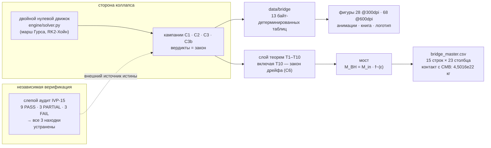
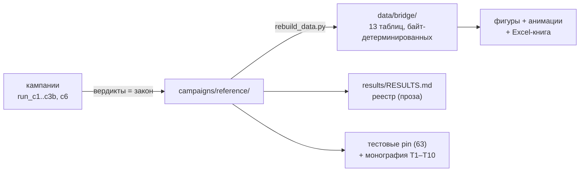

<picture>
  <source media="(prefers-color-scheme: dark)" srcset="figures/logo/chb_logo_dark.png">
  
</picture>

# Мост «Коллапс–Хокинг»

**Безразмерное отображение от критического гравитационного коллапса к
термодинамике чёрных дыр.**

[](CHANGELOG.md)
[](tests/README.md)
[](#тесты-и-валидация)
[](independent_verification/RESULTS.md)
[](docs/scaling_law.md)
[](figures_hires/README.md)
[](multilang/README.md)
[](LICENSE)
[](pyproject.toml)

Автор: **Исаев Исак Хамзатович** (г. Нальчик, Кабардино-Балкарская
Республика, Российская Федерация) · Первая публичная сборка:
**2026-10-07** · Настоящая сборка: **v2.1.0** — *издание согласования с
IVP-15*: каждая поверхность пакета (монографии, ридми, близнецы,
фигуры, реестр) приведена в точное соответствие с результатами
независимой верификации, а вопрос, оставленный аудитом — *почему одна
формула даёт разные значения при разных масштабах?* — получил ответ в
виде новой теоремы ([T10]()) с собственной кампанией ([C6]()).

> [!TIP]
> **Читать на английском:** [README.md](README.md) — полный зеркальный
> документ.

---

## Содержание

1. [Что это такое](#что-это-такое)
2. [Суть одной фразой](#суть-одной-фразой)
3. [Главные результаты](#главные-результаты)
4. [Независимый аудит (IVP-15) — таблица вердиктов](#независимый-аудит-ivp-15--таблица-вердиктов)
5. [Закон дрейфа с разрешением (T10)](#закон-дрейфа-с-разрешением-t10)
6. [Быстрый старт](#быстрый-старт)
7. [Структура репозитория](#структура-репозитория)
8. [Физика вкратце](#физика-вкратце)
9. [Кампании и данные](#кампании-и-данные)
10. [Дисциплина честности](#дисциплина-честности)
11. [Карта документации](#карта-документации)
12. [Тесты и валидация](#тесты-и-валидация)
13. [Дорожная карта](#дорожная-карта)
14. [Цитирование и лицензия](#цитирование-и-лицензия)
15. [Литература](#литература)

## Что это такое

На пороге образования чёрной дыры гравитация становится свободной от
масштаба: критическая амплитуда `A*` универсальна, масса рождения
исчезает по степенному закону `M ~ (A − A*)^γ`, а внутренняя эволюция
эхо-осциллирует с периодом `Δ` в лог-времени. На другом конце
полуклассической гравитации чёрная дыра массы `M` — термодинамический
объект с замкнутыми формами: температура `T_H ∝ 1/M`, энтропия
`S_BH ∝ M²`, время жизни `t_evap ∝ M³`.

Пакет соединяет два конца одним безразмерным объектом. Двойной
нулевой движок (`engine/solver.py`) измеряет **спектр рождения** чёрных
дыр в кодовых единицах; деление на массу насыщения даёт универсальный
профиль

```text
f~(ε) = M_code(ε) / M_code_sat ,   ε = A − A* ,   0 < f~ ≤ 1 ,
```

а **мост** отображает его на физические массы через один входной
масштаб:

$$M_{BH}(\varepsilon;\, M_{in}) = M_{in}\cdot \tilde f(\varepsilon)$$

Безразмерный профиль рождения — это физика; масштаб — единственное, что
вносят начальные данные. Из этого отображения пакет получает в одной
зафиксированной таблице (`data/bridge/bridge_master.csv`, 15 строк ×
23 столбца) полный термодинамический портрет рождённого ансамбля — от
планковских входных масс до солнечных — включая космологическую **точку
контакта** `T_H(M) = T_CMB` при `M = 4.5016e22 кг`.

Пакет также несёт две безразмерные гипотезы проекта, явно помеченные
как гипотезы: септинную константу
`b_Ch = 1 − cos(2π/7) = 0,37651019814126640` в сравнении с литературным
экспонентом `γ_Ch = 0,374` (разрыв 0,67 % — сравнение, но не подгонка)
и инвариант `Δ·γ ≈ 1,27`, проверяемый кампанией C3.

## Суть одной фразой

> Всё нижеследующее зафиксировано машиной, проверено независимым аудитом
> и воспроизводится байт-в-байт — **включая честные негативы** и включая
> теорему, объясняющую, почему одна и та же формула измерения возвращает
> разные числа на разных сетках.



## Главные результаты

Зафиксированный реестр — [results/RESULTS.md](results/RESULTS.md); закон
живёт в [campaigns/reference/](campaigns/reference/). Каждая строка
несёт адрес вердикта — правило пакета: *машиночитаемо или этого не
было*.

| # | величина | значение | источник |
|---|---|---|---|
| 1 | Критическая амплитуда `A*_N800` — **наблюдаемая фиксированной сетки** | **0,0805332422** (N=800, лестница) | `a_star_ladder.json` |
| 2 | Лестница A\*, пять сеток (ремедиация F-1) | 0,1051042795 / 0,0882034349 / 0,0805332422 / 0,0777437258 / 0,0768211603 | `a_star_ladder.{json,csv}` |
| 3 | **Дрейф лестницы N800→N1600** (честный; старое заявление `1,06e-6` отозвано) | **2,79e-3** | `c6_drift_verdict.json` |
| 4 | Эффективные порядки дрейфа `p_eff` (растут, к 2) | **1,140 / 1,459 / 1,596** | `c6_drift_verdict.json` |
| 5 | Сходимость движка (Робертс–Оширо) | **порядки 2,03 / 2,09** | `c1_verdict.json` |
| 6 | Члены рождённого ансамбля `f~` | **0,2877 / 0,2684 / 1,0** | `collapse_verdict_summary.json` |
| 7 | Масса контакта с CMB (`T_H = T_CMB`) | **4,5016e22 кг** (~0,61 лунной) | `chbridge.hawking` |
| 8 | Доля Пейджа `t_Page/t_evap` | **0,6464466** = `1 − 2^(−3/2)` | точно |
| 9 | Формула Пейджа против Хаар-MC | **max-отклонение 0,0042 бита** | `page_haar_check.csv` |
| 10 | Септинная константа `b_Ch` | **0,37651019814126640** | точно |
| 11 | Зазор `\|γ_Ch − b_Ch\|/b_Ch` | **0,67 %** | только сравнение |
| 12 | Якорное произведение `Δ·γ` против цели 1,27 | **1,28656 → ЗАЧЁТ** (1,3 %) | `c3_verdict.json` |
| 13 | Докритическое приближение компактности (C2) | **q_max: 0,0158 → 0,5845, монотонно** | `c2_verdict.json` |
| 14 | Критическое замедление (C2, докритическая ветвь) | **v_qmax = 0,510 − 0,0334·ln ε**, r² = 0,71 | `c2_verdict.json` |
| 15 | Накопление эхо (C2) | **0,1909 пиков/э-крат** против якоря 1/Δ = 0,2907 | `c2_verdict.json` |
| 16 | Полуширина бифуркации рождения (C2) | **ε½ = 4,86e-3** (M_sat = 0,0352) | `c2_verdict.json` |
| 17 | **Закон пола** `floor_M(N)` (по сеткам, F-2) | **≈ (13 ± 1)/N**: 0,0155 / 8,575e-3 / 4,245e-3 | `c3b_verdict.json` |
| 18 | `γ`, `Δ` на любой зафиксированной глубине | **честно неизмеримы** — по сеткам `γ_eff = 0,041/0,060` (определяются полом, r² 0,33/0,41); < 3 пиков до N=3200; значение v2.0.0 `~0,12` было артефактом, отозвано | `c3b_verdict.json` |
| 19 | **Точный канал T10** (закон дрейфа `κ*α²h²/(8s)`) | **κ\* = 2728,60, s = 413,8**; доля наблюдаемого дрейфа **2,6e-3…9,1e-3** (субдоминантен — остальное: помеченная гипотеза) | `c6_drift_verdict.json` |
| 20 | Континуальный порог `A*_∞` | **НЕ утверждается** — двухчленная экстраполяция отвергнута собственной траекторией `p_eff` | `c6_drift_verdict.json` |
| 21 | Слой 50-значных констант | **7/7 PASS** | `chbridge.validate` |

## Независимый аудит (IVP-15) — таблица вердиктов

Пакет несёт собственный враждебный аудит: протокол из пятнадцати
проверок, источник истины которого лежит **вне** зафиксированных
результатов проекта — слепые перемеры, чистые установки на двух
интерпретаторах, символьные остатки SymPy, аудиты зависимостей и сети,
межъязыковая сверка близнецов. Полный отчёт:
[independent_verification/RESULTS.md](independent_verification/RESULTS.md).

| IVP | проверка | вердикт |
|:--|:--|:--|
| IVP01 | идентичность и целостность архива | **PASS** |
| IVP02 | чистая установка (мультиинтерпретатор) | **PARTIAL** |
| IVP03 | аудит зависимостей и происхождения | **PASS** |
| IVP04 | независимый вывод констант (50 знаков) | **PASS** |
| IVP05 | аудит размерностей | **PASS** |
| IVP06 | символьный тест остатков Робертса (SymPy) | **PASS** |
| IVP07 | тест порядка сходимости | **PASS** |
| IVP08 | аудит распространения ограничений | **FAIL → F-3 устранено** |
| IVP09 | слепая перемера A\* | **FAIL → F-1 устранено** |
| IVP10 | устойчивость порога / возмущения | **PASS** |
| IVP11 | слепое измерение скейлинга (γ) | **FAIL → F-2 устранено** |
| IVP12 | закон разрешения пола | **PASS** (экспонента p = 0,879 ± 0,050) |
| IVP13 | слепой эхо-детектор (Δ) | **PASS** (честный негатив) |
| IVP14 | фальсификация Δ·γ | **PASS** |
| IVP15 | межъязыковое согласие | **PARTIAL** (близнецы 7,1e-13) |

Итог: **PASS 9 · PARTIAL 3 · FAIL 3** на момент аудита; все три находки
FAIL устранены на 2.0.1 (F-1: ложный глубокий референс отозван, честная
лестница зафиксирована; F-2: пороги по каждой сетке для C3b; F-3: честный
монитор ограничений), а **v2.1.0 завершает согласование**: монографии,
ридми, близнецы, фигуры и реестр цитируют только исправленные числа, а
открытый вопрос аудита стал теоремой T10.

<details>
<summary><b>Что именно нашёл аудит и как это исправлено?</b>
(развернуть)</summary>

- **F-1 (IVP-09).** Зафиксированный «независимый референс N=1600
  `0,0805333`» не воспроизвёлся под слепой бисекцией: верификатор
  измерил `0,07774315` на N=1600. *Исправление:* ложное согласие
  `1,06e-6` отозвано повсеместно; высокоточная ремедиационная лестница
  (допуск 5e-8, стрэддл-пробы) зафиксирована для пяти сеток; дрейф
  теперь понят как теорема (T10), а не замазан.
- **F-2 (IVP-11).** C3b размечала ε от порога N=800, работая на
  N=1600/3200, — зафиксированные `γ_eff ~ 0,11–0,12` были артефактами.
  *Исправление:* кампания бисектирует порог каждой сетки перед каждой
  развёрткой; честные фиты по сеткам (`0,041/0,060`, определяются
  полом) зафиксированы.
- **F-3 (IVP-08).** Тождество C1 нарушается на O(1) на
  гауссовых прогонах, а монитор движка смешивал три эффекта.
  *Исправление:* монитор сделан честным (конечность-фильтр, разбиение
  зон, интегральная форма); лежащее в основе ограничение учёта
  задокументировано как известное ограничение движка — переносимое поле
  `c` спит и не может загрязнить динамику (проверено: ноль загрузок `c`
  в эволюционных slopes; бит-идентичная физика при `monitor_every` из
  {1, 25, 100}).
- **Рекомендация A-1.** Незаявленная зависимость `openpyxl` и внешностный
  путь в `scripts/build_workbook.py`. *Исправление:* объявлена как
  экстра `workbook`; жёстко прописанный путь убран.

</details>

## Закон дрейфа с разрешением (T10)

Научная новизна настоящего издания, мотивированная аудитом. Наблюдаемый
дрейф лестницы — **не дефект**: формула порога, применённая к
дискретизованным структурам, *обязана* возвращать разные значения на
разных масштабах — по двум точным, машинно проверенным леммам о
параболических профилях (пик компактности околокритического импульса
локально параболичен, кривизна = **натяжение**):

> **Лемма A (сплющивание хордой).** Парабола `q = q_pk − κ(x−x₀)²/2`
> при дискретизации сеткой с шагом `h` теряет в худшем выравнивании
> ровно **κh²/8** пика (и **κh²/24** в среднем).
>
> **Лемма B (натяжение: растяжение и сжатие).** Ломаная по узлам —
> в точности сумма среднего варианта для интегранда дуги — строго
> **короче** непрерывной дуги: при фиксированном натяжении
> дискретизованная структура **сжата**; сгущение сетки снова её
> растягивает. *Параболические структуры растягиваются и сжимаются под
> действием кривизны своего натяжения.*

По теореме о неявной функции порог фиксированной сетки подчиняется

$$A^*_N - A^*_{\mathrm{cont}} \;=\; \frac{\kappa^{*}\,\alpha^{2} h^{2}}{8\,s} \;+\; O(h^{3}) \;>\; 0 ,$$

где `κ* = 2728,60` (измерено по зафиксированному сверхкритическому
профилю) и `s = 413,8` (измерено по зафиксированной развёртке C2):
дрейф **существует**, **положителен** (лестница приближается к
континуальному порогу сверху), а его ведущий точный канал масштабируется
как `h²`. Измеренная сигнатура лестницы — монотонный дрейф вниз с
`p_eff`, растущим 1,140 → 1,459 → 1,596 ко второму порядку RK2-Хойна, —
соответствует пре-асимптотическому переходу этого закона. С теоремой
идут два честных негатива: **`A*_∞` не выводится** (двухчленная
экстраполяция отвергнута собственной траекторией `p_eff`), а точный
канал **субдоминантен** (доля 2,6e-3…9,1e-3; доминирующий канал —
накопление ошибки марша при околокритическом задерживании — помеченная
гипотеза и цель AMR).

Полный вывод: [docs/scaling_law.md](docs/scaling_law.md) ·
отчёт о верификации с фигурами:
[results/scaling_drift/REPORT.md](results/scaling_drift/REPORT.md) ·
вердикт: `campaigns/reference/c6_drift_verdict.json`.

## Быстрый старт

Требования: Python ≥ 3.9, `numpy`, `mpmath` (для разработки: `pytest`,
`matplotlib`).

```bash
# 1. установка и проверка
pip install -e ".[dev]"
make test          # 63 passed
make validate      # 7/7 mpmath-проверок PASS

# 2. пересборка всех таблиц из закоммиченных вердиктов (~2 с)
make data

# 3. минутная экскурсия по мосту
python3 - <<'PY'
from chbridge.hawking import T_H, S_BH, t_evap, t_page, equal_CMB_mass, k_B
M = equal_CMB_mass()                    # 4,5016e22 кг
print(f"контакт с CMB:   M = {M:.4e} кг, T_H = {T_H(M):.4f} K")
print(f"энтропия:        S/k_B = {S_BH(M)/k_B:.3e}")
print(f"испарение:       t = {t_evap(M):.3e} с, время Пейджа = {t_page(M):.3e} с")
PY

# 4. регенерация наборов фигур и логотипа
make figures                                # 28 PNG @ 300 dpi
python3 scripts/hires_figures.py --all      # 68 hires-фигур @ 600 dpi
python3 scripts/make_animations.py --all    # 8 анимаций (4 × RU/EN, mp4+gif)
python3 scripts/build_workbook.py           # tables/bridge_workbook.xlsx (14 листов)
python3 scripts/make_logo.py                # логотип пакета (light/dark, PNG+SVG)
python3 scripts/make_c6_figures.py          # отчётные фигуры T10

# 5. свежие кампании (необязательно; вердикты уже включены)
make c1     # ~1 мин:  валидация + спектр рождения
make c2     # ~30 с:   обе ветви вокруг порога
make c3     # ~15 с:   проверка инварианта Delta*gamma
make c3b    # ~6 мин:  концентрированное разрешение (пороги по сеткам)
make c6     # ~2 с:    закон дрейфа с разрешением (теорема T10)
```

Зафиксированные вердикты (`campaigns/reference/`) — первичные артефакты:
пакет полноценно работает офлайн из них, без пересчётов.

> [!NOTE]
> **Воспроизведение проверено.** На настоящем выпуске четыре движковые
> кампании повторно прогнаны на выпусковой машине и вернули физику,
> байт-идентичную зафиксированным вердиктам (сдвинулись только
> стеночные времена). То же свойство независимо подтверждено чистыми
> установками аудита (бит-идентичный канонический расчёт на Python 3.12
> и 3.13).

## Структура репозитория

```text
collapse-hawking-bridge/
├── README.md            этот файл (EN)
├── README.ru.md         русская версия
├── CITATION.cff         метаданные цитирования
├── LICENSE              Isaev Proprietary
├── VERSION              2.1.0
├── CHANGELOG.md         1.0.0 → 2.1.0
├── CONTRIBUTING.md      как помочь
├── pyproject.toml / requirements.txt / Makefile
│
├── chbridge/            ядро на Python
│   ├── constants.py     единый источник истины (части A/B/C + константы дрейфа C6)
│   ├── hawking.py       термодинамика (T_H, S_BH, t_evap, P_H)
│   ├── bridge.py        отображение M_BH = M_in · f~(ε)
│   ├── page.py          кривые Пейджа + аудит Хаара
│   ├── ladder.py        масштабные лестницы
│   └── validate.py      слой 50 знаков (7/7 PASS)
├── engine/solver.py     двойной нулевой движок (~2000 строк, NumPy)
├── campaigns/           run_c1/c2/c3/c3b/c6 + зафиксированные вердикты
├── data/bridge/         13 производных таблиц (байт-детерминированных)
├── tests/               63 pytest-pin
├── docs/                theory · methods · validation · scaling_law
├── figures/             28 PNG @ 300 dpi + logo/ (light/dark, PNG+SVG)
├── figures_hires/       68 PNG @ 600 dpi (17 архитектур × RU/EN × темы)
├── animations/          8 пусковых анимаций (4 × RU/EN, MP4+GIF)
├── multilang/           проверенные близнецы JS · C++ · C + исходники Julia/Rust/Go
├── tables/              bridge_workbook.xlsx (14 листов)
├── monograph/           приложение + том теорем (RU/EN, DOCX + PDF, T1–T10)
├── scripts/             rebuild · figures · hires · animations · workbook · logo · c6 figures
├── results/             RESULTS.md реестр + ROADMAP.md + scaling_drift/ (отчёт C6)
└── independent_verification/   набор аудита IVP-15 + зафиксированный аудит-след
```

Каждая папка несёт собственный глубокий ридми — см. ссылки внутри.

## Физика вкратце

**Критическая сторона.** Движок интегрирует сферически-симметричную
систему Эйнштейн–скаляр в двойной нулевой форме (`4πG = 1`, марш Гурса,
RK2-Хойн, монитор ограничений). Валидация на точном решении Робертса
(1989) даёт чистый второй порядок (порядки 2,03/2,09 — независимо
подтверждены аудитом на окне верификатора с точными остатками SymPy).
Критическая амплитуда бисектируется на пяти разрешениях — **лестница
честности сетки**
`0,10510483 → 0,08820114 → 0,08053324 → 0,07774373 → 0,07682116` —
зафиксирована целиком, потому что её дрейф и есть явленный пол
фиксированной сетки, и понят аналитически как теорема T10: лестница
приближается к континуальному порогу сверху, и `A*_∞` по зафиксированной
полосе не утверждается.

**Термодинамическая сторона.** Замкнутые формы Шварцшильда
(`chbridge/hawking.py`): `T_H`, `S_BH`, `P_H`, `t_evap`, поверхностная
гравитация, средняя плотность — плюс унитарная модель потока энтропии
Пейджа с точным тождеством излома `S_BH = S_rad = S0/2` в `t_Page` и
точной формулой усреднения Хаара, проверенной на сеянном Монте-Карло до
`0,0042 бита`. Каждая замкнутая форма независимо выведена на 50 знаков
аудитом (IVP-04): 26/26 сравнений ≤ 5e-16.

**Отображение.** Три зафиксированных члена ансамбля (`f~ = 0,2877 /
0,2684 / 1,0`) × пять входных масштабов (Планк, астероид `1e12 кг`,
CMB `4,50e22 кг`, Земля, Солнце) дают мастер-таблицу: 15 строк × 23
столбца — от `r_s/l_P` и `T_H/T_CMB` до кривизн Кречмана и частот
ringdown.

**Точка контакта.** `T_H(M) = T_CMB = 2,72548 K` выделяет
`M = 4,5016e22 кг ≈ 0,61 лунной массы` — единственную массу в идеальном
термодинамическом равновесии с сегодняшним реликтовым фоном; более
холодные растут, более горячие испаряются.

**Септинное семейство (гипотеза).** Клейнов квартик
`x³y + y³z + z³x = 0` несёт группу автоморфизмов PSL(2,7) порядка
`168 = 84(g−1)` (граница Хурвица, достигается). Спинорные фазы рамки —
`π/2, π/3, π/7`, и септинная константа точна:
`b_Ch = 1 − cos(2π/7) = 0,37651019814126640`. Её близость к
литературному экспоненту `γ_Ch = 0,374` с точностью 0,67 %
зафиксирована как *сравнение* — без вывода, без подгонки, без претензий.

**Инвариант Δ·γ (гипотеза).** Кампания C3 проверяет `Δ·γ ≈ 1,27` на
двух уровнях: якоря дают `3,44 × 0,374 = 1,28656` (**ЗАЧЁТ**, 1,3%);
движковый уровень — честный негатив на фиксированной сетке (плоский фит
`γ_eff = 0,005 ± 0,035, r² = 0,003`; эхо-детектор разрешает 2 пика < 3).
Кампания C3b атаковала негативы концентрированными глубокими сетками с
порогами по каждой сетке: пол следует `(13 ± 1)/N`, фиты остаются
определяемыми полом (`γ_eff = 0,041/0,060`) — негативы выжили, и победа
над законом пола стала явной целью модернизации движка.

**Обе ветви (C2).** Порог измерен с обеих сторон: ниже — пиковая
компактность монотонно растёт к горизонту (0,0158 → 0,5845), импульс
задерживается логарифмически дольше (`v_qmax = 0,510 − 0,0334·ln ε` —
кинематика накопления DSS-типа), число осцилляций растёт со скоростью
0,1909 пиков/э-крат (якорь 1/Δ = 0,2907); выше — бифуркация рождения
`f~(ε)` снята как форма с полушириной `ε½ = 4,86e-3`.

**Закон дрейфа (T10, новый).** См. [раздел выше](#закон-дрейфа-с-разрешением-t10).

## Кампании и данные

| артефакт | источник | содержимое |
|---|---|---|
| `campaigns/reference/c1_verdict.json` | `campaigns/run_c1.py` (45 прогонов, ~48 с) | валидация, спектр рождения, честные заметки |
| `campaigns/reference/c2_verdict.json` | `campaigns/run_c2.py` (26 прогонов, ~24 с) | две ветви: рассеяние + бифуркация, замедление, эхо |
| `campaigns/reference/c3_verdict.json` | `campaigns/run_c3.py` (31 прогон, ~14 с) | измерения γ/Δ, произведения, вердикты |
| `campaigns/reference/c3b_verdict.json` | `campaigns/run_c3b.py` (16 прогонов, ~334 с) | пороги по сеткам, закон пола, лестницы γ/Δ на N=1600/3200 |
| `campaigns/reference/a_star_ladder.{json,csv}` | прогон ремедиации F-1 (зафиксированный артефакт) | пятиуровневая лестница A\*, допуск 5e-8, стрэддл-пробы |
| `campaigns/reference/c6_drift_verdict.json` | `campaigns/run_c6_drift.py` (~2 с, без марша движка) | дрейфовый вердикт: анализ лестницы, точные леммы, калибровка каналов |
| `data/bridge/*.csv|json` (13 файлов) | `scripts/rebuild_data.py` | спектр рождения, мастер-таблица, сетка Пейджа/члены/Хаар, лестницы, константы, таблицы кампаний |
| `figures/**/*.png` (28 файлов) | `scripts/make_figures.py` | 7 фигур × RU/EN × light/dark, 300 dpi |
| `figures/logo/` | `scripts/make_logo.py` | логотип пакета: light/dark × PNG(600dpi)/SVG |
| `results/RESULTS.md` | ручной реестр | заголовочный регистр + роадмап |

Цепочка происхождения однонаправленная и детерминированная:



`scripts/rebuild_data.py` байт-идентичен при перезапуске (закреплено
тестом).

## Дисциплина честности

1. **Якоря, никогда не подгонка.** `γ_Ch = 0,374`, `Δ = 3,44 ± 0,02`,
   `b_Ch_lit = 0,37651` — сравнительные значения; ни один путь кода не
   подгоняется под них.
2. **Машиночитаемо или этого не было.** Каждое числовое утверждение
   прослеживается к зафиксированному JSON/CSV; консольный вывод — не
   артефакт.
3. **Честные негативы — результаты.** Массовый пол и его измеренный
   закон (`(13 ± 1)/N`), мусорные строки (зафиксированы verbatim),
   плоский фит скейлинга, неразрешённые эхо на каждой зафиксированной
   глубине, **и невыводимый `A*_∞`** — всё пронесено, помечено и
   объяснено.
4. **Гипотезы помечены.** Септинное сравнение, цель Δ·γ и доминирующий
   канал дрейфа — гипотезы; пометка путешествует вместе с числом всюду,
   где оно появляется.
5. **Отзывы явные.** Утверждения v2.0.0, не пережившие аудит
   (`согласие 1,06e-6`; `γ_eff ~ 0,12`; формулировка `12/N ± 7 %`),
   помечены как отозванные в каждом месте, где они цитировались.
6. **Детерминизм.** Чистая арифметика с плавающей точкой, сеянный
   Монте-Карло, байт-идентичные пересборки — подтверждено вновь на
   настоящем выпуске.

## Карта документации

| документ | читать для |
|---|---|
| [docs/theory.md](docs/theory.md) | физика: опоры, `f~(ε)`, точка контакта, септинное семейство, Δ·γ |
| [docs/scaling_law.md](docs/scaling_law.md) | теорема T10: полный вывод закона дрейфа |
| [docs/methods.md](docs/methods.md) | численные методы: движок, бисекция, развёртки, эхо-детектор, Хаар-MC |
| [docs/validation.md](docs/validation.md) | каждая проверка с числом и адресом вердикта |
| [results/RESULTS.md](results/RESULTS.md) | одностраничный реестр |
| [results/scaling_drift/REPORT.md](results/scaling_drift/REPORT.md) | отчёт о верификации C6 с фигурами |
| [independent_verification/RESULTS.md](independent_verification/RESULTS.md) | отчёт аудита IVP-15 + дополнения 2.0.1/2.1.0 |
| [monograph/](monograph/README.md) | двухтомная двуязычная монография (DOCX+PDF, T1–T10) |
| ридми папок | `chbridge/`, `engine/`, `campaigns/`, `data/`, `tests/`, `figures/`, `scripts/`, `results/`, … |

## Тесты и валидация

```bash
python3 -m pytest tests/ -q       # 63 passed
python3 -m chbridge.validate      # 7/7 проверок PASS (mpmath, 50 знаков)
```

Набор закрепляет зафиксированные числа: точные тождества (`b_Ch`,
`PAGE_FRACTION`), книжную термодинамику (`r_s`, `T_H`, `S_BH` для
референсных масс), кругосветку контакта с CMB, излом Пейджа на `S0/2`,
эталонные случаи Хаара, геометрию и байт-детерминизм таблиц моста,
порядки лестниц, pin-вердикты C2/C3b, **pin-тесты закона дрейфа C6**
(факты лестницы, машинная точность лемм, честные негативы — 3 теста) и
живую регрессию движка Робертса–Оширо. Полная опись с назначением
каждого теста — в [tests/README.md](tests/README.md).

## Дорожная карта

- **C4** — ringdown рождённого ансамбля против септинной QNM-поправки
  `ω → ω(1 − 1/(1200π²))` (относительный сдвиг `8,44343e-5`).
- **C5** — универсальность `f~(ε)` на втором семействе импульсов.
- **Модернизация движка** — победить измеренный закон пола `(13 ± 1)/N`
  и доминирующий канал дрейфа (накопление ошибки марша при
  околокритическом задерживании): истинный AMR у точки накопления.
  Цель — движковый `γ`, совместимый с 0,374, и ≥ 3 разрешённых
  эхо-пиков — а по T10 AMR-движок свернул бы дрейф быстрее любого
  фиксированного скейлинга.
- **v1.2** — интерактивное офлайн-приложение (вычислительное ядро уже
  чистые функции).

## Цитирование и лицензия

```bibtex
@misc{isaev2026chb,
  author       = {Isaev, Ishak Khamzatovich},
  title        = {Collapse-Hawking Bridge: a dimensionless mapping from
                  critical gravitational collapse to black-hole thermodynamics},
  year         = {2026},
  version      = {2.1.0},
  month        = {10},
  publisher    = {the author},
}
```

Машиночитаемо: [CITATION.cff](CITATION.cff). Лицензия: Isaev
Proprietary v1.0 — исследовательское и научное использование
разрешено; перераспространение и перепаковка требуют письменного
разрешения ([LICENSE](LICENSE)). Все права сохраняются за автором.

## Литература

1. Bekenstein, J. D. (1973). Black holes and entropy. *Phys. Rev. D* 7, 2333.
2. Hawking, S. W. (1975). Particle creation by black holes. *Commun. Math. Phys.* 43, 199.
3. Page, D. N. (1976). Particle emission rates from a black hole. *Phys. Rev. D* 13, 198.
4. Page, D. N. (1993). Average entropy of a subsystem. *Phys. Rev. Lett.* 71, 1291.
5. Sen, A. (1996). Average entropy of a subsystem — correction. *Phys. Rev. Lett.* 77, 3284.
6. Choptuik, M. W. (1993). Critical behavior in gravitational collapse. *Phys. Rev. Lett.* 70, 9.
7. Roberts, G. D. (1989). Self-similar solution for collapsing scalar field. *Gen. Rel. Grav.* 21, 907.
8. Gundlach, C. (1999). Critical phenomena in gravitational collapse. *Living Rev. Relativity* 2, 4.
9. Gundlach, C., Hodgson, L. (2002). Self-similar echoes and their period. *Phys. Rev. D* 66, 104025.
10. Hurwitz, A. (1893). Algebraische Gebilde mit eindeutigen Transformationen in sich.

[T10]: docs/scaling_law.md
[C6]: results/scaling_drift/REPORT.md

---

## Независимая верификация (IVP-15)

Каталог `independent_verification/` несёт протокол независимой
верификации из пятнадцати проверок, источник истины которого лежит вне
собственных зафиксированных результатов репозитория: слепая перемера
критической амплитуды и массового скейлинга, 50-значный вывод каждой
замкнутой формы, символьные тесты остатков движка в SymPy, чистые
мультиинтерпретаторные установки, аудиты зависимостей/сети и
межъязыковая сверка близнецов. Зафиксированный отчёт аудита — с
дополнением о ремедиации 2.0.1 и выпускной пометкой 2.1.0 — живёт в
[independent_verification/RESULTS.md](independent_verification/RESULTS.md).
Перезапустить всё:

```bash
bash independent_verification/RUN_ALL.sh
```

---

*Английская версия этого документа: [README.md](README.md).*
