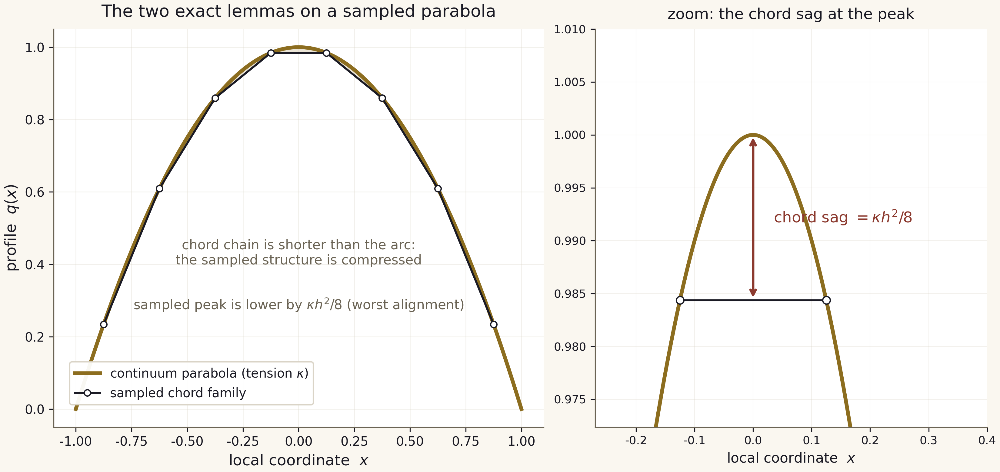
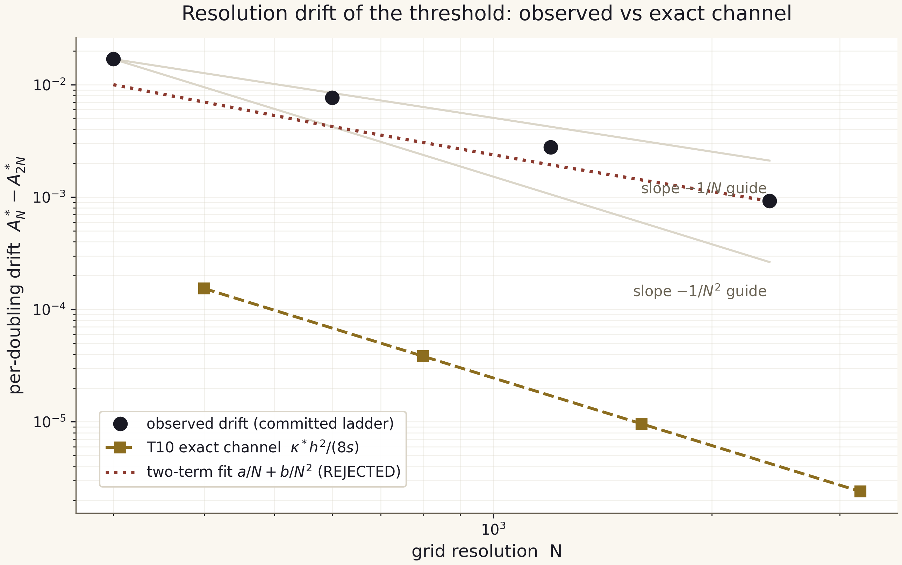

# C6 — the resolution-drift law: verification report

**Campaign:** C6 (`campaigns/run_c6_drift.py`, deterministic, no engine
march, ~2 s) · **Version:** 2.1.0 · **Inputs:** committed artifacts only
· **Theorem of record:** T10 (parabolic-tension drift), full derivation
in [`../../docs/scaling_law.md`](../../docs/scaling_law.md)

---

## 1. Question and answer

The independent audit (IVP-15) and the F-1 remediation left the package
with a committed threshold **ladder** — the same classification formula
bisected at five grid resolutions — whose values drift by
`1.69e-2 -> 9.23e-4` per doubling. Campaign C6 closes the question this
raises — *why does one formula give different values when the scale is
rescaled?* — with a theorem, two exact machine-verified lemmas, and a
measured channel decomposition:

1. **The drift is forced, not accidental.** The classification operator
   acts on grid-sampled parabolic structures; sampling flattens the
   peak by exactly `kappa h^2/8` (worst alignment) and shortens the
   chord chain against the continuum arc (the structure compresses
   under its tension). One formula applied to a structure whose peak
   and tension move with `h` cannot return one number.
2. **The direction is provable:** every fixed-grid threshold sits
   *above* the continuum one; the ladder approaches from above.
3. **The measured ladder is pre-asymptotic:** `p_eff` climbs
   1.140 -> 1.459 -> 1.596 (faster than `1/N`, toward the RK2-Heun
   order 2); no continuum `A*_inf` is claimable — committed as an
   honest negative with a rejection proof for the two-term fit.

## 2. The two exact lemmas (machine-verified)

| lemma | statement | verified to |
|---|---|---:|
| A (chord flattening) | sampled-peak deficit = `kappa h^2/8` (worst alignment); `kappa h^2/24` (alignment average) — both exact for parabolas | 2.0e-9 rel. (float64 floor of the deficit) |
| B (tension / arc) | the chord chain of a sampled parabola equals the midpoint-rule sum of the arc integrand; the deficit `L - L_h` is positive and `<= w h^2 f''_max/24` — the sampled structure is *compressed* at fixed tension | 1.9e-16 rel. |

Full rows: `campaigns/reference/c6_parabola_check.csv` (five grids,
`N = 200..3200`). Figure: `figures/parabola_tension_en_light.png`
(below), which draws the worst-alignment sampling and the exact sag.



## 3. What the committed ladder measures

| N pair | drift per doubling | p_eff |
|---|---:|---:|
| 200 -> 400 | 1.690084e-2 | 1.140 |
| 400 -> 800 | 7.670193e-3 | 1.459 |
| 800 -> 1600 | 2.789516e-3 | 1.596 |
| 1600 -> 3200 | 9.225655e-4 | — |

All drifts positive (approach from above, as T10 requires); `p_eff > 1`
at every pair; `p_eff` strictly climbing — the observed signature of a
transition toward the second-order asymptotics of the instrument.



## 4. Honest negatives committed by C6

1. **No `A*_inf`.** The two-term power-law model
   `A*_N = A_inf + a/N + b/N^2` fits the five points with
   `R^2 = 0.99925` and is **REJECTED** as an extrapolation law: its own
   `p_eff` trajectory decreases (1.316 -> 1.188 -> 1.104) while the
   measured one climbs. Out-of-sample errors: `1.7e-3` at N=400,
   `1.9e-2` at N=200. Every `A*_N` is a fixed-grid observable — the
   refusal to print any single threshold value (IVP-15, F-1) is now
   theorem-backed.
2. **The exact channel is sub-dominant.** Calibrated on committed
   artifacts (`kappa* = 2728.60` from the supercritical compaction
   profile at `v = 0.5853`; `s = 413.8` from the two deepest-eps C2
   rows; `h_r = 9.287e-4` at N=800), the T10 channel
   `kappa* h^2/(8 s)` carries `2.6e-3 .. 9.1e-3` of the observed
   drift. The dominant, monotone channel is attributed — **labeled
   hypothesis** — to march-error amplification under near-critical
   lingering (the threshold-side twin of the floor law T5), the
   explicit target of the AMR engine upgrade.

## 5. Artifacts of this folder

| file | content |
|---|---|
| `REPORT.md` | this report |
| `README.md` | folder guide (RU summary included) |
| `figures/drift_ladder_{en,ru}_{light,dark}.png` | observed drift vs exact channel vs rejected fit |
| `figures/parabola_tension_{en,ru}_{light,dark}.png` | the two lemmas visualised |
| `../../campaigns/reference/c6_drift_verdict.json` | the machine verdict (law) |
| `../../campaigns/reference/c6_drift_channels.csv` | per-grid channel decomposition |
| `../../campaigns/reference/c6_parabola_check.csv` | machine-precision lemma checks |
| `../../docs/scaling_law.md` | the full derivation (theorem T10) |

## 6. Reproduction

```bash
python3 campaigns/run_c6_drift.py     # ~2 s, deterministic, committed inputs only
python3 scripts/make_c6_figures.py    # the eight figures of this folder
python3 -m pytest tests/ -q           # C6 pins included (see tests/test_campaigns.py)
```

## Краткое резюме (Russian)

Кампания C6 отвечает на вопрос «почему одна формула при скалярном
изменении масштаба даёт разные значения». Ответ — теорема T10: оператор
классификации действует не на непрерывное семейство, а на
дискретизованное; выборка сплющивает пик параболической структуры ровно
на `kappa h^2/8` (худшее выравнивание) и укорачивает ломаную относительно
непрерывной дуги — структура сжимается под действием кривизны своего
натяжения. Отсюда дрейф порога существует, положителен (лестница
приближается к непрерывному значению сверху) и имеет точный канал
`O(h^2)`. Обе леммы проверены машинно до `1.9e-16`–`2e-9` относительной
точности; коэффициенты калиброваны исключительно на зафиксированных
артефактах. Честные негативы: экстраполяция `A_inf + a/N + b/N^2`
ОТВЕРГНУТА собственной траекторией p_eff (законописная кривая убывает,
измеренная растёт) — непрерывный порог по этой лестнице не утверждается;
точный канал субдоминантен (доля 2.6e-3..9.1e-3) — доминирующий канал
(гипотеза, помечена) — накопление ошибки марша при околокритическом
задерживании, мишень AMR-модернизации движка.
