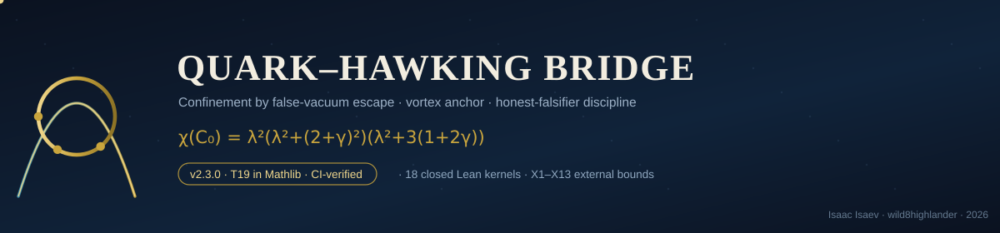
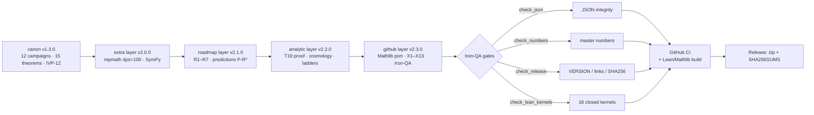

<div align="center">



# Quark–Hawking Bridge · Unified Archive

**Confinement by false-vacuum escape · vortex anchor · five convergence ladders · falsification-first discipline**

[](#verification-stack)
[](monolith/lean/)
[](monolith/lean/QHB_Theorems.lean)
[](CHANGELOG.md)
[](#falsification-first-policy)
[](LICENSE)


**v2.3.0 — the Mathlib edition.** Theorem T19 is ported to Mathlib, the external
bounds table grows to X1–X13, the whole archive is iron-clad: machine JSON layers,
Iron-QA tools, CI verification, checksums, and a git-ready history.

</div>

---

## What is this?

The **Quark–Hawking Bridge (QHB)** is a research program in which confinement is
modeled as an *escape into a false vacuum*: a three-quark system bridged by a
Y-shaped string to a vortex anchor, with the escape probability
**T(0) = 9.21×10⁻¹³** acting as the no-free-quarks gate. The package does not
predict physical fluxes; it states laws with uncertainty budgets, exact kernels,
and — above all — **falsifiers**. Every claim (C1–C12), theorem (T1–T20) and
prediction (P-\*) carries a one-line falsifier and an address in a machine JSON
layer, so any number in the prose can be re-derived and any mistake fails the build.

The monograph (`MONOGRAPH/`, RU/EN, PDF+DOCX, 17 chapters) is the single-voice
narrative; this repository is its **living, machine-checked substrate**.

## Verification stack



### Lean 4 / Mathlib (new in v2.3.0)

| Kernel | Statement | Tactic core |
|---|---|---|
| `T19_M_charpoly` | χ(C₀) = (λ²+(2+γ)²)·λ²·(λ²+3(1+2γ)) | `charpoly_fromBlocks_zero₂₁` + `ring` |
| `UBlock_charpoly` | χ(U) = λ²+(2+γ)² | `simp` + `ring` |
| `SBlock_charpoly` | χ(S) = λ²·(λ²+3(1+2γ)) | `simp` + `ring` |
| `T19_M_spectrum` | roots = {0} ∪ {±i(2+γ)} ∪ {±i√(3(1+2γ))} | `mul_eq_zero` |
| `T19_M_splitting` | ν_tr²−ν_int² = (γ−1)²/(2π)² | `field_simp` + `ring` |
| `T19_M_degenerate` | γ=1 ⟹ both branches = 3/(2π) = ω | `norm_num` |
| `T19_M_variance` | branch gap = circulation variance | `ring` |
| `T19_M_synge` | counter-circulation stable ⇔ γ < 1/2 | `linarith` |

Plus the ten core kernels of `QHB_Theorems.lean` — **18 closed kernels total**,
audited by [`QHB_AxiomAudit.lean`](monolith/lean/QHB_AxiomAudit.lean) (CI fails on
any `sorryAx`). Build locally:

```bash
cd monolith/lean
lake update && lake exe cache get! && lake build
lake env lean QHB_AxiomAudit.lean
```

> **Erratum (v2.3.0).** The stall-cliff monotonicity kernel `T20_stall_monotone`
> had its conclusion sign reversed in v2.2.0: τ_max = ε_H·e^{B/T}/ν is strictly
> **decreasing** in T (“danger lives at the hot end”). The chapter-16 numerics
> always showed the decreasing cliff; only the formal statement was wrong.
> Fixed and closed in this release.

## External bounds X1–X13

Expanded in v2.3.0 from X1–X8 to **X1–X13** (rows X9–X13 verified against
2024–2026 primary sources; addresses in each row of
[`monolith/roadmap_research/roadmap_results.json`](monolith/roadmap_research/roadmap_results.json)):

| # | Who | Channel | Bound / status |
|---|-----|---------|----------------|
| X1 | de Rújula, Glashow 1984 | nuclearite yardstick | F ≈ 7.8·(1 g/m) cm⁻²s⁻¹sr⁻¹ |
| X2 | MACRO 1997–2001 | underground nuclearites | < 2.7×10⁻¹⁶ cm⁻²s⁻¹sr⁻¹ |
| X3 | SLIM | nuclearite tracks | ~10⁻¹⁵ cm⁻²s⁻¹sr⁻¹ |
| X4 | ANTARES 2023 | 9 yr, m ≤ 10¹⁷ GeV/c² | ~5×10⁻¹⁷ cm⁻²s⁻¹sr⁻¹ |
| X5 | Pi-of-the-Sky 2020 | 100 g – 100 kg macs | most stringent in class |
| X6 | BNL E864 | strangelets Au+Pt | ≲10⁻⁶–10⁻⁷ / central |
| X7 | STAR 2007 | strangelets Au+Au | ≲ few·10⁻⁶–10⁻⁷ / central |
| X8 | AMS-01 2000 | cosmic-ray SMN | no candidates (see note) |
| **X9** | **SQM-ISS 2024–25** | **ISS dual-mode detector** | prospective (install 2025+) |
| **X10** | **IceCube 2025** | **sub-relativistic monopoles** | > 1 order improvement |
| **X11** | **KM3NeT 2023–24** | **down-going nuclearites** | prospective sensitivity |
| **X12** | **Macro recast 2024–26** | **extended mass functions** | methodology standard |
| **X13** | **CTAO / HESS J1731-347 2025** | **γ-ray strangelets** | prospective channel |

<details>
<summary><b>Honesty frame of the comparison</b> (click)</summary>

The QHB package does **not** predict physical fluxes: T(0) = 9.21×10⁻¹³ is a
dimensionless *model* tunneling probability. The X-table fixes the empirical
arena — verified bounds of real searches — within which any future physical
prediction of the program must live. Equating model and physical quantities
without calibration is forbidden by the honesty discipline. The falsifier of the
whole comparison layer: a confirmed nugget/strangelet candidate above X1–X13.
</details>

## Master numbers

| Quantity | Value | Layer |
|---|---|---|
| Valley floor β* | 3.3583 | canon v1.3.0 |
| Gap minimum Δ_F,min | 0.181777 | canon |
| Detector threshold | 0.03634845261904761 | canon |
| Naive closure β_c (falsified) | 2.9910 (6.3× margin) | canon |
| Free-trio escape P_esc | 0.2433 ± 0.0043 | canon |
| Vortex anchor ω | 3/(2π) | canon |
| Static barrier V* | 0.9359375 (0/300 escapes) | canon |
| Asymmetric lock η_crit | 0.0908885 (margin 1.49×10⁸) | canon |
| χ(C₀) factorization | exact, griddev 0.0 | v2.2.0 |
| Cooling deadline | t_death = 673·t_c (α=1/2, N=10¹²) | v2.2.0 |
| Dynamic deadline t_lim | 4.04×10⁻¹¹ (N-independent) | v2.2.0 |
| RK4 ladder order | p = 4.0956 (Richardson dev 2.5×10⁻¹¹) | v2.2.0 |
| Stall-cliff span | 22 orders (10¹² → 5.9×10⁻¹¹) | v2.2.0 |

## Repository structure

```text
QHB_Unified_v2.3.0/
├── MONOGRAPH/            # RU/EN monograph, PDF + DOCX (17 chapters)
├── qhb/                  # canon package: constants, core, vortex, claims…
├── data/                 # 12 campaign JSONs + IVP-12 audit
├── docs/                 # GitHub Pages landing (animated)
├── tests/                # canon pytest suite
├── tools/                # Iron-QA: check_json / numbers / release / lean_kernels
├── monolith/
│   ├── extra_research/   # v2.0.0: dps=100 verification, 12 figures
│   ├── roadmap_research/ # v2.1.0: R1–R7, predictions, X1–X13
│   ├── analytic_layer/   # v2.2.0: T19 proof, cosmology, 5 ladders
│   └── lean/             # v2.3.0: QHB_Theorems + QHB_T19_Mathlib + audit
├── legacy_v1.2.0/        # methods, gap law, IVP-01..11, multilang twins
└── .github/              # CI, Lean CI, Pages, release; templates; images
```

## Quickstart

```bash
# canon (full pipeline)
make all

# extra / roadmap / analytic layers
python3 monolith/analytic_layer/qhb_v220_t19.py     # requires sympy, mpmath, numpy
python3 monolith/analytic_layer/qhb_v220_cosmo.py
python3 monolith/analytic_layer/qhb_v220_ladders.py

# Iron-QA
python tools/check_json.py
python tools/check_numbers.py
python tools/check_release.py
python tools/check_lean_kernels.py
```

## Falsification-first policy

> Any roadmap item starts from the **falsifier** of the corresponding claim, not
> from the confirmation. Statuses (`exact` / `measured` / `honneg`) are never
> upgraded without a closed kernel or an exact symbolic derivation. Negative
> results are reported with the same care as positive ones.

## Citation

```bibtex
@misc{qhb2026,
  author = {Isaev, Isaac and wild8highlander},
  title  = {Quark--Hawking Bridge: Unified Monolithic Edition v2.3.0},
  year   = {2026},
  note   = {merge of v1.2.0 and v1.3.0; roadmap executed; proofs, scenarios,
            ladders, Mathlib port, X1--X13}
}
```

See [`CITATION.cff`](CITATION.cff). Publishing runbook: [`GITHUB_SETUP.md`](GITHUB_SETUP.md) —
suggested description, topics, branch protection, Pages, and social preview.

<div align="center">

<br/><sub>Quark–Hawking Bridge · 2026 · built with a falsifier before every promise</sub>
</div>
