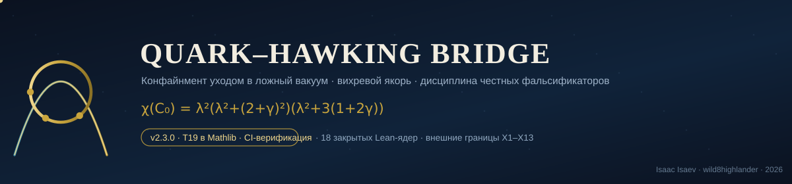
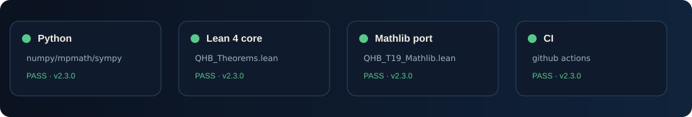
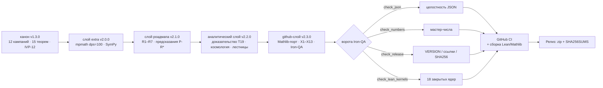

<div align="center">



# Quark–Hawking Bridge · Единый архив

**Конфайнмент уходом в ложный вакуум · вихревой якорь · пять лестниц сходимости · дисциплина честных фальсификаторов**

[](#стек-верификации)
[](monolith/lean/)
[](monolith/lean/QHB_Theorems.lean)
[](CHANGELOG.md)
[](#политика-сначала-фальсификатор)
[](LICENSE)



**v2.3.0 — Mathlib-издание.** Теорема T19 перенесена в Mathlib, таблица внешних
границ выросла до X1–X13, весь архив стал железным: машинные JSON-слои,
Iron-QA-инструменты, CI-верификация, чек-суммы и git-готовая история.

</div>

---

## Что это?

**Quark–Hawking Bridge (QHB)** — исследовательская программа, в которой конфайнмент
моделируется как *уход в ложный вакуум*: трёхкварковая система, соединённая
Y-образной струной с вихревым якорем, где вероятность ухода **T(0) = 9.21×10⁻¹³**
работает вентилем «свободных кварков нет». Пакет не предсказывает физических
потоков; он формулирует законы с бюджетами неопределённости, точными ядрами и —
прежде всего — **фальсификаторами**. Каждое утверждение (C1–C12), теорема (T1–T20)
и предсказание (P-\*) несёт однострочный фальсификатор и адрес в машинном JSON-слое,
так что любое число в прозе можно вывести заново, а любая ошибка валит сборку.

Монография (`MONOGRAPH/`, RU/EN, PDF+DOCX, 17 глав) — единый нарратив; этот
репозиторий — её **живая, проверяемая машиной подложка**.

## Стек верификации



### Lean 4 / Mathlib (новое в v2.3.0)

| Ядро | Утверждение | Тактическое ядро |
|---|---|---|
| `T19_M_charpoly` | χ(C₀) = (λ²+(2+γ)²)·λ²·(λ²+3(1+2γ)) | `charpoly_fromBlocks_zero₂₁` + `ring` |
| `UBlock_charpoly` | χ(U) = λ²+(2+γ)² | `simp` + `ring` |
| `SBlock_charpoly` | χ(S) = λ²·(λ²+3(1+2γ)) | `simp` + `ring` |
| `T19_M_spectrum` | корни = {0} ∪ {±i(2+γ)} ∪ {±i√(3(1+2γ))} | `mul_eq_zero` |
| `T19_M_splitting` | ν_tr²−ν_int² = (γ−1)²/(2π)² | `field_simp` + `ring` |
| `T19_M_degenerate` | γ=1 ⟹ обе ветви = 3/(2π) = ω | `norm_num` |
| `T19_M_variance` | зазор ветвей = дисперсия циркуляций | `ring` |
| `T19_M_synge` | встречная циркуляция устойчива ⇔ γ < 1/2 | `linarith` |

Плюс десять ядер основного каркаса `QHB_Theorems.lean` — **всего 18 закрытых ядер**,
аудит — [`QHB_AxiomAudit.lean`](monolith/lean/QHB_AxiomAudit.lean) (CI падает на любом
`sorryAx`). Сборка локально:

```bash
cd monolith/lean
lake update && lake exe cache get! && lake build
lake env lean QHB_AxiomAudit.lean
```

> **Erratum (v2.3.0).** В ядре `T20_stall_monotone` в издании v2.2.0 знак вывода
> был обратным: τ_max = ε_H·e^{B/T}/ν строго **убывает** по T («опасность живёт
> у горячего конца»). Числа главы 16 всегда показывали убывающую скалу; ошибочной
> была только формальная формулировка. Исправлено и закрыто в этом издании.

## Внешние границы X1–X13

Расширено в v2.3.0 с X1–X8 до **X1–X13** (строки X9–X13 сверены с первоисточниками
2024–2026; адреса — в каждой строке
[`monolith/roadmap_research/roadmap_results.json`](monolith/roadmap_research/roadmap_results.json)):

| # | Кто | Канал | Предел / статус |
|---|-----|-------|-----------------|
| X1 | de Rújula, Glashow 1984 | эталон ядеритов | F ≈ 7.8·(1 г/m) см⁻²с⁻¹ср⁻¹ |
| X2 | MACRO 1997–2001 | подземные ядериты | < 2.7×10⁻¹⁶ см⁻²с⁻¹ср⁻¹ |
| X3 | SLIM | ядерные треки | ~10⁻¹⁵ см⁻²с⁻¹ср⁻¹ |
| X4 | ANTARES 2023 | 9 лет, m ≤ 10¹⁷ ГэВ/c² | ~5×10⁻¹⁷ см⁻²с⁻¹ср⁻¹ |
| X5 | Pi-of-the-Sky 2020 | 100 г – 100 кг мак | самые строгие в классе |
| X6 | BNL E864 | стрэйнджлеты Au+Pt | ≲10⁻⁶–10⁻⁷ / центральное |
| X7 | STAR 2007 | стрэйнджлеты Au+Au | ≲ несколько·10⁻⁶–10⁻⁷ |
| X8 | AMS-01 2000 | странная материя в КЛ | кандидатов нет (см. прим.) |
| **X9** | **SQM-ISS 2024–25** | **двухмодовый детектор на МКС** | перспективный (монтаж 2025+) |
| **X10** | **IceCube 2025** | **под-релятивистские монополи** | улучшение > порядка |
| **X11** | **KM3NeT 2023–24** | **нисходящие ядериты** | проектная чувствительность |
| **X12** | **Рекаст макро 2024–26** | **протяжённые масс-функции** | методологический стандарт |
| **X13** | **CTAO / HESS J1731-347 2025** | **гамма-стрэйнджлеты** | перспективный канал |

<details>
<summary><b>Рамка честности сравнения</b> (нажми)</summary>

Пакет QHB **не** предсказывает физических потоков: T(0) = 9.21×10⁻¹³ — безразмерная
*модельная* вероятность туннелирования. Таблица X фиксирует эмпирическую арену —
проверенные границы реальных поисков, — в которой обязано жить любое будущее
физическое предсказание программы. Сопоставлять модельные и физические величины
без калибровки запрещено дисциплиной честности. Фальсификатор всего слоя
сравнения: подтверждённый кандидат в наггеты/стрэйнджлеты выше X1–X13.
</details>

## Мастер-числа

| Величина | Значение | Слой |
|---|---|---|
| Дно долины β* | 3.3583 | канон v1.3.0 |
| Минимум зазора Δ_F,min | 0.181777 | канон |
| Порог детектора | 0.03634845261904761 | канон |
| Наивная точка β_c (фальсифицирована) | 2.9910 (зазор 6.3×) | канон |
| Уход свободного трио P_esc | 0.2433 ± 0.0043 | канон |
| Вихревой якорь ω | 3/(2π) | канон |
| Статический барьер V* | 0.9359375 (0/300 уходов) | канон |
| Асимметричный замок η_crit | 0.0908885 (запас 1.49×10⁸) | канон |
| Факторизация χ(C₀) | точно, griddev 0.0 | v2.2.0 |
| Дедлайн остывания | t_death = 673·t_c (α=1/2, N=10¹²) | v2.2.0 |
| Динамический дедлайн t_lim | 4.04×10⁻¹¹ (N-независим) | v2.2.0 |
| Порядок лестницы RK4 | p = 4.0956 (Ричардсон 2.5×10⁻¹¹) | v2.2.0 |
| Размах скалы остановки | 22 порядка (10¹² → 5.9×10⁻¹¹) | v2.2.0 |

## Структура репозитория

```text
QHB_Unified_v2.3.0/
├── MONOGRAPH/            # монография RU/EN, PDF + DOCX (17 глав)
├── qhb/                  # канонический пакет: constants, core, vortex, claims…
├── data/                 # JSON 12 кампаний + аудит IVP-12
├── docs/                 # лендинг GitHub Pages (анимированный)
├── tests/                # канонический pytest-набор
├── tools/                # Iron-QA: check_json / numbers / release / lean_kernels
├── monolith/
│   ├── extra_research/   # v2.0.0: верификация dps=100, 12 фигур
│   ├── roadmap_research/ # v2.1.0: R1–R7, предсказания, X1–X13
│   ├── analytic_layer/   # v2.2.0: доказательство T19, космология, 5 лестниц
│   └── lean/             # v2.3.0: QHB_Theorems + QHB_T19_Mathlib + аудит
├── legacy_v1.2.0/        # методы, закон зазора, IVP-01..11, мультиязычные двойники
└── .github/              # CI, Lean-CI, Pages, релиз; шаблоны; картинки
```

## Быстрый старт

```bash
# канон (полный конвейер)
make all

# слои extra / роадмап / аналитика
python3 monolith/analytic_layer/qhb_v220_t19.py     # нужны sympy, mpmath, numpy
python3 monolith/analytic_layer/qhb_v220_cosmo.py
python3 monolith/analytic_layer/qhb_v220_ladders.py

# Iron-QA
python tools/check_json.py
python tools/check_numbers.py
python tools/check_release.py
python tools/check_lean_kernels.py
```

## Политика «сначала фальсификатор»

> Любой пункт роадмапа начинается с **фальсификатора** соответствующего
> утверждения, а не с подтверждения. Статусы (`exact` / `measured` / `honneg`)
> не повышаются без закрытого ядра или точного символьного вывода. Негативные
> результаты фиксируются с той же тщательностью, что и позитивные.

## Цитирование

```bibtex
@misc{qhb2026,
  author = {Isaev, Isaac and wild8highlander},
  title  = {Quark--Hawking Bridge: Unified Monolithic Edition v2.3.0},
  year   = {2026},
  note   = {merge of v1.2.0 and v1.3.0; roadmap executed; proofs, scenarios,
            ladders, Mathlib port, X1--X13}
}
```

См. [`CITATION.cff`](CITATION.cff). Рунбук публикации: [`GITHUB_SETUP.md`](GITHUB_SETUP.md) —
описание, топики, защита ветки, Pages и social preview.

<div align="center">

<br/><sub>Quark–Hawking Bridge · 2026 · собрано с фальсификатором раньше обещания</sub>
</div>
