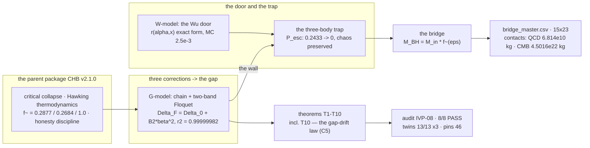
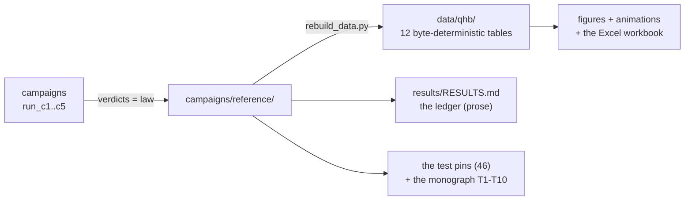

<picture>
  <source media="(prefers-color-scheme: dark)" srcset="figures/logo/qhb_logo_dark.png">
  
</picture>

# The Quark-Hawking Bridge

**A dimensionless mapping from the three septinial corrections to the
confinement gap, the Wu door and the three-body trap.**

[](CHANGELOG.md)
[](tests/README.md)
[](#tests-and-validation)
[](independent_verification/RESULTS.md)
[](docs/theory.md)
[](results/CLAIMS.md)
[](figures_hires/README.md)
[](multilang/README.md)
[](LICENSE)
[](pyproject.toml)

Author: **Isaev, Ishak Khamzatovich** (Nalchik, Kabardino-Balkarian
Republic, Russian Federation) · research-packaging co-author:
**wild8highlander** (GitHub) · First public build: **1.0.0,
2026-10-09** · current: **1.2.0, 2026-10-10** (the evidence block
C9–C11 + the Evidence Engine).

> [!TIP]
> **Читать по-русски:** [README.ru.md](README.ru.md) — полный зеркальный
> документ.

---

## Contents

1. [What this is](#what-this-is)
2. [The one-sentence essence](#the-one-sentence-essence)
3. [Headline results](#headline-results)
4. [The independent audit (IVP-08)](#the-independent-audit-ivp-08)
5. [The gap-drift law (T10)](#the-gap-drift-law-t10)
6. [Quick start](#quick-start)
7. [Repository structure](#repository-structure)
8. [The physics in brief](#the-physics-in-brief)
9. [Campaigns and data](#campaigns-and-data)
10. [The honesty discipline](#the-honesty-discipline)
11. [The documentation map](#the-documentation-map)
12. [Tests and validation](#tests-and-validation)
13. [Roadmap](#roadmap)
14. [Citation and license](#citation-and-license)
15. [References](#references)

## What this is

Quarks are never observed alone — only inside hadrons (confinement).
QCD supplies overwhelming lattice evidence, but no analytic proof
exists; the statement is part of the Yang-Mills mass-gap millennium
problem. This package is a research program that takes three ready
instruments from its parent, the **Collapse-Hawking Bridge** (CHB
v2.1.0) — critical collapse, Hawking thermodynamics and the honesty
discipline — and develops a four-link hypothesis of the confinement
origin:

> **H1. The furnace.** Quark triplets are welded at maximal density —
> the critical-collapse regime of CHB, where the born mass tends to
> zero and the mean horizon density tends to the Planck density.
> **H2. The gap.** The three dynamic corrections of the septinial
> family — the Berry quanta `pi^2/8, pi^2/18, pi^2/98` and the braking
> quanta `pi^5/704, pi^5/5346, pi^5/369754` of the `pi/2, pi/3, pi/7`
> sectors — vibrate, shift the discretized geometry and open a real
> spectral gap `Delta_F` — a mass-gap analog in the toy model.
> **H3. The door.** Hawking pairs leave the horizon; the weak channel
> violates parity (Wu et al. 1957), and a residual matter imbalance
> survives annihilation.
> **H4. The trap.** A triplet bound at maximal density cannot shed a
> member: the unsolved three-body problem shares energy chaotically,
> and the gap stands as an oscillating geometric wall — **bound
> chaos**.

> [!IMPORTANT]
> **Hypothesis status.** The confinement mechanism of the package is a
> **marked HYPOTHESIS**. Every theorem (T1-T13) is a machine-checked
> fact about the committed toy models, not a derivation of QCD. The
> honest negatives are carried in the headline of the ledger, and the
> Evidence Engine registry (27 claims, five statuses) makes the
> proof / measurement / comparison / hypothesis separation
> machine-checkable.

## The one-sentence essence

> Everything below is machine-fixed, independently audited and
> reproduces byte-for-byte — **including the honest negatives**: the
> equilateral Lagrange solution is unstable (exact), the free trio
> unbinds (P_esc = 0.2433), the detector tail is unresolved, the
> continuum gap is not claimed — and **including the new exact layer**:
> the gap NEVER closes on the whole searched phase map (C9), the
> vortex triangle is neutrally stable where the Newtonian one is not
> (T11, symbolic dev 0), the Aref manifold is bound WITHOUT any wall
> (T12), and the static wall seals EXACTLY (T13, V* = 0.9359375).



## Headline results

The committed ledger is [results/RESULTS.md](results/RESULTS.md); the
law lives in [campaigns/reference/](campaigns/reference/). Every row
carries its verdict address — the package rule: *machine-readable or
it did not happen*.

| # | quantity | value | source |
|---|---|---|---|
| 1 | static gap `Delta_0` (N=64, committed geometry) | **0.523004556028** | c1_verdict.json |
| 2 | response `s = dDelta/dq_pk` | **-1.00398294** (the sign is real, carried) | c1_verdict.json |
| 3 | **the gap law** `Delta_F = Delta_0 + B2 beta^2` | **B2 = -5.49670294e-2, r2 = 0.99999982** (window [0, 0.2]) | c1_verdict.json |
| 4 | per-sector hierarchy | **5.05e-2 / 4.40e-3 / 2.71e-5** (~1865 : 1) | c1_verdict.json |
| 5 | T2: b-flip evenness / a-only zero | **0.0 / ~1e-15** (machine zeros) | c1_verdict.json |
| 6 | T2: a-flip residual (genuine ab-cross) | 1.5e-6 at beta=0.4 (data) | c1_verdict.json |
| 7 | Gascheau (equal masses) | **nu = 1/3 > 1/27 — UNSTABLE (exact)** | c2_verdict.json |
| 8 | **P_esc, free trio (V0=0)** | **0.2433 ± 0.0248 — honest negative** | c2_verdict.json |
| 9 | P_esc, all V0 >= 0.4, all Omegas | **< 1e-4 — the wall seals** | c2_verdict.json |
| 10 | Lyapunov free / trapped (medians) | **0.2615 / 0.2885 — bound chaos** | c2_verdict.json |
| 11 | Wu door: formula vs MC (30 cells x 200k) | **max dev 2.5e-3** | c3_verdict.json |
| 12 | r at the Wu anchor (alpha=0.9, x=100) | **0.899996** — the door opens | c3_verdict.json |
| 13 | x leaving only eta | **1.36e-9** (the honest scale) | c3_verdict.json |
| 14 | **the QCD contact** `M_QCD` (T_H = 155.16 MeV) | **6.8140e10 kg** (0.68 x 1e11 lit. comp.) | qhb.bridge (T8) |
| 15 | the CMB contact (inherited) | 4.5016e22 kg | qhb.bridge |
| 16 | the floor: the unresolved tail | **T_sim = 20: beats 1.53 < 3 — negative** | c4_verdict.json |
| 17 | the resolution envelope | **err <= 2/N on all resolved rows** | c4_verdict.json |
| 18 | **the drift law** `Delta_cont - Delta_N = C h^2` | **C = +3.0089e-2, p_eff 1.948->1.974->1.987** | c5_verdict.json |
| 19 | the exact channel `s*kappa/8` | **-6.275e-3, share -0.209 (opposing, signed)** | c5_verdict.json |
| 20 | the Lemma-A machine check | **dev 0.0** (even and odd N) | c5_verdict.json |
| 21 | `Delta_cont` | **NOT claimed** (a two-parameter fit) | c5_verdict.json |
| 22 | the 50-digit constant layer | **9/9 PASS** | qhb.validate |
| 23 | twins JS / C / C++ | **13/13 each** | multilang/ |
| 24 | the engine Kepler anchor (e=0.5) | rel err **1.3e-9** | tests |
| 25 | **C6: the mapped gap quantum at the QCD contact** | **E_gap = 81.1 MeV** (comparison only) | c6_verdict.json |
| 26 | C6: the order window `Lambda/E_gap(QCD)` | **4.09** (same decade — NOT a derivation) | c6_verdict.json |
| 27 | C6: the three-branch round trip `T_H(M) = T` | max rel dev **1.4e-16** | c6_verdict.json |
| 28 | **C7: the sigma-extension regression gate** | **dev 0.0 exactly** (the C2 anchor re-verified) | c7_verdict.json |
| 29 | **C7: the flux tube seals** | P_esc **0.2433 → 0.06 → 0.0033**, monotone (sigma* = 0.05) | c7_verdict.json |
| 30 | **C7: the wall boundary V0\* shrinks** | **×7.1 (Ω=0) / ×7.6 (Ω=2)** as sigma: 0→0.02 | c7_verdict.json |
| 31 | C7: bound chaos WITHOUT the wall | median Lyapunov **0.264**, 100% positive | c7_verdict.json |
| 32 | **C8: the exact no-door check** | r(alpha=0) = **0.0** (bitwise) | c8_verdict.json |
| 33 | C8: RK4 convergence | **p_eff = 3.987** (pinned to 4) | c8_verdict.json |
| 34 | C8: 50-digit mpmath cross-check | dev **3.9e-16** | c8_verdict.json |
| 35 | **C8: the pairwise door at lambda=100 (alpha=0.9)** | **0.988** — the linear limit 0.9 is LEFT | c8_verdict.json |
| 36 | C8: does the T7 closed form extend? | **NO — an exact structural negative** | c8_verdict.json |
| 37 | **C9: no closure on the whole searched map** | every cell OPEN; map min **0.124449** > floor (finite-range) | c9_verdict.json |
| 38 | **C9: the narrowing valley** | beta* = **3.3583**, Delta_F,min = **0.181777**; REOPENS (band structure) | c9_verdict.json |
| 39 | C9: valley reproducibility | refinement dev **0.0002**; N-shifts **< 0.001** | c9_verdict.json |
| 40 | **C9: the naive-window counterexample** | forecast closure beta_c = 2.9910 — **FALSIFIED** (measured 6.3 × floor) | c9_verdict.json |
| 41 | **C10: the causal map of the drive** | **A 91.95% / B 8.00% / C 0.049%** — additive (cross 1.3e-4) | c10_verdict.json |
| 42 | C10: the braking-only drive | B2 = **0.0 exactly** (all-order invisible) | c10_verdict.json |
| 43 | **C10: out-of-window forecast failure** | err share 0.3% → 2.3%; residual power **4.07** (quartic wing) | c10_verdict.json |
| 44 | **T11: the stability contrast (exact)** | vortex spectrum **{0, 0, ±iω, ±iω}**; charpoly dev **0** (SymPy) | c11_verdict.json |
| 45 | T11: the rigid rotation | rigidity **1.5e-14**, ω dev **1.6e-14** | c11_verdict.json |
| 46 | **T12: the invariant wall** | Aref manifold: r_max **2.7654 << 12** — **bound WITHOUT any wall** | c11_verdict.json |
| 47 | **T13: the static barrier (exact)** | **V* = 0.9359375**: escape impossible at V0 ≥ 1.6, Ω=0 (0/300, margins ≥ 2.76) | c11_verdict.json |
| 48 | T13: the oscillating complement | median \|dE\| = **0.146** — the wall pumps energy (finite-time seal) | c11_verdict.json |
| 49 | **the Evidence Engine registry** | **27 claims, 5 statuses, validated** (breaks the build if broken) | claims_registry.json |
| 50 | the independent audit | **IVP-11: 11/11 PASS** | IVP results |

Three properties matter as much as the numbers: the honest negatives
(rows 7, 8, 13, 16, 19, 21, 36, 40, 43) stand in the headline, not the
basement; the signed quantities carry their signs; and the confinement
mechanism itself is a marked hypothesis — now with a machine-checkable
claims registry separating the proven, the measured, the compared and
the hypothesised.

## The independent audit (IVP-11)

The package carries its own hostile audit: a protocol of eleven checks
whose source of truth lies **outside** the committed results — fresh
interpreters, own 50-digit derivation paths, SymPy symbolic algebra,
SI dimension gates, hashes and seeds. Full report:
[independent_verification/RESULTS.md](independent_verification/RESULTS.md).

| IVP | check | verdict |
|:--|:--|:--|
| IVP01 | release integrity (verdicts + sha256) | **PASS** |
| IVP02 | canonical job (fresh interpreter, exact match) | **PASS** |
| IVP03 | dependency audit (ast-scan vs declared) | **PASS** |
| IVP04 | independent 50-digit derivation of closed forms | **PASS** |
| IVP05 | dimensions audit (SI gates on the contacts) | **PASS** |
| IVP06 | symbolic layer (Gascheau + Lemma A, SymPy) | **PASS** |
| IVP07 | convergence orders (the p_eff ladders) | **PASS** |
| IVP08 | seed determinism (bit-identical MC) | **PASS** |
| IVP09 | the phase-map gate (fresh cells + own bisection) | **PASS** |
| IVP10 | the competing-model gates (doubled Floquet resolution) | **PASS** |
| IVP11 | the vortex layer (SymPy charpoly dev 0 + 50-digit Aref zeros) | **PASS** |

Summary: **11/11 PASS**. A note about the audit itself: at packaging
IVP05 caught a wrong SI expectation in the protocol itself (the
Schwarzschild radius of the CMB contact is 6.7e-5 m, not kilometres) —
the gate was corrected, the package was right. The audit corrects
itself first.

## The gap-drift law (T10)

The scientific heir of the parent package's theorem T10. In CHB the
question was: *why does one formula give different thresholds at
different grid scales?* Here the same phenomenon is transplanted to
the gap: *why does the gap of one sampled geometry differ from the
continuum gap?* The answer is the same two exact lemmas, and the
honest channel-share analysis survives the transplantation verbatim:

> **Lemma A (chord flattening, exact).** A parabola
> `q = q_pk - kappa (x - x0)^2 / 2` sampled with step `h` loses exactly
> **kappa h^2/8** of its peak in the worst alignment. The committed
> centred chain with even N IS the worst alignment — the machine check
> gives exactly 0.0.
>
> **Lemma B (tension).** The chord chain is shorter than the continuum
> arc; the sampled structure is compressed by the curvature of its
> tension (in this model — the local kinetic-dispersion channel).

By the implicit-function structure the fixed-grid gap obeys

$$\Delta_{cont} - \Delta_N \;=\; C\,h^{2} \;+\; O(h^{3}),$$

with the measured `C = +3.0089e-2`, while the exact Lemma-A channel
predicts `C_exact = s*kappa/8 = -6.275e-3` at `s = -1.00398294`: the
**exact-channel share is -0.209** — it OPPOSES the kinetic dispersion
(the flattened peak alone would push the gap above the target), and
the net ladder approaches from below. The effective orders climb
**1.948 -> 1.974 -> 1.987** toward two. Two honest negatives travel
with the theorem: **`Delta_cont` is NOT claimed** (the two-parameter
fit 0.523460440588 is displayed without a claim — the same rejection
CHB applied to `A*_inf`), and the two-channel decomposition of the
remainder is a **marked hypothesis**. The sign mirror: the CHB
threshold ladder approached from above, the gap ladder approaches from
below; the sign is carried, not hidden.

Full derivation: [docs/gap_law.md](docs/gap_law.md) ·
verdict: `campaigns/reference/c5_verdict.json`.

## The evidence block (C9-C11, v1.2.0)

Three campaigns turn the honest scope notes into measured structure —
and add the first EXACT confinement statement of the package:

- **The phase map (C9).** The window law T3 is mapped over the whole
  searched (beta, q_pk) plane: every cell OPEN against the committed
  detector floor 2/N — **the gap never closes on the searched range**
  (a finite-range statement, honestly bounded by beta_max = 10).  The
  measured phase feature is the NARROWING VALLEY: the gap reaches a
  minimum (beta* = 3.3583, Delta_F,min = 0.181777 at the committed
  geometry) and REOPENS — quasi-energy band structure.  And the
  machine-found counterexample: the naive quadratic extrapolation
  forecasts closure at beta_c = 2.9910 — falsified by a factor 6.3.
  Full document: [docs/phase_map.md](docs/phase_map.md).
- **The causal map (C10).** A factorial ablation of the three
  septinial sectors: which contribution is STRUCTURALLY necessary?
  A carries 91.95% of |B2|, B 8.00%, C 0.049%; the leading response is
  additive (max cross 1.3e-4); the braking-only drive is exactly
  invisible; the septinial C sector is structurally present and
  causally a spectator in magnitude — carried, not hidden.  The
  out-of-window forecast gate quantifies the wing (residual power
  4.07).
- **The vortex anchor and the static barrier (C11).** The classical
  three-vortex problem (Kirchhoff 1876; Aref 1979), implemented from
  the classical equations with the package's own code paths
  (`qhb/vortex.py`):
  **T11 (exact)** — the stability contrast: the SAME equilateral
  triangle that is Gascheau-unstable under 1/r attraction is a
  neutrally stable relative equilibrium of the Kirchhoff problem
  (spectrum {0, 0, ±i-omega, ±i-omega}; the characteristic polynomial
  `lambda^2 (lambda^2+omega^2)^2` proven symbolically, dev 0) —
  three-ness does not create the escape channel, the INTERACTION
  decides.
  **T12 (measured)** — the invariant wall: on the classical Aref
  manifold (all four invariants vanish, machine zeros at 50 digits)
  the trio stays bound WITHOUT ANY WALL (r_max = 2.7654 << 12) —
  confinement by invariants, the topological complement of the
  geometric wall.
  **T13 (exact)** — the static barrier: with the wall frozen
  (Omega = 0) escape is EXACTLY impossible at V0 >= 1.6 (the bound
  V* = 0.9359375, a theorem about the committed softened engine);
  at Omega > 0 the wall pumps energy (median |dE| = 0.146) and the
  C2/C7 sealing stays a finite-time statement.  The honest
  stratification: exact impossibility / measured finite-time sealing.
- **The Evidence Engine.** Every load-bearing statement of the package
  lives in [results/CLAIMS.md](results/CLAIMS.md) with its status
  (exact / measured-law / honest-negative / hypothesis / comparison),
  its verdict address, a five-field uncertainty budget and a
  pre-committed falsification criterion (27 claims, build-pinned):
  a proof, a measurement, a comparison and a hypothesis can no longer
  be silently mixed.

## Quick start

Requirements: Python >= 3.9, `numpy`, `scipy`, `mpmath` (for
development: `pytest`, `matplotlib`, `sympy`, `openpyxl`).

```bash
# 1. install and verify
pip install -e ".[dev]"
make test          # 94 passed
make validate      # 9/9 mpmath checks PASS

# 2. rebuild all tables from the committed verdicts (~2 s)
make data

# 3. a one-minute tour of the bridge
python3 - <<'PY'
from qhb.bridge import equal_qcd_mass, T_H
from qhb.wu import residual
from qhb.trio import gascheau_verdict
M = equal_qcd_mass()          # 6.814e10 kg — the QCD contact
print(f"QCD contact:   M = {M:.4e} kg, T_H = {T_H(M):.3e} K")
print(f"the Wu door:   r(0.9, 100) = {residual(0.9, 100.0):.6f}")
print(f"Gascheau:      {gascheau_verdict()['verdict']}")
PY

# 4. regenerate the figures, animations, workbook and logo
make figures                                # 28 PNG @ 300 dpi
python3 scripts/hires_figures.py --all      # 68 hires @ 600 dpi
python3 scripts/make_animations.py --all    # 12 animations (3 x RU/EN)
python3 scripts/build_workbook.py           # tables/qhb_workbook.xlsx (12 sheets)
python3 scripts/make_logo.py                # the logo (light/dark, PNG+SVG)

# 5. fresh campaigns (optional; the verdicts are committed)
make c1     # ~1 s:     the gap law (T2/T3)
make c2     # ~3.5 min: the trap (T4/T5/T6)
make c3     # ~1 s:     the Wu door (T7)
make c4     # ~1 s:     the spectral floor (T9)
make c5     # ~1 s:     the drift law (T10)
make c6     # ~1 s:     the physical mapping (three branches)
make c7     # ~5 min:   the anharmonic trio (the flux tube)
make c8     # ~10 s:    the pairwise Wu door
make c9     # ~11 s:    the gap phase map (C9)
make c10    # ~4 s:     the competing models (C10)
make c11    # ~35 s:    the vortex anchor + the static barrier (C11)
make claims # the claims registry validation (27 claims)
```

The committed verdicts (`campaigns/reference/`) are the primary
artifacts: the package works offline from them, without
recomputation.

> [!NOTE]
> **Reproduction.** All eight campaigns are deterministic (the single
> seed 20261010; C6 and C8 are fully deterministic ODE/closed-form): a re-run returns physics byte-identical to the
> committed verdicts (only wall times shift). The same property is
> independently confirmed by the audit (IVP02, IVP08).

## Repository structure

```text
quark-hawking-bridge/
├── README.md            this file
├── README.ru.md         the Russian version
├── CITATION.cff         citation metadata
├── LICENSE              Isaev Proprietary
├── VERSION              1.0.0
├── CHANGELOG.md         the first public build
├── CONTRIBUTING.md      the contribution discipline
├── pyproject.toml / requirements.txt / Makefile
│
├── qhb/                 the Python core
│   ├── constants.py     the single source of truth (parts A/B/C)
│   ├── gap.py           the G-model: chain, two-band Floquet, Lemma A
│   ├── trio.py          Gascheau, the growth rate, the geometric wall
│   ├── vortex.py        the classical Kirchhoff layer (T11/T12)
│   ├── wu.py            the Wu door: the closed-form residual
│   ├── bridge.py        the bridge: 15x23 + both contact points
│   ├── ladder.py        the density/temperature/gap ladders
│   ├── claims.py        the Evidence Engine validator (27 claims)
│   └── validate.py      the 50-digit layer (9/9 PASS)
├── engine/solver.py     the engine: RK4 trio + wall + Benettin + Wu MC
├── campaigns/           run_c1..c11 + committed verdicts
├── data/qhb/            32 derived tables (byte-deterministic)
├── tests/               94 pytest pins
├── docs/                theory · methods · validation · gap_law · phase_map
├── figures/             40 PNG @ 300 dpi + logo/ (light/dark, PNG+SVG)
├── figures_hires/       100 PNG @ 600 dpi (25 architectures x RU/EN x themes)
├── animations/          12 animations (3 x RU/EN, GIF+MP4)
├── multilang/           twins JS · C · C++ (14/14) + Go/Rust/Julia
├── tables/              qhb_workbook.xlsx (the multi-sheet workbook)
├── monograph/           the theorems volume + the appendix (RU/EN, DOCX+PDF)
├── scripts/             rebuild · figures · hires · animations · workbook · logo
├── results/             the RESULTS.md ledger + ROADMAP.md + CLAIMS.md
└── independent_verification/   the IVP-11 audit set
```

Every folder carries its own deep README — see the links inside.

## The physics in brief

**The gap (C1).** The G-model: a discretized parabolic well (shallow,
exactly two levels), a two-band reduction, the three-tone drive of the
correction quanta. The exact selection rules T2 (the b-flip is even —
0.0; braking without vibration is invisible — ~1e-15; the a-residual
1.5e-6 is the genuine cross term) and the quadratic law T3 with
r2 = 0.99999982. The sector hierarchy 1865 : 1 carries the septinial
structure. The drive CLOSES the gap (B2 < 0) — the corrections shift
the geometry.

**The trap (C2).** Three exact/measured acts: Gascheau — the
equilateral solution is unstable for equal masses (an exact negative,
T4); the free trio unbinds — P_esc = 0.2433 (an honest negative, T5);
the oscillating wall seals — P_esc < 1e-4 at V0 >= 0.4 across all
Omegas, while the Lyapunov exponent stays positive and comparable
(0.26/0.29): **the chaos is the same — the exit is gone** (T6). The
engine is validated by the Kepler anchor (1.3e-9).

**The door (C3).** The closed form T7:
r(alpha, x) = [f(1-alpha) - f(1+alpha)]/[f(1-alpha) + f(1+alpha)],
f(u) = (1 - e^{-xu})/u. The limits are exact; the MC agreement is
2.5e-3; at the Wu anchor (alpha = 0.9, an approximate anchor) the door
opens to 0.899996. The honest scale: leaving only eta = 6.1e-10
requires the freeze-out x = 1.36e-9 — the door exists, cosmogenesis in
the toy does not.

**The contacts (T8).** T_H(M) = T_QCD = 155.16 MeV selects
M = 6.8140e10 kg — the black hole that boils quarks; the literature
primordial holes of the QCD epoch are ~1e11 kg — the same order
(0.68), a comparison only. The second contact is inherited (CMB,
4.5016e22 kg).

**The floor (C4).** A gap that cannot be measured does not exist for
the detector: the period-sampled spectroscopy gives the 2/N envelope
and the honest unresolved tail (T_sim = 20: 1.53 beats < 3).

**The drift (C5).** See [the section above](#the-gap-drift-law-t10).

**The mapping (C6).** The scale hypothesis becomes a three-branch
comparison, each branch with its honesty tag: Lambda_QCD = 332 MeV (a
renormalisation scale — the weakest claim), the QCD crossover 155.16
MeV (the only true temperature) and the electroweak VEV 246.22 GeV
(the least honest branch).  The mapped gap quantum at the QCD contact
is 81.1 MeV, within one decade of Lambda_QCD (4.09) — a comparison,
never a derivation.

**The flux tube (C7).** A Cornell-like linear core joins the toy: the
sigma = 0 regression gate re-verifies the C2 anchor with dev 0.0
exactly; the escape channel closes monotonically (0.2433 → 0.0033 by
sigma = 0.05); the wall boundary V0\* shrinks ×7 as sigma goes to
0.02 — the core replaces the wall; the chaos stays (bound chaos
without any wall).

**The pairwise door (C8).** Pairwise annihilation with the trigger
asymmetry: the T7 closed form does not extend (exact negative); the
machine replacements are the bitwise no-door check, the RK4 ladder
(3.987) and the 50-digit cross-check (3.9e-16).  The door stays, the
shape moves: the residual climbs past the linear alpha-limit toward
the full imbalance (0.988).

**The phase map (C9).** The whole searched (beta, q_pk) plane is OPEN
against the committed detector floor: the gap never closes on the
searched range (finite-range); the narrowing valley (beta* = 3.3583,
reopens) is the reproducible phase feature; the naive window
extrapolation is falsified at its own forecast closure point by a
factor 6.3.

**The causal map (C10).** The factorial sector ablation: A 91.95%,
B 8.00%, C 0.049% of |B2| — additive to 1.3e-4, the braking-only drive
exactly invisible; the quartic wing is quantified as an out-of-window
forecast failure (residual power 4.07).

**The vortex anchor and the static barrier (C11).** The classical
Kirchhoff trio: the SAME triangle is unstable under Newtonian 1/r (T4)
and neutrally stable under vortex advection (T11, charpoly dev 0); on
the Aref manifold the trio is bound WITHOUT any wall (T12); with the
static wall escape is EXACTLY impossible at V0 ≥ 1.6 (T13, V* =
0.9359375), while the oscillating wall pumps energy — the honest
stratification of the sealing statement.

## Campaigns and data

| artifact | source | content |
|---|---|---|
| `campaigns/reference/c1_verdict.json` | `campaigns/run_c1.py` (~1 s) | statics, the gap law, sectors, T2, M-convergence |
| `campaigns/reference/c2_verdict.json` | `campaigns/run_c2.py` (~3.5 min) | Gascheau, the 9x4 grid, the V0* boundary, Lyapunov |
| `campaigns/reference/c3_verdict.json` | `campaigns/run_c3.py` (~1 s) | the 6x5 door grid x 200k, anchors, eta |
| `campaigns/reference/c4_verdict.json` | `campaigns/run_c4.py` (~1 s) | the detector ladder T_sim 20..320 |
| `campaigns/reference/c5_verdict.json` | `campaigns/run_c5.py` (~1 s) | the drift ladder N 32..512, the channels |
| `campaigns/reference/c6_verdict.json` | `campaigns/run_c6.py` (~1 s) | the three-branch mapping, the gates, the order window |
| `campaigns/reference/c7_verdict.json` | `campaigns/run_c7.py` (~5 min) | the sigma-ladder, the V0\* boundary collapse, bound chaos |
| `campaigns/reference/c8_verdict.json` | `campaigns/run_c8.py` (~10 s) | the pairwise door grid, the RK4 ladder, the mpmath check |
| `campaigns/reference/c9_verdict.json` | `campaigns/run_c9.py` (~11 s) | the phase map, the valley, the counterexample, the gates |
| `campaigns/reference/c10_verdict.json` | `campaigns/run_c10.py` (~4 s) | the 8-config ablation, additivity, the forecast gates |
| `campaigns/reference/c11_verdict.json` | `campaigns/run_c11.py` (~35 s) | the vortex anchor, the Aref manifold, the static barrier |
| `data/qhb/*` (32 files) | `scripts/rebuild_data.py` | the master table, ladders, campaign extracts (incl. C9–C11) |
| `figures/**/*.png` (40) | `scripts/make_figures.py` | 10 figures x RU/EN x light/dark, 300 dpi |
| `figures_hires/**/*.png` (100) | `scripts/hires_figures.py` | 25 architectures, 600 dpi |
| `animations/**` (12) | `scripts/make_animations.py` | 3 animations x RU/EN, GIF+MP4 |
| `tables/qhb_workbook.xlsx` | `scripts/build_workbook.py` | the workbook |
| `results/RESULTS.md` | the manual ledger | the headline register |
| `results/claims_registry.json` | `qhb/claims.py` (validator) | the 27-claim Evidence Engine registry |

The provenance chain is one-directional and deterministic:



`scripts/rebuild_data.py` is byte-identical across re-runs (pinned by
a test).

## The honesty discipline

1. **Anchors, never fits.** `gamma_Ch = 0.374`, `Delta = 3.44 +- 0.02`,
   the Wu anchor 0.9 (approximate), `T_QCD = 155.16 MeV`,
   `eta = 6.1e-10` — comparative values; no code path is optimised
   toward them.
2. **Machine-readable or it did not happen.** Every numerical claim
   traces to a committed JSON/CSV; console output is not an artifact.
3. **Honest negatives are results.** The Lagrange instability (exact),
   the unbinding of the free trio, the unresolved detector tail, the
   unclaimed `Delta_cont`, the eta-scale of the door — all carried,
   marked and explained.
4. **Hypotheses are marked.** The confinement mechanism, the scale
   mapping of the gap, the dominant drift channel and the channel
   decomposition are hypotheses; the mark travels with the number.
5. **Signs are carried.** `s < 0`, `B2 < 0`, the exact-channel share is
   negative — no sign is smoothed away; the sign mirror with CHB (the
   threshold ladder from above, the gap ladder from below) is
   explained.
6. **Determinism.** The single seed 20261010; seeded Monte-Carlo;
   byte-identical rebuilds — confirmed by the audit (IVP02, IVP08).

## The documentation map

| document | read for |
|---|---|
| [docs/theory.md](docs/theory.md) | the physics: the four links H1-H4, the theorems T1-T13, both contacts |
| [docs/gap_law.md](docs/gap_law.md) | theorem T10: the full derivation of the gap-drift law |
| [docs/phase_map.md](docs/phase_map.md) | campaign C9: the phase map, the valley, the counterexample |
| [docs/methods.md](docs/methods.md) | the numerics: the G-model, the engine, the W-model, the detectors, the seeds |
| [docs/validation.md](docs/validation.md) | every check with its number and verdict address |
| [results/RESULTS.md](results/RESULTS.md) | the one-page ledger |
| [results/CLAIMS.md](results/CLAIMS.md) | the Evidence Engine registry (prose) |
| [independent_verification/RESULTS.md](independent_verification/RESULTS.md) | the IVP-11 audit report |
| [monograph/](monograph/README.md) | the two-volume bilingual monograph (DOCX+PDF, T1-T10) |
| folder READMEs | `qhb/`, `engine/`, `campaigns/`, `data/`, `tests/`, `figures/`, `scripts/`, `results/`, … |

## Tests and validation

```bash
python3 -m pytest tests/ -q       # 94 passed
python3 -m qhb.validate           # 9/9 checks PASS (mpmath, 50 digits)
python3 -m qhb.claims             # the registry: 27 claims validated
```

The suite pins the committed numbers: the exact identities (the six
quanta, `b_Ch`, the Page fraction), the G-model statics block, the b=0
identity, the quadratic window, the T2 selection rules, the pin
verdicts of all eleven campaigns, the engine Kepler anchor, the
byte-determinism of the tables, the 9/9 mpmath layer, the twins'
reference outputs, the vortex-layer units (T11/T12/T13) and the
claims-registry schema. The full inventory — [tests/README.md](tests/README.md).

## Roadmap

- **C6 — the physical mapping. DONE (v1.1.0).**  The three-branch
  comparison with per-branch honesty notes
  ([c6_verdict.json](campaigns/reference/c6_verdict.json)).
- **C7 — the anharmonic trio. DONE (v1.1.0).**  The linear-core
  potential; the V0\*(Omega) boundary measured and shrinking ×7
  ([c7_verdict.json](campaigns/reference/c7_verdict.json)).
- **C8 — the Wu door with pair-consuming kinetics. DONE (v1.1.0).**
  Pairwise annihilation; the door stays, the shape moves; T7 does not
  extend ([c8_verdict.json](campaigns/reference/c8_verdict.json)).
- **C9 — the gap phase map. DONE (v1.2.0).**  No closure on the whole
  searched map; the reproducible narrowing valley; the naive-window
  counterexample ([c9_verdict.json](campaigns/reference/c9_verdict.json)).
- **C10 — the competing models. DONE (v1.2.0).**  The causal map
  (A 91.95% / B 8.00% / C 0.049%), the exact braking invisibility, the
  out-of-window forecast failure
  ([c10_verdict.json](campaigns/reference/c10_verdict.json)).
- **C11 — the vortex anchor and the static barrier. DONE (v1.2.0).**
  T11 the stability contrast (exact), T12 the invariant wall, T13 the
  static barrier (the first EXACT confinement statement)
  ([c11_verdict.json](campaigns/reference/c11_verdict.json)).
- **The Evidence Engine. DONE (v1.2.0).**  The 27-claim registry with
  uncertainty budgets and falsification criteria
  ([CLAIMS.md](results/CLAIMS.md)).
- **Engine modernisation (open).** Adaptive stepping at close
  encounters: the softening caps the slingshot — an AMR-style engine
  would sharpen the escape statistics the same way the parent
  package's AMR goal attacks its mass floor.
- **Adaptive experiment selection (open).** The C9 valley locus is the
  natural seed for spending the next CPU-hours where the phase-boundary
  uncertainty is largest.
- **Interactive delivery (open).** The download portal ships the
  package verbatim; an in-browser solver front-end (the computational
  core is already pure functions) is the next step.

## Citation and license

```bibtex
@misc{isaev2026qhb,
  author       = {Isaev, Ishak Khamzatovich and wild8highlander},
  title        = {Quark-Hawking Bridge: a dimensionless mapping from
                  the three septinial corrections to the confinement
                  gap, the Wu door and the three-body trap},
  year         = {2026},
  version      = {1.2.0},
  month        = {10},
  publisher    = {the author},
  note         = {v1.2.0: the evidence block C9-C11 and the Evidence
                  Engine (theorems T11-T13, the claims registry)},
}
```

Machine-readable: [CITATION.cff](CITATION.cff). License: Isaev
Proprietary v1.0 — research and scientific use is permitted;
redistribution and repackaging require the author's prior written
permission ([LICENSE](LICENSE)). The honesty discipline is part of the
license: quoting the package's numbers obliges carrying their status
markers (anchor / comparison / hypothesis / honest negative) and the
verdict address.

## References

1. Wu, C. S. et al. (1957). Experimental test of parity conservation in beta decay. *Phys. Rev.* 105, 1413.
2. Lee, T. D., Yang, C. N. (1956). Question of parity conservation in weak interactions. *Phys. Rev.* 104, 254.
3. Gascheau, G. (1843). Sur l'équilibre d'un système de trois points matériels qui s'attirent mutuellement. *C. R. Acad. Sci.* 16.
4. Routh, E. J. (1875). On the stability of a given state of motion.
5. Choptuik, M. W. (1993). Critical behavior in gravitational collapse. *Phys. Rev. Lett.* 70, 9.
6. Hawking, S. W. (1975). Particle creation by black holes. *Commun. Math. Phys.* 43, 199.
7. Page, D. N. (1993). Average entropy of a subsystem. *Phys. Rev. Lett.* 71, 1291.
8. Borsanyi, S. et al. (2020). Calculation of the axion mass based on high-temperature lattice quantum chromodynamics. *Nature* 539, 69.
9. Isaev, I. Kh. (2026). Collapse-Hawking Bridge v2.1.0 — the parent package.
10. PDG (2024). Review of Particle Physics.
11. Kirchhoff, G. (1876). Vorlesungen über mathematische Physik: Mechanik. Leipzig: Teubner.
12. Groebli, M. (1877). Spezielle Probleme der Bewegungslehre. Bern.
13. Aref, H. (1979). Motion of three vortices revisited. *Phys. Fluids* 22, 393.
14. Synge, J. L. (1949). On the motion of three vortices. *Can. J. Math.* 1, 257.
15. Chaplygin, S. A. (1899-1904). On the motion of vortices (the classical three-vortex cases).

[T10]: docs/gap_law.md
[C5]: results/RESULTS.md

---

*The Russian version of this document: [README.ru.md](README.ru.md).*
