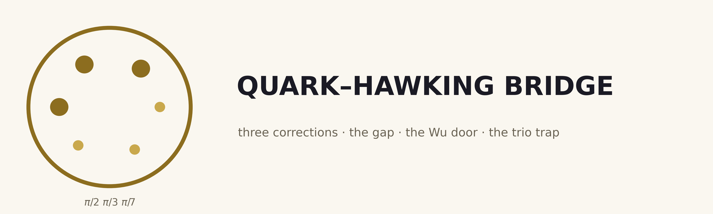
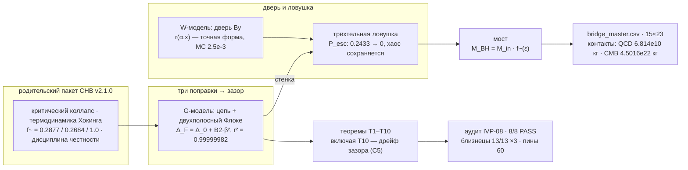
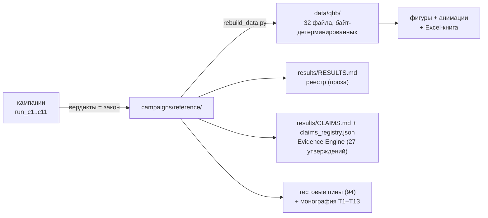

<picture>
  <source media="(prefers-color-scheme: dark)" srcset="figures/logo/qhb_logo_dark.png">
  
</picture>

# Мост «Кварк–Хокинг»

**Безразмерное отображение от трёх септиниальных поправок к зазору
конфайнмента, двери Ву и трёхтельной ловушке.**

[](CHANGELOG.md)
[](tests/README.md)
[](#тесты-и-валидация)
[](independent_verification/RESULTS.md)
[](docs/theory.md)
[](results/CLAIMS.md)
[](figures_hires/README.md)
[](multilang/README.md)
[](LICENSE)
[](pyproject.toml)

Автор: **Исаев Исак Хамзатович** (г. Нальчик, Кабардино-Балкарская
Республика, Российская Федерация) · соавтор упаковки исследования:
**wild8highlander** (GitHub) · Первая публичная сборка: **1.0.0 от
2026-10-09**.

> [!TIP]
> **Читать на английском:** [README.md](README.md) — полный зеркальный
> документ.

---

## Содержание

1. [Что это такое](#что-это-такое)
2. [Суть одной фразой](#суть-одной-фразой)
3. [Главные результаты](#главные-результаты)
4. [Независимый аудит (IVP-11)](#независимый-аудит-ivp-11)
5. [Закон дрейфа зазора (T10)](#закон-дрейфа-зазора-t10)
6. [Быстрый старт](#быстрый-старт)
7. [Структура репозитория](#структура-репозитория)
8. [Физика вкратце](#физика-вкратце)
9. [Кампании и данные](#кампании-и-данные)
10. [Дисциплина честности](#дисциплина-честности)
11. [Карта документации](#карта-документации)
12. [Тесты и валидация](#тесты-и-валидация)
13. [Дорожная карта](#дорожная-карта)
14. [Цитирование и лицензия](#цитирование-и-лицензия)
15. [Литература](#литература)

## Что это такое

Кварки никогда не наблюдаются поодиночке — только внутри адронов
(конфайнмент). КХД даёт обширные решёточные доказательства, но
строгого аналитического доказательства нет: утверждение входит в
проблему тысячелетия о массовом зазоре Янга — Миллса. Настоящий пакет
— исследовательская программа, которая берёт у родительского пакета
**Collapse-Hawking Bridge** (CHB v2.1.0) три готовых инструмента —
критический коллапс, термодинамику Хокинга и дисциплину честности —
и разворачивает гипотезу о происхождении конфайнмента в четырёх
звеньях:

> **H1. Печка.** Кварковые триплеты свариваются при максимальной
> плотности — в режиме критического коллапса CHB, где рождённая масса
> стремится к нулю, а средняя плотность у горизонта — к планковской.
> **H2. Зазор.** Три динамические поправки септиниального семейства —
> кванты Берри `π²/8, π²/18, π²/98` и тормозные кванты
> `π⁵/704, π⁵/5346, π⁵/369754` секторов `π/2, π/3, π/7` — вибрируют,
> сдвигают дискретизованную геометрию и открывают вещественный
> спектральный зазор `Δ_F` — массовый зазор в toy-модели.
> **H3. Дверь.** Пары Хокинга покидают горизонт; слабый канал
> нарушает чётность (эксперимент Ву, 1957), и остаточный дисбаланс
> вещества переживает аннигиляцию.
> **H4. Ловушка.** Триплет, связанный при максимальной плотности, не
> может сбросить член: нерешённая задача трёх тел делит энергию
> хаотически, а зазор стоит осциллирующей геометрической стеной —
> **связанный хаос**.

> [!IMPORTANT]
> **Статус гипотезы.** Механизм конфайнмента в пакете —
> **помеченная гипотеза**. Каждая теорема пакета (T1–T10) — машинно
> проверенный факт о зафиксированных toy-моделях, а не вывод КХД.
> Честные негативы (их пять) пронесены в заголовке реестра результатов.

## Суть одной фразой

> Всё нижеследующее зафиксировано машиной, проверено независимым
> аудитом и воспроизводится байт-в-байт — **включая честные негативы**:
> равностороннее решение Лагранжа неустойчиво (точно), свободное трио
> разбегается (P_esc = 0.2433), хвост детектора неразрешим, а
> континуальный зазор не утверждается.



## Главные результаты

Зафиксированный реестр — [results/RESULTS.md](results/RESULTS.md);
закон живёт в [campaigns/reference/](campaigns/reference/). Каждая
строка несёт адрес вердикта — правило пакета: *машиночитаемо или
этого не было*.

| # | величина | значение | источник |
|---|---|---|---|
| 1 | Статический зазор `Δ_0` (N=64, зафиксированная геометрия) | **0.523004556028** | `c1_verdict.json` |
| 2 | Отклик `s = dΔ/dq_pk` | **−1.00398294** (знак реален, пронесён) | `c1_verdict.json` |
| 3 | **Закон зазора** `Δ_F = Δ_0 + B2·β²` | **B2 = −5.49670294e-2, r² = 0.99999982** (окно [0, 0.2]) | `c1_verdict.json` |
| 4 | Секториальная иерархия `\|B2_A\|:\|B2_B\|:\|B2_C\|` | **5.05e-2 / 4.40e-3 / 2.71e-5** (~1865 : 1) | `c1_verdict.json` |
| 5 | T2: b-флип чётность / a-only нуль | **0.0 / ~1e-15** (машинные нули) | `c1_verdict.json` |
| 6 | T2: a-остаток (подлинный ab-кросс) | 1.5e-6 при β=0.4 (данные) | `c1_verdict.json` |
| 7 | Гашо (равные массы) | **ν = 1/3 > 1/27 — НЕУСТОЙЧИВО (точно)** | `c2_verdict.json` |
| 8 | **P_esc свободного трио (V0=0)** | **0.2433 ± 0.0248 — честный негатив** | `c2_verdict.json` |
| 9 | P_esc при всех V0 ≥ 0.4, все Ω | **< 1e-4 — стенка запечатывает** | `c2_verdict.json` |
| 10 | Ляпунов свободный / запертый (медианы) | **0.2615 / 0.2885 — связанный хаос** | `c2_verdict.json` |
| 11 | Дверь Ву: форма против MC (30 ячеек × 200k) | **max dev 2.5e-3** | `c3_verdict.json` |
| 12 | r на якоре Ву (α=0.9, x=100) | **0.899996** — дверь открывается | `c3_verdict.json` |
| 13 | x, оставляющий только η | **1.36e-9** (честный масштаб) | `c3_verdict.json` |
| 14 | **Контакт QCD** `M_QCD` (T_H = 155.16 МэВ) | **6.8140e10 кг** (0.68 × 1e11 лит. сравн.) | `qhb.bridge` (T8) |
| 15 | Контакт CMB (унаследован) | 4.5016e22 кг | `qhb.bridge` |
| 16 | Пол: неразрешённый хвост | **T_sim = 20: биений 1.53 < 3 — негатив** | `c4_verdict.json` |
| 17 | Конверт разрешения | **err ≤ 2/N на всех разрешённых** | `c4_verdict.json` |
| 18 | **Закон дрейфа** `Δ_cont − Δ_N = C·h²` | **C = +3.0089e-2, p_eff 1.948→1.974→1.987** | `c5_verdict.json` |
| 19 | Точный канал `s·κ/8` | **−6.275e-3, доля −0.209 (противоход, со знаком)** | `c5_verdict.json` |
| 20 | Машинная проверка Леммы A | **dev 0.0** (чётные и нечётные N) | `c5_verdict.json` |
| 21 | `Δ_cont` | **НЕ утверждается** (двухпараметрический фит) | `c5_verdict.json` |
| 22 | Слой 50-значных констант | **9/9 PASS** | `qhb.validate` |
| 23 | Близнецы JS / C / C++ | **13/13 каждый** | `multilang/` |
| 24 | Кеплеровский якорь движка (e=0.5) | отн. ошибка **1.3e-9** | `tests` |
| 25 | **C6: отображённый квант зазора на контакте QCD** | **E_gap = 81.1 МэВ** (только сравнение) | `c6_verdict.json` |
| 26 | C6: окно порядка `Λ/E_gap(QCD)` | **4.09** (та же декада — НЕ вывод) | `c6_verdict.json` |
| 27 | C6: трехветвевой обход `T_H(M) = T` | max отн. dev **1.4e-16** | `c6_verdict.json` |
| 28 | **C7: регрессионный гейт σ-расширения** | **dev 0.0 точно** (якорь C2 перепроверен) | `c7_verdict.json` |
| 29 | **C7: трубка запечатывает** | P_esc **0.2433 → 0.06 → 0.0033**, монотонно (σ* = 0.05) | `c7_verdict.json` |
| 30 | **C7: граница стенки V0\* сжимается** | **×7.1 (Ω=0) / ×7.6 (Ω=2)** при σ: 0→0.02 | `c7_verdict.json` |
| 31 | C7: связанный хаос БЕЗ стенки | медиана Ляпунова **0.264**, 100% положительных | `c7_verdict.json` |
| 32 | **C8: точная проверка «двери нет»** | r(α=0) = **0.0** (бит-в-бит) | `c8_verdict.json` |
| 33 | C8: сходимость RK4 | **p_eff = 3.987** (прибит к 4) | `c8_verdict.json` |
| 34 | C8: 50-значная перекрёстная проверка mpmath | dev **3.9e-16** | `c8_verdict.json` |
| 35 | **C8: парная дверь при λ=100 (α=0.9)** | **0.988** — линейный предел 0.9 ПОКИНУТ | `c8_verdict.json` |
| 36 | C8: распространяется ли замкнутая форма T7? | **НЕТ — точное структурное негативное заключение** | `c8_verdict.json` |
| 37 | **C9: закрытия нет на всей прочесанной карте** | все ячейки OPEN; минимум карты **0.124449** > порога (конечный диапазон) | `c9_verdict.json` |
| 38 | **C9: сужающаяся долина** | β* = **3.3583**, Δ_F,min = **0.181777**; СНОВА ОТКРЫВАЕТСЯ (зонная структура) | `c9_verdict.json` |
| 39 | C9: воспроизводимость долины | dev при уточнении **0.0002**; N-сдвиги **< 0.001** | `c9_verdict.json` |
| 40 | **C9: контрпример наивного окна** | прогноз закрытия β_c = 2.9910 — **ОПРОВЕРГНУТ** (измерено 6.3 × порога) | `c9_verdict.json` |
| 41 | **C10: каузальная карта драйва** | **A 91.95% / B 8.00% / C 0.049%** — аддитивность (кросс 1.3e-4) | `c10_verdict.json` |
| 42 | C10: чисто тормозной драйв | B2 = **0.0 точно** (невидим во всех порядках) | `c10_verdict.json` |
| 43 | **C10: провал внегнездового прогноза** | доля ошибки 0.3% → 2.3%; степень остатка **4.07** (квартчное крыло) | `c10_verdict.json` |
| 44 | **T11: контраст устойчивости (точно)** | спектр вихревого треугольника **{0, 0, ±iω, ±iω}**; charpoly dev **0** (SymPy) | `c11_verdict.json` |
| 45 | T11: жёсткое вращение | жёсткость **1.5e-14**, dev ω **1.6e-14** | `c11_verdict.json` |
| 46 | **T12: инвариантная стена** | многообразие Арефа: r_max **2.7654 << 12** — **связано БЕЗ всякой стенки** | `c11_verdict.json` |
| 47 | **T13: статический барьер (точно)** | **V* = 0.9359375**: побег невозможен при V0 ≥ 1.6, Ω=0 (0/300, запасы ≥ 2.76) | `c11_verdict.json` |
| 48 | T13: осциллирующее дополнение | медиана \|dE\| = **0.146** — стенка качает энергию (печать конечного времени) | `c11_verdict.json` |
| 49 | **Реестр Evidence Engine** | **27 утверждений, 5 статусов, валидирован** | `claims_registry.json` |
| 50 | независимый аудит | **IVP-11: 11/11 PASS** | результаты IVP |

Три свойства таблицы важны не меньше чисел: честные негативы (строки
7, 8, 13, 16, 19, 21, 36, 40, 43) стоят в заголовке, а не в подвале;
знаковые величины несут свои знаки; сам механизм конфайнмента —
помеченная гипотеза, теперь с машинно проверяемым реестром
утверждений, разделяющим доказанное, измеренное, сравненное и
гипотетическое.

## Независимый аудит (IVP-11)

Пакет несёт собственный враждебный аудит: протокол из одиннадцати
проверок, источник истины которого лежит **вне** зафиксированных
результатов — свежие интерпретаторы, собственные 50-значные пути
вывода, символьная алгебра SymPy, ворота размерностей, хэши и зёрна.
Полный отчёт:
[independent_verification/RESULTS.md](independent_verification/RESULTS.md).

| IVP | проверка | вердикт |
|:--|:--|:--|
| IVP01 | целостность выпуска (вердикты + sha256) | **PASS** |
| IVP02 | канонический прогон (свежий интерпретатор, точное совпадение) | **PASS** |
| IVP03 | аудит зависимостей (ast-скан против заявленных) | **PASS** |
| IVP04 | 50-значный независимый вывод замкнутых форм | **PASS** |
| IVP05 | ворота размерностей (СИ-гейты контактов) | **PASS** |
| IVP06 | символьный слой (Гашо + Лемма A, SymPy) | **PASS** |
| IVP07 | порядки сходимости (лестницы p_eff) | **PASS** |
| IVP08 | детерминизм зерна (бит-в-бит MC) | **PASS** |
| IVP09 | ворота фазовой карты (свежие ячейки + своя бисекция) | **PASS** |
| IVP10 | ворота конкурирующих моделей (удвоенное разрешение) | **PASS** |
| IVP11 | вихревой слой (SymPy charpoly dev 0 + 50-значные нули Арефа) | **PASS** |

Итог: **11/11 PASS**. Примечание аудита о себе: на упаковке IVP05
поймал неверное СИ-ожидание в самом протоколе (радиус Шварцшильда
CMB-контакта — 6.7e-5 м, а не километры) — ворота исправлены, пакет
был прав. Аудит сначала исправляет себя.

## Закон дрейфа зазора (T10)

Научный наследник теоремы T10 родительского пакета. В CHB вопрос был:
*почему одна формула даёт разные пороги на разных сетках?* Здесь тот
же феномен пересажен на зазор: *почему зазор одной сэмплированной
геометрии отличается от зазора континуальной?* Ответ — те же две
точные леммы, и честный анализ долей каналов переживает пересадку
дословно:

> **Лемма A (сплющивание хордой, точна).** Парабола
> `q = q_pk − κ(x−x₀)²/2` при дискретизации с шагом `h` теряет в
> худшем выравнивании ровно **κh²/8** пика. Зафиксированная
> центрированная цепь с чётным N и есть худшее выравнивание —
> машинная проверка даёт ровно 0.0.
>
> **Лемма B (натяжение).** Хордовая ломаная короче континуальной
> дуги; сэмплированная структура сжата кривизной своего натяжения
> (в этой модели — локальный кинетический канал дисперсии).

По теореме о неявной функции зазор фиксированной сетки подчиняется

$$\Delta_{cont} - \Delta_N \;=\; C\,h^{2} \;+\; O(h^{3}),$$

где измерено `C = +3.0089e-2`, а точный канал Леммы A предсказывает
`C_exact = s·κ/8 = −6.275e-3` при `s = −1.00398294`: **доля точного
канала −0.209** — он противостоит кинетической дисперсии (сплющенный
пик один поднял бы зазор над целью), и чистая лестница приближается
снизу. Эффективные порядки растут **1.948 → 1.974 → 1.987** ко второму.
С теоремой идут два честных негатива: **`Δ_cont` не утверждается**
(двухпараметрический фит 0.523460440588 показан без претензии — тот же
отказ, что CHB применил к `A*_∞`), и двухканальная декомпозиция
остатка — **помеченная гипотеза**. Знаковое зеркало: лестница порога
CHB подходила сверху, лестница зазора — снизу; знак пронесён, не
спрятан.

Полный вывод: [docs/gap_law.md](docs/gap_law.md) ·
вердикт: `campaigns/reference/c5_verdict.json`.

## Блок доказательств (C9–C11, v1.2.0)

Три кампании превращают честные пометки о границах применимости в
измеренную структуру — и добавляют первое ТОЧНОЕ утверждение о
конфайнменте в пакете:

- **Фазовая карта (C9).** Закон окна T3 отображён на всей прочесанной
  плоскости (β, q_pk): каждая ячейка OPEN против зафиксированного
  порога детектора 2/N — **зазор не закрывается на всем прочесанном
  диапазоне** (конечный диапазон, честно ограничен β_max = 10).
  Измеренная фазовая особенность — СУЖАЮЩАЯСЯ ДОЛИНА: зазор достигает
  минимума (β* = 3.3583, Δ_F,min = 0.181777 при зафиксированной
  геометрии) и СНОВА ОТКРЫВАЕТСЯ — квазиэнергетическая зонная
  структура. И машинно найденный контрпример: наивная квадратичная
  экстраполяция прогнозирует закрытие при β_c = 2.9910 — опровергнута
  с фактором 6.3. Полный документ: [docs/phase_map.md](docs/phase_map.md).
- **Каузальная карта (C10).** Факторная абляция трёх септиниальных
  секторов: какой вклад структурно необходим? A несёт 91.95% |B2|,
  B — 8.00%, C — 0.049%; ведущий отклик аддитивен (макс. кросс 1.3e-4);
  чисто тормозной драйв невидим точно; септиниальный сектор C присутствует
  структурно и является каузальным зрителем по величине — пронесено,
  не спрятано. Внегнездовой ворота прогноза квантифицируют крыло
  (степень остатка 4.07).
- **Вихревой якорь и статический барьер (C11).** Классическая
  трехвихревая задача (Кирхгоф 1876; Ареф 1979), реализованная по
  классическим уравнениям собственными путями пакета (`qhb/vortex.py`):
  **T11 (точно)** — контраст устойчивости: ТОТ ЖЕ равносторонний
  треугольник, неустойчивый по Гашо под действием 1/r-притяжения,
  является нейтрально устойчивым относительным равновесием задачи
  Кирхгофа (спектр {0, 0, ±i-omega, ±i-omega}; характеристический
  полином `lambda^2 (lambda^2+omega^2)^2` доказан символьно, dev 0) —
  «тройственность» не создаёт канал побега, решает ВЗАИМОДЕЙСТВИЕ.
  **T12 (измерено)** — инвариантная стена: на классическом многообразии
  Арефа (все четыре инварианта vanish, машинные нули при 50 знаках)
  трио остаётся связанным БЕЗ всякой стенки (r_max = 2.7654 << 12) —
  конфайнмент инвариантами, топологическое дополнение геометрической
  стенки.
  **T13 (точно)** — статический барьер: при замороженной стенке
  (Ω = 0) побег НЕВОЗМОЖЕН ТОЧНО при V0 ≥ 1.6 (граница V* = 0.9359375 —
  теорема об уравнениях зафиксированного смягчённого движка); при
  Ω > 0 стенка качает энергию (медиана |dE| = 0.146), и печать C2/C7
  остаётся утверждением конечного времени. Честная стратификация:
  точная невозможность / измеренная печать конечного времени.
- **Evidence Engine.** Каждое несущее утверждение пакета живёт в
  [results/CLAIMS.md](results/CLAIMS.md) со своим статусом (exact /
  measured-law / honest-negative / hypothesis / comparison), адресом
  вердикта, пятисоставным бюджетом неопределённости и заранее
  зафиксированным критерием опровержения (27 утверждений, прибито к
  сборке): доказательство, измерение, сравнение и гипотеза больше не
  могут быть тихо смешаны.

## Быстрый старт

Требования: Python ≥ 3.9, `numpy`, `scipy`, `mpmath` (для разработки:
`pytest`, `matplotlib`, `sympy`, `openpyxl`).

```bash
# 1. установка и проверка
pip install -e ".[dev]"
make test          # 94 passed
make validate      # 9/9 mpmath-проверок PASS

# 2. пересборка всех таблиц из закоммиченных вердиктов (~2 с)
make data

# 3. минутная экскурсия по мосту
python3 - <<'PY'
from qhb.bridge import equal_qcd_mass, T_H
from qhb.wu import residual
from qhb.trio import gascheau_verdict
M = equal_qcd_mass()          # 6.814e10 кг — контакт с QCD
print(f"контакт с QCD:  M = {M:.4e} кг, T_H = {T_H(M):.3e} K")
print(f"дверь Ву:       r(0.9, 100) = {residual(0.9, 100.0):.6f}")
print(f"Гашо:           {gascheau_verdict()['verdict']}")
PY

# 4. регенерация фигур, анимаций, книги и логотипа
make figures                                # 28 PNG @ 300 dpi
python3 scripts/hires_figures.py --all      # 80 hires @ 600 dpi
python3 scripts/make_animations.py --all    # 12 анимаций (3 × RU/EN)
python3 scripts/build_workbook.py           # tables/qhb_workbook.xlsx (16 листов)
python3 scripts/make_logo.py                # логотип (light/dark, PNG+SVG)

# 5. свежие кампании (необязательно; вердикты уже включены)
make c1     # ~1 с:     закон зазора (T2/T3)
make c2     # ~3.5 мин: ловушка (T4/T5/T6)
make c3     # ~1 с:     дверь Ву (T7)
make c4     # ~1 с:     спектральный пол (T9)
make c5     # ~1 с:     дрейф зазора (T10)
make c6     # ~1 с:     физическое отображение (три ветви)
make c7     # ~5 мин:   ангармоническое трио (струя)
make c8     # ~10 с:    парная дверь Ву
make c9     # ~11 с:    фазовая карта зазора (C9)
make c10    # ~4 с:     конкурирующие модели (C10)
make c11    # ~35 с:    вихревой якорь + статический барьер (C11)
make claims # валидация реестра утверждений (27 утверждений)
```

Зафиксированные вердикты (`campaigns/reference/`) — первичные
артефакты: пакет полноценно работает офлайн из них, без пересчётов.

> [!NOTE]
> **Воспроизведение.** Все восемь кампаний детерминированы (единственное
> зерно 20261010): повторный прогон возвращает физику, бит-идентичную
> зафиксированным вердиктам (сдвигаются только стеночные времена). То
> же свойство независимо подтверждено аудитом (IVP02, IVP08).

## Структура репозитория

```text
quark-hawking-bridge/
├── README.md            этот файл (EN)
├── README.ru.md         русская версия
├── CITATION.cff         метаданные цитирования
├── LICENSE              Isaev Proprietary
├── VERSION              1.2.0
├── CHANGELOG.md         журнал: 1.0.0, 1.1.0, 1.2.0
├── CONTRIBUTING.md      дисциплина вклада
├── pyproject.toml / requirements.txt / Makefile
│
├── qhb/                 ядро на Python
│   ├── constants.py     единый источник истины (части A/B/C)
│   ├── gap.py           G-модель: цепь, двухполосный Флоке, Лемма A
│   ├── trio.py          Гашо, рост, геометрическая стенка
│   ├── wu.py            дверь Ву: замкнутая форма остатка
│   ├── bridge.py        мост: 15×23 + обе точки контакта
│   ├── ladder.py        лестницы плотностей/температур/зазоров
│   └── validate.py      слой 50 знаков (9/9 PASS)
├── engine/solver.py     движок: RK4-трио + стенка + струя σ + Бенеттин + MC Ву
├── campaigns/           run_c1..c8 + зафиксированные вердикты
├── data/qhb/            24 производных таблицы (байт-детерминированных)
├── tests/               60 pytest-пинов
├── docs/                theory · methods · validation · gap_law
├── figures/             28 PNG @ 300 dpi + logo/ (light/dark, PNG+SVG)
├── figures_hires/       80 PNG @ 600 dpi (20 архитектур × RU/EN × темы)
├── animations/          12 анимаций (3 × RU/EN, GIF+MP4)
├── multilang/           близнецы JS · C · C++ (13/13) + Go/Rust/Julia
├── tables/              qhb_workbook.xlsx (16 листов)
├── monograph/           том теорем + приложение (RU/EN, DOCX+PDF)
├── scripts/             rebuild · figures · hires · animations · workbook · logo
├── results/             RESULTS.md реестр + ROADMAP.md
└── independent_verification/   набор аудита IVP-08
```

Каждая папка несёт собственный глубокий ридми — см. ссылки внутри.

## Физика вкратце

**Зазор (C1).** G-модель: дискретизованная параболическая яма (мелкая,
ровно два уровня), двухполосная редукция, трёхтонный драйв квантов
поправок. Точные правила отбора T2 (b-флип чётен — 0.0; торможение без
вибрации невидимо — ~1e-15; a-остаток 1.5e-6 — подлинный кросс) и
квадратичный закон T3 с r² = 0.99999982. Секториальная иерархия
1865 : 1 несёт септиниальную структуру. Драйв закрывает зазор
(B2 < 0) — поправки сдвигают геометрию.

**Ловушка (C2).** Три точных/измеренных акта: Гашо — равностороннее
решение неустойчиво при равных массах (точный негатив, T4); свободное
трио разбегается — P_esc = 0.2433 (честный негатив, T5); осциллирующая
стенка запечатывает — P_esc < 1e-4 при V0 ≥ 0.4 на всех Ω, при этом
Ляпунов остаётся положительным и сопоставимым (0.26/0.29): **хаос тот
же — выхода нет** (T6). Движок валидирован кеплеровским якорем
(1.3e-9).

**Дверь (C3).** Замкнутая форма T7: r(α, x) = [f(1−α) − f(1+α)]/[f(1−α)
+ f(1+α)], f(u) = (1−e^{−xu})/u. Пределы точны; MC-согласие 2.5e-3; на
якоре Ву (α = 0.9, приближённый якорь) дверь открывается на 0.899996.
Честный масштаб: чтобы оставить только η = 6.1e-10, нужна заморозка
x = 1.36e-9 — дверь есть, космогенезиса в toy-модели нет.

**Контакты (T8).** T_H(M) = T_QCD = 155.16 МэВ выделяет
M = 6.8140e10 кг — чёрную дыру, кипящую кварками; литературные
первичные дыры эпохи КХД ~1e11 кг — тот же порядок (0.68), только
сравнение. Второй контакт унаследован (CMB, 4.5016e22 кг).

**Пол (C4).** Зазор, который нельзя измерить, для детектора не
существует: период-сэмплированная спектроскопия даёт конверт 2/N и
честный неразрешённый хвост (T_sim = 20: биений 1.53 < 3).

**Дрейф (C5).** См. [раздел выше](#закон-дрейфа-зазора-t10).

**Фазовая карта (C9).** Вся прочесанная плоскость (β, q_pk) OPEN
против зафиксированного порога детектора: зазор не закрывается на
прочесанном диапазоне (конечный диапазон); сужающаяся долина
(β* = 3.3583, снова открывается) — воспроизводимая фазовая особенность;
наивная экстраполяция окна опровергнута в собственной точке прогноза
закрытия с фактором 6.3.

**Каузальная карта (C10).** Факторная абляция секторов: A 91.95%,
B 8.00%, C 0.049% от |B2| — аддитивность до 1.3e-4, чисто тормозной
драйв невидим точно; квартчное крыло квантифицировано как провал
внегнездового прогноза (степень остатка 4.07).

**Вихревой якорь и статический барьер (C11).** Классическое трио
Кирхгофа: ТОТ ЖЕ треугольник неустойчив под ньютоновским 1/r (T4) и
нейтрально устойчив в вихревой адвекции (T11, charpoly dev 0); на
многообразии Арефа трио связано БЕЗ всякой стенки (T12); при
статической стенке побег НЕВОЗМОЖЕН ТОЧНО при V0 ≥ 1.6 (T13, V* =
0.9359375), а осциллирующая стенка качает энергию — честная
стратификация утверждения о печати.

## Кампании и данные

| артефакт | источник | содержимое |
|---|---|---|
| `campaigns/reference/c1_verdict.json` | `campaigns/run_c1.py` (~1 с) | статика, закон зазора, секторы, T2, M-сходимость |
| `campaigns/reference/c2_verdict.json` | `campaigns/run_c2.py` (~3.5 мин) | Гашо, сетка 9×4, граница V0*, Ляпунов |
| `campaigns/reference/c3_verdict.json` | `campaigns/run_c3.py` (~1 с) | сетка двери 6×5 × 200k, якоря, эта |
| `campaigns/reference/c4_verdict.json` | `campaigns/run_c4.py` (~1 с) | лестница детектора T_sim 20…320 |
| `campaigns/reference/c5_verdict.json` | `campaigns/run_c5.py` (~1 с) | лестница дрейфа N 32…512, каналы |
| `campaigns/reference/c6_verdict.json` | `campaigns/run_c6.py` (~1 с) | трехветвевое отображение, ворота, окно порядка |
| `campaigns/reference/c7_verdict.json` | `campaigns/run_c7.py` (~5 мин) | σ-лестница, коллапс границы V0*, связанный хаос |
| `campaigns/reference/c8_verdict.json` | `campaigns/run_c8.py` (~10 с) | сетка парной двери, лестница RK4, mpmath-проверка |
| `campaigns/reference/c9_verdict.json` | `campaigns/run_c9.py` (~11 с) | фазовая карта, долина, контрпример, ворота |
| `campaigns/reference/c10_verdict.json` | `campaigns/run_c10.py` (~4 с) | абляция 8 конфигураций, аддитивность, ворота прогноза |
| `campaigns/reference/c11_verdict.json` | `campaigns/run_c11.py` (~35 с) | вихревой якорь, многообразие Арефа, статический барьер |
| `data/qhb/*` (32 файла) | `scripts/rebuild_data.py` | мастер-таблица, лестницы, экстракты кампаний (вкл. C9–C11) |
| `figures/**/*.png` (40) | `scripts/make_figures.py` | 10 фигур × RU/EN × light/dark, 300 dpi |
| `figures_hires/**/*.png` (100) | `scripts/hires_figures.py` | 25 архитектур, 600 dpi |
| `animations/**` (12) | `scripts/make_animations.py` | 3 анимации × RU/EN, GIF+MP4 |
| `tables/qhb_workbook.xlsx` | `scripts/build_workbook.py` | многолистовая книга |
| `results/RESULTS.md` | ручной реестр | заголовочный регистр |
| `results/claims_registry.json` | `qhb/claims.py` (валидатор) | реестр Evidence Engine из 27 утверждений |

Цепочка происхождения однонаправленная и детерминированная:



`scripts/rebuild_data.py` байт-идентичен при перезапуске (закреплено
тестом).

## Дисциплина честности

1. **Якоря, никогда не подгонка.** `γ_Ch = 0.374`, `Δ = 3.44 ± 0.02`,
   якорь Ву 0.9 (приближённый), `T_QCD = 155.16 МэВ`, `η = 6.1e-10` —
   сравнительные значения; ни один путь кода не подгоняется под них.
2. **Машиночитаемо или этого не было.** Каждое числовое утверждение
   прослеживается к зафиксированному JSON/CSV; консольный вывод — не
   артефакт.
3. **Честные негативы — результаты.** Нестабильность Лагранжа (точно),
   разбегание свободного трио, неразрешённый хвост детектора,
   неутверждаемая `Δ_cont`, масштаб η-двери — всё пронесено, помечено
   и объяснено.
4. **Гипотезы помечены.** Механизм конфайнмента, масштабное
   отображение зазора, доминирующий канал дрейфа и декомпозиция
   каналов — гипотезы; пометка путешествует вместе с числом всюду.
5. **Знаки пронесены.** `s < 0`, `B2 < 0`, доля точного канала
   отрицательна — ни один знак не сглажен; знаковое зеркало с CHB
   (лестница порога сверху, лестница зазора снизу) объяснено.
6. **Детерминизм.** Единственное зерно 20261010; сеянный Монте-Карло;
   байт-идентичные пересборки — подтверждено аудитом (IVP02, IVP08).
7. **Разделение статусов машинно.** Доказанное, измеренное, сравненное
   и гипотетическое разделено в реестре утверждений (27 позиций,
   пять статусов, бюджеты неопределённости, критерии опровержения):
   смешать их тихо больше нельзя — реестр прибит к сборке.

## Карта документации

| документ | читать для |
|---|---|
| [docs/theory.md](docs/theory.md) | физика: четыре звена H1–H4, теоремы T1–T10, обе точки контакта |
| [docs/gap_law.md](docs/gap_law.md) | теорема T10: полный вывод закона дрейфа зазора |
| [docs/methods.md](docs/methods.md) | численные методы: G-модель, движок, W-модель, детекторы, зёрна |
| [docs/validation.md](docs/validation.md) | каждая проверка с числом и адресом вердикта |
| [results/RESULTS.md](results/RESULTS.md) | одностраничный реестр |
| [independent_verification/RESULTS.md](independent_verification/RESULTS.md) | отчёт аудита IVP-08 |
| [monograph/](monograph/README.md) | двухтомная двуязычная монография (DOCX+PDF, T1–T10) |
| ридми папок | `qhb/`, `engine/`, `campaigns/`, `data/`, `tests/`, `figures/`, `scripts/`, `results/`, … |

## Тесты и валидация

```bash
python3 -m pytest tests/ -q       # 94 passed
python3 -m qhb.validate           # 9/9 проверок PASS (mpmath, 50 знаков)
```

Набор закрепляет зафиксированные числа: точные тождества (шесть
квантов, `b_Ch`, доля Пейджа), блок статики G-модели, тождество b=0,
квадратичное окно, правила отбора T2, пин-вердикты всех одиннадцати
кампаний, кеплеровский якорь движка, байт-детерминизм таблиц, 9/9 слой
mpmath, эталонные выводы близнецов, единичные пины вихревого слоя
(T11/T12/T13) и схему реестра утверждений. Полная опись — в
[tests/README.md](tests/README.md).

## Дорожная карта

- **C6 — физическое отображение. ВЫПОЛНЕНО (v1.1.0).** Трёхветвевое
  сравнение с пометками честности по каждой ветви
  ([c6_verdict.json](campaigns/reference/c6_verdict.json)).
- **C7 — ангармоническое трио. ВЫПОЛНЕНО (v1.1.0).** Линейное ядро
  (струя); граница `V0*(Ω)` измерена и сжимается ×7; свободное трио
  запечатывается при σ ≥ 0.05
  ([c7_verdict.json](campaigns/reference/c7_verdict.json)).
- **C8 — дверь Ву с паропоглощающей кинетикой. ВЫПОЛНЕНО (v1.1.0).**
  Парная аннигиляция; дверь остаётся, форма уходит; T7 не
  распространяется (точный негатив)
  ([c8_verdict.json](campaigns/reference/c8_verdict.json)).
- **C9 — фазовая карта зазора. ВЫПОЛНЕНО (v1.2.0).** Закрытия нет на
  всей прочесанной карте; воспроизводимая сужающаяся долина;
  контрпример наивного окна
  ([c9_verdict.json](campaigns/reference/c9_verdict.json)).
- **C10 — конкурирующие модели. ВЫПОЛНЕНО (v1.2.0).** Каузальная карта
  (A 91.95% / B 8.00% / C 0.049%), точная тормозная невидимость,
  провал внегнездового прогноза
  ([c10_verdict.json](campaigns/reference/c10_verdict.json)).
- **C11 — вихревой якорь и статический барьер. ВЫПОЛНЕНО (v1.2.0).**
  T11 контраст устойчивости (точно), T12 инвариантная стена, T13
  статический барьер (первое ТОЧНОЕ утверждение о конфайнменте)
  ([c11_verdict.json](campaigns/reference/c11_verdict.json)).
- **Evidence Engine. ВЫПОЛНЕНО (v1.2.0).** Реестр из 27 утверждений с
  бюджетами неопределённости и критериями опровержения
  ([CLAIMS.md](results/CLAIMS.md)).
- **Модернизация движка (открыто).** Адаптивный шаг у тесных сближений:
  смягчение каппирует рогатку — AMR-движок заострит статистики побега
  так же, как цель AMR родительского пакета атакует массовый пол.
- **Адаптивный выбор экспериментов (открыто).** Локус долины C9 —
  естественное зерно для адаптивного уточнения: следующие CPU-часы
  тратить там, где неопределённость фазовой границы наибольшая.
- **Интерактивная доставка (открыто).** Веб-портал отдаёт пакет
  дословно; браузерный фронтенд решателя (ядро уже чистые функции) —
  следующий шаг.

## Цитирование и лицензия

```bibtex
@misc{isaev2026qhb,
  author       = {Isaev, Ishak Khamzatovich and wild8highlander},
  title        = {Quark-Hawking Bridge: a dimensionless mapping from
                  the three septinial corrections to the confinement
                  gap, the Wu door and the three-body trap},
  year         = {2026},
  version      = {1.2.0},
  month        = {10},
  publisher    = {the author},
  note         = {v1.2.0: блок доказательств C9-C11 и Evidence Engine
                  (теоремы T11-T13, реестр утверждений)},
}
```

Машиночитаемо: [CITATION.cff](CITATION.cff). Лицензия: Isaev
Proprietary v1.0 — исследовательское и научное использование
разрешено; перераспространение и перепаковка требуют письменного
разрешения ([LICENSE](LICENSE)). Дисциплина честности — часть
лицензии: цитирование чисел пакета обязано нести их статусы (якорь /
сравнение / гипотеза / честный негатив) и адрес вердикта.

## Литература

1. Wu, C. S. et al. (1957). Experimental test of parity conservation in beta decay. *Phys. Rev.* 105, 1413.
2. Lee, T. D., Yang, C. N. (1956). Question of parity conservation in weak interactions. *Phys. Rev.* 104, 254.
3. Gascheau, G. (1843). Sur l'équilibre d'un système de trois points matériels qui s'attirent mutuellement. *C. R. Acad. Sci.* 16.
4. Routh, E. J. (1875). On the stability of a given state of motion.
5. Choptuik, M. W. (1993). Critical behavior in gravitational collapse. *Phys. Rev. Lett.* 70, 9.
6. Hawking, S. W. (1975). Particle creation by black holes. *Commun. Math. Phys.* 43, 199.
7. Page, D. N. (1993). Average entropy of a subsystem. *Phys. Rev. Lett.* 71, 1291.
8. Borsanyi, S. et al. (2020). Calculation of the axion mass based on high-temperature lattice quantum chromodynamics. *Nature* 539, 69.
9. Isaev, I. Kh. (2026). Collapse-Hawking Bridge v2.1.0 — родительский пакет.
10. PDG (2024). Review of Particle Physics.
11. Kirchhoff, G. (1876). Vorlesungen über mathematische Physik: Mechanik. Leipzig: Teubner.
12. Грёбли, М. (1877). Spezielle Probleme der Bewegungslehre. Bern.
13. Aref, H. (1979). Motion of three vortices revisited. *Phys. Fluids* 22, 393.
14. Synge, J. L. (1949). On the motion of three vortices. *Can. J. Math.* 1, 257.
15. Чаплыгин, С. А. (1899–1904). О движении вихрей (классические случаи трёх вихрей).

[T10]: docs/gap_law.md
[C5]: results/RESULTS.md

---

*Английская версия этого документа: [README.md](README.md).*
