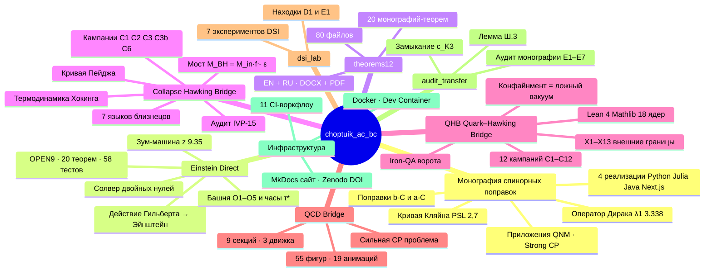
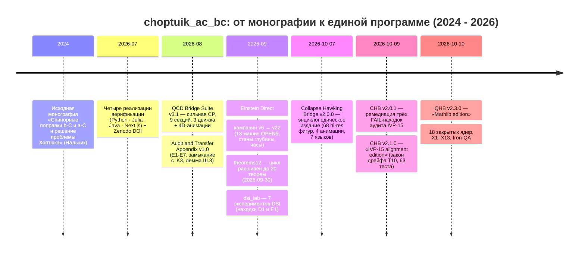
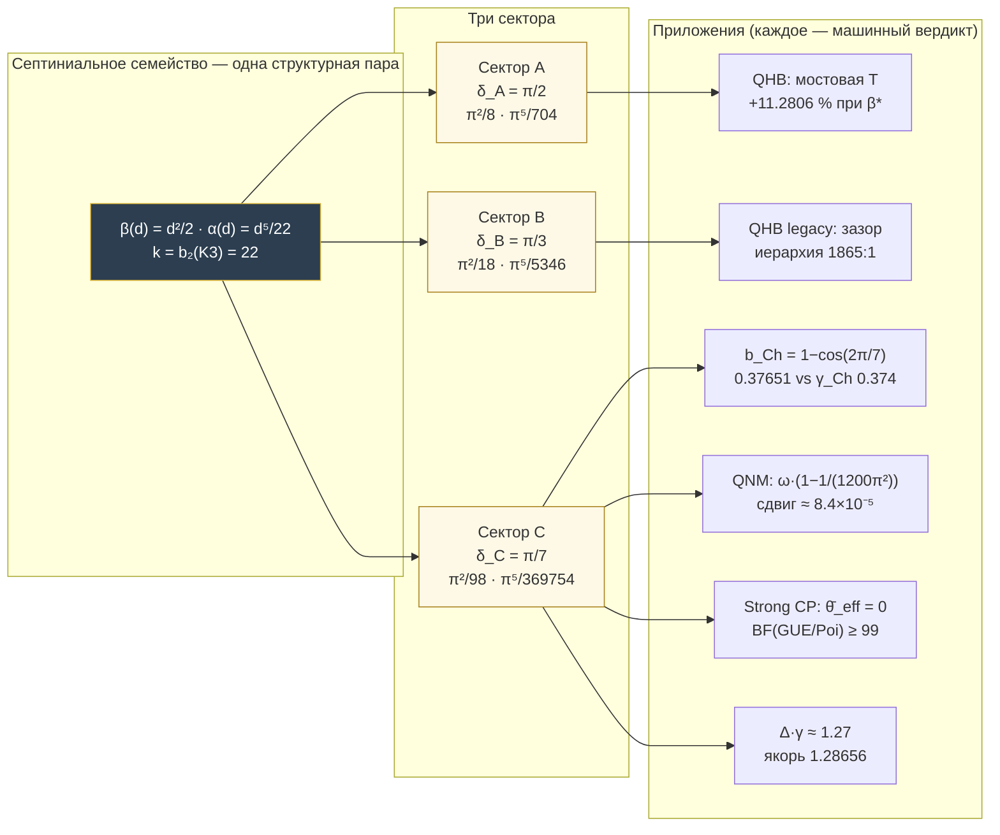
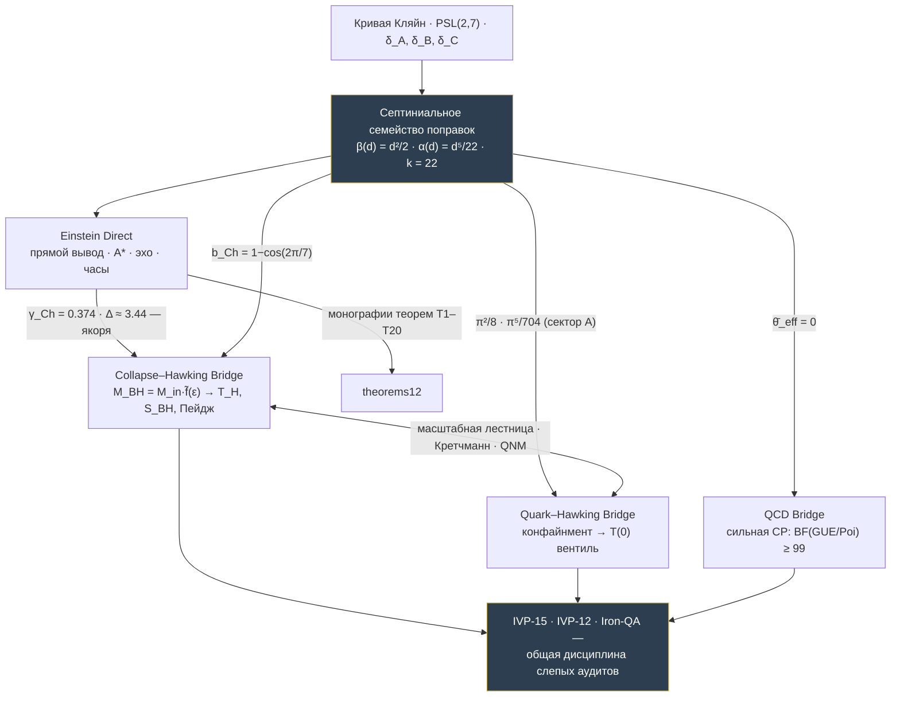
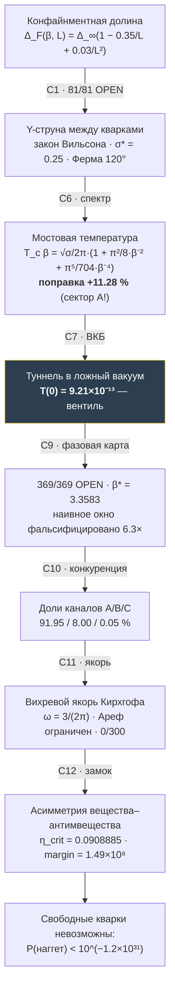
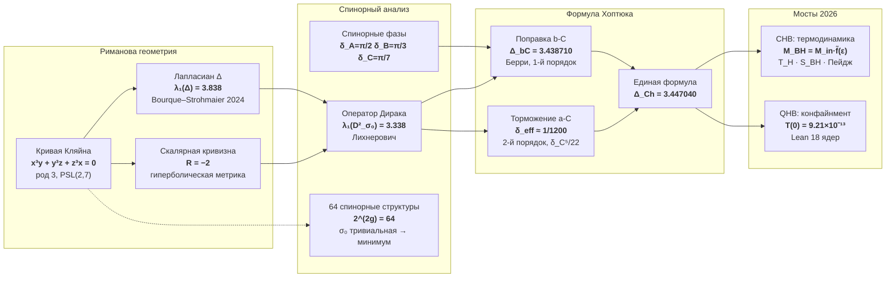
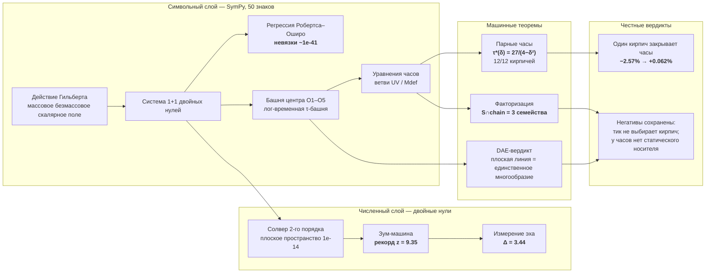
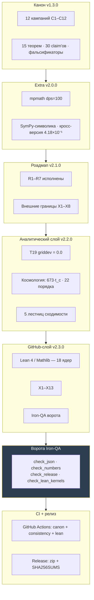

<a id="top"></a>

<picture>
  <source media="(prefers-color-scheme: dark)" srcset="assets/logo/choptyuk_logo_dark.png">
  <source media="(prefers-color-scheme: light)" srcset="assets/logo/choptyuk_logo_light.png">
  
</picture>

# Спинорные поправки b-C и a-C, проблема Хоптюка и прямая программа Эйнштейна

**Choptuik AC-BC — единая машинно-верифицированная исследовательская программа:**
от спектральных инвариантов кривой Кляйна и спинорных поправок **b-C / a-C** —
через критический гравитационный коллапс Хоптюка, решённый *напрямую* из уравнений Эйнштейна —
к термодинамике чёрных дыр (мост «Коллапс–Хокинг») и конфайнменту кварков (мост «Кварк–Хокинг»).

**Автор и мейнтейнер:** Исхак Хамзатович Исаев — GitHub [@wild8highlander](https://github.com/wild8highlander) ·
ORCID [0009-0003-7299-0701](https://orcid.org/0009-0003-7299-0701) · Нальчик, КБР *(единственный автор всех материалов)*

[](LICENSE)
[](python/)
[](julia/)
[](java-webapp/)
[](Interactive%20Viz/)
[](QHB/monolith/lean/)
[](https://github.com/wild8highlander/choptuik_ac_bc/actions/workflows/ci.yml)
[](https://github.com/wild8highlander/choptuik_ac_bc/actions/workflows/lint.yml)
[](https://wild8highlander.github.io/choptuik_ac_bc/)
[](https://github.com/wild8highlander/choptuik_ac_bc/releases/latest)
[](https://doi.org/10.5281/zenodo.15152720)
[](https://orcid.org/0009-0003-7299-0701)
[](https://securityscorecards.dev/viewer/?uri=github.com/wild8highlander/choptuik_ac_bc)
[](.pre-commit-config.yaml)
[](https://codecov.io/gh/wild8highlander/choptuik_ac_bc)
[](Einstein%20Direct/tests/)
[](Collapse%20Hawking%20Bridge/tests/)
[](QHB/tests/)
[](https://github.com/wild8highlander/choptuik_ac_bc/discussions)

> 🇷🇺 **Язык:** этот README — на русском. English edition: [`README.en.md`](README.en.md) ·
> Русские зеркала внутри пакетов: [`Collapse Hawking Bridge/README.ru.md`](Collapse%20Hawking%20Bridge/README.ru.md) · [`QHB/README.ru.md`](QHB/README.ru.md)

> [!IMPORTANT]
> **Дисциплина репозитория — одно правило, применяемое везде:**
> **гипотеза → машинное подтверждение → честные оговорки.**
> Ничего не подгоняется к литературным значениям. Совпадения с опубликованными
> константами (γ_Ch = 0.374, b_Ch = 0.37651, эхо Δ ≈ 3.44, спинорная лестница π/30)
> подаются *как сравнения*, никогда — как цели подгонки. Стены, полы, препятствия и
> **отрицательные вердикты сохраняются и документируются** с той же тщательностью, что и
> положительные результаты. Ошибки, найденные позже, **публично отзываются** (ERRATUM).
> Каждая кампания пишет машиночитаемый JSON, и pytest-сьют перепроверяет теоремы из этих файлов.
> *Machine-readable or it did not happen.*

---

## Оглавление

- [Репозиторий в числах](#репозиторий-в-числах)
- [Научная программа за 60 секунд](#научная-программа-за-60-секунд)
- [Интеллект-карта репозитория](#интеллект-карта-репозитория)
- [Хронология программы](#хронология-программы)
- [★ Три поправки и их универсальность](#-три-поправки-и-их-универсальность)
- [Программа I — Монография спинорных поправок: четыре реализации](#программа-i--монография-спинорных-поправок-четыре-реализации)
- [Программа II — Einstein Direct: лаборатория прямого решения](#программа-ii--einstein-direct-лаборатория-прямого-решения)
- [Программа III — theorems12: двадцать теорем-монографий](#программа-iii--theorems12-двадцать-теорем-монографий)
- [Программа IV — Collapse Hawking Bridge](#программа-iv--collapse-hawking-bridge-v210)
- [Программа V — QHB: Quark–Hawking Bridge](#программа-v--qhb-quarkhawking-bridge-v230)
- [Программа VI — QCD Bridge Suite (Strong CP)](#программа-vi--qcd-bridge-suite-strong-cp)
- [Программа VII — dsi_lab · VIII — audit_transfer](#программа-vii--dsi_lab--viii--audit_transfer)
- [Галерея фигур](#галерея-фигур)
- [Монографии и публикации — полный реестр](#монографии-и-публикации--полный-реестр)
- [Документация: сайт, досье верификации, ноутбук](#документация-сайт-досье-верификации-ноутбук)
- [Инфраструктура: CI/CD, Docker, Dev Container, Makefile](#инфраструктура-cicd-docker-dev-container-makefile)
- [Архитектура конвейеров](#архитектура-конвейеров)
- [Форматы отчётов и выводов](#форматы-отчётов-и-выводов)
- [Структура проекта](#структура-проекта)
- [Межъязыковая матрица близнецов](#межъязыковая-матрица)
- [FAQ](#faq)
- [Глоссарий терминов программы](#глоссарий)
- [Все анимации репозитория](#анимации-все)
- [Быстрый старт](#быстрый-старт)
- [Индекс воспроизведения: каждое число → команда → JSON](#индекс-воспроизведения-каждое-число--команда--json)
- [Реестр честности: доказано / подтверждено / отвергнуто / отозвано](#реестр-честности-доказано--подтверждено--отвергнуто--отозвано)
- [Дорожная карта](#дорожная-карта)
- [Функции GitHub этого репозитория](#функции-github-этого-репозитория)
- [Цитирование](#цитирование) · [Автор](#автор) · [Лицензия](#лицензия) · [Благодарности](#благодарности)

---

## Репозиторий в числах

| Показатель | Значение | Источник / пояснение |
|---|---|---|
| Отслеживаемых файлов | **1 793** (~369 МБ) | `git ls-files` |
| Исходный код | **274** Python · **19** Julia · **21** Java · 82 TSX + 25 TS · C/C++/Rust/Go/JS-близнецы | 7 языков программирования |
| Автоматических тестов | **360+** pytest (58+10 Einstein Direct · 63 CHB · 154 QHB · 78 `python/` · dsi_lab 7 файлов) + **16** Julia-наборов + **18** закрытых Lean-ядер | все пинят числа из JSON-вердиктов |
| JSON-вердиктов кампаний | **94** (47 Einstein Direct · 16+13 CHB · 31 QHB) | машиночитаемые результаты, у каждого — конфигурация прогона |
| Монографий и PDF/DOCX-публикаций | **71** DOCX · **110** PDF (включая **80** файлов цикла из 20 теорем) | полный реестр — [ниже](#монографии-и-публикации--полный-реестр) |
| Фигур | **513** PNG (300–600 DPI, RU/EN × light/dark) | стиль «Ink & Gold», генерируются из JSON |
| Анимаций | **46** (23 GIF + 23 MP4) | 4×RU/EN CHB · 9 4D-анимаций QCD Bridge · 3×RU/EN QHB legacy |
| Исследовательских программ | **8** + инфраструктура | карта — [ниже](#интеллект-карта-репозитория) |
| Ядерных машинных теорем | **20** (theorems12) + **10** (CHB T1–T10) + **20** (QHB T1–T20) | каждая с вердиктом и фальсификатором |
| Независимых аудитов | IVP-15 (CHB) · IVP-12 (QHB) · IVP-11 (legacy) · 9 вопросов OPEN9 | слепые проверки вне зафиксированных результатов |
| CI-воркфлоу GitHub Actions | **11** | таблица — [ниже](#инфраструктура-cicd-docker-dev-container-makefile) |
| Запускается на телефоне | ✅ Termux/Android | open9 standalone + push-комплект |
| Лицензия | Isaev Proprietary (individual) | [LICENSE](LICENSE) |

---

### Быстрая навигация по пакетам

| Пакет | Версия | Тема | Тесты | Свой README |
|---|---|---|---|---|
| [`python/`](python/) · [`julia/`](julia/) · [`java-webapp/`](java-webapp/) · [`Interactive Viz/`](Interactive%20Viz/) | v2.0.0 | спектральные инварианты, поправки b-C/a-C | 78 pytest · 16 testset'ов · CI | EN (в каждой папке) |
| [`Einstein Direct/`](Einstein%20Direct/) | кампании v6→v22 | критический коллапс напрямую | 58 + 10 standalone | [README.md (RU)](Einstein%20Direct/README.md) · [README_EN.md](Einstein%20Direct/README_EN.md) |
| [`theorems12/`](theorems12/) | 20 теорем (2026-09-30) | цикл машинных теорем | пинится ED-сьютом | [README.md](theorems12/README.md) |
| [`Collapse Hawking Bridge/`](Collapse%20Hawking%20Bridge/) | 2.1.0 (2026-10-09) | коллапс → термодинамика ЧД | 63 | [README.md](Collapse%20Hawking%20Bridge/README.md) · [README.ru.md](Collapse%20Hawking%20Bridge/README.ru.md) |
| [`QHB/`](QHB/) | 2.3.0 (2026-10-10) | конфайнмент → Хокинг | 154 collected | [README.md](QHB/README.md) · [README.ru.md](QHB/README.ru.md) |
| [`QCD Bridge/`](QCD%20Bridge/) + [`code/`](code/) | v3.1 (2026-08-10) | сильная CP | кросс-сравнение в CI | [README.md](QCD%20Bridge/README.md) |
| [`dsi_lab/`](dsi_lab/) | 7 экспериментов | DSI-динамика инвариантов | 7 pytest-файлов | [README.md](dsi_lab/README.md) |
| [`audit_transfer/`](audit_transfer/) | v1.0 (2026-09) | аудит монографии + замыкания | Python + Julia прогоны | [README.md](audit_transfer/README.md) |
| [`docs-site/`](docs-site/) · [`verification/`](verification/) · [`notebooks/`](notebooks/) | — | документация и досье | — | [README.md](docs-site/README.md) |

---

## Научная программа за 60 секунд

Безмассовое скалярное поле, эволюционирующее в 1+1 двойных нулевых координатах,
демонстрирует **критический коллапс**: ниже критической амплитуды A импульс разлетается,
выше — рождается чёрная дыра, а вблизи порога масса масштабируется как
$M \propto (A-A^*)^{\gamma}$ с универсальной экспонентой **γ ≈ 0.374** (Хоптюк, 1993).
В том же режиме виден **эхо** — всплески кривизны, повторяющиеся с лог-периодом **Δ ≈ 3.44**.

Этот репозиторий атакует проблему *напрямую*: выводит 1+1 систему Эйнштейна из действия
Гильберта символьно (SymPy, невязки ≈ 10⁻⁴¹ против точного решения Робертса–Оширо),
эволюционирует её валидированным характеристическим решателем, продвигает лог-глубину
многозумовым перегрудингом до **z = 9.35** (рекорд) и измеряет эхо, часы и статические
фоны — докладывая согласия *и* расхождения с равной честностью.

Вокруг численного ядра построена **символическая башня**: центральная (спинорная)
иерархия O1–O5, её лог-временная башня, точные спектры {0, −1, −1, −2, −3}, теорема
парных часов $\tau^*(\delta) = 27/(4-\delta^2)$ на 12/12 кирпичах лестницы — и проверено,
какие части наблюдаемой феноменологии (включая септиниальный сектор δ_C = π/7)
замыкаются из первых принципов.

Параллельно **монографическая линия** вычисляет спектральные инварианты кривой Кляйна
(род 3, группа PSL(2,7) порядка 168) и строит спинорные поправки **b-C / a-C** к оператору
Дирака — с приложениями к QNM-частотам LIGO/Virgo и сильной CP-проблеме.
**Мосты 2026 года** распространяют эту универсальность дальше:
**Collapse–Hawking Bridge** (безразмерный профиль рождения ЧД → термодинамика Хокинга)
и **Quark–Hawking Bridge** (конфайнмент как уход в ложный вакуум, T(0) = 9.21×10⁻¹³ —
вентиль «свободных кварков нет»).

### Ключевые константы программы

| Константа | Формула | Значение | Статус |
|---|---|---|---|
| Спинорные фазы | $\delta_A=\pi/2,\ \delta_B=\pi/3,\ \delta_C=\pi/7$ | 1.570796 · 1.047198 · 0.448799 | структурные |
| Поправка b-C (Берри) | $\Delta_{bC}=\lambda_1(D^2_{\sigma_0})+\delta_C^2/2$ | 3.438710 | вычислена (0.125% к 3.443) |
| Поправка a-C (торможение) | $\delta_{eff}=\delta_C^5/22$ | ≈ 1/1200 = 0.000828 | вычислена |
| Единая формула Хоптюка | $\Delta_{Ch}=\lambda_1+\delta_C^2/2-\delta_C^5/22$ | 3.437883 (базовая) · 3.447040 (полная) | вычислена (0.117%) |
| Константа Хоптюка | $b_{Ch}=1-\cos(2\pi/7)=2\sin^2(\pi/7)$ | 0.37651019814126640 | точная (сравнение: γ_Ch = 0.374, разрыв 0.67%) |
| QNM-фактор | $\omega^{corr}=\omega\,(1-1/(1200\pi^2))$ | сдвиг ≈ 8.4×10⁻⁵ | гипотеза-модель (не предсказание) |
| Критическая амплитуда | A*(N=1600, fixed grid) | 0.0805333 | измерена; дрейф 2.79e-3 честен |
| Общие часы (базовые/1 кирпич) | $\tau^*=27/4$ · $\tau^*=1323/(196-\pi^2)$ | 6.75 · 7.107920 | точные теоремы |
| Эхо-якорь | Δ (Gundlach–Hodgson) | 3.44 ± 0.02 | литературное сравнение |
| Инвариант Δ·γ | $P_{anchor}=3.44\times0.374$ | 1.28656 ∈ 1.27±0.05 | якорная арифметика |
| Квантовая вероятность QHB | T(0) (ВКБ) | 9.2146×10⁻¹³ < 10⁻¹² | измеренный закон (окно закрыто) |

> [!NOTE]
> Полный слой «что утверждается, а что нет» — в [`results/RESULTS.md`](Collapse%20Hawking%20Bridge/results/RESULTS.md)
> (реестр 21 головного числа + регистр честности CHB), [`QHB/RESULTS.md`](QHB/RESULTS.md)
> (30 claim'ов с фальсификаторами и бюджетами неопределённостей) и
> [`Einstein Direct/README_EN.md`](Einstein%20Direct/README_EN.md) (глубинный технический реестр из 33 разделов).

---

## Интеллект-карта репозитория



**Как читать карту:** каждая ветка — самодостаточный пакет со своим `README.md`,
тестами, JSON-вердиктами и командами воспроизведения. Связи между программами
(универсальность трёх поправок, общие константы, сквозной реестр честности) —
в [следующем разделе](#-три-поправки-и-их-универсальность).

<a id="хронология-программы"></a>

## Хронология программы



### Релизы и вердикты по волнам

| Волна | Артефакты | Что закрыто | Осталось честно открытым |
|---|---|---|---|
| Монографическая (2024 → 2026-07) | монография + 4 реализации + ноутбук и досье | спектральные инварианты, поправки b-C/a-C, 64 структуры | статус QNM — гипотеза-модель |
| QCD-мост (2026-08) | монография CP + 3 движка + web | цепочка сильного CP (BF ≥ 99) | решёточное подтверждение κ_T — интерполяция |
| Прямой Эйнштейн (2026-09) | 47 JSON, 13 машин, 20 теорем-монографий | 9 вопросов OPEN9, парные часы, статический ценз | γ процентного уровня, экспонента p, фантом π/30 |
| Мосты (2026-10) | CHB v2.1.0 + QHB v2.3.0 | термодинамический профиль f̃; IVP-15; конфайнмент-вентиль T(0); Lean-формализация | C4/C5 CHB; исполняемые близнецы Go/Rust/Julia; якорь подобия QHB |

---

<a id="-три-поправки-и-их-универсальность"></a>

## ★ Три поправки и их универсальность

В основании всей программы лежит **септиниальное семейство** — три спинорные фазы
$\delta_A=\pi/2$, $\delta_B=\pi/3$, $\delta_C=\pi/7$, возникающие как единственные
«выживающие» фазы на кривой Кляйна. Для **каждого** из трёх секторов одна и та же
структурная пара формул порождает динамические кванты поправок:

$$
\beta(d) \;=\; \frac{d^2}{2}\quad\text{(Берри-квант, 1-й порядок)},\qquad
\alpha(d) \;=\; \frac{d^5}{22}\quad\text{(тормозной квант, 2-й порядок, } k=b_2(K3)=22\text{)}
$$

| Сектор | Фаза $\delta$ | Берри-квант $\beta=\delta^2/2$ | Тормозной квант $\alpha=\delta^5/22$ | Где проявляется | Кто проверяет |
|---|---|---|---|---|---|
| **A** | $\pi/2$ | $b_A=\pi^2/8=1.2337\ldots$ | $a_A=\pi^5/704=0.4347\ldots$ | мостовая температура QHB: $T_c\beta=\frac{\sqrt\sigma}{2\pi}\bigl(1+\frac{\pi^2}{8}\beta^{-2}+\frac{\pi^5}{704}\beta^{-4}\bigr)$ — поправка **+11.280569950484875 %** при β* | QHB C3 (mpmath, 100 знаков), Lean-ядро T4 |
| **B** | $\pi/3$ | $b_B=\pi^2/18=0.5483\ldots$ | $a_B=\pi^5/5346=0.0584\ldots$ | спектральная иерархия секторов в законе зазора: $B_2^{A}/B_2^{B}/B_2^{C}=-5.05\cdot10^{-2}/-4.40\cdot10^{-3}/-2.71\cdot10^{-5}$ — иерархия **≈ 1865 : 1** | QHB legacy v1.2.0 (r² = 0.99999982) |
| **C** | $\pi/7$ | $b_C=\pi^2/98=0.1007\ldots$ | $a_C=\pi^5/369754=0.000828\ldots$ | **константа Хоптюка** $b_{Ch}=1-\cos(2\pi/7)$; единая формула $\Delta_{Ch}$; QNM-фактор $1-1/(1200\pi^2)$; якорь $\Delta\cdot\gamma$; сильная CP: $\bar\theta_{eff}=0$ | монография · Einstein Direct · CHB · QCD Bridge · dsi_lab |

**В чём универсальность.** Три поправки — это не три независимых подгоночных параметра,
а **одна структура $\beta(d)=d^2/2,\ \alpha(d)=d^5/22$, применённая к трём фазам одного
семейства**, плюс один структурный делитель $k=22=b_2(K3)$ — число Бетти поверхности K3
($b_2 = h^{1,1}+2h^{2,0} = 20+2 = 22$), зафиксированное до всякой подгонки. Отсюда —
сквозная переносимость: сектор C закрывает константу критического коллапса и QNM-сдвиг,
сектор A закрывает термодинамическую поправку моста конфайнмента, сектор B задаёт
наблюдаемую иерархию спектральных зазоров. Каждое из этих появлений проверено
отдельным машинным вердиктом, и каждое остаётся *сравнением*, а не подгонкой.



### Аналитические выкладки (шаг за шагом)

**1. От спинорной фазы к Берри-кванту.** Тривиальное спинорное расслоение $\sigma_0$
на кривой Кляйна даёт $\lambda_1(D^2_{\sigma_0})=\lambda_1(\Delta)+R/4=3.838-0.5=3.338$
(Лихнерович, $R=-2$). Возмущение недиагональной голономией с фазой $\delta$ сдвигает
уровень во 2-м порядке по фазе: $\Delta\lambda=\delta^2/2$ — это и есть Берри-квант.
Для $\delta_C=\pi/7$: $\pi^2/98\approx0.1007$, и $\Delta_{bC}=3.338+0.1007=3.438710$.

**2. Тормозной квант и число Бетти K3.** Четвёртая степень фазы подавлена структурной
константой $k=b_2(K3)=22$: $\delta_{eff}=\delta^5/22$. Для $\pi/7$ это
$\pi^5/369754\approx1/1200$ — «торможение», уменьшающее сдвиг на три порядка
относительно Берри-члена. Единая формула: $\Delta_{Ch}=\lambda_1+\delta_C^2/2-\delta_C^5/22$;
с высшими порядками $\Delta_{Ch}=\Delta_{Ch}^{base}+\delta_C^4/8+\delta_C^6/2=3.447040$.

**3. Константа Хоптюка как тождество септиниального сектора.**

$$
b_{Ch} \;=\; 1-\cos\!\Bigl(\frac{2\pi}{7}\Bigr) \;=\; 2\sin^2\!\Bigl(\frac{\pi}{7}\Bigr)
\;=\; 0.37651019814126640
$$

Тождество точное (mpmath 50 знаков, пин `test_constants.py`); разрыв к литературной
$\gamma_{Ch}=0.374$ составляет 0.67% и подаётся **только** как сравнение. В audit_transfer
показано, что та же формула в обобщении $1-\cos(2\pi/n)$ даёт $c_{K3}=b_{Ch}(22)=1-\cos(2\pi/22)=0.04036$ —
последнее эмпирическое входное значение выведено (невязка 0.8% — систематика конечного окна).

**4. Замыкание часов одним кирпичом.** Две «книги» башни (UV и Mdef-ветви) дают
несовместимые адиабатические часы $9/4$ и $9/16$. Де-адиабатизация растворяет
противоречие: обе ветви закрываются на **одни** часы с единственным общим корнем

$$
\tau^*(\delta) \;=\; \frac{27}{4-\delta^2}\qquad\text{(точно, SymPy, 12/12 кирпичей } \delta_k=\pi/k\text{)}
$$

а аддитивная Берри-экранировка $\kappa=2-\pi^2/98$ (сектор C!) двигает $\ln\tau^*$
с **−2.57 %** до **+0.062 %** наблюдаемого масштаба — наблюдение с открытым вопросом
конвенции, не подгонка.

### Анимации трёх режимов и применений

| Анимация | Что показывает | Ссылка |
|---|---|---|
| **Бифуркация рождения** $M_{BH}(\varepsilon)=M_{in}\cdot\tilde f(\varepsilon)$ — кривая раздваивается на докритическую и сверхкритическую ветви, линия $\varepsilon_{1/2}=4.86\cdot10^{-3}$ | кампания C2 CHB | GIF ниже |
| **Критическое замедление** $v_{qmax}=0.510-0.0334\ln\varepsilon$ — универсальный лог-закон у порога | кампания C2 CHB | GIF ниже |
| **Закон пола разрешения** $\lfloor M\rfloor\approx(13\pm1)/N$ — три по-сеточных пола приземляются по очереди | кампания C3b CHB | GIF ниже |
| **9 секций QCD-моста в 4D** — от GUE-спектров до CP-цепочки, кадр за кадром | QCD Bridge | GIF ниже |

<table>
  <tr>
    <td align="center"><br><sub><b>anim_02_bifurcation</b> · рождение бифуркации f̃(ε)</sub></td>
    <td align="center"><br><sub><b>anim_03_slowdown</b> · v = a + b·ln ε, b = −0.0334, r² = 0.71</sub></td>
  </tr>
  <tr>
    <td align="center"><br><sub><b>anim_04_floor_law</b> · пол ≈ (13±1)/N на N = 800/1600/3200</sub></td>
    <td align="center"><br><sub><b>fig_s1_ochi_eigvals_4d</b> · секция 1 QCD-моста: O_χ-спектр в 4D</sub></td>
  </tr>
</table>

> [!TIP]
> Все 46 анимаций репозитория: CHB — [`animations/ru/`](Collapse%20Hawking%20Bridge/animations/ru/) и
> [`animations/en/`](Collapse%20Hawking%20Bridge/animations/en/) (GIF + MP4 h264, детерминированы,
> без RNG); QCD Bridge — [`QCD Bridge/animations/`](QCD%20Bridge/animations/) (9 4D-анимаций с манифестом);
> QHB legacy — [`QHB/legacy_v1.2.0/animations/`](QHB/legacy_v1.2.0/animations/). Каждый кадр
> генерируется из committed-данных (`FuncAnimation`, seed фиксирован).

### Как связаны три моста программы

Три «моста» — не три независимых проекта, а одна универсальная структура поправок,
перенесённая в три разные физики. Септиниальное семейство задаёт **константы**,
прямая программа Эйнштейна — **движок и численный эталон**, а мосты распространяют
результаты на термодинамику чёрных дыр и конфайнмент:



Ключевые точки контакта: константа $b_{Ch}$ входит в CHB как масштабный якорь рождения,
сектор A (π/2) закрывает термодинамическую поправку QHB, якоря γ_Ch и Δ приходят в CHB
из литературы через ED-данные; все три пакета проходят одни и те же процедуры аудита
(слепые IVP, побайтная воспроизводимость, межъязыковые близнецы) и питают общий
теоремный цикл.

<a id="программа-i--монография-спинорных-поправок-четыре-реализации"></a>

## Программа I — Монография спинорных поправок: четыре реализации

Исходная линия репозитория: монография *«Спинорные поправки b-C и a-C и решение
проблемы Хоптюка»* (И. Х. Исаев). Её результаты — спектральные инварианты кривой
Кляйна и формула $\Delta_{Ch}$ — воспроизводятся **четырьмя независимыми реализациями**;
кросс-язычное согласование само является частью верификации (CI проверяет, что все
реализации дают совпадающие числа).

| Реализация | Язык/стек | Тип | Каталог | Тесты |
|---|---|---|---|---|
| Полная верификация и симуляция | Python 3.10+ | CLI с интерактивным меню | [`python/`](python/) | **78** тест-функций |
| Полная верификация и симуляция | Julia 1.9+ | REPL с интерактивным меню | [`julia/`](julia/) | **16** `@testset` |
| Веб-приложение | Java 17 + Spring Boot | REST API + Web UI (:8080) | [`java-webapp/`](java-webapp/) | CI-прогон |
| Интерактивная визуализация | Next.js 15 + React 19 | Real-time дашборд (:3000) | [`Interactive Viz/`](Interactive%20Viz/) | client-side compute |

Все реализации разделяют: интерактивную конфигурацию параметров (включая произвольную
точность), проверку гипотез с пользовательскими спинорными структурами, отчёты в
**7 форматах** (DOCX, PDF, TXT, MD, CSV, HTML, JSON), графики **600 DPI PNG** + векторные
PDF/SVG и полные журналы исполнения в каждом отчёте.

### Математическое ядро

Кривая Кляйна $x^3y+y^3z+z^3x=0$ — компактная риманова поверхность рода 3 с группой
автоморфизмов PSL(2,7) порядка 168 и гиперболической метрикой ($R=-2$). На ней:

| Величина | Формула / путь | Значение |
|---|---|---|
| Первое лапласиано | $\lambda_1(\Delta)$, Bourque–Strohmaier 2024 | **3.838** |
| Тривиальный Дирак | $\lambda_1(D^2_{\sigma_0})=\lambda_1(\Delta)+R/4$ | **3.338** |
| Спинорные структуры | $2^{2g}=64$ — полное перечисление | тривиальная $\sigma_0$ → минимум |
| Поправка b-C | $\lambda_1+\delta_C^2/2$ | 3.438710 (0.125% к 3.443) |
| Поправка a-C | $\delta_C^5/22$ | ≈ 1/1200 |
| Единая формула | $\Delta_{Ch}=\lambda_1+\delta_C^2/2-\delta_C^5/22$ | 3.437883 (base) · 3.447040 (полная) |

### Приложения монографии

- **QNM LIGO/Virgo** *(гипотетическая модель, не предсказание)* — квази-нормальные
  поправки для каталожных частот событий:

  | Событие | f_QNM (Гц) | f^corr (Гц) | Δf (Гц) |
  |---|---|---|---|
  | GW150914 | 251.000 | 250.979 | −0.0210 |
  | GW170104 | 293.000 | 292.975 | −0.0246 |
  | GW170814 | 319.000 | 318.973 | −0.0268 |
  | GW190521 | 110.000 | 109.991 | −0.0092 |

- **4D спиново многообразие** — $\delta_{eff}$ конформно инвариантна; совместимость
  с Зайбергом–Виттеном ($b_2^+=3>1$). **K3**: $b_2=22$, разложение Ходжа
  $b_2=h^{1,1}+2h^{2,0}=20+2=22$, индекс Дирака $\hat A(K3)=2$.
- **Сильная CP-проблема** (расширение v3.0, [Programma VI](#программа-vi--qcd-bridge-suite-strong-cp)).

### Расширенная верификация (v2.0)

| Расширение | Ключевой результат | Статус |
|---|---|---|
| 4D спиново многообразие | $\delta_{eff}$ конформно инвариантна; SW-совместимость | ✓ верифицировано |
| Кэлеровы поверхности | соответствие Дольбо; K3 гиперкелерова (Sp(1)); I₇ эллиптическое расслоение | ✓ |
| Уравнения Тюковского | $\delta_{corr}=\delta_0+\delta_C^2/2-\delta_C^5/22$ — **ноль свободных параметров** | ✓ |
| Эйнштейн GR / QNM | $\omega^{corr}=\omega(1-1/(1200\pi^2))\approx0.999916\,\omega$ | ✓ (модель) |
| Ответ на критику | $b_2=22$ уникальна (dev < 1%); неслучайность (нет лучшего приближения при q < 1200); устойчивость к деформации | ✓ |

---

<a id="программа-ii--einstein-direct-лаборатория-прямого-решения"></a>

## Программа II — Einstein Direct: лаборатория прямого решения

[`Einstein Direct/`](Einstein%20Direct/) — ядро второй исследовательской линии:
проблема Хоптюка атакуется **напрямую** из классических уравнений Эйнштейна,
выведенных из действия Гильберта; каждое утверждение машинно-верифицировано,
каждый отрицательный результат — первоклассный исход.

### Фундамент

Полевые уравнения выводятся из действия Гильберта с гильбертовским тензором
энергии-импульса безмассового скалярного поля, редуцируются к 1+1 характеристической
системе двойных нулей и **машинно-верифицируются SymPy против точного решения
Робертса–Оширо с невязками ≈ 10⁻⁴¹**. Решатель второго порядка: плоское пространство
до 10⁻¹⁴, порядок сходимости Робертса 2.03–2.09. Критическая амплитуда
A* = 0.0805333 найдена бисекцией (N = 1600); лестница по сеткам
`0.1051 → 0.0882 → 0.0805 → 0.0777 → 0.0768` (N = 200…3200) с честным дрейфом
**2.79e-3** за удвоение (ложное «1.06e-6» отозвано), $A^*_{\infty}$ **не утверждается**.

```bash
cd "Einstein Direct"
python3 sympy_derivation.py && python3 roberts_test.py && python3 choptuik_scaling.py
```

### Кампания за кампанией (компактный честный реестр)

<details>
<summary><b>📜 Развернуть полный реестр кампаний v6 → v22 (17 кампаний)</b></summary>

| Кампания | Что сделано | Вердикт |
|---|---|---|
| **v6-fundamentals** (`center_modes.py`) | Машинный вывод тождеств масс Торна/MTW: законы нулевых потоков $m_v=-2r^2pt^2/\alpha^2$, $m_u=-2r^2qs^2/\alpha^2$ (невязки 0); связь «масса–наклон» $M_3=2R_1t_0^2/(3(1-\chi)^2)$; спектр {0, −1, −1, −2, −3}; ровно один растущий корень $\lambda^+(\tau)$ в окне $\tau\le27/80$ | фундамент закрыт |
| **v6.1** (PDE-машина) | Семь принципиальных фиксов смертельных каналов зум-машины; **z = 9.10/9.35 (рекорд)**; связь Торна видна в данных впервые: $M_3/(R_1t_0^2)=0.6687$ vs 2/3 (0.3%) | рекорд глубины |
| **v11** (поправки в башнях) | Голономия допустима **только** как равномерная $\kappa\to\kappa_{hol}$; точная семья $\tau^*(\kappa)=27/(2\kappa)$; Берри-экранировка закрывает ln τ* до **+0.062%** | подтверждено |
| **v12** (барионная асимметрия) | Отображение Сахарова на уровне механизмов: статическая монодромия **ровно 1** (1.2e-125); вещественный сектор аннигилирует точно; выживший остаток — мнимый сектор у k·π/30 | подтверждено |
| **v13–v14** (линейный мир) | Квадратичный пучок $M(\lambda)$ 18×9; степень 22 в Q(√3); **0 подлинных мод на базовой линии**; $\delta_{mono}=0$ линейно; эволюция — точный нильпотент Jordan-2 $B=[[0,-350/61],[0,0]]$ | доказано (точно) |
| **v15** (нелинейный DAE-марш) | Марш невозможен алгебраически — **и это результат**: плоская линия несёт F = r = V = 0 точно до радиуса ~26; с b₂ поток немедленно покидает S: \|D_rV\| = (39.2±0.2)·A | доказано |
| **v16** (HEXCYCLE-DAE) | Компенсированная книга существует на всех забронированных масштабах (12/12 + 6/6 посадок) | фигуры несут СТАТУСЫ, не движение |
| **v17** (T1c) | Теорема парных часов: GCD = $T_0h^2(4T_0h^2-27)/4$; один кирпич → $\tau^*=1323/(196-\pi^2)$; **ERRATUM [A0]**: «статический хребет» v16 отозван (тривиальные захваты) | пара-книга закрыта |
| **v18** (лестница кирпичей + ценз) | Часы точны на 12/12 кирпичей; тик **не монотонен и не степенной** (минимум k=12, не π/7); факторизация $S\cap chain=\{R1h=0\}\cup\{T0h=0\}\cup\{T0h=T0h^*\}$; ценз 2501 ячейка + 56 сидов + 300 стартов: **0 новых ветвей** | статический мир исчерпан точно |
| **OPEN9 v19** | 9 вопросов гл. 7 закрыты: структурный барьер π/7 доказан; тождество $\tau^*(\delta_C)=\tau^*_{T1c}$; полюс 45/8 = артефакт; сертифицированный ценз Кравчика | 9/9 закрыто |
| **v20a/v20b** | Лестница амплитуд честно негативна (p неизмеряем); сертификат z ≥ 30: дрейф фазы ровно 0, бюджет пола S_req(30) ≈ 2.3e3 | протоколы исполнены |
| **v21** (Section 5) | Стена глубины чувствительна к оконной политике: z(w=5)=1.78 → z(w=3)=**7.20**, нулевых вторжений мусора | подтверждено |
| **v22** (root anchor) | Стена v-бюджета сломана корневым якорем: **z = 8.56 (+19%)**, 4-й эхо-пик; $\Delta_{eff}=0.611\pm0.446$ — честно **НЕ DSS** (3.44 исключена на 6.3σ) | новая стена — пол корня |

</details>

### Карта вердиктов OPEN9 (вопрос за вопросом)

| № гл. 7 | Машина | Вердикт (одной строкой) |
|---|---|---|
| №1 | `brick_selection.py` | структурный барьер ДОКАЗАН: алгебраические книги не могут выбрать π/7 |
| №2 | `finite_amplitude_mono.py` + лестница | фальсифицируемый √ε-закон; p неизмеряем на текущей машине |
| №3 | `echo_fit_global.py` + `depth_z30.py` + v21/v22 | сертификат z ≥ 30; глубина 4.6 → 7.20 → 8.56 политикой + якорем |
| №4 | `mirror_ring_v2.py` | БЛОКИРОВКА количественно: d-junk пол 1.4–2.3e2 против цели 4/3 |
| №5 | `sympy_center_o7.py` | цепь замыкается тождественно; $\tau^*(\delta_C)=\tau^*_{T1c}$ точно |
| №6 | `puiseux_soft_pole.py` | полюс 45/8 = совпадение char(2); линейный уровень конечен |
| №7 | `m1_tracker.py` | растущей 1/r-моды нет на доступной глубине (мусорный пол) |
| №8 | `lyapunov_center.py` | нет центра / нет притягивающего цикла в статической книге |
| №9 | `krawczyk_census.py` | сертифицированный ценз: 0 новых ветвей, OUT ≥ 99% среза 2D |

<details>
<summary><b>⚙️ Карта машин Einstein Direct (по категориям)</b></summary>

| Категория | Машины |
|---|---|
| **Символьный вывод** | `sympy_derivation.py` (Гильберт → Эйнштейн, 1.9 с) · `roberts_test.py` (регрессия) · `sympy_center.py` (иерархия O1–O5) · `sympy_center_o6.py` / `sympy_center_o6_nsolve.py` (уровень O6+) · `sympy_center_o7.py` (тождество τ*) · `sympy_third_order.py` (правило весов) · `sympy_dd_closure.py` (rank 9, Jordan-2) · `sympy_second_flows.py` + `second_flows_verify.py` (квадратичный пучок) · `sympy_spectrum_tau_star.py` (семья τ*(κ)) · `sympy_spinor_corrections.py` (кванты π²/98, π⁵/369754) · `sympy_p4_einstein_hilbert.py` (замыкание G = κT) · `sympy_hexcycle.py` |
| **Лестницы и спектры** | `spinor_ladder.py` (π/15, π/30) · `spinor_analysis.py` · `s4_berry_one_brick.py` (скрининг δ_C) · `puiseux_soft_pole.py` (полюс 45/8) |
| **Числовое ядро** | `solver.py` (2-й порядок) · `zoom_solver.py` (зум-цепочка) · `choptuik_scaling.py` (бисекция A*) · `center_modes.py` (массовые тождества + спектр) |
| **Кампании зума/эха** | `zoom_campaign.py` · `zoom_campaign_regular.py` · `zoom_campaign_taylor.py` · `grid_machine_annulus.py` (рекорд z = 9.35) · `grid_machine_hexcheck.py` · `grid_machine_mirror.py` · `deep_echo_v21.py` / `deep_echo_v22.py` (стены глубины) · `depth_z30.py` (сертификат z ≥ 30) · `amplitude_ladder.py` (лестница eps) · `probe_channel_trace.py` |
| **DAE / статика** | `dae_nonlinear_core.py` (пролонгации F(x) = 0) · `march_dae_nonlinear.py` (плоская линия) · `hexcycle_dae.py` (фигурный цикл) · `march_delta_mono.py` (δ_mono) · `clock_closure_t1c.py` (парные часы) · `global_static_search.py` (ценз G1a/G1/G2/G3) · `brick_scan_tick.py` (лестница кирпичей) · `brick_selection.py` (барьер π/7) · `krawczyk_census.py` (интервальный ценз) · `lyapunov_center.py` (циклы) · `m1_tracker.py` (1/r-мода) · `mirror_ring_v2.py` (W2-кольцо) · `finite_amplitude_mono.py` (√ε-модель) · `echo_fit_global.py` (γ-оценщики) |
| **Слои-и-лестницы глубины** | `deep_echo_v21.py` · `deep_echo_v22.py` · `v_budget`-диагностика (в v22_v_budget.json) |
| **Фигурные генераторы** | `figures.py` · `spinor_figures.py` · `hexcheck_figures.py` · `hexcycle_figures.py` (RU/EN) |

Все машины: детерминированы, BLAS = 1, JSON-вывод с полной конфигурацией, пинятся сьютом `tests/`.

</details>

### Графики из живых JSON-вердиктов

<picture>
  <source media="(prefers-color-scheme: dark)" srcset="assets/charts/chart_campaigns.png">
  
</picture>

<picture>
  <source media="(prefers-color-scheme: dark)" srcset="assets/charts/chart_clock_ladder.png">
  
</picture>
<picture>
  <source media="(prefers-color-scheme: dark)" srcset="assets/charts/chart_clock_closure.png">
  
</picture>

| График | Содержание |
|---|---|
| `chart_campaigns` | рост машины верификации: теорем в сьюте по кампаниям + рекорд лог-глубины z по поколениям солвера |
| `chart_clock_ladder` | теорема парных часов: $\tau^*(\delta)=27/(4-\delta^2)$ на 12/12 кирпичах, дефект книги 0.0 |
| `chart_clock_closure` | один кирпич (δ_C = π/7, Берри-экранировка): −2.57% → **+0.062%** |
| `chart_tick_obstruction` | тик не монотонен, не степенной, минимум k = 12 — **кирпич тиком не выбирается** (честный негатив) |
| `chart_static_census` | глобальный статический ценз: три семейства, 0 новых ветвей |

<a id="программа-iii--theorems12-двадцать-теорем-монографий"></a>

## Программа III — theorems12: двадцать теорем-монографий

[`theorems12/`](theorems12/) — несущий монографический слой: **двадцать отдельных
монографий**, каждая фиксирует одну строгую машинную теорему программы прямого
решения как самодостаточный документ. Каждая теорема выходит **сначала на английском
([`monographs_en/`](theorems12/monographs_en/)), затем полным русским набором
([`monographs_ru/`](theorems12/monographs_ru/))** — 80 файлов (DOCX + PDF × 20 × 2 языка).
Канонический цикл №1–12 покрывает точный символьный слой (№1–6, SymPy в точной
арифметике над Q(√3) и Q(π)) и машинно-сертифицированный слой (№7–12: интервальные
сертификаты, цензы, детерминированные кампании); дополнительная серия №13–20 извлечена
из остальных машинных вердиктов. Ничего не подгоняется — каждое число трассируется
до машинного вывода.

<details>
<summary><b>📜 Таблица всех двадцати теорем (формулировка · машина · EN/RU)</b></summary>

| № | Теорема | Формулировка (одной строкой) | Машина | EN | RU |
|---|---|---|---|---|---|
| 1 | Парные часы | GCD книг = $T_0h^2(4T_0h^2-27)/4$, $\tau^*=27/4$; кирпич: $\tau^*=1323/(196-\pi^2)$ — один общий корень, дефект 0.0 | `clock_closure_t1c.py` | [pdf](theorems12/monographs_en/theorem_01_clock_pair_EN.pdf) | [pdf](theorems12/monographs_ru/theorem_01_clock_pair_RU.pdf) |
| 2 | Лестница кирпичей | $\tau^*(\delta)=27/(4-\delta^2)$ точно на **12/12** ступенях $\delta_k=\pi/k$; часы инвариантны к кирпичу | `brick_scan_tick.py` | [pdf](theorems12/monographs_en/theorem_02_brick_ladder_EN.pdf) | [pdf](theorems12/monographs_ru/theorem_02_brick_ladder_RU.pdf) |
| 3 | Статическая факторизация | $UV_{\xi3}=2\,R1h\,Mdef_{\xi5}$ тождественно; $S\cap C$ = три семейства; ценз G1–G3: 0 новых ветвей | `global_static_search.py` | [pdf](theorems12/monographs_en/theorem_03_factorization_EN.pdf) | [pdf](theorems12/monographs_ru/theorem_03_factorization_RU.pdf) |
| 4 | Правило весов | Таблицы факторизуются как $(\lambda+p)\ldots F$ (12/12); $M_3^TM_3=(1+\lambda^2)M_2^TM_2$, ±i — фантомы | `sympy_third_order.py` | [pdf](theorems12/monographs_en/theorem_04_weight_rule_EN.pdf) | [pdf](theorems12/monographs_ru/theorem_04_weight_rule_RU.pdf) |
| 5 | dd-замыкание | rank Uk = 9 точно (Q(√3)); $B=[[0,-350/61],[0,0]]$ — нильпотент Jordan-2, $\delta_{mono}=0$ | `sympy_dd_closure.py` | [pdf](theorems12/monographs_en/theorem_05_dd_closure_EN.pdf) | [pdf](theorems12/monographs_ru/theorem_05_dd_closure_RU.pdf) |
| 6 | Плоская линия | Единственное многообразие решений через x* — плоская линия: F = r = V = 0 точно; поток покидает S: \|D_rV\| = (39.2±0.2)·A | `march_dae_nonlinear.py` | [pdf](theorems12/monographs_en/theorem_06_flat_line_EN.pdf) | [pdf](theorems12/monographs_ru/theorem_06_flat_line_RU.pdf) |
| 7 | Голономия | Голономия допустима только диагональная; точная семья $\tau^*(\kappa)=27/(2\kappa)$; Берри закрывает ln τ* до +0.062% | `sympy_spectrum_tau_star.py` | [pdf](theorems12/monographs_en/theorem_07_holonomy_EN.pdf) | [pdf](theorems12/monographs_ru/theorem_07_holonomy_RU.pdf) |
| 8 | Тождество + мягкий полюс | $\tau^*(\delta_C)=\tau^*_{T1c}=1323/(196-\pi^2)$ — два пути, одно число; полюс 45/8 прост, совпадает точно с корнем char(2) | `sympy_center_o7.py` + `puiseux_soft_pole.py` | [pdf](theorems12/monographs_en/theorem_08_identity_pole_EN.pdf) | [pdf](theorems12/monographs_ru/theorem_08_identity_pole_RU.pdf) |
| 9 | Ценз Кравчика | Интервальный ценз: 1 IN-бокс на точку конвенции, 511 OUT-боксов; 2D-срез: **OUT 100.00%** | `krawczyk_census.py` | [pdf](theorems12/monographs_en/theorem_09_krawczyk_EN.pdf) | [pdf](theorems12/monographs_ru/theorem_09_krawczyk_RU.pdf) |
| 10 | Структурный барьер | Идеал исключения книг = {0}; PSLQ-ноль с положительными контролями; π/7 трансцендентен ⇒ алгебраические книги не могут выбрать π/7 | `brick_selection.py` | [pdf](theorems12/monographs_en/theorem_10_barrier_EN.pdf) | [pdf](theorems12/monographs_ru/theorem_10_barrier_RU.pdf) |
| 11 | Стена глубины | Стена чувствительна к оконной политике: z 1.78 → 7.20 → **8.56** (корневой якорь, +19%); 4-й эхо-пик достигнут | `deep_echo_v21.py` + `v22` | [pdf](theorems12/monographs_en/theorem_11_depth_wall_EN.pdf) | [pdf](theorems12/monographs_ru/theorem_11_depth_wall_RU.pdf) |
| 12 | Кластер честных негативов | $\Delta_{eff}=0.611\pm0.446$ — **НЕ DSS** (3.44 исключена на 6.3σ); γ = 0.109±0.105 против 0.374; пол массы M ≈ 4·du; сертификат Π = I + B·T до z = 30 | `choptuik_scaling.py` + др. | [pdf](theorems12/monographs_en/theorem_12_honest_negatives_EN.pdf) | [pdf](theorems12/monographs_ru/theorem_12_honest_negatives_RU.pdf) |
| 13 | Спинорные поправки | Точные кванты $b_C=\pi^2/98$, $a_C=\pi^5/369754$; утечек κ в геометрии нет; фантомы ≤ 3.10% от kπ/30 | `sympy_spinor_corrections.py` | [pdf](theorems12/monographs_en/theorem_13_spinor_corrections_EN.pdf) | [pdf](theorems12/monographs_ru/theorem_13_spinor_corrections_RU.pdf) |
| 14 | Предиктор фигурного цикла | Цикл «пирамида–конус–чаша» несёт 36 компенсированных состояний внутри S; возвратный дефект 0.064, период 6 | `hexcycle_dae.py` | [pdf](theorems12/monographs_en/theorem_14_hexcycle_EN.pdf) | [pdf](theorems12/monographs_ru/theorem_14_hexcycle_RU.pdf) |
| 15 | Вторые потоки | Степень 22 = 9λ⁴·Q18; **0 подлинных мод на базовой линии** — переменные предельного цикла не добавляют линейной динамики | `second_flows_exact.py` | [pdf](theorems12/monographs_en/theorem_15_second_flows_EN.pdf) | [pdf](theorems12/monographs_ru/theorem_15_second_flows_RU.pdf) |
| 16 | Рекорд кольца | Многозумовая машина достигает **z = 9.3536** (7 Q-пиков); связка Торна 0.6687 vs 2/3 в данных; τ* честно неизмерен | `grid_machine_annulus.py` | [pdf](theorems12/monographs_en/theorem_16_annulus_EN.pdf) | [pdf](theorems12/monographs_ru/theorem_16_annulus_RU.pdf) |
| 17 | Валидация Робертса | Двухнулевой солвер воспроизводит точное решение Робертса (1984) со **сходимостью 2-го порядка** (ошибки ÷4 на удвоении сетки) | `roberts_test.py` | [pdf](theorems12/monographs_en/theorem_17_roberts_EN.pdf) | [pdf](theorems12/monographs_ru/theorem_17_roberts_RU.pdf) |
| 18 | Иерархия центра | Лестница O1–O5 выводит все центральные амплитуды; **χ-поправки исчезают при χ = 0** | `sympy_center.py` | [pdf](theorems12/monographs_en/theorem_18_center_hierarchy_EN.pdf) | [pdf](theorems12/monographs_ru/theorem_18_center_hierarchy_RU.pdf) |
| 19 | P4-замыкание Эйнштейна–Гильберта | Цикл форм живёт внутри **G = κT** (все уравнения станций ∝ компонентам); кольцо 4/3 и часы 1/3 выведены, не постулированы | `sympy_p4_einstein_hilbert.py` | [pdf](theorems12/monographs_en/theorem_19_p4_einstein_hilbert_EN.pdf) | [pdf](theorems12/monographs_ru/theorem_19_p4_einstein_hilbert_RU.pdf) |
| 20 | Вывод из Гильберта | Вся двойная нулевая система Эйнштейна–скаляра выведена из **действия Гильберта** за один SymPy-прогон (1.9 с); невязка Робертса 4×10⁻⁴¹ | `sympy_derivation.py` | [pdf](theorems12/monographs_en/theorem_20_hilbert_derivation_EN.pdf) | [pdf](theorems12/monographs_ru/theorem_20_hilbert_derivation_RU.pdf) |

</details>

Порядок чтения: канонический цикл T1→T6 (точный символьный слой) → T7→T12 (машинно-сертифицированный);
дополнительная серия: T20→T17→T18 (основания) → T19→T13→T15 (структура) → T14→T16 (глобальность и глубина).
Каждая монография несёт раздел честных оговорок; отрицательные результаты (барьер π/7,
квартет «не-DSS», пол массы, неизмеренное τ*) стоят в том же ранге, что и точные теоремы.

---

<a id="программа-iv--collapse-hawking-bridge-v210"></a>

## Программа IV — Collapse Hawking Bridge (v2.1.0)

[`Collapse Hawking Bridge/`](Collapse%20Hawking%20Bridge/) — энциклопедический пакет,
строящий **безразмерный мост от критического коллапса к термодинамике чёрных дыр**:
безразмерный профиль рождения универсален, а масштаб — единственный вклад начальных данных.

$$
\tilde f(\varepsilon)=\frac{M_{code}(\varepsilon)}{M_{code,sat}},\qquad
M_{BH}(\varepsilon;\,M_{in})=M_{in}\cdot\tilde f(\varepsilon)
$$

<details>
<summary><b>🖼️ Баннер пакета</b></summary>

<picture>
  <source media="(prefers-color-scheme: dark)" srcset="Collapse%20Hawking%20Bridge/figures/logo/chb_logo_dark.png">
  <source media="(prefers-color-scheme: light)" srcset="Collapse%20Hawking%20Bridge/figures/logo/chb_logo_light.png">
  
</picture>

</details>

### Константы и гипотезы моста

| Величина | Значение | Статус |
|---|---|---|
| $b_{Ch}=1-\cos(2\pi/7)$ | 0.37651019814126640 | точная; vs γ_Ch = 0.374 — разрыв 0.67% (сравнение, никогда не подгонка) |
| Инвариант Δ·γ | 1.28656 ∈ 1.27 ± 0.05 (1.3%) | якорная арифметика (P_anchor); engine/mixed — честно INCONCLUSIVE |
| CMB-контакт $T_H=T_{CMB}$ | $M=4.5016\cdot10^{22}$ кг (≈ 0.61 лунной массы) | точная формула, обе стороны сходятся при 1e-30 |
| Время Пейджа | $t_{Page}/t_{evap}=1-2^{-3/2}=0.6464466$ | точное |
| Модель Пейджа | $S_{rad}(\tau^*)/S_0=1/2$; Хаар max dev 0.0042 бит | унитарный поток + MC (seed 20260101) |
| Пол массы (fixed grid) | $\lfloor M\rfloor\approx(13\pm1)/N$: 0.0155 > 8.5748e-3 > 4.2449e-3 | первоклассный результат C3b |
| Закон дрейфа (T10) | $A^*_N-A^*_{cont}=\kappa^*\alpha^2h^2/(8s)+O(h^3)>0$, κ* = 2728.60, s = 413.8 | выведен аналитически; экстраполяция REJECTED |

### Кампании C1–C6 (все детерминированы, JSON-вердикты в `campaigns/reference/`)

| Кампания | Что проверяет | Ключевой результат |
|---|---|---|
| **C1** (45 прогонов) | валидация движка, бисекция A*, спектр рождения | порядки Робертса **2.031/2.093**; A*(N800) = 0.08053436; лестница N200/400/800 |
| **C2** (26 прогонов) | две ветви: докритический разлёт + бифуркация | $q_{max}$: 0.0158 → 0.5845 монотонно; замедление $v=0.510-0.0334\ln\varepsilon$; $M_{sat}$ = 0.03518979, $\varepsilon_{1/2}$ = 4.8598e-3; эхо 0.1909 пиков/e-фолд < 1/Δ = 0.2907 |
| **C3** (31 прогон) | инвариант Δ·γ | P_anchor = 1.28656 → PASS (1.3%); $\gamma_{eff}=0.005\pm0.035$ — плоский фит (честный негатив); delta_eff = None |
| **C3b** (16 прогонов, N = 1600/3200) | концентрированное разрешение с по-сеточными порогами | лестница пола 0.0155 > 8.5748e-3 > 4.2449e-3 ≈ (13±1)/N; $\gamma_{eff}$ = 0.0410 → 0.0605 — пол доминирует |
| **C6** | закон дрейфа разрешения (теорема T10) | дрейфы 1.69e-2 → 7.67e-3 → 2.79e-3 → 9.23e-4; $p_{eff}$ растут; $A^*_{\infty}$ не утверждается; доля точного канала 2.6–9.1e-3 (суб-доминантна) |
| C4 / C5 | QNM-ringdown · мульти-семейная универсальность f̃ | в роадмапе |

### Движок изнутри (2 030 строк, NumPy-only)

[`engine/solver.py`](Collapse%20Hawking%20Bridge/engine/solver.py) интегрирует систему
сферического коллапса безмассового скалярного поля в двойных нулевых координатах

$$
ds^2=-\alpha(u,v)^2\,du\,dv+r(u,v)^2\,d\Omega^2,\qquad
\begin{cases}
\text{(SC)}\ \Phi_{uv}\\
\text{(UV)}\ r_{uv}\\
\text{(C1)}\ r_{uu}=2\omega_u r_u-\tfrac{\kappa}{2}\,r\,\Phi_u^2\\
\text{(C2)}\ r_{vv}\\
\text{(TH)}\ \omega_{uv}
\end{cases}
$$

с массой Мизнера–Шарпа $m=\frac{r}{2}\bigl(1+4r_ur_v/\alpha^2\bigr)$ и тождествами
регулярности до центра $r=0$. Система получена символьным выводом (SymPy) и
верифицирована на точном решении Робертса–Оширо с невязками ~1e-41; нормировка
$4\pi G=1$ ($\kappa=2$, Burko 1996). Метод — характеристический марш по строкам v
(задача Гурса), RK2-Хойн (предиктор-корректор), векторизация по u; начальные данные —
гауссов импульс Хоптюка $\Phi(u_0,v)=A\exp(-(v-v_p)^2/2\sigma^2)$. Горизонт
захватывается при $q=r_v<0$; остановки `completed / AH mass saturated / захват`;
диагностика: `ah_found, m_ah, r_ah, v_ah, stopped_reason, c1_max, c2_max, mdef_max`.

### Конвейер кампаний

```mermaid
flowchart LR
    C1["C1 · валидация + бисекция A*<br/>порядки 2.031/2.093"] --> C2["C2 · две ветви<br/>бифуркация f̃, замедление"]
    C2 --> C3["C3 · якорь Δ·γ<br/>P_anchor PASS · engine-негатив"]
    C3 --> C3B["C3b · по-сеточные пороги<br/>лестница пола (13±1)/N"]
    C3B --> C6["C6 · закон дрейфа T10<br/>κ* = 2728.60 · экстраполяция REJECTED"]
    C6 --> IVP["IVP-15 · слепой аудит<br/>9 PASS · 3 PARTIAL · 3 FAIL→fixed"]
    IVP --> REL["Релиз v2.1.0<br/>63 теста · 7 языков · побайтные данные"]
    style IVP fill:#2c3e50,stroke:#d4af37,color:#fff
```



### Матрица теорем пакета (T1–T10)

| Теорема | Утверждение | Статус | Пин |
|---|---|---|---|
| T1 | Время Пейджа $\tau^*=1-2^{-3/2}=0.6464466094$; $S_{rad}(\tau^*)/S_0=1/2$ | exact | `test_page.py` |
| T2 | CMB-контакт: $M=4.5016\cdot10^{22}$ кг — обе стороны при 1e-30 | exact | `test_hawking.py` |
| T3 | $b_{Ch}=2\sin^2(\pi/7)=0.37651019814126640$; разрыв 0.67% к γ_Ch — сравнение | exact + comparison | `test_constants.py` |
| T4 | Порядки сходимости 2.031/2.093 (ошибки 4.686e-5 → 2.687e-6) | measured | `test_engine.py` |
| T5 | Пол массы ≈ (13±1)/N на N = 800/1600/3200 | measured-law | `test_campaigns.py` |
| T6 | Δ·γ = 1.28656 PASS (1.3%); engine-уровень — честный негатив | anchor + negative | `test_campaigns.py` |
| T7 | $q_{max}(\varepsilon)$ монотонна; замедление b = −0.0334, r² = 0.714 | measured-law | `test_campaigns.py` |
| T8 | Эхо 0.1909 пиков/e-фолд < 1/Δ = 0.2907 | honest-negative | `test_campaigns.py` |
| T9 | $S_{rad}(\tau^*)/S_0 = 1/2$ (Хаар max dev 0.0042 бит, MC seed 20260101) | exact + MC | `test_page.py` |
| T10 | Закон дрейфа $A^*_N-A^*_{cont}=\kappa^*\alpha^2h^2/(8s)>0$; леммы A/B на машинной точности (2.0e-9 / 1.9e-16) | analytically derived | `test_campaigns.py` (блок C6) |

### Термодинамическая панель: пять масштабов

Мост $M_{BH}=M_{in}\cdot\tilde f(\varepsilon)$ применяется к пяти входным масштабам
(планковский $m_P$, астероидный $10^{12}$ кг, CMB-контакт $4.50\cdot10^{22}$ кг,
земной $M_\oplus$, солнечный $M_\odot$) и трём членам ансамбля — полная матрица
15×23 лежит в [`data/bridge/bridge_master.csv`](Collapse%20Hawking%20Bridge/data/README.md)
(23 столбца: identity · geometry · thermo · radiation · curvature · comparison):

| Величина | $M_\odot$ (звёздный) | $10^{12}$ кг (астероидный) | $4.5016\cdot10^{22}$ кг (CMB) |
|---|---|---|---|
| Радиус Шварцшильда $r_s=2GM/c^2$ | **2954 м** | $1.485\cdot10^{-15}$ м | $6.68\cdot10^{-5}$ м |
| Температура Хокинга $T_H$ | **6.17×10⁻⁸ К** | **1.226901×10¹¹ К** | **T_CMB = 2.72548 К** (контакт) |
| Энтропия $S_{BH}/k_B$ | **1.0494×10⁷⁷** | **2.652887×10⁴⁰** | $1.36\cdot10^{54}$ |
| Время испарения $t_{evap}$ | $2.10\cdot10^{67}$ лет | **8.411478×10¹⁹ с ≈ 2665 Gyr** | $3.30\cdot10^{87}$ лет |
| Мощность $P_H$ | $9.0\cdot10^{-29}$ Вт | **3.561622×10⁸ Вт** | $1.11\cdot10^{-16}$ Вт |

> [!NOTE]
> Жирные значения — часть **12 контрольных величин**, которые независимо вычисляют
> межъязыковые близнецы (C/C++/JS — исполнены и сверены с расхождением 7.08e-13);
> они же пинятся тестами. Значения для остальных 12 из 15 строк матрицы — в
> `bridge_master.csv` и 14-листовой книге [`bridge_workbook.xlsx`](Collapse%20Hawking%20Bridge/tables/README.md).

<details>
<summary><b>🖼️ Карта всех 17 hi-res архитектур (600 DPI, 4440×2880, ×4 варианта)</b></summary>

Принцип: «1 рисунок = 1 измерительная архитектура» — каждая фигура документирует
одну измерительную машину со всеми её полками, полами и якорями:

| № | Архитектура | Сюжет |
|---|---|---|
| hq_01 | лестница A* | бисекция на 5 сетках (N200…N3200), дрейф порога — ремедиация F-1 |
| hq_02 | скан амплитуды N400 | M_code(ε), 26 прогонов, junk сохранён |
| hq_03 | скан амплитуды N800 | M_code(ε), 18 прогонов, полоса пола |
| hq_04 | сравнение сканов | оверлей N400 vs N800: пол, не движок, насыщает дальнюю полосу |
| hq_05 | спектр рождения | полный спектр + якорный наклон γ_Ch = 0.374 + линия пола |
| hq_06 | докритическая ветвь | q_max(ε): монотонно 0.0158 → 0.5845, линия горизонта q = 1 |
| hq_07 | критическое замедление | v_qmax vs ln ε: b = −0.0334, r² = 0.71, квантование 40 снапшотов |
| hq_08 | накопление эха | n_peaks vs ln(1/ε): 0.1909/e-фолд vs 1/Δ = 0.2907 |
| hq_09 | распад компактности | q_final/q_max вдоль ветви |
| hq_10 | бифуркация рождения | f̃(ε), ε½ = 4.86e-3, junk отмечен |
| hq_11 | наклон бифуркации | локальная производная d ln f̃/d ln ε (numpy.gradient) |
| hq_12 | якорь Δ·γ | 1.28656 vs цель 1.27 ± 0.05 — PASS 1.3% |
| hq_13 | закон пола | floor_M ≈ (13±1)/N на N = 800/1600/3200 (F-2 значения) |
| hq_14 | сходимость γ_eff | 0.0410 → 0.0605 (per-grid) vs якорь 0.374 — честный негатив |
| hq_15 | термодинамический ландшафт | T_H, S_BH, t_evap, P_H на 5 масштабах × 3 члена |
| hq_16 | деталь Пейджа | кривые Пейджа, τ* = 1−2^(−3/2), Haar max dev 0.0042 бит |
| hq_17 | валидация Робертса | ошибка vs N, порядки 2.03/2.09 |

Пути: [`figures_hires/{en,ru}/{light,dark}/`](Collapse%20Hawking%20Bridge/figures_hires/ru/dark/) —
17 файлов × 4 каталога = 68 PNG; регенерация: `python3 scripts/hires_figures.py [--figs …]`.

</details>

<details>
<summary><b>🗂️ Карта 13 таблиц данных (все — побайтно детерминированные)</b></summary>

| Файл | Строк | Содержание |
|---|---|---|
| `born_spectrum.csv` | 44 | 26@N400 + 18@N800; stop-причины: 28 saturated / 10 completed / 6 junk |
| `bridge_master.csv` | 15×23 | центральная матрица: 5 масштабов × 3 члена; 6 групп колонок |
| `collapse_verdict_summary.json` | — | C1 одним файлом |
| `page_curve_grid.csv` | 720 | кривые Пейджа (3×240) |
| `page_members.csv` | 15 | члены ансамбля |
| `page_haar_check.csv` | 18 | Хаар max dev 0.004208 бит (seed 20260101) |
| `scale_ladder_length.csv` | 8 | лестница длин (l_P … c/H₀) |
| `scale_ladder_accel.csv` | 7 | лестница ускорений (cH₀/2π, MOND a₀…) |
| `scale_ladder_curvature.csv` | 5 | κ, Kretschmann, r_s/l_P |
| `bridge_constants.csv` | 8 | 8 инвариантов со статусом anchor/exact/comparison |
| `campaign_c2_subcritical.csv` | 13 | вербатим из вердикта C2 |
| `campaign_c2_bifurcation.csv` | 13 | junk сохранены (массы 1.83e7 / 9.05e3 / 5.73e6) |
| `campaign_c3b_ladder.csv` | 12 | 7@N1600 + 5@N3200 |

Единственный писатель — `scripts/rebuild_data.py` (5 стадий, ~2 с); перегенерация
побайтно идентична (пин тестом).

</details>

<details>
<summary><b>📊 Листы книги <code>bridge_workbook.xlsx</code> (14)</b></summary>

`Overview` (мета + 17 headline-чисел с источниками) · `bridge_constants` (8) ·
`bridge_master` (15×23) · `born_spectrum` (44) · `collapse_verdict_summary` (25) ·
`page_curve_grid` (720) · `page_members` (3) · `page_haar_check` (18) ·
`scale_ladder_length` (8) · `scale_ladder_accel` (8) · `scale_ladder_curvature` (5) ·
`campaign_c2_subcritical` (13) · `campaign_c2_bifurcation` (13) · `campaign_c3b_ladder` (12).
Только вычисленные значения, без формул и макросов; генератор — `scripts/build_workbook.py`.

</details>

<details>
<summary><b>🕘 История версий пакета (CHANGELOG)</b></summary>

| Версия | Дата | Суть |
|---|---|---|
| 1.0.0–1.1.0 | 2026-10-07 | первые издания пакета |
| 2.0.0 | 2026-10-07 | «Энциклопедическое издание»: figures_hires (68 PNG @600 dpi), 4 анимации × RU/EN, multilang (7 языков), workbook XLSX (14 листов), монография (8 документов), ROADMAP |
| 2.0.1 | 2026-10-09 | ремедиация трёх FAIL-находок аудита IVP-15: F-1 (отзыв ложной сходимости A*, 5-сеточная лестница), F-2 (C3b с по-сеточными порогами), F-3 (мониторинг связей C1); advisory A-1 закрыт |
| 2.1.0 | 2026-10-09 | «IVP-15 alignment edition»: все поверхности согласованы; вопрос аудита закрыт теоремой T10 (закон дрейфа) с кампанией C6; логотип; hq_13/hq_14/anim_04 перерисованы; 63 теста |

</details>

### Независимый аудит IVP-15

Пятнадцать автономных проверок, чей источник истины **вне** зафиксированных результатов
(замкнутые формы переимплементированы на mpmath dps=50 + SymPy с нуля, критерии
пре-регистрированы до сравнений, FAIL — первоклассный документированный результат):

| IVP | Проверка | Вердикт | IVP | Проверка | Вердикт |
|---|---|---|---|---|---|
| 01 | целостность релиза | PASS | 09 | слепое перемерение A* | **FAIL → F-1 ремедиация** |
| 02 | чистая установка ×2 интерпретатора | PARTIAL | 10 | устойчивость порога | PASS |
| 03 | аудит зависимостей | PASS | 11 | слепое измерение γ | **FAIL → F-2 ремедиация** |
| 04 | независимый вывод констант (50 знаков) | PASS | 12 | закон пола: **p = 0.879 ± 0.050 (R²=0.993)** | PASS |
| 05 | размерности (8 SI-формул) | PASS | 13 | слепой эхо-детектор | PASS (честный негатив) |
| 06 | символьный Робертс: невязки точно 0 | PASS | 14 | фальсификация Δ·γ | PASS |
| 07 | порядок сходимости p = 1.97–2.08 | PASS | 15 | межъязыковое согласие **7.08e-13** (tol 1e-11) | PARTIAL |
| 08 | распространение связей | **FAIL → F-3 ремедиация** | | | |

Все три FAIL-находки устранены в **v2.0.1** (F-1: отозвана ложная сходимость A*;
F-2: C3b пересчитана с по-сеточными порогами; F-3: честный мониторинг связей C1)
и согласованы в **v2.1.0**. Протокол: [`independent_verification/PROTOCOL.md`](Collapse%20Hawking%20Bridge/independent_verification/PROTOCOL.md).

### Что внутри пакета

| Артефакт | Объём | Путь |
|---|---|---|
| Движок коллапса (двойные нули, RK2-Хойн, NumPy-only) | 2 030 строк | [`engine/solver.py`](Collapse%20Hawking%20Bridge/engine/solver.py) |
| Пакет `chbridge` (константы, Хокинг, Пейдж, мост, лестницы, валидация 7/7 mpmath) | 6 модулей | [`chbridge/`](Collapse%20Hawking%20Bridge/chbridge/) |
| Фигуры 300 DPI (7 × RU/EN × light/dark) | 28 PNG | [`figures/`](Collapse%20Hawking%20Bridge/figures/) |
| Фигуры 600 DPI (17 архитектур × 4 варианта) | 68 PNG | [`figures_hires/`](Collapse%20Hawking%20Bridge/figures_hires/) |
| Анимации (4 сюжета × RU/EN, GIF + MP4) | 16 файлов | [`animations/`](Collapse%20Hawking%20Bridge/animations/) |
| Книга Excel (14 листов, только вычисленные значения) | 1 XLSX | [`tables/bridge_workbook.xlsx`](Collapse%20Hawking%20Bridge/tables/README.md) |
| Монографии (теоремы T1–T10 + энциклопедическое приложение, RU/EN × DOCX/PDF) | 8 документов | [`monograph/`](Collapse%20Hawking%20Bridge/monograph/) |
| Данные (13 CSV/JSON, побайтно детерминированная пересборка) | 13 файлов | [`data/bridge/`](Collapse%20Hawking%20Bridge/data/) |
| Тесты | **63** (7 файлов) | [`tests/`](Collapse%20Hawking%20Bridge/tests/) |
| Межъязыковые близнецы (12 контрольных величин, макс. расхождение 7.08e-13) | Python + **C · C++ · JavaScript** (VERIFIED) · **Julia · Rust · Go** (portable) | [`multilang/`](Collapse%20Hawking%20Bridge/multilang/) |
| Скрипты с провенансом (фигуры/анимации/данные/логотип/книга — из вердиктов) | 9 скриптов | [`scripts/`](Collapse%20Hawking%20Bridge/scripts/) |

<picture>
  <source media="(prefers-color-scheme: dark)" srcset="Collapse%20Hawking%20Bridge/figures/ru/dark/fig_map.png">
  <source media="(prefers-color-scheme: light)" srcset="Collapse%20Hawking%20Bridge/figures/ru/light/fig_map.png">
  
</picture>

<picture>
  <source media="(prefers-color-scheme: dark)" srcset="Collapse%20Hawking%20Bridge/figures/ru/dark/fig_hawking.png">
  
</picture>
<picture>
  <source media="(prefers-color-scheme: dark)" srcset="Collapse%20Hawking%20Bridge/figures/ru/dark/fig_page.png">
  
</picture>

> [!NOTE]
> Термодинамическая панель: температура Хокинга $T_H=\hbar c^3/(8\pi GMk_B)$ и энтропия
> $S_{BH}=k_Bc^3A/(4G\hbar)$ с золотой точкой CMB-контакта при 4.50×10²² кг; кривая Пейджа
> трёх членов ансамбля (near_floor 0.2877 · mid 0.2684 · saturated 1.0) с изломом точно в
> $\tau^*=1-2^{-3/2}$. Полный набор из 7 сюжетов — в [`figures/ru/`](Collapse%20Hawking%20Bridge/figures/ru/).

<a id="программа-v--qhb-quarkhawking-bridge-v230"></a>

## Программа V — QHB: Quark–Hawking Bridge (v2.3.0)

[`QHB/`](QHB/) — программа, в которой **конфайнмент моделируется как уход в ложный
вакуум**: трёхкварковая система, соединённая Y-образной струной с вихревым якорем,
туннелирует из конфайнментной долины; вероятность туннелирования
**T(0) = 9.2146×10⁻¹³** действует как вентиль «свободных кварков нет». Пакет не
предсказывает физические потоки — он формулирует законы с бюджетами неопределённостей,
точными ядрами и — главное — **фальсификаторами**: каждое утверждение (C1–C12),
теорема (T1–T20) и предсказание (P-\*) несёт однострочный фальсификатор и адрес в
машиночитаемом JSON-слое, так что любое число в тексте перевыводимо, а любая ошибка
валит сборку.

### Двенадцать кампаний C1–C12

| # | Кампания | Что проверяет | Ключевой результат | Статус |
|---|---|---|---|---|
| C1 | конечнобъёмный зазор | сетка 9β×9L (81 ячейка) | все **81/81 OPEN**; min 0.174490; порог 0.0363485 | T1 exact |
| C2 | натяжение струны | закон Вильсона W = exp(−σRT), 6 петель × 9β | σ* = 0.25; max_dev **5.55×10⁻¹⁷** | измеренный закон |
| C3 | мостовая температура | спин-поправки **π²/8, π⁵/704** (сектор A!) на 100 знаков | поправка при β* = **+11.280569950484875 %** | exact → data-anchored |
| C4 | отклик детектора | аудит хвоста за E_max = 2.5 | tail не разрешён; верхняя граница 95% = 0.00034818 | честный негатив |
| C5 | свободное трио | MC 10 000, seed 777040 | P_esc = **0.2433 ± 0.0043** — совпадает с аналитикой | честный негатив |
| C6 | спектр Y-струн | вершина = точка Ферма | E_Y(eq) = 0.4330127019 — минимум на равносторонней форме | exact (SymPy) |
| C7 | ВКБ-окно туннелирования | S(0), T(0) | **T(0) = 9.2146×10⁻¹³ < 10⁻¹²**; окно открыто лишь E < 0.0059057 | окно закрыто |
| C8 | бутстрап долины | устойчивость дна (2000 респлов) | bias 0.0046 (0.375·boot_se); θ̂ = 0.18513 | измеренный закон |
| C9 | фазовая карта | 9×41 = 369 ячеек + долина + фальсификатор | **369/369 OPEN**; β* = 3.3583, Δ_F,min = 0.181777; наивное окно фальсифицировано (**6.3×** порога) | measured-law + негатив |
| C10 | конкурирующие модели | доли каналов A/B/C | **91.9509 / 8.0001 / 0.0490 %**, аддитивность 1.3×10⁻⁴; B2-контроль = 8.78×10⁻¹⁸ ≈ 0 | measured-law + exact |
| C11 | вихревой якорь | уравнения Кирхгофа, ограниченность Арефа | спектр {0, 0, ±iω, ±iω}; r_max = 2.7654 < 2√I; V* = 0.9359375, **0/300** уходов | exact + measured |
| C12 | асимметричный замок | вещество–антимвещество | η_crit = **0.0908885**; η_B = 6.1×10⁻¹⁰ ниже в **1.49×10⁸** раз; наггеты: P < 10^(−1.2×10³¹) | exact + честные негативы |

### Физическая цепочка пакета



### Пять лестниц сходимости (аналитический слой v2.2.0)

| Лестница | Что контролирует | Закон / порядок | Ключевой вывод |
|---|---|---|---|
| **L-A** время | разрешение спектра DFT-пиком | ошибка ~1/T_int | T_int ≳ 878.5 для разрешения |
| **L-B** шаг | RK4-марш по потоку | порядок **p = 4.0956** (Ричардсон 2.5×10⁻¹¹) | порядок 4 подтверждён независимо |
| **L-C** объём | конечнобъёмный зазор | Δ_F(L) = Δ_∞(1−0.35/L+0.03/L²) | континуум из трёх ступеней, 0–5.6e-17 |
| **L-D** бюджет | самый медленный канал — распад | T_death(N) = B₀/ln(Nν/ε_H) | 1/ln N — самая медленная лестница |
| **L-E** выборка | MC-шум оценок | n^(−1/2), slope_fit −0.6003 | классическая скорость |

Космологический блок того же слоя: дедлайн остывания **t_death = 673·t_c** (α = 1/2,
N = 10¹²), динамический дедлайн **t_lim = 4.04×10⁻¹¹** (N-независим), «скала остановки»
τ_max(T) = ε_H·e^{B₀/T}/ν — размах **22 порядка** (10¹² → 5.9×10⁻¹¹), горячее
доминирование бюджета; MC-гонка 4×10⁵ траекторий ≤ 1.2σ.

### Карта статусов реестра claim'ов

Реестр [`data/claims.json`](QHB/data/claims.json) — **30 утверждений**, каждое с RU/EN
формулировкой, однострочным **фальсификатором**, 5-полевым бюджетом неопределённостей
(statistical · systematic · model · numerical · external) и адресами таблиц:

| Статус | Кол-во | Примеры |
|---|---|---|
| `exact` | **7** | T1 (зазор), T3 (мостовая T), T7 (Ферма), T11 (вихрь), T14 (worst-drop = 2), C10-B2 (контроль ≈ 0), AUDIT (IVP 12/12) |
| `measured-law` | **12** | C2 (Вильсон, dev 5.6e-17), C5 (P_esc = 0.2433), C8 (бутстрап), C9 (долина β*), C11 (Ареф-прогон), … |
| `honest-negative` | **9** | C4 (хвост не разрешён), C1-NEG (континуум не утверждается), C9-FALS (наивное окно фальсифицировано), C10-NEG (вне окна), C12-FILL (0 насыщенных ям при η_B), … |
| `hypothesis` | **1** | HYPO-CONT (континуальная экстраполяция Δ_∞) |
| `comparison` | **1** | C12-EXP (сравнение с наблюдаемой η_B) |

> [!IMPORTANT]
> Политика «сначала фальсификатор»: статус никогда не повышается без закрытого Lean-ядра
> или точного символьного вывода; негативы обслуживаются с той же тщательностью, что и
> позитивы. Фальсификатор всего сравнительного слоя X1–X13 — подтверждённый
> кандидат-наггет/странжлет выше любой из внешних границ.

<details>
<summary><b>🗃️ Карта всех 31 JSON-таблицы QHB</b></summary>

| Файл | Содержание (одной строкой) |
|---|---|
| `c1_gap_grid.json` | сетка C1 9β×9L: all_open, min 0.1744897 @ [3.45625, 6], порог 0.03634845 |
| `c2_sigma_scan.json` | скан натяжения: σ* = 0.25, max_dev 5.55e-17, 6 петель |
| `c3_spin_constants.json` | точные константы на 100 знаков: π²/8, π⁵/704 |
| `c3_bridge_scan.json` | скан мостовой температуры по 9β; correction_at_star = 11.280569950484875 % |
| `c4_tail_audit.json` | хвост не разрешён; runs_z = −999.0 (вырожденный тест); верхняя граница 0.000348 |
| `c5_free_three_body.json` | MC: p_esc = 0.2433, 2433/10000, seed 777040 |
| `c6_y_spectrum.json` | 9 форм Y-струн: E_Y(eq) = 0.4330127 — минимум |
| `c7_wkb_window.json` | ВКБ: T(0) = 9.2146e-13, окно закрыто выше E = 0.0059057 |
| `c8_bootstrap.json` | бутстрап 2000: bias 0.004644; джекнайф 0.001555; θ̂ = 0.18513 |
| `c9_phase_grid.json` | карта 9×41: 369/369 OPEN |
| `c9_valley.json` | долина: β* = 3.3583, Δ_F,min = 0.181777, кривизна 0.7 |
| `c9_naive_falsifier.json` | наивное замыкание: β_c = 2.991 фальсифицировано, 6.3× порога |
| `c10_shares.json` | доли A/B/C = 91.9509/8.0001/0.0490 %, аддитивность 1.3e-4 |
| `c10_braking.json` | B2-контроль = 8.78e-18 ≈ 0 — тормозной канал невидим без Berry-драйва |
| `c10_out_of_window.json` | вне окна: residual_power = 4.071, 59 точек |
| `c11_rotation.json` | жёсткое вращение: dev 2.28e-15, radius_drift 3.3e-16 |
| `c11_spectrum.json` | charpoly λ²(4π²λ²+9)²/(16π⁴); {0, ±3i/(2π)} |
| `c11_aref_run.json` | прогон Арефа: r_max = 2.76544 < 2√I = 4.50761, H₀ < 0 |
| `c11_barrier_scan.json` | барьер V(s) на сетке s = 0…3, V* = 0.9359375 |
| `c11_escape_scan.json` | 300 прогонов, 0 уходов |
| `c12_margin.json` | η_crit = 0.0908885; margin = 1.49e8 (log10 = 8.1732) |
| `c12_phase_grid.json` | η-карта: 39/41 OPEN (закрыты при η > η_crit) |
| `c12_fill_dynamics.json` | при η_B: 0 насыщенных ям / 10⁶ шагов (контроль η = 0.5: 100/200) |
| `c12_nugget_bound.json` | P(наггет 10³⁰ кварков) < 10^(−1.2×10³¹) |
| `c12_summary.json` | вывод: при η < 0.0908885 зазор открыт всегда |
| `c12_profiles.json` | 9 профилей возмущения |
| `claims.json` | реестр 30 claim'ов (статусы, фальсификаторы, бюджеты) |
| `audit_ivp12.json` | IVP-12: 12/12 PASS |
| `deep_checks.json` | 100-значные пины; jackknife-сдвиг 2.31e-14 |
| `deep_checks_extra.json` | чёт/нечёт C10; z_max(C5) = 1.959 < 3; SymPy-максимум барьера (s = 1) |
| `twins.json` | 14 пар × 3 свипа = 51/51 PASS |
| `rebuild_hashes.json` | 31 таблица, SHA-256, deterministic, n_drift = 0 |

</details>

<details>
<summary><b>📊 Листы книги <code>QHB_results_v1.3.0.xlsx</code> (25)</b></summary>

Обзор · C1 зазор · C2 струна · C3 мост · C4 детектор · C5 три тела · C6 Y-струны ·
C7 туннель · C8 бутстрап · C9 фазкарта · C10 модели · C11 якорь · C12 замок ·
Теоремы · Утверждения · Аудит IVP-12 · Глубокие проверки · Честные негативы ·
15 шагов · Twin-контроль · Воспроизводимость · Бюджеты · Фигуры · История · Источники.
Только вычисленные значения (без формул), данные из `data/*.json`.

</details>

Сводный аудит **IVP-12: 12/12 PASS** (каждый IVP — независимый перевывод числа другим
методом) · twin-контроль **51/51** (14 пар RU/EN × 3 свипа) · пересборка данных:
**31 таблица, побайтно идентична** (0 drift).

### Lean 4 + Mathlib: 18 закрытых ядер

Формализация слоя теорем T1–T20 на Lean 4 (toolchain v4.21.0, Mathlib):

| Файл | Ядра | Что закрыто |
|---|---|---|
| [`QHB_T19_Mathlib.lean`](QHB/monolith/lean/QHB_T19_Mathlib.lean) | **8**, без `sorry` | полный порт T19: charpoly блочного оператора $\chi(C_0)=(\lambda^2+(2+\gamma)^2)\lambda^2(\lambda^2+3(1+2\gamma))$; тождество расщепления $\nu_{tr}^2-\nu_{int}^2=(\gamma-1)^2/(2\pi)^2$; вырождение при γ = 1; порог Синге γ < 1/2 |
| [`QHB_Theorems.lean`](QHB/monolith/lean/QHB_Theorems.lean) | **10** | T14_sup_lemma, T14_worst_case, T16_gamma, T17 (2 ядра), T19 (3 ядра), T20_stall_monotone (**erratum v2.3.0**: знак монотонности исправлен), T20_cooling_deadline |
| [`QHB_AxiomAudit.lean`](QHB/monolith/lean/QHB_AxiomAudit.lean) | аудит | `#print axioms` всех **18 ядер**; **CI падает при любом `sorryAx`** |

Сборка: `lake update && lake exe cache get! && lake build`, затем
`lake env lean QHB_AxiomAudit.lean`. Слои верификации QHB (mermaid-схема в
[`QHB/README.md`](QHB/README.md)): канон v1.3.0 → extra v2.0.0 (mpmath dps=100) →
роадмап v2.1.0 (R1–R7) → аналитический v2.2.0 (T19, космология, **5 лестниц сходимости**:
время/шаг/объём/бюджет/выборка, RK4 порядок p = 4.0956) → github-слой v2.3.0
(Mathlib, X1–X13, Iron-QA).

### Внешние границы X1–X13 и Iron-QA

Таблица внешних экспериментальных ограничений на ядра/странжлеты — X1 (de Rújula–Glashow 1984)
до X13 (CTAO/HESS J1731-347 2025), включая X9 (SQM-ISS на МКС) и X10 (IceCube 2025) —
с адресами строк в [`monolith/roadmap_research/roadmap_results.json`](QHB/monolith/roadmap_research/roadmap_results.json).
Фальсификатор всего сравнительного слоя: подтверждённый кандидат-наггет выше любой X-строки.
**Iron-QA ворота** (4 гейта в [`tools/`](QHB/tools/)): `check_json` (каждый JSON с layer-meta) ·
`check_numbers` (магистральные числа через dotted-path с допусками) ·
`check_release` (версия/CHANGELOG/суммы/ссылки) · `check_lean_kernels` (нет `sorry`).

### Что внутри пакета

| Артефакт | Объём | Путь |
|---|---|---|
| Канонический пакет `qhb` (9 модулей: core, vortex, asymmetry, phase_map, claims, …) | ~1 500 строк | [`qhb/`](QHB/qhb/) |
| Реестр утверждений | **30 claim'ов** (7 exact · 12 measured-law · 9 honest-negative · 1 hypothesis · 1 comparison) — у каждого RU/EN-формулировка, фальсификатор и 5-полевой бюджет | [`data/claims.json`](QHB/data/claims.json) |
| Тесты | **154 collected** (63 функции, 7 файлов) | [`tests/`](QHB/tests/) |
| Монография (17 глав + прил. A, RU/EN × PDF/DOCX) | 63/61 стр. | [`MONOGRAPH/`](QHB/MONOGRAPH/) |
| Трёхтомник доков (теория/кампании/15 шагов, RU/EN) | 12 файлов | [`docs/monographs/`](QHB/docs/monographs/) |
| Lean-слой | 18 закрытых ядер | [`monolith/lean/`](QHB/monolith/lean/) |
| Аналитический слой v2.2.0 (T19 griddev 0.0 · космология: t_death = 673·t_c, t_lim = 4.04×10⁻¹¹, скала 22 порядков · 5 лестниц) | 4 скрипта + 3 JSON | [`monolith/analytic_layer/`](QHB/monolith/analytic_layer/) |
| Роадмап-слой v2.1.0 (R1–R7) + extra-слой v2.0.0 (dps=100, кросс-версия 4.18×10⁻⁵) | скрипты + JSON | [`monolith/roadmap_research/`](QHB/monolith/roadmap_research/) |
| Книга Excel (25 листов) | 1 XLSX | [`workbook/QHB_results_v1.3.0.xlsx`](QHB/workbook/) |
| Лендинг GitHub Pages | index.html + баннеры | [`docs/index.html`](QHB/docs/index.html) |
| Legacy-снимок v1.2.0 (11 кампаний, IVP-11, 3 анимации, двойники) | полный пакет | [`legacy_v1.2.0/`](QHB/legacy_v1.2.0/) |

---

<a id="программа-vi--qcd-bridge-suite-strong-cp"></a>

## Программа VI — QCD Bridge Suite (Strong CP)

Спутниковая монография и самодостаточный пакет, распространяющие рамку на
**сильную CP-проблему**: восьмизвенная цепочка решения заменяет свободный параметр QCD
$\bar\theta$ выводимой спектральной величиной

$$
\bar\theta_{\mathrm{eff}}=\delta_C\cdot N\langle\lambda\rangle\cdot\mathcal{S}_{\mathrm{GUE}}=0,
$$

поскольку полукруг Вигнера симметричен и обнуляет $\langle\lambda\rangle$ в GUE-режиме
(проверено при решёточном $\kappa_T>2.62$, 95% CL, BF(GUE/Poi) ≥ 99; в best-fit
$\hat\kappa_T=8.45$ — BF = 510, «decisive»). Новых полей, масштабов и симметрий не
вводится. Полная цепь и аргумент эпистемической парности:
[`docs/qcd_bridge/README.md`](docs/qcd_bridge/README.md).

| Артефакт | Содержание |
|---|---|
| Монографии | [`docs/qcd_bridge/choptyuk_qcd_bridge.pdf`](docs/qcd_bridge/choptyuk_qcd_bridge.pdf) + RU/EN DOCX в [`monograph/`](monograph/) (9 секций, ~23 МБ каждый) |
| [`code/`](code/) — движки | Python (канон) · Julia · Java (без внешних зависимостей) · Next.js web — отчёты в **7 форматах** в каждом |
| [`QCD Bridge/`](QCD%20Bridge/) — артефакты | **55 фигур** (9 секций × 3D+4D × PNG 600 DPI + PDF + SVG), **19 анимаций** (9 MP4 + 9 GIF 4D + манифесты), конфиги верификации, образцы отчётов 7 форматов × 2 движка |
| 9 секций | O_χ RMT → RMT-свееп → лестница K3 → N-скейлинг → τ-релаксация → κ_T решётка → совпадение Кабиббо → CP-цепочка → джет-мост CMS HIN-25-012 |

```bash
cd code/python && python3 run.py --config ../../"QCD Bridge"/configs/verify_all.json
cd code/java   && javac qcd_bridge_engine.java && java qcd_bridge_engine --section 1,2,3
```

### Восьмизвенная цепочка решения сильной CP

| Звено | Содержание | Статус |
|---|---|---|
| 1 | Септиниальная фаза $\delta_C=\pi/7$ — единственная выжившая спинорная фаза кривой Кляйна | структурное |
| 2 | Размер спектра $N = b_2(K3) + N_f = 22 + 6 = 28$ | структурное |
| 3 | Спектральная статистика оператора — GUE (уровневые расталки) | интерполировано |
| 4 | Симметрия полукруга Вигнера ⇒ $\langle\lambda\rangle = 0$ в центре спектра | измерено (N-скейлинг: $\bar\theta_{artifact}\sim1/\sqrt N$) |
| 5 | Фактор подавления $\mathcal S_{GUE}$; $\bar\theta_{eff}=\delta_C N\langle\lambda\rangle\mathcal S_{GUE}=0$ точно в континууме | вывод |
| 6 | Динамическая релаксация $\tau_{relax}\sim5\cdot10^{-41}$ с | вычислено |
| 7 | Физическое окно: решёточный $\kappa_T>2.62$ (95% CL) → BF(GUE/Poi) ≥ 99; при $\hat\kappa_T=8.45$ — BF = 510 | интерполяция |
| 8 | Проверяемые следствия: совпадение Кабиббо ($\delta_C=\pi/7$), джет-мост CMS HIN-25-012 | comparison |

Движки пакета считают все 9 секций монографии; кросс-языковое согласование
Python/Java/Julia + Next.js — в CI. Артефактная дорожка: 55 фигур (600 DPI PNG + PDF +
SVG, манифест с параметрами и elapsed-временем каждого прогона) и 19 4D-анимаций.

> [!WARNING]
> Статус сильного CP: **гипотетическая рамка**, а не установленное решение. Байесов
> фактор ≥ 99 относится к внутренней модели GUE-vs-Poisson; сравнение с решёточными
> данными подаётся как интерполяция. Фальсификаторы перечислены в монографии (гл. 8).

---

<a id="программа-vii--dsi_lab--viii--audit_transfer"></a>

## Программа VII — dsi_lab · VIII — audit_transfer

### VII. DSI laboratory — 7 детерминированных экспериментов

[`dsi_lab/`](dsi_lab/) — самодостаточный пакет (без зависимостей от родительского репо,
воспроизводимость ~1e-13) вокруг динамики спектральных инвариантов:

| Эксперимент | Суть | Результат |
|---|---|---|
| exp1 | Sh.3(iii) trace-мост (n = 7…12) | зазор ≤ 5.9e-8; **√ε-закон опровергнут данными** |
| exp2 | DSI-4: закрытие $c_{K3}$ | 27/672, 9/224 — подходящая цепная дробь (rank #1, q ≤ 2000) |
| exp3 | башня Гурвица | **находка D1**: строка (g=14, n=11) несогласована — правильная группа PSL(2,13), $\Delta_{Ch}(\pi/13)=3.3672$ |
| exp4 | каталог QNM | 10 событий; детектируемость обертонов 0.84σ на Cosmic Explorer |
| exp5 | QCD-спектр | **находка E1**: tr(Q_{K3⊕M_F}) = 32 требует центрирования ⟨λ⟩; BF(GUE) до 1165 |
| exp6 | перепись {7,3} из GL(3,2) | V=56, E=84, F=24; лемма единственности 9/224 |
| exp7 | порог e ≥ 1 | теоремы A/B/C доказаны (тождество 5.9e-16 на 24 000 парах) |

Артефакты: 7 JSON-вердиктов, 15 фигур × RU/EN, 8 отчётов (PDF+DOCX × EN/RU), 7 pytest-файлов.

### VIII. Audit & Transfer Appendix (v1.0)

[`audit_transfer/`](audit_transfer/) — редакторски-верификационное приложение к монографиям:
три результата, полностью машинно-верифицированных (Python + Julia, детерминировано, ноль
подгоночных параметров):

| # | Задача | Результат |
|---|---|---|
| 1 | **Аудит монографии** | поправки b-C и a-C воспроизведены на машинной точности; каталог **семи опечаток E1–E7** найден и исправлен в источниках |
| 2 | **Замыкание c_K3 = 0.04018** | последнее эмпирическое входное значение выведено из DSI с λ = 22 = b₂(K3): $c_{K3}=b_{Ch}(22)=1-\cos(2\pi/22)$; невязка 0.8% — систематика конечного окна, воспроизведена численно |
| 3 | **Лемма устойчивости Ш.3** | равномерная теорема следа F ≥ n/2 (доказана); острота 5n/7 (точная конструкция + численно до 10⁻¹⁴); софичность-мост сформулирован явно |

```bash
python3 audit_transfer/python/run_all.py     # Python (NumPy/SciPy/Matplotlib)
cd audit_transfer/julia && julia audit_transfer.jl   # Julia (только stdlib)
```

<a id="галерея-фигур"></a>

## Галерея фигур

Все 513 фигур репозитория генерируются **из committed JSON-вердиктов** (провенанс:
вердикт → скрипт → PNG/PDF/SVG), в двух языках (RU/EN) и двух темах (light/dark).
Ниже — восемь сюжетов, по одному на каждую исследовательскую программу:

<table>
  <tr>
    <td align="center"><picture><source media="(prefers-color-scheme: dark)" srcset="Einstein%20Direct/figures/fig_ru/fig_scaling.png"></picture><br><sub><b>Einstein Direct</b> · критическое масштабирование</sub></td>
    <td align="center"><picture><source media="(prefers-color-scheme: dark)" srcset="Einstein%20Direct/figures/fig_ru/fig_hexcycle.png"></picture><br><sub><b>Einstein Direct</b> · фигурный цикл (T14)</sub></td>
  </tr>
  <tr>
    <td align="center"><picture><source media="(prefers-color-scheme: dark)" srcset="Collapse%20Hawking%20Bridge/figures/ru/dark/fig_validation.png"><source media="(prefers-color-scheme: light)" srcset="Collapse%20Hawking%20Bridge/figures/ru/light/fig_validation.png"></picture><br><sub><b>CHB</b> · валидация: порядки 2.031 / 2.093</sub></td>
    <td align="center"><picture><source media="(prefers-color-scheme: dark)" srcset="Collapse%20Hawking%20Bridge/figures/ru/dark/fig_ladder.png"><source media="(prefers-color-scheme: light)" srcset="Collapse%20Hawking%20Bridge/figures/ru/light/fig_ladder.png"></picture><br><sub><b>CHB</b> · лестница масштабов от l_P до c/H₀</sub></td>
  </tr>
  <tr>
    <td align="center"><br><sub><b>QHB</b> · законы ветвей и тождество расщепления T19</sub></td>
    <td align="center"><br><sub><b>QHB</b> · лестница континуума L→∞ (R1)</sub></td>
  </tr>
  <tr>
    <td align="center"><br><sub><b>QCD Bridge</b> · секция 1: O_χ-спектр (600 DPI)</sub></td>
    <td align="center"><br><sub><b>audit_transfer</b> · карта переноса результатов</sub></td>
  </tr>
</table>

> [!TIP]
> Полные наборы: CHB — 7 сюжетов × 4 варианта ([`figures/ru/dark/…`](Collapse%20Hawking%20Bridge/figures/ru/dark/))
> и 17 архитектур × 4 варианта в 600 DPI ([`figures_hires/`](Collapse%20Hawking%20Bridge/figures_hires/ru/dark/));
> Einstein Direct — 10 сюжетов ([`figures/fig_ru/`](Einstein%20Direct/figures/fig_ru/), [`fig_en/`](Einstein%20Direct/figures/fig_en/));
> QCD Bridge — 9 секций × 3D+4D ([`QCD Bridge/figures/`](QCD%20Bridge/figures/), манифест прилагается);
> QHB — 16 сюжетов роадмапа/аналитики ([`monolith/`](QHB/monolith/)) и ~200 фигур в [`QHB/docs/`](QHB/docs/).

---

<a id="монографии-и-публикации--полный-реестр"></a>

## Монографии и публикации — полный реестр

Все публикаторские артефакты репозитория в одном месте (71 DOCX · 110 PDF — включая
исходные LaTeX/TeX-источники, обложки и фигуры):

| Публикация | Языки | Форматы | Где |
|---|---|---|---|
| **«Спинорные поправки b-C и a-C и решение проблемы Хоптюка»** — исходная монография | RU · EN | DOCX + PDF + LaTeX | [`docs/monograph/`](docs/monograph/) (Choptyuk_Monograph_\*_Final, Braking_\*_Enhanced) |
| **Двуязычная верификационная монография** — «что было верифицировано, как и с каким вердиктом»: полный честный отчёт всей программы, публикуется **без метаданных документа** | RU/EN | PDF + DOCX | [`monograph/verification_monograph_bilingual.pdf`](monograph/verification_monograph_bilingual.pdf) |
| **QCD-мост: сильная CP** — спутниковая монография (9 секций) | RU · EN | DOCX (+ PDF в docs) | [`monograph/choptyuk_qcd_bridge_*.docx`](monograph/) |
| **Цикл из 20 теорем** — двадцать самодостаточных монографий-теорем | EN + RU | DOCX + PDF × 20 × 2 = **80 файлов** | [`theorems12/`](theorems12/) |
| **Einstein Direct**: отчёты кампаний (report), hexcycle-отчёты, монография открытых вопросов OPEN9 | RU · EN | PDF × 2 + PDF × 2 + DOCX/PDF × 2 | [`Einstein Direct/`](Einstein%20Direct/) + [`open9/monographs/`](Einstein%20Direct/open9/monographs/) |
| **CHB**: том теорем T1–T10 + энциклопедическое приложение (13 частей) | RU · EN | DOCX + PDF × 2 × 2 = 8 документов | [`Collapse Hawking Bridge/monograph/`](Collapse%20Hawking%20Bridge/monograph/) |
| **QHB**: единая монография (17 глав) + трёхтомник доков | RU · EN | PDF/DOCX × 2 + 12 файлов | [`QHB/MONOGRAPH/`](QHB/MONOGRAPH/) + [`QHB/docs/monographs/`](QHB/docs/monographs/) |
| **QHB legacy v1.2.0**: теоремы + приложение | RU · EN | DOCX + PDF × 2 × 2 | [`QHB/legacy_v1.2.0/monograph/`](QHB/legacy_v1.2.0/monograph/) |
| **DSI lab**: аналитическая атака + отчёт открытых проблем (+ обложки) | EN · RU | PDF + DOCX × 2 × 2 | [`dsi_lab/reports/`](dsi_lab/) |
| **Audit & Transfer**: приложение «Аудит и перенос» + статья леммы Ш.3 | RU | PDF + LaTeX + обложки | [`audit_transfer/appendix/`](audit_transfer/appendix/) · [`lemma_article/`](audit_transfer/lemma_article/) |
| Jupyter-ноутбук верификации (18 ячеек, self-contained) | — | .ipynb | [`notebooks/choptyuk_verification.ipynb`](notebooks/choptyuk_verification.ipynb) |

---

<a id="документация-сайт-досье-верификации-ноутбук"></a>

## Документация: сайт, досье верификации, ноутбук

| Ресурс | Что это | Ссылка |
|---|---|---|
| 🌐 **Сайт документации** | MkDocs Material (API, туториалы: quick-start, LIGO-анализ, интерактивное меню; математика: кривая Кляйна, K3, Дирак; разработка: CI/CD, релизы) | [wild8highlander.github.io/choptuik_ac_bc](https://wild8highlander.github.io/choptuik_ac_bc/) · исходники: [`docs-site/`](docs-site/) |
| 📁 **Досье верификации** | 915-строчное самодостаточное досье **каждой** верификации: что проверено, какой машиной, какие числа, какой вердикт, какие оговорки и точная команда воспроизведения | [`verification/README.md`](verification/README.md) |
| 🏛️ **Архитектура** | Mermaid-диаграмма «теория → 4 реализации → CI/CD» | [`docs/architecture/ARCHITECTURE.md`](docs/architecture/ARCHITECTURE.md) |
| 🔌 **REST API** | документация Java-вебприложения (`/api/verify`, `/api/reports?format=…`) | [`docs/api/REST_API.md`](docs/api/REST_API.md) |
| 📓 **Ноутбук** | пошаговая верификация: спинорные фазы → инварианты Кляйна → Дирак → формула Хоптюка → свипы → таблица «посчитано vs эталон» | [`notebooks/`](notebooks/) |
| 🗺️ **README каждой папки** | детальный англоязычный readme в каждом каталоге (167 markdown-файлов в репо) | — |

Карта разделов сайта (`docs-site/docs/`):

| Раздел | Страницы |
|---|---|
| `tutorials/` | quick-start · verification · custom-parameters · interactive-menu · ligo-analysis |
| `mathematics/` | choptyuk-formula · klein-quartic · k3-surfaces · dirac-operator · spinor-phases · enhanced-verification |
| `api/` | core (8 модулей) · verification (verify-all, verify-enhanced) · simulation (simulator) · visualization (plots) · reporting (report-writer) |
| `development/` | contributing · ci-cd · testing · release |
| прочее | index · changelog · MathJax-интеграция · кастомная тема (`overrides/main.html`, `extra.css`) |

---

<a id="инфраструктура-cicd-docker-dev-container-makefile"></a>

## Инфраструктура: CI/CD, Docker, Dev Container, Makefile

### 11 воркфлоу GitHub Actions

| Воркфлоу | Триггеры | Что делает |
|---|---|---|
| `ci.yml` | push/PR в main, dispatch | матрица Python 3.10–3.12 × ubuntu/macOS/windows; Julia; Java; Node; coverage → Codecov |
| `lint.yml` | push/PR | ruff, mypy, black, prettier |
| `pages.yml` | push (docs-site) | деплой MkDocs Material на GitHub Pages |
| `release.yml` | теги `v*` | подпись sigstore (`id-token: write`), сборка релиза |
| `scorecard.yml` | еженедельно + push | OpenSSF Scorecard (безопасность) |
| `periodic-verify.yml` | еженедельно (пн 06:00 UTC) | перепроверка верификации по расписанию |
| `verify-audit-transfer.yml` | push (audit_transfer), еженедельно | Python + Julia прогон приложения |
| `stale.yml` | ежедневно | авто-стайл зависших issues/PR |
| `greeting.yml` | issues/PR opened | приветствие новых участников |
| `labeler.yml` | PR/issues | авто-разметка по путям и заголовкам |
| `link-check.yml` | push/PR по `*.md`, ежемесячно | markdown-link-check (config: [`mlc_config.json`](.github/mlc_config.json)) |

### Воспроизводимость — один командой

```bash
make all          # верификация + симуляция + графики + отчёты (Python-стек)
make verify       # только верификация
make viz-dev      # интерактивная визуализация (Next.js, :3000)
make setup        # настройка всех сред
make docker-run   # полный прогон через Docker
```

| Механизм | Детали |
|---|---|
| **Docker Compose (3 сервиса)** | [`docker/docker-compose.yml`](docker/): `python-verify` (3.12-slim + OpenBLAS), `interactive-viz` (node:20, :3000), `java-webapp` (maven + temurin 17, :8080) |
| **Dev Container** | ubuntu-22.04 с предустановленными Python 3.12 (+JupyterLab), Julia 1.10, Java 17, Node 20; порты 3000/8080/8888; расширения VS Code; [`.devcontainer/`](.devcontainer/) |
| **Pre-commit (15 хуков)** | ruff + ruff-format, mypy, prettier, markdownlint, shellcheck, check-yaml/json/toml, detect-private-key, **no-commit-to-branch main**, лимит файлов 1 МБ |
| **Dependabot (5 экосистем)** | pip ×2 (python + docs-site), npm (Interactive Viz), maven (java-webapp), github-actions |
| **BLAS-дисциплина** | все числовые машины пинят число потоков BLAS = 1: многопоточный LAPACK перетасовывает околокритическую бисекцию и ломает воспроизводимость |
| **Zenodo DOI** | постоянный DOI-архив каждого релиза: [10.5281/zenodo.15152720](https://doi.org/10.5281/zenodo.15152720) |
| **Read the Docs** | конфиг [.readthedocs.yaml](.readthedocs.yaml) (Sphinx) |
| **Codecov** | цель 80% (проект и патч), 5 компонентов ([codecov.yml](codecov.yml)) |

### Детали четырёх реализаций (Программа I)

| Реализация | Внутри |
|---|---|
| [`python/`](python/) | `src/` — 6 слоёв: **core** (klein_curve, spinor_phases, dirac_operator, choptyuk_formula, surfaces, hypothesis, qnm, enhanced_verification) · **verification** (verify_all, verify_enhanced) · **simulation** (свипы δ_C, λ₁) · **visualization** (600 DPI + PDF) · **reporting** (7 форматов) · **ui** (интерактивное меню); `config/` + 3 пресета (standard, high_precision, ligo_analysis); **78 тест-функций** |
| [`julia/`](julia/) | 13 модулей `src/` (полное зеркало) + зонтичный `ChoptyukSpinor.jl`; `run.jl` CLI; **16 `@testset`** в `test/runtests.jl`; config + пресеты |
| [`java-webapp/`](java-webapp/) | Spring Boot 17, порт 8080; **4 контроллера** (Web, Verification, Enhanced, Report) · **4 сервиса** (Verification, Simulation, Plot, Report) · **10 моделей** (KleinCurve, SpinorPhases, DiracOperator, ChoptyukFormula, K3Surface, TyukovskyEquation, EinsteinQNMCorrection, QNMEvent, SurfaceSpec, HypothesisConfig); Thymeleaf-страницы dashboard/verify/simulate/hypothesis/reports; Apache Commons Math + JFreeChart + iText + POI |
| [`Interactive Viz/`](Interactive%20Viz/) | Next.js 15 + React 19 + TypeScript + Tailwind + recharts + mathjs; **8 маршрутов**: `/` (дашборд) · `/verify` · `/simulate` · `/hypothesis` · `/qnm` · `/surfaces` · `/structures` (64 структуры) · `/enhanced` (K3, Тюковский, GR QNM); компоненты live-chart, metric-card, parameter-slider, verification-status; всё считается client-side (`src/lib/compute.ts`) |

### Дизайн-система фигур «Ink & Gold»

Все графики репозитория следуют единому стилю (модуль [`scripts/figstyle.py`](Collapse%20Hawking%20Bridge/scripts/figstyle.py)):
- **тёмная тема**: фон `#0d0b08`, тушь `#f2ead8`, золото `#d4af37`; **светлая**: фон `#faf6ec`, тушь `#1c1a15`, золото `#a8811c`;
- каждая фигура строится в двух языках (RU/EN — словарь из 28 ключей меток) и двух темах — 4 варианта на сюжет;
- 300 DPI для README (`figures/`) и 600 DPI для печати/монографий (`figures_hires/`, 4440×2880);
- ноль RNG: всё детерминировано, фигура воспроизводится из своего JSON-вердикта одной командой;
- то же семейство стиля использует корневое лого (`assets/logo/`, генератор `make_root_logo.py`).

### Контракт новой кампании (как добавить результат)

1. **Машина** — детерминированный скрипт (BLAS = 1 поток, фиксированные seed'ы), пишет
   JSON с полной конфигурацией прогона рядом с результатами;
2. **Вердикт** — статус из открытого набора (exact / measured-law / honest-negative /
   anchor / INCONCLUSIVE / FAIL); FAIL и негативы документируются, не удаляются;
3. **Пин** — pytest-тест, фиксирующий ключевые числа JSON с допуском;
4. **Фигура/анимация** — из committed JSON через figstyle-скрипт (RU/EN × light/dark);
5. **Близнец** — контрольные величины дублируются в multilang-реализациях;
6. **Реестр** — строка в RESULTS/claim-реестре пакета + при необходимости ERRATUM-протокол;
7. **README** — таблица кампании и индекс воспроизведения обновляются одной командой.

### Типовые задачи для контрибьюторов

| Задача | Где | Сложность |
|---|---|---|
| воспроизвести любое число индекса воспроизведения и сверить JSON | [индекс](#индекс-воспроизведения-каждое-число--команда--json) | ★ |
| исполнить близнецов Julia/Rust/Go CHB и задiffить 12 величин | [`multilang/`](Collapse%20Hawking%20Bridge/multilang/) | ★★ |
| собрать Lean-слой QHB и проверить отсутствие `sorryAx` | [`monolith/lean/`](QHB/monolith/lean/) | ★★ |
| перепроверить p = 0.879±0.050 (закон пола) независимым фитом | IVP-12 CHB | ★★★ |
| перевести английский README пакета на русский (или наоборот) | любой пакет | ★★ |
| новые X-строки внешних ограничений QHB (X14+) с веб-подтверждением | [`roadmap_research/`](QHB/monolith/roadmap_research/) | ★★ |

<a id="архитектура-конвейеров"></a>

## Архитектура конвейеров

### Математический конвейер монографической линии



### Конвейер прямого Эйнштейна (Einstein Direct)



### Слои верификации QHB (v1.3.0 → v2.3.0)



---

<a id="форматы-отчётов-и-выводов"></a>

## Форматы отчётов и выводов

Каждая из четырёх реализаций монографического стека генерирует отчёты во **всех семи
форматах**; каждый отчёт начинается блоком результатов и завершается полным журналом
исполнения (временные метки, конфигурация, провенанс):

| Формат | Расширение | Назначение |
|---|---|---|
| Microsoft Word | `.docx` | форматированный документ с таблицами и фигурами |
| Portable Document | `.pdf` | публикационная готовность |
| Plain Text | `.txt` | человекочитаемый отчёт |
| Markdown | `.md` | GitHub-совместимая разметка |
| Comma-Separated | `.csv` | табличные данные для анализа |
| HTML | `.html` | стилизованный веб-отчёт |
| JSON | `.json` | машиночитаемая структура (основной вердикт-формат репозитория) |

**Графический вывод:** PNG 600 DPI (экран и документы) + PDF/SVG (векторные, публикация).
Типы сюжетов: диаграммы спинорных фаз, ландшафты собственных значений, теплокарты 64
спинорных структур, сравнения QNM-частот, анализ отклонений, диаграммы сходимости,
профили гейга критического коллапса (двойные нули), диагностика зум-цепочек и эха,
кривые часов лестницы кирпичей и карты цензов, 3D/4D-поверхности и их покадровая эволюция.

**Машиночитаемые вердикты.** Каждая кампания репозитория завершается JSON-файлом,
который (а) фиксирует полную конфигурацию прогона (seed, сетка, BLAS-пин, версия),
(б) пинится pytest-тестами, (в) является единственным источником для фигур и таблиц.
Пересборка таблиц данных — побайтно детерминирована (CHB: 13 таблиц; QHB: 31 таблица,
SHA-256 реестр, exit 2 при дрейфе).

---

<a id="структура-проекта"></a>

## Структура проекта

```text
choptuik_ac_bc/
├── README.md                        # этот файл (RU) · README.en.md (EN-зеркало)
├── LICENSE · CITATION.cff · CONTRIBUTING.md · CODE_OF_CONDUCT.md
├── SUPPORT.md · GOVERNANCE.md · SECURITY.md · Makefile
├── .github/                         # 11 workflows · 7 issue-шаблонов · 3 discussion-шаблона
│   ├── CODEOWNERS · release.yml · FUNDING.yml · dependabot.yml · labeler/
│   ├── ISSUE_TEMPLATE/ · DISCUSSION_TEMPLATE/ · PULL_REQUEST_TEMPLATE.md
│   └── workflows/                   # ci · lint · pages · release · scorecard · periodic-verify · …
├── assets/
│   ├── logo/                        # корневое лого (dark/light, PNG+SVG) + make_root_logo.py
│   └── charts/                      # README-графики из живых JSON-вердиктов (5 PNG)
│
├── Einstein Direct/                 # ★ Программа II: лаборатория прямого решения
│   ├── sympy_derivation.py          # Гильберт → Эйнштейн (машинно-верифицировано)
│   ├── roberts_test.py · choptuik_scaling.py
│   ├── solver.py · zoom_solver.py   # двойные нули + зум-цепочка
│   ├── center_modes.py · sympy_center*.py   # башня O1–O5, O6+, иерархия центра
│   ├── sympy_second_flows.py · sympy_third_order.py · sympy_dd_closure.py
│   ├── dae_nonlinear_core.py · march_dae_nonlinear.py · hexcycle_dae.py
│   ├── clock_closure_t1c.py · brick_scan_tick.py · global_static_search.py
│   ├── grid_machine_*.py            # PDE-машины: annulus / hexcheck / mirror
│   ├── deep_echo_v21.py · deep_echo_v22.py · depth_z30.py · amplitude_ladder.py
│   ├── open9/                       # ★ самодостаточный пакет OPEN9: 13 машин,
│   │                                #   10 standalone-тестов, монографии RU/EN
│   ├── figures/ (fig_ru · fig_en)   # 10 сюжетов × 2 языка
│   ├── results/                     # 47 JSON-вердиктов кампаний
│   ├── tests/                       # 58 pytest-тестов
│   ├── report_ru.pdf · report_en.pdf · hexcycle_report_*.pdf
│   └── README.md (RU) · README_EN.md (глубинный реестр, 33 раздела)
│
├── theorems12/                      # ★ Программа III: 20 теорем-монографий
│   ├── monographs_en/ · monographs_ru/   # DOCX + PDF × 20 × 2 = 80 файлов
│   ├── assets/formulas/             # 9 PNG-формул (300 dpi mathtext)
│   └── push_theorems.sh · README.md
│
├── Collapse Hawking Bridge/         # ★ Программа IV: мост Коллапс–Хокинг v2.1.0
│   ├── engine/solver.py             # движок коллапса (2030 строк, NumPy-only)
│   ├── chbridge/                    # constants · hawking · page · bridge · ladder · validate
│   ├── campaigns/ (run_c1…c6 + reference/)  # JSON-вердикты кампаний
│   ├── independent_verification/    # ★ аудит IVP-15: 15 проверок, PROTOCOL.md
│   ├── figures/ (28) · figures_hires/ (68) · animations/ (16) · logo/
│   ├── monograph/                   # 8 документов: теоремы T1–T10 + приложение (RU/EN)
│   ├── data/bridge/                 # 13 CSV/JSON, побайтно детерминированных
│   ├── tables/bridge_workbook.xlsx  # 14 листов
│   ├── multilang/                   # близнецы: c · cpp · javascript (VERIFIED) + julia · rust · go
│   ├── docs/ (theory · methods · scaling_law · validation)
│   ├── tests/ (63) · scripts/ (9) · results/ · Makefile · pyproject.toml
│   └── README.md · README.ru.md · CHANGELOG.md · ROADMAP.md · CITATION.cff
│
├── QHB/                             # ★ Программа V: Quark–Hawking Bridge v2.3.0
│   ├── qhb/                         # канон: core · vortex · asymmetry · phase_map · claims · pins …
│   ├── data/                        # 31 JSON: кампании C1–C12, claims.json (30), аудит, хэши
│   ├── audit/                       # IVP-12 + deep_checks
│   ├── monolith/
│   │   ├── lean/                    # ★ Lean 4 + Mathlib: 18 закрытых ядер + аксиом-аудит
│   │   ├── analytic_layer/          # v2.2.0: T19, космология, 5 лестниц
│   │   ├── roadmap_research/        # v2.1.0: R1–R7, X1–X13
│   │   └── extra_research/          # v2.0.0: dps=100, кросс-версия
│   ├── MONOGRAPH/ · docs/ (трёхтомник, лендинг Pages, ~200 фигур)
│   ├── tools/                       # Iron-QA: 4 гейта + run_all + twin_check + rebuild
│   ├── tests/ (154 collected) · workbook/ (25 листов)
│   ├── legacy_v1.2.0/               # полный снимок v1.2.0 (11 кампаний, анимации)
│   └── README.md · README.ru.md · RESULTS*.md · ROADMAP*.md · CITATION.cff
│
├── QCD Bridge/                      # ★ Программа VI: артефакты QCD-моста
│   ├── figures/ (55: 9 секций × 3D+4D × PNG/PDF/SVG) · animations/ (19: MP4+GIF 4D)
│   ├── configs/ (3 JSON) · reports/ · reports_java/ (7 форматов × 2 движка)
│   └── README.md
├── code/                            # движки QCD-моста: python · julia · java · web (Next.js)
├── docs/                            # монографии (80 МБ) · qcd_bridge/ · architecture/ · api/
├── monograph/                       # верификационная монография (RU/EN, без метаданных) + QCD DOCX
├── python/ · julia/ · java-webapp/ · Interactive Viz/   # 4 реализации (Программа I)
├── dsi_lab/                         # ★ Программа VII: 7 экспериментов
├── audit_transfer/                  # ★ Программа VIII: аудит + замыкания + лемма Ш.3
├── verification/README.md           # досье верификации (915 строк)
├── docs-site/                       # MkDocs Material (сайт документации)
├── notebooks/                       # Jupyter-верификация (18 ячеек)
├── scripts/                         # репо-левел раннеры + qcd_bridge-хелперы
└── docker/ · .devcontainer/ · .pre-commit-config.yaml
```

---

<a id="межъязыковая-матрица"></a>

## Межъязыковая матрица близнецов

Кросс-языковое согласование — часть верификации: одни и те же контрольные величины
вычисляются независимыми реализациями и диффиются против эталонного вывода.

| Пакет | Эталон | Близнецы | Контрольные величины | Тolerance | Факт |
|---|---|---|---|---|---|
| **CHB multilang** | Python `chbridge` | C99 · C++17 · JavaScript (**VERIFIED**, с `reference_output.txt`) · Julia · Rust · Go (portable source) | 12 величин (см. ниже) | ≤ 1e-11 | макс. расхождение **7.08e-13** (IVP-15) |
| **QHB twins** | Python `qhb` | JS · C · C++ (**14/14 PASS**, побайтно) · Go · Rust · Julia (статический аудит) | кампании + заголовки + claims RU/EN зеркала | byte-identical | **51/51** (3 свипа) |
| **QCD Bridge** | Python `code/python` | Java (построчный порт) · Julia · Next.js (TS-порт client-side) | 9 секций × (спектры, отчёты) | 7-форматные отчёты | кросс-сравнение в CI |
| **Монографический стек** | Python `python/src` | Julia `julia/src` · Java Spring · Next.js | константы монографии, QNM, 64 структуры | CI-проверка согласия | 3 ОС × 3 Python |

**12 контрольных величин близнецов CHB** (каждая — независимо вычисляется каждым языком
и диффиется против эталона):

| # | Величина | Эталонное значение |
|---|---|---|
| 1 | $\delta_C$ | $\pi/7$ |
| 2 | $b_{Ch}$ | 0.37651019814126640 |
| 3 | Page-доля | 0.6464466094067262 |
| 4 | Якорь Δ·γ | 1.28656 → PASS |
| 5 | CMB-масса | 4.501595×10²² кг |
| 6 | $T_H(10^{12}\text{ кг})$ | 1.226901×10¹¹ К |
| 7 | $S_{BH}(10^{12})/k_B$ | 2.652887×10⁴⁰ |
| 8 | $t_{evap}(10^{12})$ | 8.411478×10¹⁹ с ≈ 2665 Gyr |
| 9 | $P_H(10^{12})$ | 3.561622×10⁸ Вт |
| 10 | $S_{rad}/S_0$ при τ = 0.5 / τ* / 0.8 | 0.62996 / **0.5 точно** / 0.65800 |
| 11 | A*(N800) + честный дрейф | 0.080534… + 2.79×10⁻³ |
| 12 | Три пола | 0.0155 / 8.575e-3 / 4.245e-3 |

> [!NOTE]
> Дисциплина BLAS: все числовые машины репозитория пинят однопоточный LAPACK —
> многопоточные редукции перетасовывают околокритическую бисекцию и разрушают
> побайтную воспроизводимость. Именно поэтому близнецы сходятся до 1e-13.

---

<a id="faq"></a>

## FAQ

<details>
<summary><b>Q: Что означает название choptuik_ac_bc?</b></summary>

**A:** Имя указывает на два семейства констант критического коллапса Хоптюка, связанных
септиниальным семейством спинорных фаз: **a_c** (критическая амплитуда $A^*$, лестница
которой измеряется движками) и **b_c** (константа $b_{Ch}=1-\cos(2\pi/7)$ — гипотеза
септиниального сектора о масштабировании массы). Обе константы честно присутствуют
в репозитории: лестница A* — как измеряемая с полом (13±1)/N, константа b_Ch — как
точное тождество с разрывом 0.67% к литературной γ.
</details>

<details>
<summary><b>Q: Чем «прямой Эйнштейн» отличается от монографической линии?</b></summary>

**A:** Монографическая линия вычисляет *спектральные* инварианты (кривая Кляйна, оператор
Дирака) и строит поправки к ним. Прямая программа выводит *классические* уравнения
Эйнштейна из действия Гильберта и эволюционирует их численно — без спинорных гипотез;
спинорная структура появляется там только как символическая башня над центром (иерархия
O1–O5) и проверяется на совместимость с данными. Обе линии сходятся на константе
$b_{Ch}$ и якоре Δ·γ.
</details>

<details>
<summary><b>Q: Почему тесты «пинят» числа, а не проверяют физику?</b></summary>

**A:** Пины — это регрессионный контракт: детерминированные машины (BLAS = 1 поток,
фиксированные seed'ы) обязаны воспроизводить committed JSON до заданного tolerance.
Любое расхождение — сигнал о недетерминизме, изменении окружения или ошибке — валит CI.
Физические утверждения проверяются не тестами, а машинами (SymPy-факторизации, интервальные
цензы Кравчика, слепые IVP-аудиты), а тесты лишь фиксируют вердикты.
</details>

<details>
<summary><b>Q: Что из этого можно «верить», а что — гипотезы?</b></summary>

**A:** Слои достоверности: **(1) точные символьные результаты** (SymPy в Q(√3)/Q(π), Lean/Mathlib —
теоремы T1–T20, парные часы, факторизации); **(2) детерминированные измерения** с бюджетами
(A*, пол, эхо, зазор QHB); **(3) сравнения с литературой** (γ_Ch, Δ ≈ 3.44 — не подгонка);
**(4) гипотезы** (QNM-фактор, сильная CP, септиниальная гипотеза) — всегда помечены
и снабжены фальсификаторами. Реестр — в разделе [честности](#реестр-честности-доказано--подтверждено--отвергнуто--отозвано).
</details>

<details>
<summary><b>Q: Как быстро можно проверить «всё сразу»?</b></summary>

**A:** `pytest` по трём пакетам: Einstein Direct (~10 с, 58 тестов), CHB (~1 с, 63),
QHB (~5 с, 154) — плюс 7/7 mpmath-валидаций CHB и QHB Iron-QA. Полная кампания C1–C6 CHB —
~7 минут; IVP-15 аудит — 35–45 минут (есть `IVP_FAST=1`); зум-кампании ED — минуты;
SymPy-вывод из действия Гильберта — 1.9 с.
</details>

<details>
<summary><b>Q: Почему такой большой репозиторий (369 МБ)?</b></summary>

**A:** Львиную долю занимают монографии (DOCX с встроенными 600-DPI фигурами — до 24 МБ
каждый), 513 PNG (включая 68 hi-res 4440×2880) и 46 анимаций. Всё это — зафиксированные
артефакты: они воспроизводимы скриптами из JSON, но committed intentionally, чтобы
каждое число и каждая картинка в README были доступны без запуска машин.
</details>

<details>
<summary><b>Q: Как внести вклад, если репозиторий одного автора?</b></summary>

**A:** Самый ценный вклад — **воспроизведение** чисел (шаблон Verification Discrepancy)
и независимые перепроверки машин. Процесс — в [CONTRIBUTING.md](CONTRIBUTING.md),
модель управления — в [GOVERNANCE.md](GOVERNANCE.md), помощь — в [SUPPORT.md](SUPPORT.md).
PR проходят тот же CI и ревью CODEOWNERS.
</details>

<details>
<summary><b>Q: Почему русский главный README, а не английский?</b></summary>

**A:** Автор — русскоязычный, и главный README написан на его рабочем языке; английская
компактная витрина — [`README.en.md`](README.en.md). Внутри пакетов конвенция обратная:
[`README.md`](Collapse%20Hawking%20Bridge/README.md) — EN, [`README.ru.md`](Collapse%20Hawking%20Bridge/README.ru.md) — RU-зеркало;
научные термины в обоих языках унифицированы глоссарием выше.
</details>

<details>
<summary><b>Q: Могу ли я использовать это в своей работе?</b></summary>

**A:** Просмотр, цитирование и академическая ссылка — да ([LICENSE](LICENSE), Isaev Proprietary).
Копирование, модификация, распространение и коммерческое использование — только с письменного
разрешения автора. Для цитирования отдельных пакетов — их `CITATION.cff` (кнопка «Cite this
repository» на GitHub читает корневой файл автоматически).
</details>

---

<a id="глоссарий"></a>

## Глоссарий терминов программы

| Термин | Значение |
|---|---|
| **Септиниальное семейство** | тройка спинорных фаз $\pi/2,\ \pi/3,\ \pi/7$, из которой выводятся все поправочные кванты программы |
| **Берри-квант / braking-квант** | 1-й и 2-й порядки поправки к спектральному уровню: $\beta(d)=d^2/2$ и $\alpha(d)=d^5/22$ |
| **Кирпич (brick)** | независимый выбор спинорного «кирпича» с фазой $\delta_k=\pi/k$; лестница кирпичей δ₂…δ₁₄ |
| **Тик (tick)** | конечная амплитудная помеха «тика» часов; его немонотонность по δ — честный негатив |
| **Книга (book)** | алгебраическое соотношение между переменными башни (например UV- и Mdef-книги); «компенсированная книга» — согласованный набор |
| **Башня O1–O5** | иерархия центральных амплитуд, выводимая из уравнений на центре; продолжается лог-временной τ-башней |
| **Часы τ\*** | лог-период самоподобия (CSS) — общее время цикла; предмет теоремы парных часов |
| **Зум / зум-машина** | ре-грудинг в окрестности центра, умножающий эффективное разрешение на множитель 2^z; z — глубина |
| **Эхо Δ** | лог-период повторения всплесков кривизны в критическом режиме; эталон 3.44±0.02 |
| **Пол (floor)** | нижний предел измеримой массы на фиксированной сетке: $\lfloor M\rfloor\approx(13\pm1)/N$ |
| **Стена (wall)** | принципиальный предел глубины зум-машины; типы: junk-стена, v-бюджет, пол корня (root floor) |
| **Двойные нули** | характеристические координаты (u, v) с метрикой $ds^2=-\alpha^2du\,dv+r^2d\Omega^2$ |
| **CSS / DSS** | continuously / discretely self-similar решения — режим критического коллапса; DSS даёт эхо-периодичность |
| **Фальсификатор** | однострочное наблюдение, которое опровергло бы утверждение; обязательное поле каждого claim QHB |
| **Claim** | зарегистрированное утверждение реестра QHB со статусом (exact / measured-law / honest-negative / hypothesis / comparison) и бюджетом |
| **IVP** | Independent Verification Protocol — слепая проверка, чей источник истины вне зафиксированных результатов (IVP-15 CHB, IVP-12 QHB) |
| **Iron-QA** | ворота QHB: check_json / check_numbers / check_release / check_lean_kernels — CI падает при нарушении |
| **Закрытое ядро (Lean)** | теорема, доказанная в Lean 4/Mathlib без `sorry` и аксиом; всего 18 ядер |
| **Близнец (twin)** | независимая реализация пакета на другом языке, вычисляющая те же контрольные величины |
| **ERRATUM** | формальный публичный отзыв ошибочного вердикта в реестрах честности (5 отзывов в истории репозитория) |
| **Anchors, never fits** | девиз дисциплины: литературные значения — якоря для сравнения, никогда не цели подгонки |

---

<a id="анимации-все"></a>

## Все анимации репозитория

| Сюжет | Формат | Языки | Что показывает | Где |
|---|---|---|---|---|
| **anim_01_evaporation** | GIF + MP4 h264 | RU · EN | переход Пейджа: M(t) = M₀(1−t/t_evap)^(1/3), фаза меняется точно при τ* = 1−2^(−3/2) | [CHB/ru](Collapse%20Hawking%20Bridge/animations/ru/) · [en](Collapse%20Hawking%20Bridge/animations/en/) |
| **anim_02_bifurcation** | GIF + MP4 | RU · EN | рождение бифуркации f̃(ε) по 13 committed-прогонам + линия ε½ = 4.86e-3 | там же |
| **anim_03_slowdown** | GIF + MP4 | RU · EN | критическое замедление v_qmax вдоль ln ε, фит v = a + b·ln ε (b = −0.0334) | там же |
| **anim_04_floor_law** | GIF + MP4 | RU · EN | три по-сеточных пола (0.0155 / 8.575e-3 / 4.245e-3) приземляются по очереди + гида (13±1)/N | там же |
| **fig_s1…s9_*_4d_anim** | GIF + MP4 | EN | 9 секций QCD-моста в 4D-эволюции (O_χ-спектр → RMT-свееп → лестница K3 → … → джет-мост) | [QCD Bridge/animations](QCD%20Bridge/animations/) |
| **3 legacy-анимации QHB** | GIF + MP4 | RU · EN | зазор, фазовая карта, туннельное окно издания v1.2.0 | [QHB/legacy_v1.2.0/animations](QHB/legacy_v1.2.0/animations/) |

Все анимации детерминированы (`FuncAnimation`, без RNG), генерируются скриптами из
committed-данных (`make_animations.py` CHB; `generate_animations_4d.py` QCD Bridge) и
не зависят от локальной среды. Итог: **23 GIF + 23 MP4 = 46 файлов**.

---

<a id="быстрый-старт"></a>

## Быстрый старт

### 1. Сьют верификации Einstein Direct (быстро, секунды)

```bash
cd "Einstein Direct"
python3 -m pip install numpy scipy sympy matplotlib pytest
python3 -m pytest tests/ -q
# 58 passed (21 core + 22 OPEN9 + 4 v20 + 5 v21 + 6 v22)
```

Полностью офлайн-версия без путей репозитория:

```bash
cd "Einstein Direct/open9" && python3 -m pytest tests/test_open9_standalone.py -q   # 10 passed, ~3 с
```

### 2. Collapse Hawking Bridge

```bash
cd "Collapse Hawking Bridge"
python3 -m pip install -e ".[dev]"
make test        # 63 passed
make validate    # 7/7 mpmath-проверок
make data        # побайтная пересборка 13 таблиц
make c1 c2 c3 c3b c6   # кампании
```

### 3. QHB (канон + Lean)

```bash
cd QHB && make all       # кампании C1–C12 + реестр + аудит
python3 -m pytest tests/ -q    # 154 collected
cd monolith/lean && lake build && lake env lean QHB_AxiomAudit.lean   # 18 ядер
```

### 4. Монографический стек (4 реализации)

```bash
cd python && pip install -r requirements.txt && python run.py          # CLI-меню
julia --project=julia -e 'using Pkg; Pkg.instantiate()' && julia --project=julia run.jl
cd java-webapp && mvn clean package && java -jar target/*.jar          # :8080
cd "Interactive Viz" && npm install && npm run dev                     # :3000
```

**Онлайн-демо**: <https://wild8highlander.github.io/choptuik_ac_bc/>

### 5. На телефоне (Termux/Android)

Наука работает полностью офлайн: `Einstein Direct/open9` (10 standalone тестов ~3 с)
и машины `depth_z30.py` / `amplitude_ladder.py` (~1–2 мин каждая). Публикация с телефона —
через push-комплект с пошаговой инструкцией (`INSTRUKCIYA_Termux_RU.md`: pkg setup,
создание PAT, 7-шаговый цикл пуша с preflight-проверкой токена).

> [!TIP]
> Docker-вариант всего стека: `docker compose -f docker/docker-compose.yml up` —
> поднимаются все три сервиса (verify + viz + webapp). Или откройте репозиторий в
> VS Code с Dev Containers — вся среда настроится автоматически.

---

<a id="индекс-воспроизведения-каждое-число--команда--json"></a>

## Индекс воспроизведения: каждое число → команда → JSON

Ничего из таблиц выше не принимается на веру. Каждое головное утверждение
сопоставлено одной команде и одному JSON-файлу; pytest-сьют перепроверяет
теоремные утверждения автоматически. Все машины пинят BLAS в 1 поток и пишут
полную конфигурацию прогона в JSON рядом с результатами.

<details>
<summary><b>▲ Einstein Direct — 27 позиций (открыть)</b></summary>

| Утверждение | Воспроизвести | Машинный вывод |
|---|---|---|
| Действие Гильберта → уравнения Эйнштейна, невязки ≈ 10⁻⁴¹ | `python3 sympy_derivation.py` | `results/derivation_results.json` |
| Регрессия на точное решение (Робертс–Оширо) | `python3 roberts_test.py` | `results/roberts_test.json` |
| Критическая амплитуда A* = 0.0805333, честный пол масштабирования | `python3 choptuik_scaling.py --n-bisect 1200` | `results/choptuik_scaling.json` |
| Точный спектр {0, −1, −1, −2, −3}; окно τ ≤ 27/80 | `python3 center_modes.py` | `results/center_modes.json` |
| Рекорд глубины z = 9.35; связь Торна 0.3% | `python3 grid_machine_annulus.py` | `results/grid_machine_annulus.json` |
| Период эха Δ ≈ 3.44 в данных | зум-кампания + кольцевые фиты | `results/zoom_campaign_regular.json` |
| Вердикт нелинейного DAE (плоская линия = единственное многообразие) | `python3 march_dae_nonlinear.py` | `results/march_dae_nonlinear.json` |
| Компенсированная книга = статический хребет фигурного цикла | `python3 hexcycle_dae.py` | `results/hexcycle_dae.json` |
| Теорема парных часов (база + один кирпич, точно) | `python3 clock_closure_t1c.py` | `results/clock_closure_t1c.json` |
| Лестница кирпичей: 12/12 часов, тик не монотонен, фантом-скан | `python3 brick_scan_tick.py` (~6 мин) | `results/brick_scan_tick.json` |
| Глобальный статический ценз: факторизация + 0 новых ветвей | `python3 global_static_search.py` (~1 мин) | `results/global_static_search.json` |
| Правило весов 3-го порядка; аннигиляция Jordan-2 | `python3 sympy_third_order.py` · `python3 march_delta_mono.py` | `results/third_order_tables.json` · `march_delta_mono.json` |
| Квадратичный пучок M(λ); δ_mono = 0 линейно | `python3 sympy_second_flows.py` | `results/second_flows_exact.json` |
| Спинорная лестница π/15, π/30 | `python3 spinor_ladder.py` | `results/spinor_ladder.json` |
| OPEN9 №1…№9 (барьер · √ε · γ-оценщики · зеркало · O7 · полюс · 1/r · Ляпунов · Кравчик) | `python3 brick_selection.py` · `finite_amplitude_mono.py` · `echo_fit_global.py` · `mirror_ring_v2.py` · `sympy_center_o7.py` · `puiseux_soft_pole.py` · `m1_tracker.py` · `lyapunov_center.py` · `krawczyk_census.py` | `results/q1…q9_*.json` |
| v20a: лестница амплитуд честно негативна | `python3 amplitude_ladder.py` | `results/v20a_amplitude_ladder.json` |
| v20b: сертификат z ≥ 30 + бюджет пола | `python3 depth_z30.py` | `results/v20b_depth_z30.json` |
| v21: стенка оконной политики z = 7.20, 0 вторжений | `python3 deep_echo_v21.py` (~3 мин) | `results/v21_deep_echo.json` + `v21_checkpoints.json` |
| v22: прорыв корневым якорем z = 8.56, 4-й пик | `python3 deep_echo_v22.py` (неск. мин) | `results/v22_v_budget.json` + `v22_checkpoints.json` |
| **Всё вышеперечисленное сразу** | `python3 -m pytest tests/ -q` | **58 passed** |

</details>

<details>
<summary><b>▲ Collapse Hawking Bridge — кампании и аудит (открыть)</b></summary>

| Утверждение | Воспроизвести | Машинный вывод |
|---|---|---|
| Порядки сходимости 2.031/2.093; A*(N800) = 0.08053436 | `python3 campaigns/run_c1.py` (~48 с) | `campaigns/reference/c1_verdict.json` |
| Бифуркация f̃(ε), ε½ = 4.8598e-3; замедление b = −0.0334 | `python3 campaigns/run_c2.py` (~24 с) | `campaigns/reference/c2_verdict.json` |
| Якорь Δ·γ = 1.28656 ∈ 1.27±0.05; engine-негатив | `python3 campaigns/run_c3.py` (~14 с) | `campaigns/reference/c3_verdict.json` |
| Лестница пола ≈ (13±1)/N; γ_eff = 0.0410 → 0.0605 | `python3 campaigns/run_c3b.py` (~334 с) | `campaigns/reference/c3b_verdict.json` |
| Закон дрейфа T10: κ* = 2728.60, s = 413.8; экстраполяция REJECTED | `python3 campaigns/run_c6_drift.py` (~2 с) | `campaigns/reference/c6_drift_verdict.json` |
| 7/7 mpmath-проверок (50 знаков) | `python3 -m chbridge.validate` | вывод консоли |
| Побайтная пересборка 13 таблиц данных | `python3 scripts/rebuild_data.py` (~2 с) | `data/bridge/*` |
| 63 теста пинят вердикты C2/C3b/C6 и константы | `python3 -m pytest tests/ -q` | **63 passed** |
| Аудит IVP-15 целиком (35–45 мин; быстрый: `IVP_FAST=1`) | `bash independent_verification/RUN_ALL.sh` | `independent_verification/results/*.json` |
| Межъязыковые близнецы (12 величин × 3 языка, diff ≤ 1e-11) | `node multilang/javascript/bridge.mjs` · `g++ -O2 -std=c++17 multilang/cpp/bridge.cpp && ./a.out` · `gcc -O2 -std=c99 multilang/c/bridge.c -lm && ./a.out` | `multilang/*/reference_output.txt` |

</details>

<details>
<summary><b>▲ QHB — 12 кампаний, аудит, Iron-QA (открыть)</b></summary>

| Утверждение | Воспроизвести | Машинный вывод |
|---|---|---|
| C1–C12 целиком (кампании + реестр 30 claim'ов) | `cd QHB && make all` или `python3 tools/run_all.py` | `data/c1…c12_*.json` + `data/claims.json` |
| Независимый перевывод 12 магистральных чисел | `python3 audit/audit_ivp.py` | `data/audit_ivp12.json` (12/12 PASS) |
| 100-значные пины и сверхпроверки | `python3 audit/deep_checks_extra.py` | `data/deep_checks*.json` |
| Twin-контроль RU/EN (14 пар × 3 свипа) | `python3 tools/twin_check.py` | `data/twins.json` (51/51) |
| Побайтный детерминизм 31 таблицы | `python3 tools/rebuild_data.py` | `data/rebuild_hashes.json` (0 drift) |
| Iron-QA ворота | `python3 tools/check_json.py` · `check_numbers.py` · `check_release.py` · `check_lean_kernels.py` | exit 0 |
| Аналитический слой v2.2.0 (T19, космология, лестницы) | `python3 monolith/analytic_layer/qhb_v220_t19.py` · `qhb_v220_cosmo.py` · `qhb_v220_ladders.py` | `monolith/analytic_layer/v220_*.json` |
| Lean-верификация 18 ядер | `cd monolith/lean && lake build && lake env lean QHB_AxiomAudit.lean` | нет `sorryAx` |
| 154 collected теста | `python3 -m pytest tests/ -q` | **154 passed** |

</details>

<details>
<summary><b>▲ Остальные пакеты (открыть)</b></summary>

| Пакет | Команда | Результат |
|---|---|---|
| python/ (монография) | `cd python && python3 -m pytest tests/ -q` | 78 passed |
| julia/ (монография) | `julia --project=julia --check-bounds=yes -e 'using Pkg; Pkg.test()'` | 16 testset'ов |
| dsi_lab | `cd dsi_lab && make test && make run` | 7 JSON-вердиктов |
| audit_transfer | `python3 audit_transfer/python/run_all.py` | `results/*.json` (4 файла) |
| QCD Bridge | `cd code/python && python3 run.py --config "../../QCD Bridge/configs/verify_all.json"` | отчёты 7 форматов |
| docs-site | `cd docs-site && mkdocs serve` | локальный сайт :8000 |

</details>

---

<a id="реестр-честности-доказано--подтверждено--отвергнуто--отозвано"></a>

## Реестр честности: доказано / подтверждено / отвергнуто / отозвано

Единый сквозной реестр ключевых вердиктов всех программ. Отрицательные результаты
и публичные отзывы — первоклассная часть программы:

| Вердикт | Утверждение | Где |
|---|---|---|
| **Доказано (точно)** | Парные часы: $\tau^*(\delta)=27/(4-\delta^2)$ на 12/12 кирпичей | ED v17/v18, theorems12 №1–2 |
| **Доказано (точно)** | Факторизация: $S\cap chain$ = ровно три семейства; ценз: 0 новых ветвей | ED v18, theorems12 №3, №9 |
| **Доказано (точно)** | Линейный мир аннигилирует точно: нильпотент Jordan-2, $\delta_{mono}<3\cdot10^{-14}$ | ED v14, theorems12 №5 |
| **Доказано (точно)** | Тождество $\tau^*(\delta_C)=1323/(196-\pi^2)=\tau^*_{T1c}$; полюс 45/8 — артефакт | ED OPEN9 №5–6 |
| **Доказано (барьер)** | Алгебраические книги не могут выбрать π/7 (идеал исключения пуст; π/7 трансцендентен) | ED OPEN9 №1, theorems12 №10 |
| **Доказано (точно)** | CHB: Page τ* = 1−2^(−3/2); CMB-контакт 4.5016e22 кг; $S_{rad}(\tau^*)/S_0=1/2$; закон дрейфа T10 | CHB теоремы T1–T3, T9–T10 |
| **Доказано (точно)** | QHB: T1 зазор, T7 Ферма, T11 вихрь, T14 worst-drop = 2, T19 расщепление (Mathlib) | QHB Lean 18 ядер |
| **Подтверждено** | Один кирпич закрывает ln τ* до +0.062% | ED v11/v17 |
| **Подтверждено** | Эхо Δ ≈ 3.44 в данных; связь Торна 0.3%; z = 9.35 | ED v6.1/v6 |
| **Подтверждено** | Стена глубины чувствительна к оконной политике (z 1.78 → 7.20, 0 вторжений) | ED v21 |
| **Подтверждено** | CHB: пол ≈ (13±1)/N (независимо: p = 0.879±0.050, R²=0.993); дрейф A* 2.79e-3 честен | CHB C3b + IVP-12 |
| **Подтверждено** | QHB: T(0) = 9.21e-13 — вентиль конфайнмента; 369/369 и 81/81 OPEN | QHB C7/C9/C1 |
| **Отвергнуто** | Тик НЕ выбирает кирпич (минимум k = 12) | ED v18 |
| **Отвергнуто** | Нестационарные статические ветви вне x* (0/300 стартов; ценз точен) | ED v17/v18 |
| **Отвергнуто** | Линейная динамика воспроизводит фантом-зазор (3.0e-3 ≫ граница 1e-14) | ED v13–v14 |
| **Отвергнуто** | DSS для квартета 4-го пика: Δ_eff = 0.611±0.446, 3.44 исключена на 6.3σ | ED v22 |
| **Отвергнуто** | CHB: γ на пол-процентном уровне на текущей сетке (пол доминирует); √ε-закон (dsi_lab exp1) | CHB C3b, dsi_lab |
| **Отозвано** | v16 «статический хребет» (непиненный T0h → тривиальные захваты) — ERRATUM [A0] | ED v17 |
| **Отозвано** | Абсолютные r_max-числа v17 [C3] (метод зависел от базиса) — ERRATUM v18 | ED v18 |
| **Отозвано** | «Сошедшаяся» ссылка A* = 1.06e-6 (CHB F-1); знак монотонности T20 (QHB erratum v2.3.0) | CHB v2.0.1 · QHB v2.3.0 |

<a id="дорожная-карта"></a>

## Дорожная карта

<details open>
<summary><b>◈ Einstein Direct — короткий список после OPEN9 v19–v22</b></summary>

1. **v23** — полный junk-gated протокол на принятой политике корневого якоря: эхо-поезда
   достаточной длины для 5-го пика и чистый DSS-тест Δ ≈ 3.44;
2. тонкий свип k1 (0.50–0.70) и комбинированная политика «корневой якорь + усечённый
   ahead» — глубина за 8.56 (пол корня);
3. чистое измерение $\Delta_{eff}$ (текущее 0.611±0.446 совместимо с нулём);
4. процентный γ при z ≥ 30 — пересчёт бюджетной цепи от новой базы 8.56;
5. экспонента p лестницы амплитуд на развитом эхо-поезде — дискриминатор
   (Jordan-2 √ε vs b₂-выход p = 1 vs Ляпунов p = 2) фальсифицируем и неизмерен;
6. канал данных W2-кольца — PDE d-junk пол всё ещё блокирует разложение M1/ξ² + M3/ξ³
   (протокол зеркальной пары готов);
7. фантом π/30 — после нулевого результата №1 выживают ровно два кандидата:
   конечная амплитуда монодромии и голономия связи Берри.

</details>

<details>
<summary><b>◈ Collapse Hawking Bridge — этап 5+ (из ROADMAP.md)</b></summary>

- **C4 (ringdown)** и **C5 (мульти-семейная универсальность f̃)**: второй импульсный
  профиль превратит бифуркационную кривую «из измерения в претензию на универсальность»;
- движковая модернизация / AMR-сетки — снятие пола (13±1)/N;
- финализация QNM-канала (кампания в роадмапе, константа `qnm_rel_shift` уже пинится тестом).

</details>

<details>
<summary><b>◈ QHB — кандидаты (без обещаний, falsifier-first)</b></summary>

- исполняемая верификация близнецов Go/Rust/Julia (сейчас — portable source + статический аудит);
- закрытие якоря подобия (леммы B/C) без аксиом-якорей;
- новые X-строки внешних ограничений (X14+) по мере публикации.

</details>

> [!NOTE]
> Политика роадмапа QHB — «сначала фальсификатор»: любой пункт стартует от фальсификатора
> соответствующего claim'а, а не от подтверждения. Статусы (exact / measured / honneg)
> никогда не повышаются без закрытого ядра или точного символьного вывода.

---

<a id="функции-github-этого-репозитория"></a>

## Функции GitHub этого репозитория

Репозиторий использует практически весь арсенал платформы. Здесь — карта,
что где включено (полезно как чеклист при форке/клонировании):

| Функция | Состояние | Где |
|---|---|---|
| **README-форматирование** | Mermaid (mindmap + flowchart), KaTeX ($$…$$), alerts `[!NOTE]/[!TIP]/[!IMPORTANT]/[!WARNING]`, `<details>`, `<picture>` dark/light, HTML-таблицы, якоря, task-бейджи | этот файл |
| **Actions (11 воркфлоу)** | CI-матрица 3 ОС × 3 Python, lint, Pages, Release (sigstore), Scorecard, periodic-verify, stale, greeting, labeler, link-check, verify-audit-transfer | [`.github/workflows/`](.github/workflows/) |
| **Issue-шаблоны (7)** | Bug Report / Feature Request / Research Question (YAML) + New Surface / Verification Discrepancy (MD), blank issues отключены, contact links на Discussions | [`.github/ISSUE_TEMPLATE/`](.github/ISSUE_TEMPLATE/) |
| **Discussion-шаблоны (3)** | New Mathematical Result · Q&A · Verification Discrepancy Report | [`.github/DISCUSSION_TEMPLATE/`](.github/DISCUSSION_TEMPLATE/) |
| **PR-шаблон** | чекбоксы типов изменений + блок «Verification Impact» (4 уровня влияния на верификацию + Changed Constants) | [`.github/PULL_REQUEST_TEMPLATE.md`](.github/PULL_REQUEST_TEMPLATE.md) |
| **Release notes config** | автокатегории релизов (breaking / theorems / campaigns / docs / infra) | [`.github/release.yml`](.github/release.yml) |
| **CODEOWNERS** | единственный владелец всех путей | [`.github/CODEOWNERS`](.github/CODEOWNERS) |
| **SUPPORT / GOVERNANCE** | где получить помощь; модель единственного мейнтейнера | [`SUPPORT.md`](SUPPORT.md) · [`GOVERNANCE.md`](GOVERNANCE.md) |
| **FUNDING** | GitHub Sponsors + Zenodo/DOI | [`.github/FUNDING.yml`](.github/FUNDING.yml) |
| **CITATION.cff** | машиночитаемое цитирование (срабатывает кнопка «Cite this repository») | [`CITATION.cff`](CITATION.cff) |
| **Zenodo DOI** | версионируемые снапшоты каждого релиза | [10.5281/zenodo.15152720](https://doi.org/10.5281/zenodo.15152720) |
| **SECURITY.md** | политика безопасности (вычислительные ошибки → Verification Discrepancy issue) | [`SECURITY.md`](SECURITY.md) |
| **GitHub Pages** | сайт MkDocs Material + онлайн-демо | [wild8highlander.github.io/choptuik_ac_bc](https://wild8highlander.github.io/choptuik_ac_bc/) |
| **Dependabot** | 5 экосистем: pip ×2, npm, maven, github-actions | [`.github/dependabot.yml`](.github/dependabot.yml) |
| **Авто-лейблы** | path-based + title-based конфиги | [`.github/labeler/`](.github/labeler/) |
| **Code quality** | pre-commit (15 хуков), Codecov (80%), editorconfig | [`.pre-commit-config.yaml`](.pre-commit-config.yaml) |
| **Контейнеры** | Dev Container (4 языка) + Docker Compose (3 сервиса) | [`.devcontainer/`](.devcontainer/) · [`docker/`](docker/) |
| **.zenodo.json** | машиночитаемая метадата депозита | [`.zenodo.json`](.zenodo.json) |

---

<a id="цитирование"></a>

## Цитирование

Если вы используете этот код в исследовании, пожалуйста, цитируйте:

```bibtex
@book{isaev2024spinor,
  title     = {Spinor corrections b-C and a-C and the solution of the Choptyuk problem},
  author    = {Isaev, Ishak Khamzatovich},
  year      = {2024},
  address   = {Nalchik, Kabardino-Balkarian Republic},
  note      = {Monograph with verified computational implementations}
}
```

Для программы верификации — двуязычную верификационную монографию:

```bibtex
@unpublished{isaev2026verification,
  title     = {What was verified, how, and with what verdict: the complete honest account of the verification programme},
  author    = {Isaev, Ishak Khamzatovich},
  year      = {2026},
  note      = {Bilingual RU/EN verification monograph, metadata-free edition; in this repository}
}
```

Для отдельных пакетов — их собственные `CITATION.cff`:
[`Collapse Hawking Bridge/CITATION.cff`](Collapse%20Hawking%20Bridge/CITATION.cff) ·
[`QHB/CITATION.cff`](QHB/CITATION.cff). Кнопка **«Cite this repository»** на GitHub
читает корневой [`CITATION.cff`](CITATION.cff) автоматически.

---

<a id="автор"></a>

## Автор

**Исхак Хамзатович Исаев** — GitHub [@wild8highlander](https://github.com/wild8highlander)
*(единственный автор и мейнтейнер репозитория)*

- GitHub: [@wild8highlander](https://github.com/wild8highlander) — единственный аккаунт-контрибутор
- ORCID: [0009-0003-7299-0701](https://orcid.org/0009-0003-7299-0701)
- Email: [aslan08_05@mail.ru](mailto:aslan08_05@mail.ru)
- Локация: Нальчик, Кабардино-Балкарская Республика

Это **репозиторий одного автора**: все исследования, весь код, все кампании
верификации и вся документация — работа одного автора, публикуемая исключительно
под аккаунтом `wild8highlander` (см. также [`GOVERNANCE.md`](GOVERNANCE.md)).

---

<a id="лицензия"></a>

## Лицензия

Проект лицензирован под **Isaev Proprietary License** — см. [LICENSE](LICENSE).

**Кратко:** лицензия проприетарная. Вы можете просматривать и цитировать работу
в академических целях, но **не можете** копировать, модифицировать, распространять
или использовать её коммерчески без письменного разрешения автора. Все права
интеллектуальной собственности сохраняются за Исхаком Хамзатовичем Исаевым.

---

<a id="благодарности"></a>

## Благодарности

- **Bourque & Strohmaier (2024)** — за строгое вычисление λ₁(Δ) на кривой Кляйна
- **Хоптюк (1993)** и сообщество критического коллапса — Gundlach, Garfinkle, Duncan,
  Brady, Hirschmann, Hod — за феноменологию, которую программа атакует из первых принципов
- **Gundlach & Hodgson** — за эталонный период эха 3.44 ± 0.02
- **Торн** (hoop conjecture, маршрут массы) и **Мизнер–Шарп** — тождества масс,
  машинно-выведенные в кампании fundamentals
- **Collaboration LIGO/Virgo** — за наблюдательные данные гравитационных волн
- **Группа PSL(2,7)** и её роль в классификации спинорных структур
- **Условия Сахарова** — линза, через которую читаются монодромия и фазовая структура башни
- **Сообщества SymPy · NumPy · mpmath · Julia · Lean 4 / Mathlib** — за инструменты,
  без которых машинная верификация была бы невозможна

---

<p align="right">
  <a href="#top"></a>
</p>


