<picture>
  <source media="(prefers-color-scheme: dark)" srcset="assets_logo/choptyuk_logo_dark.png">
  <source media="(prefers-color-scheme: light)" srcset="assets_logo/choptyuk_logo_light.png">
  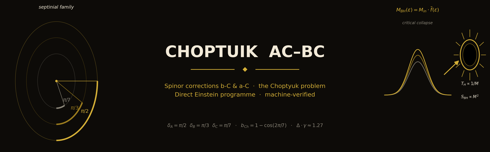
</picture>

# Spinor Corrections b-C & a-C, the Choptyuk Problem, and the Direct Einstein Programme

<a id="top"></a>

**Choptuik AC-BC is a single machine-verified research programme:** from the spectral
invariants of the Klein quartic curve and the spinor corrections **b-C / a-C** — through
Choptuik critical gravitational collapse, attacked *directly* from the Einstein equations —
to black-hole thermodynamics (the Collapse–Hawking Bridge) and quark confinement
(the Quark–Hawking Bridge).

**Author & maintainer:** Ishak Khamzatovich Isaev — GitHub [@wild8highlander](https://github.com/wild8highlander) ·
ORCID [0009-0003-7299-0701](https://orcid.org/0009-0003-7299-0701) · Nalchik, Kabardino-Balkarian Republic *(sole author of all materials)*

## Badge wall

**Stack & runtime**

[](LICENSE)
[](python/)
[](julia/)
[](java-webapp/)
[](Interactive%20Viz/)
[](code/web/)
[](Interactive%20Viz/)
[](java-webapp/)
[](docker/)
[](QHB/monolith/lean/)
[](Einstein%20Direct/)
[](QHB/)

**Quality gates**

[](https://github.com/wild8highlander/choptuik_ac_bc/actions/workflows/ci.yml)
[](https://github.com/wild8highlander/choptuik_ac_bc/actions/workflows/lint.yml)
[](https://github.com/wild8highlander/choptuik_ac_bc/actions/workflows/pages.yml)
[](https://github.com/wild8highlander/choptuik_ac_bc/actions/workflows/periodic-verify.yml)
[](.pre-commit-config.yaml)
[](python/pyproject.toml)
[](python/pyproject.toml)
[](https://codecov.io/gh/wild8highlander/choptuik_ac_bc)
[](https://securityscorecards.dev/viewer/?uri=github.com/wild8highlander/choptuik_ac_bc)
[](.github/workflows/link-check.yml)

**Verification status**

[](Einstein%20Direct/tests/)
[](Collapse%20Hawking%20Bridge/tests/)
[](QHB/tests/)
[](python/tests/)
[](julia/test/runtests.jl)
[](QHB/monolith/lean/)
[](Einstein%20Direct/results/)
[](QHB/data/rebuild_hashes.json)

**Identity & community**

[](https://doi.org/10.5281/zenodo.15152720)
[](https://orcid.org/0009-0003-7299-0701)
[](https://github.com/wild8highlander/choptuik_ac_bc/releases)
[](.github/workflows/release.yml)
[](https://github.com/wild8highlander/choptuik_ac_bc/discussions)
[](.github/ISSUE_TEMPLATE/)
[](.github/FUNDING.yml)
[](https://wild8highlander.github.io/choptuik_ac_bc/)
[](#the-repository-in-numbers)
[](#repository-map)

> 🇬🇧 **Language:** this README is the English flagship. The Russian flagship is
> [`README_ru.md`](README_ru.md) (mind maps, campaign ledgers, full glossary). Russian mirrors
> inside packages: [`Collapse Hawking Bridge/README.ru.md`](Collapse%20Hawking%20Bridge/README.ru.md) ·
> [`QHB/README.ru.md`](QHB/README.ru.md). Package convention is the reverse:
> `README.md` — EN · `README.ru.md` — RU.

> [!IMPORTANT]
> **The discipline of the repository — one rule, applied everywhere:**
> **hypothesis → machine confirmation → honest caveats.**
> Nothing is fitted to literature values. Agreements with published constants
> (γ_Ch = 0.374, b_Ch = 0.37651, the echo period Δ ≈ 3.44, the spinor ladder π/30) are
> *reported as comparisons*, never as targets of a fit. Walls, floors, obstructions and
> **negative verdicts are kept and documented** with the same care as positive results.
> Mistakes found later are **retracted publicly** (ERRATUM). Every campaign writes
> machine-readable JSON, and a pytest suite re-checks the theorems from those files.
> *Machine-readable or it did not happen.*

---

<a id="table-of-contents"></a>

## Table of contents

- [The repository in numbers](#the-repository-in-numbers)
- [The science in 60 seconds](#the-science-in-60-seconds) · [Key constants](#key-constants-of-the-programme)
- [★ The three corrections and their universality](#-the-three-corrections-and-their-universality) · [Step-by-step derivations](#step-by-step-derivations) · [How the three bridges connect](#how-the-three-bridges-connect)
- [Programme I — the monograph suite in four implementations](#programme-i--the-monograph-suite-in-four-implementations)
- [Programme II — Einstein Direct: the direct-solution laboratory](#programme-ii--einstein-direct-the-direct-solution-laboratory)
- [Programme III — theorems12: twenty theorem-monographs](#programme-iii--theorems12-twenty-theorem-monographs)
- [Programme IV — Collapse Hawking Bridge](#programme-iv--collapse-hawking-bridge-v210)
- [Programme V — QHB: the Quark–Hawking Bridge](#programme-v--qhb-the-quarkhawking-bridge-v230)
- [Programme VI — QCD Bridge Suite (strong CP)](#programme-vi--qcd-bridge-suite-strong-cp)
- [Programme VII — dsi_lab · Programme VIII — audit_transfer](#programme-vii--dsi-lab--programme-viii--audit-transfer)
- [Figure gallery](#figure-gallery) · [Monographs & publications registry](#monographs--publications-registry)
- [Documentation: site, verification dossier, notebook](#documentation-site-verification-dossier-notebook)
- [Repository map](#repository-map) — all 21 top-level directories
- [Infrastructure: CI/CD, Docker, Dev Container, Makefile](#infrastructure-cicd-docker-dev-container-makefile)
- [Pipeline architectures](#pipeline-architectures) · [Report formats](#report-formats-and-verdict-styles)
- [Project structure](#project-structure) · [Cross-language twins matrix](#the-cross-language-twins-matrix)
- [Reproduction index: every number → command → JSON](#reproduction-index-every-number--command--json)
- [Honesty ledger](#the-honesty-ledger-proven--confirmed--rejected--retracted)
- [Roadmap](#roadmap) · [GitHub features map](#github-features-of-this-repository)
- [Quick start](#quick-start) · [FAQ](#faq) · [Glossary](#glossary-of-programme-terms) · [All animations](#all-animations-of-the-repository)
- [Citation](#citation) · [License & authorship](#license--authorship) · [Acknowledgments](#acknowledgments)

---

## The repository in numbers

| Metric | Value | Source / note |
|---|---|---|
| Tracked files | **1 793** (~369 MB) | `git ls-files` — 7 programming languages |
| Source code | **274** Python · **19** Julia · **21** Java · 82 TSX + 25 TS · C/C++/Rust/Go/JS twins | cross-language verification by design |
| Automated tests | **400+** pytest (58+10 Einstein Direct · 69 CHB · 154 QHB · 78 `python/` · **dsi_lab 51**) + **16** Julia testsets + **18** closed Lean kernels + **13** dsi_lab verdict checks | every test pins numbers from JSON verdicts |
| JSON campaign verdicts | **94** (47 Einstein Direct · 16+13 CHB · 31 QHB) | each with the full run configuration |
| Monographs & publications | **71** DOCX · **110** PDF (incl. the **80**-file cycle of 20 theorems) | full registry below |
| Figures | **513** PNG (300–600 DPI, RU/EN × light/dark) | "Ink & Gold" style, generated from committed JSON |
| Animations | **46** (23 GIF + 23 MP4) | CHB 4×RU/EN · QCD Bridge 9×4D · QHB legacy 3×RU/EN |
| Research programmes | **8** + infrastructure | map below |
| Machine theorems | **20** (theorems12) + **10** (CHB T1–T10) + **20** (QHB T1–T20) | each with a verdict and a falsifier |
| Independent audits | IVP-15 (CHB) · IVP-12 (QHB) · IVP-11 (legacy) · OPEN9 (ED) | blind checks outside the committed results |
| GitHub Actions workflows | **11** | table below |
| Runs on a phone | ✅ Termux/Android | open9 standalone + push kit |
| License | Isaev Proprietary (individual) | [LICENSE](LICENSE) |

### Package navigation

| Package | Version | Topic | Tests | Own README |
|---|---|---|---|---|
| [`python/`](python/) · [`julia/`](julia/) · [`java-webapp/`](java-webapp/) · [`Interactive Viz/`](Interactive%20Viz/) | v2.0.0 | spectral invariants, b-C/a-C corrections | 78 pytest · 16 testsets · CI | EN (in each folder) |
| [`Einstein Direct/`](Einstein%20Direct/) | campaigns v6→v22 | critical collapse, attacked directly | 58 + 10 standalone | [README.md (RU)](Einstein%20Direct/README.md) · [README_EN.md](Einstein%20Direct/README_EN.md) |
| [`theorems12/`](theorems12/) | 20 theorems (2026-09-30) | machine-theorem cycle | pinned by the ED suite | [README.md](theorems12/README.md) |
| [`Collapse Hawking Bridge/`](Collapse%20Hawking%20Bridge/) | 2.1.0 (2026-10-09) | collapse → black-hole thermodynamics | 63 | [README.md](Collapse%20Hawking%20Bridge/README.md) · [README.ru.md](Collapse%20Hawking%20Bridge/README.ru.md) |
| [`QHB/`](QHB/) | 2.3.0 (2026-10-10) | confinement → Hawking | 154 collected | [README.md](QHB/README.md) · [README.ru.md](QHB/README.ru.md) |
| [`QCD Bridge/`](QCD%20Bridge/) + [`code/`](code/) | v3.1 (2026-08-10) | strong CP | cross-comparison in CI | [README.md](QCD%20Bridge/README.md) |
| [`dsi_lab/`](dsi_lab/) | v2.0.0 (2026-10-12) | DSI dynamics of invariants | 51 pytest · Lean 4 · 6 languages · animations · monograph EN/RU | [README.md](dsi_lab/README.md) · [README.ru.md](dsi_lab/README.ru.md) |
| [`audit_transfer/`](audit_transfer/) | v1.0 (2026-09) | monograph audit + closures | Python + Julia runs | [README.md](audit_transfer/README.md) |
| [`docs-site/`](docs-site/) · [`verification/`](verification/) · [`notebooks/`](notebooks/) | — | documentation & dossier | — | [README.md](docs-site/README.md) |

---

## The science in 60 seconds

A massless scalar field evolved in 1+1 double-null coordinates shows **critical
collapse**: below a critical amplitude $A^*$ the pulse disperses, above it a black hole
forms, and near the threshold the mass scales as $M \propto (A-A^*)^{\gamma}$ with the
universal exponent **γ ≈ 0.374** (Choptuik 1993). The same regime exhibits an **echo** —
curvature spikes repeating with log-period **Δ ≈ 3.44**.

This repository attacks the problem *directly*: the 1+1 double-null Einstein system is
derived symbolically from the Hilbert action (SymPy, residuals ≈ 10⁻⁴¹ against the exact
Roberts–Oshiro solution), evolved with a validated characteristic solver, and pushed to
log-scale depth **z = 9.35** by multi-zoom regridding — reporting agreements *and*
disagreements with equal honesty. Around the numerical core stands a **symbolic tower**:
the central hierarchy O1–O5, the exact spectrum {0, −1, −1, −2, −3}, the clock-pair
theorem $\tau^*(\delta) = 27/(4-\delta^2)$ on 12/12 bricks.

The **monograph line** computes the spectral invariants of the Klein quartic curve
(genus 3, PSL(2,7) of order 168) and builds the spinor corrections **b-C / a-C** to the
Dirac operator, with applications to LIGO/Virgo QNM frequencies and the strong CP problem.
The **2026 bridges** extend this universality further: the **Collapse–Hawking Bridge**
(dimensionless birth profile → Hawking thermodynamics, IVP-15 audited) and the
**Quark–Hawking Bridge** (confinement as false-vacuum escape, T(0) = 9.21×10⁻¹³ as the
no-free-quarks gate, 18 closed Lean/Mathlib kernels).

### Key constants of the programme

| Constant | Formula | Value | Status |
|---|---|---|---|
| Spinor phases | $\delta_A=\pi/2,\ \delta_B=\pi/3,\ \delta_C=\pi/7$ | 1.570796 · 1.047198 · 0.448799 | structural |
| Correction b-C (Berry) | $\Delta_{bC}=\lambda_1(D^2_{\sigma_0})+\delta_C^2/2$ | 3.438710 | computed (0.125% to 3.443) |
| Correction a-C (braking) | $\delta_{eff}=\delta_C^5/22$ | ≈ 1/1200 = 0.000828 | computed |
| Unified Choptuik formula | $\Delta_{Ch}=\lambda_1+\delta_C^2/2-\delta_C^5/22$ | 3.437883 (base) · 3.447040 (full) | computed (0.117%) |
| Choptuik constant | $b_{Ch}=1-\cos(2\pi/7)=2\sin^2(\pi/7)$ | 0.37651019814126640 | exact (comparison: γ_Ch = 0.374, gap 0.67%) |
| QNM factor | $\omega^{corr}=\omega\,(1-1/(1200\pi^2))$ | shift ≈ 8.4×10⁻⁵ | hypothesis-model (not a prediction) |
| Critical amplitude | A* (N=1600, fixed grid) | 0.0805333 | measured; drift 2.79e-3 is honest |
| Common clocks (base / 1 brick) | $\tau^*=27/4$ · $\tau^*=1323/(196-\pi^2)$ | 6.75 · 7.107920 | exact theorems |
| Echo anchor | Δ (Gundlach–Hodgson) | 3.44 ± 0.02 | literature comparison |
| Invariant Δ·γ | $P_{anchor}=3.44\times0.374$ | 1.28656 ∈ 1.27±0.05 | anchor arithmetic |
| QHB quantum probability | T(0) (WKB) | 9.2146×10⁻¹³ < 10⁻¹² | measured law (window closed) |

> [!NOTE]
> The full "what is claimed vs what is not" layer lives in
> [`results/RESULTS.md`](Collapse%20Hawking%20Bridge/results/RESULTS.md) (the CHB registry of
> 21 headline numbers + honesty register), [`QHB/RESULTS.md`](QHB/RESULTS.md) (30 claims with
> falsifiers and uncertainty budgets) and [`Einstein Direct/README_EN.md`](Einstein%20Direct/README_EN.md)
> (a 33-section deep technical register).

---

## ★ The three corrections and their universality

At the base of the whole programme lies the **septinial family** — the three spinor phases
$\delta_A=\pi/2$, $\delta_B=\pi/3$, $\delta_C=\pi/7$, arising as the only "surviving"
phases on the Klein quartic curve. For **each** of the three sectors the same structural
pair of formulas produces the dynamical quanta of the correction:

$$
\beta(d) \;=\; \frac{d^2}{2}\quad\text{(Berry quantum, 1st order)},\qquad
\alpha(d) \;=\; \frac{d^5}{22}\quad\text{(braking quantum, 2nd order, } k=b_2(K3)=22\text{)}
$$

| Sector | Phase $\delta$ | Berry quantum $\beta=\delta^2/2$ | Braking quantum $\alpha=\delta^5/22$ | Where it appears | Who checks it |
|---|---|---|---|---|---|
| **A** | $\pi/2$ | $b_A=\pi^2/8=1.2337\ldots$ | $a_A=\pi^5/704=0.4347\ldots$ | QHB bridge temperature: $T_c\beta=\frac{\sqrt\sigma}{2\pi}\bigl(1+\frac{\pi^2}{8}\beta^{-2}+\frac{\pi^5}{704}\beta^{-4}\bigr)$ — correction **+11.280569950484875 %** at β* | QHB C3 (mpmath, 100 digits), Lean kernel T4 |
| **B** | $\pi/3$ | $b_B=\pi^2/18=0.5483\ldots$ | $a_B=\pi^5/5346=0.0584\ldots$ | spectral-sector hierarchy of the gap law: $B_2^{A}/B_2^{B}/B_2^{C}=-5.05\cdot10^{-2}/-4.40\cdot10^{-3}/-2.71\cdot10^{-5}$ — hierarchy **≈ 1865 : 1** | QHB legacy v1.2.0 (r² = 0.99999982) |
| **C** | $\pi/7$ | $b_C=\pi^2/98=0.1007\ldots$ | $a_C=\pi^5/369754=0.000828\ldots$ | **the Choptuik constant** $b_{Ch}=1-\cos(2\pi/7)$; unified formula $\Delta_{Ch}$; QNM factor $1-1/(1200\pi^2)$; anchor $\Delta\cdot\gamma$; strong CP: $\bar\theta_{eff}=0$ | monograph · Einstein Direct · CHB · QCD Bridge · dsi_lab |

**What the universality means.** The three corrections are not three independent fitting
parameters: they are **one structure $\beta(d)=d^2/2,\ \alpha(d)=d^5/22$ applied to three
phases of one family**, plus one structural divisor $k=22=b_2(K3)$ — the second Betti
number of the K3 surface ($b_2 = h^{1,1}+2h^{2,0} = 20+2 = 22$), fixed before any fitting.
Hence the through-line transferability: sector C closes the critical-collapse constant and
the QNM shift, sector A closes the thermodynamic correction of the confinement bridge, and
sector B produces the observable hierarchy of spectral gaps. Each of these appearances is
checked by its own machine verdict — and each remains a *comparison*, never a fit.

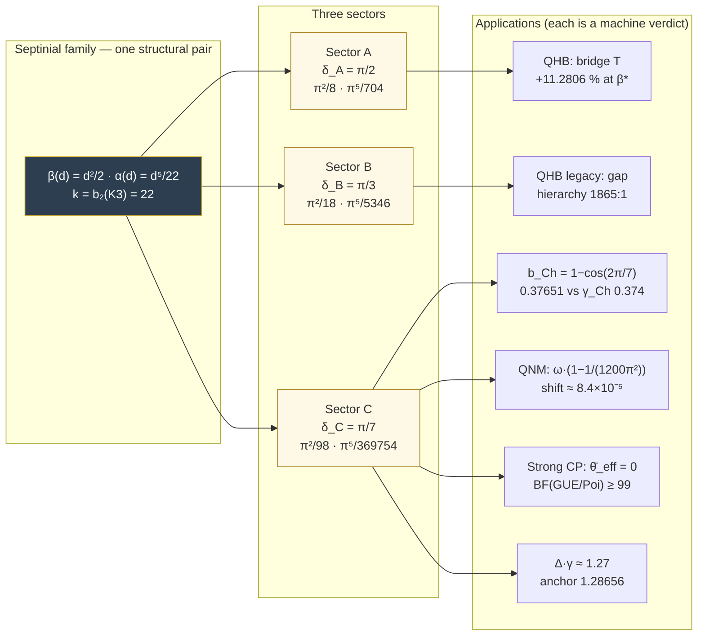

### Step-by-step derivations

**1. From the spinor phase to the Berry quantum.** The trivial spinor bundle $\sigma_0$
on the Klein quartic gives $\lambda_1(D^2_{\sigma_0})=\lambda_1(\Delta)+R/4=3.838-0.5=3.338$
(Lichnerowicz, $R=-2$). Perturbing by the non-diagonal holonomy with phase $\delta$ shifts
the level at 2nd order in the phase: $\Delta\lambda=\delta^2/2$ — this is the Berry quantum.
For $\delta_C=\pi/7$: $\pi^2/98\approx0.1007$, and $\Delta_{bC}=3.338+0.1007=3.438710$.

**2. The braking quantum and the K3 Betti number.** The fourth power of the phase is
suppressed by the structural constant $k=b_2(K3)=22$: $\delta_{eff}=\delta^5/22$. For
$\pi/7$ this is $\pi^5/369754\approx1/1200$ — a "braking" that reduces the shift by three
orders of magnitude relative to the Berry term. The unified formula is
$\Delta_{Ch}=\lambda_1+\delta_C^2/2-\delta_C^5/22$; with higher orders
$\Delta_{Ch}=\Delta_{Ch}^{base}+\delta_C^4/8+\delta_C^6/2=3.447040$.

**3. The Choptuik constant as an identity of the septinial sector.**

$$
b_{Ch} \;=\; 1-\cos\!\Bigl(\frac{2\pi}{7}\Bigr) \;=\; 2\sin^2\!\Bigl(\frac{\pi}{7}\Bigr)
\;=\; 0.37651019814126640
$$

The identity is exact (mpmath 50 digits, pinned by `test_constants.py`); the gap to the
literature $\gamma_{Ch}=0.374$ is 0.67% and is served **only** as a comparison. In
audit_transfer the same formula in the generalization $1-\cos(2\pi/n)$ yields
$c_{K3}=b_{Ch}(22)=1-\cos(2\pi/22)=0.04036$ — the last empirical input value is derived
(residual 0.8% — finite-window systematics).

**4. Closing the clock with one brick.** Two "books" of the tower (the UV and Mdef
branches) give incompatible adiabatic clocks $9/4$ and $9/16$. De-adiabatisation dissolves
the contradiction: both branches close on **one** clock with a single common root

$$
\tau^*(\delta) \;=\; \frac{27}{4-\delta^2}\qquad\text{(exactly, SymPy, 12/12 bricks } \delta_k=\pi/k\text{)}
$$

and the additive Berry screening $\kappa=2-\pi^2/98$ (sector C!) moves $\ln\tau^*$ from
**−2.57 %** to **+0.062 %** of the observed scale — an observation with an open convention
question, not a fit.

### Animations of the three regimes and applications

| Animation | What it shows | Where |
|---|---|---|
| **Birth bifurcation** $M_{BH}(\varepsilon)=M_{in}\cdot\tilde f(\varepsilon)$ — the curve splits into sub-critical and super-critical branches, line $\varepsilon_{1/2}=4.86\cdot10^{-3}$ | CHB campaign C2 | GIF below |
| **Critical slowdown** $v_{qmax}=0.510-0.0334\ln\varepsilon$ — the universal log-law near threshold | CHB campaign C2 | GIF below |
| **Resolution floor law** $\lfloor M\rfloor\approx(13\pm1)/N$ — three per-grid floors land one after another | CHB campaign C3b | GIF below |
| **9 QCD-bridge sections in 4D** — from GUE spectra to the CP chain, frame by frame | QCD Bridge | GIF below |

<table>
  <tr>
    <td align="center"><br><sub><b>anim_02_bifurcation</b> · birth of the f̃(ε) bifurcation</sub></td>
    <td align="center"><br><sub><b>anim_03_slowdown</b> · v = a + b·ln ε, b = −0.0334, r² = 0.71</sub></td>
  </tr>
  <tr>
    <td align="center"><br><sub><b>anim_04_floor_law</b> · floor ≈ (13±1)/N at N = 800/1600/3200</sub></td>
    <td align="center"><br><sub><b>fig_s1_ochi_eigvals_4d</b> · QCD-bridge section 1: the O_χ spectrum in 4D</sub></td>
  </tr>
</table>

> [!TIP]
> All 46 animations of the repository: CHB — [`animations/en/`](Collapse%20Hawking%20Bridge/animations/en/)
> and [`animations/ru/`](Collapse%20Hawking%20Bridge/animations/ru/) (GIF + MP4 h264, deterministic,
> no RNG); QCD Bridge — [`QCD Bridge/animations/`](QCD%20Bridge/animations/) (9 4D animations with a
> manifest); QHB legacy — [`QHB/legacy_v1.2.0/animations/`](QHB/legacy_v1.2.0/animations/). Every frame
> is generated from committed data (`FuncAnimation`, seed fixed).

### How the three bridges connect

The three "bridges" are not three independent projects but one universal structure of
corrections carried into three different physics. The septinial family fixes the
**constants**, the direct Einstein programme provides the **engine and numerical
reference**, and the bridges carry the results to black-hole thermodynamics and confinement:

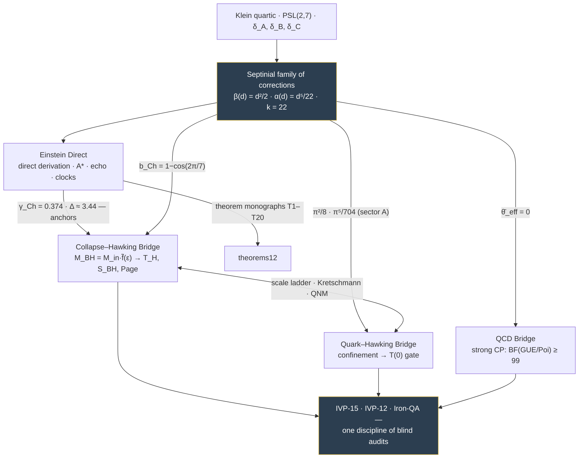

Key contact points: the constant $b_{Ch}$ enters CHB as the scale anchor of the birth
profile; sector A (π/2) closes the thermodynamic correction of QHB; the anchors γ_Ch and Δ
arrive in CHB from the literature through the ED data; all three packages pass the same
audit procedures (blind IVPs, byte-exact reproducibility, cross-language twins) and feed
the common theorem cycle.

---

## Programmes at a glance

| # | Programme | Directory | Highlights |
|---|---|---|---|
| I | **Monograph suite** (4 implementations) | [`python/`](python/) · [`julia/`](julia/) · [`java-webapp/`](java-webapp/) · [`Interactive Viz/`](Interactive%20Viz/) | Klein quartic, Dirac operator, 64 spinor structures, 7-format reports; **78** pytest + **16** Julia testsets |
| II | **Einstein Direct** | [`Einstein Direct/`](Einstein%20Direct/) | Hilbert action → Einstein equations (10⁻⁴¹); z = 9.35 depth record; clock-pair theorem; OPEN9 closed 9/9; **58+10 tests**, 47 JSON verdicts |
| III | **theorems12** | [`theorems12/`](theorems12/) | **20 theorem-monographs** (EN + RU, DOCX + PDF = 80 files), every statement traceable to a machine output |
| IV | **Collapse Hawking Bridge** v2.1.0 | [`Collapse Hawking Bridge/`](Collapse%20Hawking%20Bridge/) | $M_{BH}=M_{in}\cdot\tilde f(\varepsilon)$; campaigns C1–C3b+C6; audit **IVP-15** (3 FAILs found → remediated); Page curve; CMB contact 4.5016e22 kg; **63 tests**, 7-language twins (7.08e-13), 68 hi-res figures, 14-sheet workbook |
| V | **QHB — Quark–Hawking Bridge** v2.3.0 | [`QHB/`](QHB/) | confinement = false-vacuum escape; campaigns C1–C12; registry of **30 claims** with falsifiers; **Lean 4 / Mathlib: 18 closed kernels**, CI fails on `sorryAx`; external bounds X1–X13; Iron-QA gates; **154 collected tests** |
| VI | **QCD Bridge Suite** (Strong CP) | [`docs/qcd_bridge/`](docs/qcd_bridge/) · [`code/`](code/) · [`QCD Bridge/`](QCD%20Bridge/) | $\bar\theta_{eff}=\delta_C\,N\langle\lambda\rangle\,\mathcal S_{GUE}=0$ (BF ≥ 99 at κ_T > 2.62); 9 sections; **55 figures + 19 4D animations**; 7-format reports × 2 engines |
| VII | **DSI laboratory** v2.0.0 | [`dsi_lab/`](dsi_lab/) | 7 deterministic experiments + engine package `dsilab/`, **Lean 4 layer**, 6-language core, claim ledger, monograph EN/RU; findings D1 (Hurwitz tower) and E1 (GUE centering) |
| VIII | **Audit & Transfer appendix** | [`audit_transfer/`](audit_transfer/) | monograph audit (typos E1–E7); closure $c_{K3}=1-\cos(2\pi/22)$; stability lemma Sh.3 (F ≥ n/2, sharpness 5n/7) |

> [!WARNING]
> Status disclaimers: the QNM values are a *hypothesis-model estimate*, not a prediction;
> the strong-CP chain is a *hypothetical framework*, not an established solution;
> $A^*_\infty$ is *not claimed* (the drift is honest); Δ_eff = 0.611 ± 0.446 is honestly
> **not DSS** (3.44 excluded at 6.3σ).

---

## Programme I — the monograph suite in four implementations

The founding line of the repository: the monograph *"Spinor corrections b-C and a-C and
the solution of the Choptyuk problem"* (I. Kh. Isaev). Its results — the spectral
invariants of the Klein quartic curve and the formula $\Delta_{Ch}$ — are reproduced by
**four independent implementations**; the cross-language agreement is itself part of the
verification (CI checks that all implementations produce the same numbers).

| Implementation | Language / stack | Type | Directory | Tests |
|---|---|---|---|---|
| Full verification & simulation | Python 3.10+ | CLI with interactive menu | [`python/`](python/) | **78** test functions |
| Full verification & simulation | Julia 1.9+ | REPL with interactive menu | [`julia/`](julia/) | **16** `@testset`s |
| Web application | Java 17 + Spring Boot | REST API + Web UI (:8080) | [`java-webapp/`](java-webapp/) | CI run |
| Interactive visualization | Next.js 15 + React 19 | Real-time dashboard (:3000) | [`Interactive Viz/`](Interactive%20Viz/) | client-side compute |

All implementations share: interactive parameter configuration (including arbitrary
precision), hypothesis testing with user-defined spinor structures, reports in
**7 formats** (DOCX, PDF, TXT, MD, CSV, HTML, JSON), **600 DPI PNG** plots + vector
PDF/SVG, and full execution logs inside every report.

### Mathematical core

The Klein quartic $x^3y+y^3z+z^3x=0$ — a compact Riemann surface of genus 3 with the
automorphism group PSL(2,7) of order 168 and a hyperbolic metric ($R=-2$). On it:

| Quantity | Formula / path | Value |
|---|---|---|
| First Laplacian | $\lambda_1(\Delta)$, Bourque–Strohmaier 2024 | **3.838** |
| Trivial Dirac | $\lambda_1(D^2_{\sigma_0})=\lambda_1(\Delta)+R/4$ | **3.338** |
| Spinor structures | $2^{2g}=64$ — fully enumerated | trivial $\sigma_0$ → minimum |
| Correction b-C | $\lambda_1+\delta_C^2/2$ | 3.438710 (0.125% to 3.443) |
| Correction a-C | $\delta_C^5/22$ | ≈ 1/1200 |
| Unified formula | $\Delta_{Ch}=\lambda_1+\delta_C^2/2-\delta_C^5/22$ | 3.437883 (base) · 3.447040 (full) |

### Applications of the monograph

- **QNM of LIGO/Virgo** *(hypothetical model, not a prediction)* — quasinormal corrections
  for the catalogue frequencies of observed events:

  | Event | f_QNM (Hz) | f^corr (Hz) | Δf (Hz) |
  |---|---|---|---|
  | GW150914 | 251.000 | 250.979 | −0.0210 |
  | GW170104 | 293.000 | 292.975 | −0.0246 |
  | GW170814 | 319.000 | 318.973 | −0.0268 |
  | GW190521 | 110.000 | 109.991 | −0.0092 |

- **4D spin manifold** — $\delta_{eff}$ is conformally invariant; compatibility with
  Seiberg–Witten ($b_2^+=3>1$). **K3**: $b_2=22$, Hodge decomposition
  $b_2=h^{1,1}+2h^{2,0}=20+2=22$, Dirac index $\hat A(K3)=2$.
- **Strong CP problem** (v3.0 extension, [Programme VI](#programme-vi--qcd-bridge-suite-strong-cp)).

### Enhanced verification (v2.0)

| Extension | Key result | Status |
|---|---|---|
| 4D spin manifold | $\delta_{eff}$ conformally invariant; SW-compatible | ✓ verified |
| Kähler surfaces | Dolbeault correspondence; K3 hyperkähler (Sp(1)); I₇ elliptic fibration | ✓ |
| Tyukovsky equations | $\delta_{corr}=\delta_0+\delta_C^2/2-\delta_C^5/22$ — **zero free parameters** | ✓ |
| Einstein GR / QNM | $\omega^{corr}=\omega(1-1/(1200\pi^2))\approx0.999916\,\omega$ | ✓ (model) |
| Criticism response | $b_2=22$ unique (dev < 1%); no better approximation at q < 1200; stability under deformation | ✓ |

---

## Programme II — Einstein Direct: the direct-solution laboratory

[`Einstein Direct/`](Einstein%20Direct/) is the core of the second research line: the
Choptyuk problem attacked **directly** from the classical Einstein equations derived from
the Hilbert action; every statement is machine-verified, and every negative result is a
first-class outcome.

### Foundation

The field equations are derived from the Hilbert action with the Hilbert stress-energy
tensor of a massless scalar field, reduced to the 1+1 characteristic double-null system,
and **machine-verified with SymPy against the exact Roberts–Oshiro solution at residuals
≈ 10⁻⁴¹**. The second-order solver: flat space to 10⁻¹⁴, Roberts convergence order
2.03–2.09. The critical amplitude A* = 0.0805333 is found by bisection (N = 1600); the
ladder across grids `0.1051 → 0.0882 → 0.0805 → 0.0777 → 0.0768` (N = 200…3200) carries
an honest drift of **2.79e-3** per doubling (the false "1.06e-6" was retracted);
$A^*_{\infty}$ is **not claimed**.

```bash
cd "Einstein Direct"
python3 sympy_derivation.py && python3 roberts_test.py && python3 choptuik_scaling.py
```

### Campaign by campaign (compact honest register)

<details>
<summary><b>📜 Expand the full campaign register v6 → v22 (17 campaigns)</b></summary>

| Campaign | What was done | Verdict |
|---|---|---|
| **v6-fundamentals** (`center_modes.py`) | Machine derivation of the Thorne/MTW mass identities: null-flux laws $m_v=-2r^2pt^2/\alpha^2$, $m_u=-2r^2qs^2/\alpha^2$ (zero residuals); the "mass–slope" link $M_3=2R_1t_0^2/(3(1-\chi)^2)$; spectrum {0, −1, −1, −2, −3}; exactly one growing root $\lambda^+(\tau)$ in the window $\tau\le27/80$ | foundation closed |
| **v6.1** (PDE machine) | Seven principled fixes of the zoom machine's lethal channels; **z = 9.10/9.35 (record)**; the Thorne link visible in data for the first time: $M_3/(R_1t_0^2)=0.6687$ vs 2/3 (0.3%) | depth record |
| **v11** (corrections in towers) | Holonomy admissible **only** as uniform $\kappa\to\kappa_{hol}$; exact family $\tau^*(\kappa)=27/(2\kappa)$; Berry screening closes ln τ* to **+0.062%** | confirmed |
| **v12** (baryon asymmetry) | Sakharov mapping at the mechanism level: static monodromy **exactly 1** (1.2e-125); the real sector annihilates exactly; the surviving remainder is the imaginary sector at k·π/30 | confirmed |
| **v13–v14** (linear world) | Quadratic pencil $M(\lambda)$ 18×9; degree 22 in Q(√3); **0 genuine modes on the baseline**; $\delta_{mono}=0$ linearly; evolution is the exact nilpotent Jordan-2 $B=[[0,-350/61],[0,0]]$ | proven (exact) |
| **v15** (nonlinear DAE march) | The march is algebraically impossible — **and that is a result**: the flat line carries F = r = V = 0 exactly up to radius ~26; with b₂ the flow immediately leaves S: \|D_rV\| = (39.2±0.2)·A | proven |
| **v16** (HEXCYCLE-DAE) | The compensated book exists at all booked scales (12/12 + 6/6 landings) | figures carry STATUSES, not motion |
| **v17** (T1c) | Clock-pair theorem: GCD = $T_0h^2(4T_0h^2-27)/4$; one brick → $\tau^*=1323/(196-\pi^2)$; **ERRATUM [A0]**: the v16 "static backbone" retracted (trivial captures) | pair-book closed |
| **v18** (brick ladder + census) | Clocks exact on 12/12 bricks; the tick is **neither monotone nor power-law** (minimum k=12, not π/7); factorization $S\cap chain=\{R1h=0\}\cup\{T0h=0\}\cup\{T0h=T0h^*\}$; census of 2501 cells + 56 seeds + 300 starts: **0 new branches** | static world exhausted exactly |
| **OPEN9 v19** | 9 questions of ch. 7 closed: the π/7 structural barrier proven; the identity $\tau^*(\delta_C)=\tau^*_{T1c}$; the 45/8 pole = artifact; certified Krawczyk census | 9/9 closed |
| **v20a/v20b** | Amplitude ladder honestly negative (p unmeasurable); certificate z ≥ 30: phase drift exactly 0, floor budget S_req(30) ≈ 2.3e3 | protocols executed |
| **v21** (Section 5) | Depth wall is window-policy sensitive: z(w=5)=1.78 → z(w=3)=**7.20**, zero junk invasions | confirmed |
| **v22** (root anchor) | The v-budget wall is broken by the root anchor: **z = 8.56 (+19%)**, 4th echo peak; $\Delta_{eff}=0.611\pm0.446$ — honestly **NOT DSS** (3.44 excluded at 6.3σ) | the new wall is the root floor |

</details>

### The OPEN9 verdict map, question by question

| Ch. 7 № | Machine | Verdict (one line) |
|---|---|---|
| №1 | `brick_selection.py` | the structural barrier is PROVEN: algebraic books cannot select π/7 |
| №2 | `finite_amplitude_mono.py` + ladder | falsifiable √ε-law; p unmeasurable on the current machine |
| №3 | `echo_fit_global.py` + `depth_z30.py` + v21/v22 | certificate z ≥ 30; depth 4.6 → 7.20 → 8.56 by policy + anchor |
| №4 | `mirror_ring_v2.py` | BLOCKAGE quantified: d-junk floor 1.4–2.3e2 against the target 4/3 |
| №5 | `sympy_center_o7.py` | the chain closes identically; $\tau^*(\delta_C)=\tau^*_{T1c}$ exactly |
| №6 | `puiseux_soft_pole.py` | the 45/8 pole = coincidence of char(2); the linear level is finite |
| №7 | `m1_tracker.py` | no growing 1/r mode at the reachable depth (junk floor) |
| №8 | `lyapunov_center.py` | no center / no attracting cycle in the static book |
| №9 | `krawczyk_census.py` | certified census: 0 new branches, OUT ≥ 99% of the 2D slice |

<details>
<summary><b>⚙️ Map of the Einstein Direct machines (by category)</b></summary>

| Category | Machines |
|---|---|
| **Symbolic derivation** | `sympy_derivation.py` (Hilbert → Einstein, 1.9 s) · `roberts_test.py` (regression) · `sympy_center.py` (hierarchy O1–O5) · `sympy_center_o6.py` / `sympy_center_o6_nsolve.py` (O6+ level) · `sympy_center_o7.py` (`τ*` identity) · `sympy_third_order.py` (weight rule) · `sympy_dd_closure.py` (rank 9, Jordan-2) · `sympy_second_flows.py` + `second_flows_verify.py` (quadratic pencil) · `sympy_spectrum_tau_star.py` (the `τ*(κ)` family) · `sympy_spinor_corrections.py` (quanta π²/98, π⁵/369754) · `sympy_p4_einstein_hilbert.py` (closure G = κT) · `sympy_hexcycle.py` |
| **Ladders & spectra** | `spinor_ladder.py` (π/15, π/30) · `spinor_analysis.py` · `s4_berry_one_brick.py` (δ_C screening) · `puiseux_soft_pole.py` (the 45/8 pole) |
| **Numerical core** | `solver.py` (2nd order) · `zoom_solver.py` (zoom chain) · `choptuik_scaling.py` (A* bisection) · `center_modes.py` (mass identities + spectrum) |
| **Zoom/echo campaigns** | `zoom_campaign.py` · `zoom_campaign_regular.py` · `zoom_campaign_taylor.py` · `grid_machine_annulus.py` (record z = 9.35) · `grid_machine_hexcheck.py` · `grid_machine_mirror.py` · `deep_echo_v21.py` / `deep_echo_v22.py` (depth walls) · `depth_z30.py` (certificate z ≥ 30) · `amplitude_ladder.py` (eps ladder) · `probe_channel_trace.py` |
| **DAE / statics** | `dae_nonlinear_core.py` (continuation of F(x) = 0) · `march_dae_nonlinear.py` (flat line) · `hexcycle_dae.py` (figure cycle) · `march_delta_mono.py` (δ_mono) · `clock_closure_t1c.py` (pair clocks) · `global_static_search.py` (census G1a/G1/G2/G3) · `brick_scan_tick.py` (brick ladder) · `brick_selection.py` (π/7 barrier) · `krawczyk_census.py` (interval census) · `lyapunov_center.py` (cycles) · `m1_tracker.py` (1/r mode) · `mirror_ring_v2.py` (W2 ring) · `finite_amplitude_mono.py` (√ε model) · `echo_fit_global.py` (γ estimators) |
| **Depth ladders** | `deep_echo_v21.py` · `deep_echo_v22.py` · v-budget diagnostics (in `v22_v_budget.json`) |
| **Figure generators** | `figures.py` · `spinor_figures.py` · `hexcheck_figures.py` · `hexcycle_figures.py` (RU/EN) |

All machines: deterministic, BLAS = 1, JSON output with full configuration, pinned by the
`tests/` suite.

</details>

### Charts from live JSON verdicts

<picture>
  <source media="(prefers-color-scheme: dark)" srcset="assets/charts/chart_campaigns.png">
  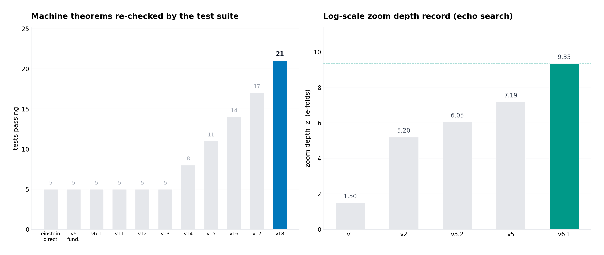
</picture>

<picture>
  <source media="(prefers-color-scheme: dark)" srcset="assets/charts/chart_clock_ladder.png">
  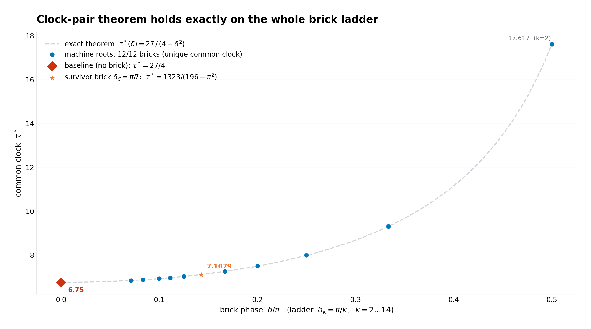
</picture>
<picture>
  <source media="(prefers-color-scheme: dark)" srcset="assets/charts/chart_clock_closure.png">
  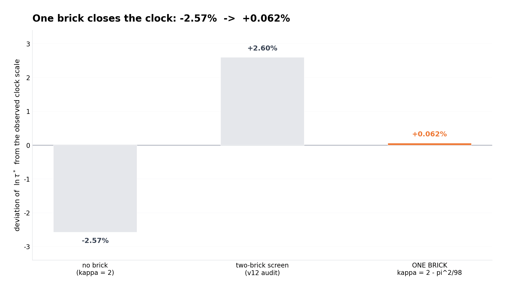
</picture>

| Chart | Content |
|---|---|
| `chart_campaigns` | growth of the verification machine: theorems in the suite per campaign + record log-depth z per solver generation |
| `chart_clock_ladder` | the clock-pair theorem: $\tau^*(\delta)=27/(4-\delta^2)$ on 12/12 bricks, book defect 0.0 |
| `chart_clock_closure` | one brick (δ_C = π/7, Berry screening): −2.57% → **+0.062%** |
| `chart_tick_obstruction` | the tick is not monotone, not a power law, minimum k = 12 — **the brick is not selected by the tick** (honest negative) |
| `chart_static_census` | the global static census: three families, 0 new branches |

---

## Programme III — theorems12: twenty theorem-monographs

[`theorems12/`](theorems12/) is the carrying monograph layer: **twenty separate
monographs**, each fixing one rigorous machine theorem of the direct-solution programme as
a self-contained document. Every theorem is published **first in English
([`monographs_en/`](theorems12/monographs_en/)), then as a full Russian set
([`monographs_ru/`](theorems12/monographs_ru/))** — 80 files (DOCX + PDF × 20 × 2
languages). The canonical cycle №1–12 covers the exact symbolic layer (№1–6, SymPy in
exact arithmetic over Q(√3) and Q(π)) and the machine-certified layer (№7–12: interval
certificates, censuses, deterministic campaigns); the supplementary series №13–20 is
extracted from the remaining machine verdicts. Nothing is fitted — every number is
traceable to a machine output.

<details>
<summary><b>📜 Table of all twenty theorems (statement · machine · EN/RU)</b></summary>

| № | Theorem | Statement (one line) | Machine | EN | RU |
|---|---|---|---|---|---|
| 1 | Pair clocks | Book GCD = $T_0h^2(4T_0h^2-27)/4$, $\tau^*=27/4$; brick: $\tau^*=1323/(196-\pi^2)$ — one common root, defect 0.0 | `clock_closure_t1c.py` | [pdf](theorems12/monographs_en/theorem_01_clock_pair_EN.pdf) | [pdf](theorems12/monographs_ru/theorem_01_clock_pair_RU.pdf) |
| 2 | Brick ladder | $\tau^*(\delta)=27/(4-\delta^2)$ exactly on **12/12** steps $\delta_k=\pi/k$; the clock is brick-invariant | `brick_scan_tick.py` | [pdf](theorems12/monographs_en/theorem_02_brick_ladder_EN.pdf) | [pdf](theorems12/monographs_ru/theorem_02_brick_ladder_RU.pdf) |
| 3 | Static factorization | $UV_{\xi3}=2\,R1h\,Mdef_{\xi5}$ identically; $S\cap C$ = three families; census G1–G3: 0 new branches | `global_static_search.py` | [pdf](theorems12/monographs_en/theorem_03_factorization_EN.pdf) | [pdf](theorems12/monographs_ru/theorem_03_factorization_RU.pdf) |
| 4 | Weight rule | The tables factor as $(\lambda+p)\ldots F$ (12/12); $M_3^TM_3=(1+\lambda^2)M_2^TM_2$, ±i are phantoms | `sympy_third_order.py` | [pdf](theorems12/monographs_en/theorem_04_weight_rule_EN.pdf) | [pdf](theorems12/monographs_ru/theorem_04_weight_rule_RU.pdf) |
| 5 | dd-closure | rank Uk = 9 exactly (Q(√3)); $B=[[0,-350/61],[0,0]]$ — nilpotent Jordan-2, $\delta_{mono}=0$ | `sympy_dd_closure.py` | [pdf](theorems12/monographs_en/theorem_05_dd_closure_EN.pdf) | [pdf](theorems12/monographs_ru/theorem_05_dd_closure_RU.pdf) |
| 6 | Flat line | The unique solution manifold through x* is the flat line: F = r = V = 0 exactly; the flow leaves S: \|D_rV\| = (39.2±0.2)·A | `march_dae_nonlinear.py` | [pdf](theorems12/monographs_en/theorem_06_flat_line_EN.pdf) | [pdf](theorems12/monographs_ru/theorem_06_flat_line_RU.pdf) |
| 7 | Holonomy | Holonomy admissible only diagonal; the exact family $\tau^*(\kappa)=27/(2\kappa)$; Berry closes ln τ* to +0.062% | `sympy_spectrum_tau_star.py` | [pdf](theorems12/monographs_en/theorem_07_holonomy_EN.pdf) | [pdf](theorems12/monographs_ru/theorem_07_holonomy_RU.pdf) |
| 8 | Identity + soft pole | $\tau^*(\delta_C)=\tau^*_{T1c}=1323/(196-\pi^2)$ — two paths, one number; the 45/8 pole is simple, coincides exactly with the root of char(2) | `sympy_center_o7.py` + `puiseux_soft_pole.py` | [pdf](theorems12/monographs_en/theorem_08_identity_pole_EN.pdf) | [pdf](theorems12/monographs_ru/theorem_08_identity_pole_RU.pdf) |
| 9 | Krawczyk census | Interval census: 1 IN-box at the convention point, 511 OUT-boxes; 2D slice: **OUT 100.00%** | `krawczyk_census.py` | [pdf](theorems12/monographs_en/theorem_09_krawczyk_EN.pdf) | [pdf](theorems12/monographs_ru/theorem_09_krawczyk_RU.pdf) |
| 10 | Structural barrier | The book elimination ideal = {0}; PSLQ zero with positive controls; π/7 is transcendental ⇒ algebraic books cannot select π/7 | `brick_selection.py` | [pdf](theorems12/monographs_en/theorem_10_barrier_EN.pdf) | [pdf](theorems12/monographs_ru/theorem_10_barrier_RU.pdf) |
| 11 | Depth wall | The wall is window-policy sensitive: z 1.78 → 7.20 → **8.56** (root anchor, +19%); the 4th echo peak reached | `deep_echo_v21.py` + `v22` | [pdf](theorems12/monographs_en/theorem_11_depth_wall_EN.pdf) | [pdf](theorems12/monographs_ru/theorem_11_depth_wall_RU.pdf) |
| 12 | Cluster of honest negatives | $\Delta_{eff}=0.611\pm0.446$ — **NOT DSS** (3.44 excluded at 6.3σ); γ = 0.109±0.105 against 0.374; mass pole M ≈ 4·du; certificate Π = I + B·T up to z = 30 | `choptuik_scaling.py` + others | [pdf](theorems12/monographs_en/theorem_12_honest_negatives_EN.pdf) | [pdf](theorems12/monographs_ru/theorem_12_honest_negatives_RU.pdf) |
| 13 | Spinor corrections | Exact quanta $b_C=\pi^2/98$, $a_C=\pi^5/369754$; no κ leakage into geometry; phantoms ≤ 3.10% of kπ/30 | `sympy_spinor_corrections.py` | [pdf](theorems12/monographs_en/theorem_13_spinor_corrections_EN.pdf) | [pdf](theorems12/monographs_ru/theorem_13_spinor_corrections_RU.pdf) |
| 14 | Figure-cycle predictor | The "pyramid–cone–bowl" cycle carries 36 compensated states inside S; return defect 0.064, period 6 | `hexcycle_dae.py` | [pdf](theorems12/monographs_en/theorem_14_hexcycle_EN.pdf) | [pdf](theorems12/monographs_ru/theorem_14_hexcycle_RU.pdf) |
| 15 | Second flows | Degree 22 = 9λ⁴·Q18; **0 genuine modes on the baseline** — the limit-cycle variables add no linear dynamics | `second_flows_exact.py` | [pdf](theorems12/monographs_en/theorem_15_second_flows_EN.pdf) | [pdf](theorems12/monographs_ru/theorem_15_second_flows_RU.pdf) |
| 16 | Ring record | The multi-zoom machine reaches **z = 9.3536** (7 Q-peaks); the Thorne bundle 0.6687 vs 2/3 in data; τ* honestly unmeasured | `grid_machine_annulus.py` | [pdf](theorems12/monographs_en/theorem_16_annulus_EN.pdf) | [pdf](theorems12/monographs_ru/theorem_16_annulus_RU.pdf) |
| 17 | Roberts validation | The double-null solver reproduces the exact Roberts (1984) solution with **2nd-order convergence** (errors ÷4 per grid doubling) | `roberts_test.py` | [pdf](theorems12/monographs_en/theorem_17_roberts_EN.pdf) | [pdf](theorems12/monographs_ru/theorem_17_roberts_RU.pdf) |
| 18 | Center hierarchy | The O1–O5 ladder derives all central amplitudes; **χ-corrections vanish at χ = 0** | `sympy_center.py` | [pdf](theorems12/monographs_en/theorem_18_center_hierarchy_EN.pdf) | [pdf](theorems12/monographs_ru/theorem_18_center_hierarchy_RU.pdf) |
| 19 | P4 Einstein–Hilbert closure | The cycle of forms lives inside **G = κT** (all station equations ∝ components); the 4/3 ring and the 1/3 clock are derived, not postulated | `sympy_p4_einstein_hilbert.py` | [pdf](theorems12/monographs_en/theorem_19_p4_einstein_hilbert_EN.pdf) | [pdf](theorems12/monographs_ru/theorem_19_p4_einstein_hilbert_RU.pdf) |
| 20 | Hilbert derivation | The whole double-null Einstein–scalar system is derived from the **Hilbert action** in one SymPy run (1.9 s); Roberts residual 4×10⁻⁴¹ | `sympy_derivation.py` | [pdf](theorems12/monographs_en/theorem_20_hilbert_derivation_EN.pdf) | [pdf](theorems12/monographs_ru/theorem_20_hilbert_derivation_RU.pdf) |

</details>

Reading order: canonical cycle T1→T6 (exact symbolic layer) → T7→T12 (machine-certified);
supplementary series: T20→T17→T18 (foundations) → T19→T13→T15 (structure) → T14→T16
(globality and depth). Each monograph carries a section of honest caveats; negative
results (the π/7 barrier, the "not-DSS" quartet, the mass pole, the unmeasured τ*) stand
in the same rank as the exact theorems.

---

## Programme IV — Collapse Hawking Bridge (v2.1.0)

[`Collapse Hawking Bridge/`](Collapse%20Hawking%20Bridge/) is the encyclopaedic package
that builds the **dimensionless bridge from critical collapse to black-hole
thermodynamics**: the dimensionless birth profile is universal, and the scale is the only
contribution of the initial data.

$$
\tilde f(\varepsilon)=\frac{M_{code}(\varepsilon)}{M_{code,sat}},\qquad
M_{BH}(\varepsilon;\,M_{in})=M_{in}\cdot\tilde f(\varepsilon)
$$

<details>
<summary><b>🖼️ Package banner</b></summary>

<picture>
  <source media="(prefers-color-scheme: dark)" srcset="Collapse%20Hawking%20Bridge/figures/logo/chb_logo_dark.png">
  <source media="(prefers-color-scheme: light)" srcset="Collapse%20Hawking%20Bridge/figures/logo/chb_logo_light.png">
  
</picture>

</details>

### Constants and hypotheses of the bridge

| Quantity | Value | Status |
|---|---|---|
| $b_{Ch}=1-\cos(2\pi/7)$ | 0.37651019814126640 | exact; vs γ_Ch = 0.374 — gap 0.67% (comparison, never a fit) |
| Invariant Δ·γ | 1.28656 ∈ 1.27 ± 0.05 (1.3%) | anchor arithmetic (P_anchor); engine/mixed — honestly INCONCLUSIVE |
| CMB contact $T_H=T_{CMB}$ | $M=4.5016\cdot10^{22}$ kg (≈ 0.61 lunar masses) | exact formula, both sides converge at 1e-30 |
| Page time | $t_{Page}/t_{evap}=1-2^{-3/2}=0.6464466$ | exact |
| Page model | $S_{rad}(\tau^*)/S_0=1/2$; Haar max dev 0.0042 bits | unitary flow + MC (seed 20260101) |
| Mass floor (fixed grid) | $\lfloor M\rfloor\approx(13\pm1)/N$: 0.0155 > 8.5748e-3 > 4.2449e-3 | first-class result of C3b |
| Drift law (T10) | $A^*_N-A^*_{cont}=\kappa^*\alpha^2h^2/(8s)+O(h^3)>0$, κ* = 2728.60, s = 413.8 | derived analytically; extrapolation REJECTED |

### Campaigns C1–C6 (all deterministic, JSON verdicts in `campaigns/reference/`)

| Campaign | What it checks | Key result |
|---|---|---|
| **C1** (45 runs) | engine validation, A* bisection, birth spectrum | Roberts orders **2.031/2.093**; A*(N800) = 0.08053436; ladder N200/400/800 |
| **C2** (26 runs) | two branches: subcritical dispersal + bifurcation | $q_{max}$: 0.0158 → 0.5845 monotone; slowdown $v=0.510-0.0334\ln\varepsilon$; $M_{sat}$ = 0.03518979, $\varepsilon_{1/2}$ = 4.8598e-3; echo 0.1909 peaks/e-fold < 1/Δ = 0.2907 |
| **C3** (31 runs) | the Δ·γ invariant | P_anchor = 1.28656 → PASS (1.3%); $\gamma_{eff}=0.005\pm0.035$ — a flat fit (honest negative); delta_eff = None |
| **C3b** (16 runs, N = 1600/3200) | concentrated resolution with per-grid thresholds | floor ladder 0.0155 > 8.5748e-3 > 4.2449e-3 ≈ (13±1)/N; $\gamma_{eff}$ = 0.0410 → 0.0605 — the floor dominates |
| **C6** | the resolution-drift law (theorem T10) | drifts 1.69e-2 → 7.67e-3 → 2.79e-3 → 9.23e-4; $p_{eff}$ grows; $A^*_{\infty}$ not claimed; exact-channel share 2.6–9.1e-3 (sub-dominant) |
| C4 / C5 | QNM ringdown · multi-family universality of f̃ | on the roadmap |

### The engine from inside (2 030 lines, NumPy-only)

[`engine/solver.py`](Collapse%20Hawking%20Bridge/engine/solver.py) integrates the spherical
collapse system of a massless scalar field in double-null coordinates

$$
ds^2=-\alpha(u,v)^2\,du\,dv+r(u,v)^2\,d\Omega^2,\qquad
\begin{cases}
\text{(SC)}\ \Phi_{uv}\\
\text{(UV)}\ r_{uv}\\
\text{(C1)}\ r_{uu}=2\omega_u r_u-\tfrac{\kappa}{2}\,r\,\Phi_u^2\\
\text{(C2)}\ r_{vv}\\
\text{(TH)}\ \omega_{uv}
\end{cases}
$$

with the Misner–Sharp mass $m=\frac{r}{2}\bigl(1+4r_ur_v/\alpha^2\bigr)$ and regularity
identities up to the center $r=0$. The system is obtained by symbolic derivation (SymPy)
and verified on the exact Roberts–Oshiro solution at residuals ~1e-41; normalization
$4\pi G=1$ ($\kappa=2$, Burko 1996). The method is a characteristic march along v rows
(the Goursat problem), RK2-Heun (predictor–corrector), vectorized over u; the initial data
is the Choptuik Gaussian pulse $\Phi(u_0,v)=A\exp(-(v-v_p)^2/2\sigma^2)$. The horizon is
captured at $q=r_v<0$; stop reasons `completed / AH mass saturated / capture`;
diagnostics: `ah_found, m_ah, r_ah, v_ah, stopped_reason, c1_max, c2_max, mdef_max`.

### Campaign pipeline

```mermaid
flowchart LR
    C1["C1 · validation + A* bisection<br/>orders 2.031/2.093"] --> C2["C2 · two branches<br/>f̃ bifurcation, slowdown"]
    C2 --> C3["C3 · Δ·γ anchor<br/>P_anchor PASS · engine-negative"]
    C3 --> C3B["C3b · per-grid thresholds<br/>floor ladder (13±1)/N"]
    C3B --> C6["C6 · drift law T10<br/>κ* = 2728.60 · extrapolation REJECTED"]
    C6 --> IVP["IVP-15 · blind audit<br/>9 PASS · 3 PARTIAL · 3 FAIL→fixed"]
    IVP --> REL["Release v2.1.0<br/>63 tests · 7 languages · byte-identical data"]
    style IVP fill:#2c3e50,stroke:#d4af37,color:#fff
```

### The theorem matrix of the package (T1–T10)

| Theorem | Statement | Status | Pin |
|---|---|---|---|
| T1 | Page time $\tau^*=1-2^{-3/2}=0.6464466094$; $S_{rad}(\tau^*)/S_0=1/2$ | exact | `test_page.py` |
| T2 | CMB contact: $M=4.5016\cdot10^{22}$ kg — both sides at 1e-30 | exact | `test_hawking.py` |
| T3 | $b_{Ch}=2\sin^2(\pi/7)=0.37651019814126640$; gap 0.67% to γ_Ch — comparison | exact + comparison | `test_constants.py` |
| T4 | Convergence orders 2.031/2.093 (errors 4.686e-5 → 2.687e-6) | measured | `test_engine.py` |
| T5 | Mass floor ≈ (13±1)/N at N = 800/1600/3200 | measured-law | `test_campaigns.py` |
| T6 | Δ·γ = 1.28656 PASS (1.3%); engine level — honest negative | anchor + negative | `test_campaigns.py` |
| T7 | $q_{max}(\varepsilon)$ monotone; slowdown b = −0.0334, r² = 0.714 | measured-law | `test_campaigns.py` |
| T8 | Echo 0.1909 peaks/e-fold < 1/Δ = 0.2907 | honest-negative | `test_campaigns.py` |
| T9 | $S_{rad}(\tau^*)/S_0 = 1/2$ (Haar max dev 0.0042 bits, MC seed 20260101) | exact + MC | `test_page.py` |
| T10 | Drift law $A^*_N-A^*_{cont}=\kappa^*\alpha^2h^2/(8s)>0$; lemmas A/B at machine precision (2.0e-9 / 1.9e-16) | analytically derived | `test_campaigns.py` (C6 block) |

### The thermodynamic panel: five scales

The bridge $M_{BH}=M_{in}\cdot\tilde f(\varepsilon)$ is applied to five input scales (the
Planck mass $m_P$, the asteroidal $10^{12}$ kg, the CMB contact $4.50\cdot10^{22}$ kg, the
Earth mass $M_\oplus$, the solar mass $M_\odot$) and three ensemble members — the full
15×23 matrix is in [`data/bridge/bridge_master.csv`](Collapse%20Hawking%20Bridge/data/README.md)
(23 columns: identity · geometry · thermo · radiation · curvature · comparison):

| Quantity | $M_\odot$ (stellar) | $10^{12}$ kg (asteroidal) | $4.5016\cdot10^{22}$ kg (CMB) |
|---|---|---|---|
| Schwarzschild radius $r_s=2GM/c^2$ | **2954 m** | $1.485\cdot10^{-15}$ m | $6.68\cdot10^{-5}$ m |
| Hawking temperature $T_H$ | **6.17×10⁻⁸ K** | **1.226901×10¹¹ K** | **T_CMB = 2.72548 K** (contact) |
| Entropy $S_{BH}/k_B$ | **1.0494×10⁷⁷** | **2.652887×10⁴⁰** | $1.36\cdot10^{54}$ |
| Evaporation time $t_{evap}$ | $2.10\cdot10^{67}$ years | **8.411478×10¹⁹ s ≈ 2665 Gyr** | $3.30\cdot10^{87}$ years |
| Power $P_H$ | $9.0\cdot10^{-29}$ W | **3.561622×10⁸ W** | $1.11\cdot10^{-16}$ W |

> [!NOTE]
> The bold values are part of the **12 control quantities** independently recomputed by
> the cross-language twins (C/C++/JS — executed and diffed at 7.08e-13 agreement); they are
> also pinned by tests. The values for the other 12 of 15 rows of the matrix are in
> `bridge_master.csv` and the 14-sheet workbook
> [`bridge_workbook.xlsx`](Collapse%20Hawking%20Bridge/tables/README.md).

<details>
<summary><b>🖼️ Map of all 17 hi-res architectures (600 DPI, 4440×2880, ×4 variants)</b></summary>

The principle: "1 figure = 1 measurement architecture" — each figure documents one
measurement machine with all its shelves, floors and anchors:

| № | Architecture | Plot |
|---|---|---|
| hq_01 | A* ladder | bisection on 5 grids (N200…N3200), threshold drift — remediation F-1 |
| hq_02 | amplitude scan N400 | M_code(ε), 26 runs, junk kept |
| hq_03 | amplitude scan N800 | M_code(ε), 18 runs, floor band |
| hq_04 | scan comparison | overlay N400 vs N800: the floor, not the engine, saturates the far band |
| hq_05 | birth spectrum | full spectrum + anchor slope γ_Ch = 0.374 + floor line |
| hq_06 | subcritical branch | q_max(ε): monotone 0.0158 → 0.5845, horizon line q = 1 |
| hq_07 | critical slowdown | v_qmax vs ln ε: b = −0.0334, r² = 0.71, 40-snapshot quantization |
| hq_08 | echo accumulation | n_peaks vs ln(1/ε): 0.1909/e-fold vs 1/Δ = 0.2907 |
| hq_09 | compactness decay | q_final/q_max along the branch |
| hq_10 | birth bifurcation | f̃(ε), ε½ = 4.86e-3, junk marked |
| hq_11 | bifurcation slope | local derivative d ln f̃/d ln ε (numpy.gradient) |
| hq_12 | Δ·γ anchor | 1.28656 vs target 1.27 ± 0.05 — PASS 1.3% |
| hq_13 | floor law | floor_M ≈ (13±1)/N at N = 800/1600/3200 (F-2 values) |
| hq_14 | γ_eff convergence | 0.0410 → 0.0605 (per-grid) vs anchor 0.374 — honest negative |
| hq_15 | thermodynamic landscape | T_H, S_BH, t_evap, P_H on 5 scales × 3 members |
| hq_16 | Page detail | Page curves, τ* = 1−2^(−3/2), Haar max dev 0.0042 bits |
| hq_17 | Roberts validation | error vs N, orders 2.03/2.09 |

Paths: [`figures_hires/{en,ru}/{light,dark}/`](Collapse%20Hawking%20Bridge/figures_hires/ru/dark/) —
17 files × 4 directories = 68 PNG; regeneration: `python3 scripts/hires_figures.py [--figs …]`.

</details>

<details>
<summary><b>🗂️ Map of the 13 data tables (all byte-exact deterministic)</b></summary>

| File | Rows | Content |
|---|---|---|
| `born_spectrum.csv` | 44 | 26@N400 + 18@N800; stop reasons: 28 saturated / 10 completed / 6 junk |
| `bridge_master.csv` | 15×23 | the central matrix: 5 scales × 3 members; 6 column groups |
| `collapse_verdict_summary.json` | — | C1 in one file |
| `page_curve_grid.csv` | 720 | Page curves (3×240) |
| `page_members.csv` | 15 | ensemble members |
| `page_haar_check.csv` | 18 | Haar max dev 0.004208 bits (seed 20260101) |
| `scale_ladder_length.csv` | 8 | length ladder (l_P … c/H₀) |
| `scale_ladder_accel.csv` | 7 | acceleration ladder (cH₀/2π, MOND a₀…) |
| `scale_ladder_curvature.csv` | 5 | κ, Kretschmann, r_s/l_P |
| `bridge_constants.csv` | 8 | 8 invariants with anchor/exact/comparison status |
| `campaign_c2_subcritical.csv` | 13 | verbatim from the C2 verdict |
| `campaign_c2_bifurcation.csv` | 13 | junk kept (masses 1.83e7 / 9.05e3 / 5.73e6) |
| `campaign_c3b_ladder.csv` | 12 | 7@N1600 + 5@N3200 |

The single writer is `scripts/rebuild_data.py` (5 stages, ~2 s); regeneration is
byte-identical (pinned by a test).

</details>

<details>
<summary><b>📊 Sheets of the <code>bridge_workbook.xlsx</code> workbook (14)</b></summary>

`Overview` (meta + 17 headline numbers with sources) · `bridge_constants` (8) ·
`bridge_master` (15×23) · `born_spectrum` (44) · `collapse_verdict_summary` (25) ·
`page_curve_grid` (720) · `page_members` (3) · `page_haar_check` (18) ·
`scale_ladder_length` (8) · `scale_ladder_accel` (8) · `scale_ladder_curvature` (5) ·
`campaign_c2_subcritical` (13) · `campaign_c2_bifurcation` (13) · `campaign_c3b_ladder` (12).
Computed values only, no formulas or macros; generator — `scripts/build_workbook.py`.

</details>

<details>
<summary><b>🕘 Package version history (CHANGELOG)</b></summary>

| Version | Date | Summary |
|---|---|---|
| 1.0.0–1.1.0 | 2026-10-07 | first editions of the package |
| 2.0.0 | 2026-10-07 | "Encyclopaedic edition": figures_hires (68 PNG @600 dpi), 4 animations × RU/EN, multilang (7 languages), workbook XLSX (14 sheets), monograph (8 documents), ROADMAP |
| 2.0.1 | 2026-10-09 | remediation of the three FAIL findings of the IVP-15 audit: F-1 (retraction of the false A* convergence, 5-grid ladder), F-2 (C3b with per-grid thresholds), F-3 (honest monitoring of the C1 links); advisory A-1 closed |
| 2.1.0 | 2026-10-09 | "IVP-15 alignment edition": all surfaces aligned; the audit question closed by theorem T10 (the drift law) with campaign C6; logo; hq_13/hq_14/anim_04 redrawn; 63 tests |

</details>

### The independent audit IVP-15

Fifteen autonomous checks whose source of truth is **outside** the committed results (the
closed forms are re-implemented from scratch on mpmath dps=50 + SymPy, the criteria are
pre-registered before the comparisons, FAIL is a first-class documented outcome):

| IVP | Check | Verdict | IVP | Check | Verdict |
|---|---|---|---|---|---|
| 01 | release integrity | PASS | 09 | blind re-measure of A* | **FAIL → F-1 remediation** |
| 02 | clean install ×2 interpreters | PARTIAL | 10 | threshold stability | PASS |
| 03 | dependency audit | PASS | 11 | blind measurement of γ | **FAIL → F-2 remediation** |
| 04 | independent derivation of constants (50 digits) | PASS | 12 | floor law: **p = 0.879 ± 0.050 (R²=0.993)** | PASS |
| 05 | dimensions (8 SI formulas) | PASS | 13 | blind echo detector | PASS (honest negative) |
| 06 | symbolic Roberts: residuals exactly 0 | PASS | 14 | falsification of Δ·γ | PASS |
| 07 | convergence order p = 1.97–2.08 | PASS | 15 | cross-language agreement **7.08e-13** (tol 1e-11) | PARTIAL |
| 08 | propagation of links | **FAIL → F-3 remediation** | | | |

All three FAIL findings were fixed in **v2.0.1** (F-1: the false A* convergence retracted;
F-2: C3b recomputed with per-grid thresholds; F-3: honest monitoring of the C1 links) and
aligned in **v2.1.0**. Protocol:
[`independent_verification/PROTOCOL.md`](Collapse%20Hawking%20Bridge/independent_verification/PROTOCOL.md).

### What is inside the package

| Artifact | Volume | Path |
|---|---|---|
| Collapse engine (double nulls, RK2-Heun, NumPy-only) | 2 030 lines | [`engine/solver.py`](Collapse%20Hawking%20Bridge/engine/solver.py) |
| `chbridge` package (constants, Hawking, Page, bridge, ladders, 7/7 mpmath validation) | 6 modules | [`chbridge/`](Collapse%20Hawking%20Bridge/chbridge/) |
| 300 DPI figures (7 × RU/EN × light/dark) | 28 PNG | [`figures/`](Collapse%20Hawking%20Bridge/figures/) |
| 600 DPI figures (17 architectures × 4 variants) | 68 PNG | [`figures_hires/`](Collapse%20Hawking%20Bridge/figures_hires/) |
| Animations (4 plots × RU/EN, GIF + MP4) | 16 files | [`animations/`](Collapse%20Hawking%20Bridge/animations/) |
| Excel workbook (14 sheets, computed values only) | 1 XLSX | [`tables/bridge_workbook.xlsx`](Collapse%20Hawking%20Bridge/tables/README.md) |
| Monographs (theorems T1–T10 + encyclopaedic appendix, RU/EN × DOCX/PDF) | 8 documents | [`monograph/`](Collapse%20Hawking%20Bridge/monograph/) |
| Data (13 CSV/JSON, byte-exact deterministic rebuild) | 13 files | [`data/bridge/`](Collapse%20Hawking%20Bridge/data/) |
| Tests | **63** (7 files) | [`tests/`](Collapse%20Hawking%20Bridge/tests/) |
| Cross-language twins (12 control quantities, max deviation 7.08e-13) | Python + **C · C++ · JavaScript** (VERIFIED) · **Julia · Rust · Go** (portable) | [`multilang/`](Collapse%20Hawking%20Bridge/multilang/) |
| Provenance scripts (figures/animations/data/logo/workbook — from the verdicts) | 9 scripts | [`scripts/`](Collapse%20Hawking%20Bridge/scripts/) |

<picture>
  <source media="(prefers-color-scheme: dark)" srcset="Collapse%20Hawking%20Bridge/figures/ru/dark/fig_map.png">
  <source media="(prefers-color-scheme: light)" srcset="Collapse%20Hawking%20Bridge/figures/ru/light/fig_map.png">
  
</picture>

<picture>
  <source media="(prefers-color-scheme: dark)" srcset="Collapse%20Hawking%20Bridge/figures/ru/dark/fig_hawking.png">
  
</picture>
<picture>
  <source media="(prefers-color-scheme: dark)" srcset="Collapse%20Hawking%20Bridge/figures/ru/dark/fig_page.png">
  
</picture>

> [!NOTE]
> The thermodynamic panel: Hawking temperature $T_H=\hbar c^3/(8\pi GMk_B)$ and entropy
> $S_{BH}=k_Bc^3A/(4G\hbar)$ with the golden CMB-contact point at 4.50×10²² kg; the Page
> curve of the three ensemble members (near_floor 0.2877 · mid 0.2684 · saturated 1.0) with
> the kink exactly at $\tau^*=1-2^{-3/2}$. The full set of 7 plots — in
> [`figures/ru/`](Collapse%20Hawking%20Bridge/figures/ru/).

---

## Programme V — QHB: the Quark–Hawking Bridge (v2.3.0)

[`QHB/`](QHB/) is the programme in which **confinement is modelled as false-vacuum
escape**: a three-quark system connected by a Y-shaped string with a vortex anchor
tunnels out of the confinement valley; the tunnelling probability
**T(0) = 9.2146×10⁻¹³** acts as the "no free quarks" gate. The package does not predict
physical fluxes — it formulates laws with uncertainty budgets, exact cores and — most
importantly — **falsifiers**: every claim (C1–C12), theorem (T1–T20) and prediction (P-*)
carries a one-line falsifier and an address in the machine-readable JSON layer, so any
number in the text is re-derivable and any error breaks the build.

### The twelve campaigns C1–C12

| # | Campaign | What it checks | Key result | Status |
|---|---|---|---|---|
| C1 | finite-volume gap | grid 9β×9L (81 cells) | all **81/81 OPEN**; min 0.174490; threshold 0.0363485 | T1 exact |
| C2 | string tension | Wilson law W = exp(−σRT), 6 loops × 9β | σ* = 0.25; max_dev **5.55×10⁻¹⁷** | measured law |
| C3 | bridge temperature | spin corrections **π²/8, π⁵/704** (sector A!) at 100 digits | correction at β* = **+11.280569950484875 %** | exact → data-anchored |
| C4 | detector response | audit of the tail beyond E_max = 2.5 | tail not resolved; 95% upper bound = 0.00034818 | honest negative |
| C5 | free trio | MC 10 000, seed 777040 | P_esc = **0.2433 ± 0.0043** — matches the analytics | honest negative |
| C6 | Y-string spectrum | vertex = Fermat point | E_Y(eq) = 0.4330127019 — minimum at the equilateral shape | exact (SymPy) |
| C7 | WKB tunnelling window | S(0), T(0) | **T(0) = 9.2146×10⁻¹³ < 10⁻¹²**; the window opens only at E < 0.0059057 | window closed |
| C8 | valley bootstrap | stability of the bottom (2000 resamples) | bias 0.0046 (0.375·boot_se); θ̂ = 0.18513 | measured law |
| C9 | phase map | 9×41 = 369 cells + valley + falsifier | **369/369 OPEN**; β* = 3.3583, Δ_F,min = 0.181777; the naive window falsified (**6.3×** the threshold) | measured law + negative |
| C10 | competing models | channel shares A/B/C | **91.9509 / 8.0001 / 0.0490 %**, additivity 1.3×10⁻⁴; the B2 control = 8.78×10⁻¹⁸ ≈ 0 | measured law + exact |
| C11 | vortex anchor | Kirchhoff equations, boundedness of Aref | spectrum {0, 0, ±iω, ±iω}; r_max = 2.7654 < 2√I; V* = 0.9359375, **0/300** escapes | exact + measured |
| C12 | asymmetric lock | matter–antimatter | η_crit = **0.0908885**; η_B = 6.1×10⁻¹⁰ lower by a factor **1.49×10⁸**; nuggets: P < 10^(−1.2×10³¹) | exact + honest negatives |

### The physical chain of the package

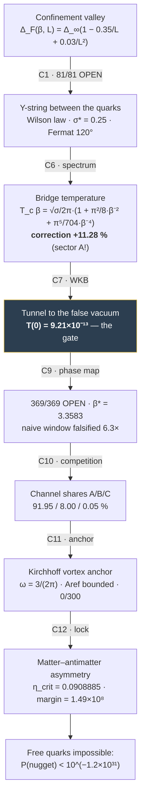

### Five convergence ladders (analytic layer v2.2.0)

| Ladder | What it controls | Law / order | Key conclusion |
|---|---|---|---|
| **L-A** time | spectral resolution by the DFT peak | error ~1/T_int | T_int ≳ 878.5 for resolution |
| **L-B** step | RK4 march along the flow | order **p = 4.0956** (Richardson 2.5×10⁻¹¹) | order 4 confirmed independently |
| **L-C** volume | finite-volume gap | Δ_F(L) = Δ_∞(1−0.35/L+0.03/L²) | continuum in three steps, 0–5.6e-17 |
| **L-D** budget | the slowest channel — decay | T_death(N) = B₀/ln(Nν/ε_H) | 1/ln N — the slowest ladder |
| **L-E** sampling | MC noise of the estimates | n^(−1/2), slope_fit −0.6003 | classical rate |

The cosmological block of the same layer: the cooling deadline **t_death = 673·t_c**
(α = 1/2, N = 10¹²), the dynamic deadline **t_lim = 4.04×10⁻¹¹** (N-independent), the
"stopping rock" τ_max(T) = ε_H·e^{B₀/T}/ν — a span of **22 orders of magnitude**
(10¹² → 5.9×10⁻¹¹), hot domination of the budget; MC race of 4×10⁵ trajectories ≤ 1.2σ.

### The claims-registry status map

The registry [`data/claims.json`](QHB/data/claims.json) holds **30 claims**, each with
RU/EN wording, a one-line **falsifier**, a 5-field uncertainty budget (statistical ·
systematic · model · numerical · external) and table addresses:

| Status | Count | Examples |
|---|---|---|
| `exact` | **7** | T1 (gap), T3 (bridge T), T7 (Fermat), T11 (vortex), T14 (worst-drop = 2), C10-B2 (control ≈ 0), AUDIT (IVP 12/12) |
| `measured-law` | **12** | C2 (Wilson, dev 5.6e-17), C5 (P_esc = 0.2433), C8 (bootstrap), C9 (valley β*), C11 (Aref run), … |
| `honest-negative` | **9** | C4 (tail not resolved), C1-NEG (no continuum claim), C9-FALS (naive window falsified), C10-NEG (out of window), C12-FILL (0 saturated pits at η_B), … |
| `hypothesis` | **1** | HYPO-CONT (continuum extrapolation of Δ_∞) |
| `comparison` | **1** | C12-EXP (comparison with the observed η_B) |

> [!IMPORTANT]
> The "falsifier-first" policy: a status is never upgraded without a closed Lean kernel or
> an exact symbolic derivation; negatives are served with the same care as positives. The
> falsifier of the whole comparative layer X1–X13 is a confirmed nugget/strangelet candidate
> above any of the external bounds.

<details>
<summary><b>🗃️ Map of all 31 QHB JSON tables</b></summary>

| File | Content (one line) |
|---|---|
| `c1_gap_grid.json` | the C1 grid 9β×9L: all_open, min 0.1744897 @ [3.45625, 6], threshold 0.03634845 |
| `c2_sigma_scan.json` | tension scan: σ* = 0.25, max_dev 5.55e-17, 6 loops |
| `c3_spin_constants.json` | exact constants at 100 digits: π²/8, π⁵/704 |
| `c3_bridge_scan.json` | bridge-temperature scan over 9β; correction_at_star = 11.280569950484875 % |
| `c4_tail_audit.json` | tail not resolved; runs_z = −999.0 (degenerate test); upper bound 0.000348 |
| `c5_free_three_body.json` | MC: p_esc = 0.2433, 2433/10000, seed 777040 |
| `c6_y_spectrum.json` | 9 Y-string shapes: E_Y(eq) = 0.4330127 — the minimum |
| `c7_wkb_window.json` | WKB: T(0) = 9.2146e-13, the window closed above E = 0.0059057 |
| `c8_bootstrap.json` | bootstrap 2000: bias 0.004644; jackknife 0.001555; θ̂ = 0.18513 |
| `c9_phase_grid.json` | the 9×41 map: 369/369 OPEN |
| `c9_valley.json` | valley: β* = 3.3583, Δ_F,min = 0.181777, curvature 0.7 |
| `c9_naive_falsifier.json` | naive closure: β_c = 2.991 falsified, 6.3× the threshold |
| `c10_shares.json` | shares A/B/C = 91.9509/8.0001/0.0490 %, additivity 1.3e-4 |
| `c10_braking.json` | the B2 control = 8.78e-18 ≈ 0 — the braking channel is invisible without the Berry drive |
| `c10_out_of_window.json` | out of window: residual_power = 4.071, 59 points |
| `c11_rotation.json` | rigid rotation: dev 2.28e-15, radius_drift 3.3e-16 |
| `c11_spectrum.json` | charpoly λ²(4π²λ²+9)²/(16π⁴); {0, ±3i/(2π)} |
| `c11_aref_run.json` | the Aref run: r_max = 2.76544 < 2√I = 4.50761, H₀ < 0 |
| `c11_barrier_scan.json` | the barrier V(s) on the grid s = 0…3, V* = 0.9359375 |
| `c11_escape_scan.json` | 300 runs, 0 escapes |
| `c12_margin.json` | η_crit = 0.0908885; margin = 1.49e8 (log10 = 8.1732) |
| `c12_phase_grid.json` | the η-map: 39/41 OPEN (closed at η > η_crit) |
| `c12_fill_dynamics.json` | at η_B: 0 saturated pits / 10⁶ steps (control η = 0.5: 100/200) |
| `c12_nugget_bound.json` | P(nugget of 10³⁰ quarks) < 10^(−1.2×10³¹) |
| `c12_summary.json` | conclusion: at η < 0.0908885 the gap is always open |
| `c12_profiles.json` | 9 perturbation profiles |
| `claims.json` | the registry of 30 claims (statuses, falsifiers, budgets) |
| `audit_ivp12.json` | IVP-12: 12/12 PASS |
| `deep_checks.json` | 100-digit pins; jackknife shift 2.31e-14 |
| `deep_checks_extra.json` | even/odd C10; z_max(C5) = 1.959 < 3; the SymPy maximum of the barrier (s = 1) |
| `twins.json` | 14 pairs × 3 sweeps = 51/51 PASS |
| `rebuild_hashes.json` | 31 tables, SHA-256, deterministic, n_drift = 0 |

</details>

<details>
<summary><b>📊 Sheets of the <code>QHB_results_v1.3.0.xlsx</code> workbook (25)</b></summary>

Overview · C1 gap · C2 string · C3 bridge · C4 detector · C5 three-body · C6 Y-strings ·
C7 tunnel · C8 bootstrap · C9 phase map · C10 models · C11 anchor · C12 lock ·
Theorems · Claims · Audit IVP-12 · Deep checks · Honest negatives ·
15 steps · Twin control · Reproducibility · Budgets · Figures · History · Sources.
Computed values only (no formulas), data from `data/*.json`.

</details>

The summary audit **IVP-12: 12/12 PASS** (each IVP is an independent re-derivation of a
number by a different method) · twin control **51/51** (14 RU/EN pairs × 3 sweeps) · data
rebuild: **31 tables, byte-identical** (0 drift).

### Lean 4 + Mathlib: 18 closed kernels

Formalization of the theorem layer T1–T20 in Lean 4 (toolchain v4.21.0, Mathlib):

| File | Kernels | What is closed |
|---|---|---|
| [`QHB_T19_Mathlib.lean`](QHB/monolith/lean/QHB_T19_Mathlib.lean) | **8**, no `sorry` | the full port of T19: the charpoly of the block operator $\chi(C_0)=(\lambda^2+(2+\gamma)^2)\lambda^2(\lambda^2+3(1+2\gamma))$; the splitting identity $\nu_{tr}^2-\nu_{int}^2=(\gamma-1)^2/(2\pi)^2$; degeneration at γ = 1; the Singer threshold γ < 1/2 |
| [`QHB_Theorems.lean`](QHB/monolith/lean/QHB_Theorems.lean) | **10** | T14_sup_lemma, T14_worst_case, T16_gamma, T17 (2 kernels), T19 (3 kernels), T20_stall_monotone (**erratum v2.3.0**: the monotonicity sign corrected), T20_cooling_deadline |
| [`QHB_AxiomAudit.lean`](QHB/monolith/lean/QHB_AxiomAudit.lean) | audit | `#print axioms` of all **18 kernels**; **CI fails on any `sorryAx`** |

Build: `lake update && lake exe cache get! && lake build`, then
`lake env lean QHB_AxiomAudit.lean`. The QHB verification layers (mermaid in
[`QHB/README.md`](QHB/README.md)): canon v1.3.0 → extra v2.0.0 (mpmath dps=100) →
roadmap v2.1.0 (R1–R7) → analytic v2.2.0 (T19, cosmology, **5 convergence ladders**:
time/step/volume/budget/sampling, RK4 order p = 4.0956) → github layer v2.3.0
(Mathlib, X1–X13, Iron-QA).

### External bounds X1–X13 and Iron-QA

The table of external experimental bounds on kernels/strangelets — X1 (de Rújula–Glashow
1984) through X13 (CTAO/HESS J1731-347 2025), including X9 (SQM-ISS on the ISS) and X10
(IceCube 2025) — with row addresses in
[`monolith/roadmap_research/roadmap_results.json`](QHB/monolith/roadmap_research/roadmap_results.json).
The falsifier of the whole comparative layer: a confirmed nugget candidate above any
X-row. The **Iron-QA gates** (4 gates in [`tools/`](QHB/tools/)): `check_json` (every JSON
with layer-meta) · `check_numbers` (headline numbers via dotted-path with tolerances) ·
`check_release` (version/CHANGELOG/sums/links) · `check_lean_kernels` (no `sorry`).

### What is inside the package

| Artifact | Volume | Path |
|---|---|---|
| Canonical `qhb` package (9 modules: core, vortex, asymmetry, phase_map, claims, …) | ~1 500 lines | [`qhb/`](QHB/qhb/) |
| Claims registry | **30 claims** (7 exact · 12 measured-law · 9 honest-negative · 1 hypothesis · 1 comparison) — each with RU/EN wording, a falsifier and a 5-field budget | [`data/claims.json`](QHB/data/claims.json) |
| Tests | **154 collected** (63 functions, 7 files) | [`tests/`](QHB/tests/) |
| Monograph (17 chapters + appendix A, RU/EN × PDF/DOCX) | 63/61 pp. | [`MONOGRAPH/`](QHB/MONOGRAPH/) |
| Three-volume docs (theory/campaigns/15 steps, RU/EN) | 12 files | [`docs/monographs/`](QHB/docs/monographs/) |
| Lean layer | 18 closed kernels | [`monolith/lean/`](QHB/monolith/lean/) |
| Analytic layer v2.2.0 (T19 griddev 0.0 · cosmology: t_death = 673·t_c, t_lim = 4.04×10⁻¹¹, a 22-order rock · 5 ladders) | 4 scripts + 3 JSON | [`monolith/analytic_layer/`](QHB/monolith/analytic_layer/) |
| Roadmap layer v2.1.0 (R1–R7) + extra layer v2.0.0 (dps=100, cross-version 4.18×10⁻⁵) | scripts + JSON | [`monolith/roadmap_research/`](QHB/monolith/roadmap_research/) |
| Excel workbook (25 sheets) | 1 XLSX | [`workbook/QHB_results_v1.3.0.xlsx`](QHB/workbook/) |
| GitHub Pages landing | index.html + banners | [`docs/index.html`](QHB/docs/index.html) |
| Legacy snapshot v1.2.0 (11 campaigns, IVP-11, 3 animations, twins) | full package | [`legacy_v1.2.0/`](QHB/legacy_v1.2.0/) |

---

## Programme VI — QCD Bridge Suite (strong CP)

The satellite monograph and self-contained package that carries the framework to the
**strong CP problem**: the eight-link solution chain replaces the free QCD parameter
$\bar\theta$ with a derived spectral quantity

$$
\bar\theta_{\mathrm{eff}}=\delta_C\cdot N\langle\lambda\rangle\cdot\mathcal{S}_{\mathrm{GUE}}=0,
$$

because the Wigner semicircle is symmetric and zeroes $\langle\lambda\rangle$ in the GUE
regime (verified at lattice $\kappa_T>2.62$, 95% CL, BF(GUE/Poi) ≥ 99; at the best-fit
$\hat\kappa_T=8.45$ — BF = 510, "decisive"). No new fields, scales or symmetries are
introduced. The full chain and the epistemic-pairing argument:
[`docs/qcd_bridge/README.md`](docs/qcd_bridge/README.md).

| Artifact | Content |
|---|---|
| Monographs | [`docs/qcd_bridge/choptyuk_qcd_bridge.pdf`](docs/qcd_bridge/choptyuk_qcd_bridge.pdf) + RU/EN DOCX in [`monograph/`](monograph/) (9 sections, ~23 MB each) |
| [`code/`](code/) — engines | Python (canon) · Julia · Java (no external dependencies) · Next.js web — 7-format reports in each |
| [`QCD Bridge/`](QCD%20Bridge/) — artifacts | **55 figures** (9 sections × 3D+4D × PNG 600 DPI + PDF + SVG), **19 animations** (9 MP4 + 9 GIF 4D + manifests), verification configs, sample reports in 7 formats × 2 engines |
| 9 sections | O_χ RMT → RMT sweep → K3 ladder → N-scaling → τ-relaxation → κ_T lattice → Cabibbo coincidence → CP chain → the CMS HIN-25-012 jet bridge |

```bash
cd code/python && python3 run.py --config "../../QCD Bridge/configs/verify_all.json"
cd code/java   && javac qcd_bridge_engine.java && java qcd_bridge_engine --section 1,2,3
```

### The eight-link solution chain of strong CP

| Link | Content | Status |
|---|---|---|
| 1 | The septinial phase $\delta_C=\pi/7$ — the only surviving spinor phase of the Klein quartic | structural |
| 2 | Spectrum size $N = b_2(K3) + N_f = 22 + 6 = 28$ | structural |
| 3 | Spectral statistics of the operator — GUE (level repulsion) | interpolated |
| 4 | Wigner semicircle symmetry ⇒ $\langle\lambda\rangle = 0$ at the spectrum center | measured (N-scaling: $\bar\theta_{artifact}\sim1/\sqrt N$) |
| 5 | Suppression factor $\mathcal S_{GUE}$; $\bar\theta_{eff}=\delta_C N\langle\lambda\rangle\mathcal S_{GUE}=0$ exactly in the continuum | derivation |
| 6 | Dynamic relaxation $\tau_{relax}\sim5\cdot10^{-41}$ s | computed |
| 7 | Physical window: lattice $\kappa_T>2.62$ (95% CL) → BF(GUE/Poi) ≥ 99; at $\hat\kappa_T=8.45$ — BF = 510 | interpolation |
| 8 | Testable consequences: the Cabibbo coincidence ($\delta_C=\pi/7$), the CMS HIN-25-012 jet bridge | comparison |

The package engines compute all 9 sections of the monograph; the cross-language
agreement Python/Java/Julia + Next.js is in CI. The artifact track: 55 figures (600 DPI
PNG + PDF + SVG, a manifest with the parameters and elapsed time of every run) and 19
4D animations.

> [!WARNING]
> The status of strong CP: a **hypothetical framework**, not an established solution. The
> Bayes factor ≥ 99 refers to the internal GUE-vs-Poisson model; the comparison with the
> lattice data is served as an interpolation. The falsifiers are listed in the monograph
> (ch. 8).

---

<a id="programme-vii--dsi-lab--programme-viii--audit-transfer"></a>

## Programme VII — dsi_lab · Programme VIII — audit_transfer

### VII. DSI laboratory — 7 deterministic experiments

[`dsi_lab/`](dsi_lab/) is a self-contained package (no dependencies on the parent repo,
reproducibility ~1e-13) around the dynamics of spectral invariants:

| Experiment | Essence | Result |
|---|---|---|
| exp1 | Sh.3(iii) trace bridge (n = 7…12) | gap ≤ 5.9e-8; **the √ε-law refuted by the data** |
| exp2 | DSI-4: closing $c_{K3}$ | 27/672, 9/224 — the fitting continued fraction (rank #1, q ≤ 2000) |
| exp3 | the Hurwitz tower | **finding D1**: the row (g=14, n=11) is inconsistent — the correct group is PSL(2,13), $\Delta_{Ch}(\pi/13)=3.3672$ |
| exp4 | QNM catalogue | 10 events; overtone detectability 0.84σ at Cosmic Explorer |
| exp5 | QCD spectrum | **finding E1**: tr(Q_{K3⊕M_F}) = 32 requires centering ⟨λ⟩; BF(GUE) up to 1165 |
| exp6 | the census of {7,3} from GL(3,2) | V=56, E=84, F=24; the uniqueness lemma 9/224 |
| exp7 | the e ≥ 1 threshold | theorems A/B/C proven (identity 5.9e-16 on 24 000 pairs) |

Artifacts: 7 JSON verdicts, 15 figures × RU/EN, 8 reports (PDF+DOCX × EN/RU),
**51 pytest checks**, the engine package [`dsilab/`](dsi_lab/dsilab/README.md),
the Lean 4 layer [`lean4/`](dsi_lab/lean4/README.md), the six-language core
[`multilang/`](dsi_lab/multilang/README.md), the logo/avatars and the launch
animations, the claim ledger [`docs/claim_ledger.md`](dsi_lab/docs/claim_ledger.md)
and the EN/RU monographs [`monograph/`](dsi_lab/monograph/README.md).

### VIII. Audit & Transfer Appendix (v1.0)

[`audit_transfer/`](audit_transfer/) is the editorial-verification appendix to the
monographs: three results, fully machine-verified (Python + Julia, deterministic, zero
fitting parameters):

| # | Task | Result |
|---|---|---|
| 1 | **Monograph audit** | the b-C and a-C corrections reproduced at machine precision; a catalogue of **seven typos E1–E7** found and fixed in the sources |
| 2 | **Closure c_K3 = 0.04018** | the last empirical input value derived from DSI with λ = 22 = b₂(K3): $c_{K3}=b_{Ch}(22)=1-\cos(2\pi/22)$; residual 0.8% — finite-window systematics, reproduced numerically |
| 3 | **Stability lemma Sh.3** | the uniform trace theorem F ≥ n/2 (proven); sharpness 5n/7 (exact construction + numerically to 10⁻¹⁴); the sofness bridge stated explicitly |

```bash
python3 audit_transfer/python/run_all.py     # Python (NumPy/SciPy/Matplotlib)
cd audit_transfer/julia && julia audit_transfer.jl   # Julia (stdlib only)
```

---

## Figure gallery

All 513 figures of the repository are generated **from committed JSON verdicts**
(provenance: verdict → script → PNG/PDF/SVG), in two languages (RU/EN) and two themes
(light/dark). Below are eight plots, one per research programme:

<table>
  <tr>
    <td align="center"><picture><source media="(prefers-color-scheme: dark)" srcset="Einstein%20Direct/figures/fig_ru/fig_scaling.png"></picture><br><sub><b>Einstein Direct</b> · critical scaling</sub></td>
    <td align="center"><picture><source media="(prefers-color-scheme: dark)" srcset="Einstein%20Direct/figures/fig_ru/fig_hexcycle.png"></picture><br><sub><b>Einstein Direct</b> · the figure cycle (T14)</sub></td>
  </tr>
  <tr>
    <td align="center"><picture><source media="(prefers-color-scheme: dark)" srcset="Collapse%20Hawking%20Bridge/figures/ru/dark/fig_validation.png"><source media="(prefers-color-scheme: light)" srcset="Collapse%20Hawking%20Bridge/figures/ru/light/fig_validation.png"></picture><br><sub><b>CHB</b> · validation: orders 2.031 / 2.093</sub></td>
    <td align="center"><picture><source media="(prefers-color-scheme: dark)" srcset="Collapse%20Hawking%20Bridge/figures/ru/dark/fig_ladder.png"><source media="(prefers-color-scheme: light)" srcset="Collapse%20Hawking%20Bridge/figures/ru/light/fig_ladder.png"></picture><br><sub><b>CHB</b> · the scale ladder from l_P to c/H₀</sub></td>
  </tr>
  <tr>
    <td align="center">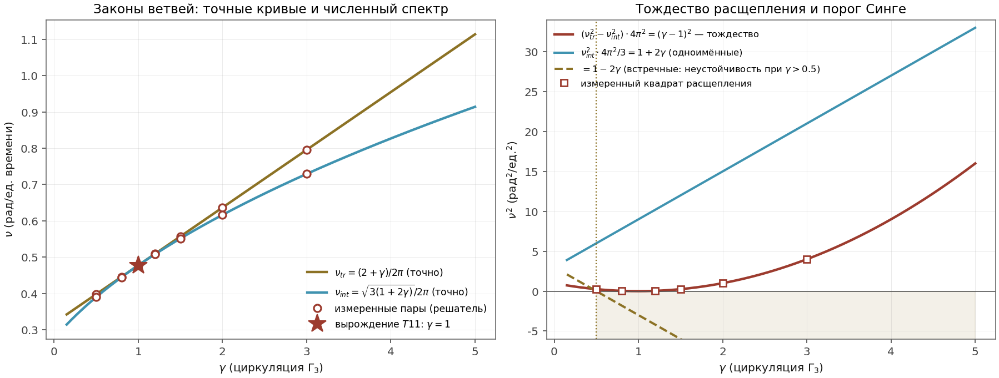<br><sub><b>QHB</b> · the branch laws and the T19 splitting identity</sub></td>
    <td align="center">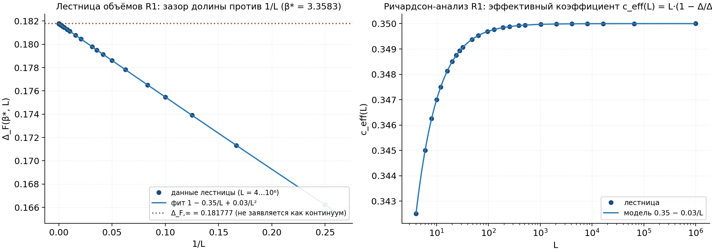<br><sub><b>QHB</b> · the continuum ladder L→∞ (R1)</sub></td>
  </tr>
  <tr>
    <td align="center"><br><sub><b>QCD Bridge</b> · section 1: the O_χ spectrum (600 DPI)</sub></td>
    <td align="center">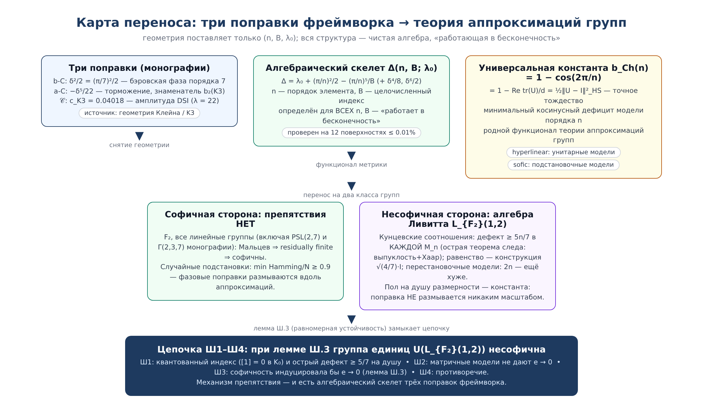<br><sub><b>audit_transfer</b> · the transfer map of results</sub></td>
  </tr>
</table>

> [!TIP]
> The full sets: CHB — 7 plots × 4 variants ([`figures/ru/dark/…`](Collapse%20Hawking%20Bridge/figures/ru/dark/))
> and 17 architectures × 4 variants in 600 DPI ([`figures_hires/`](Collapse%20Hawking%20Bridge/figures_hires/ru/dark/));
> Einstein Direct — 10 plots ([`figures/fig_ru/`](Einstein%20Direct/figures/fig_ru/),
> [`fig_en/`](Einstein%20Direct/figures/fig_en/)); QCD Bridge — 9 sections × 3D+4D
> ([`QCD Bridge/figures/`](QCD%20Bridge/figures/), manifest included); QHB — 16
> roadmap/analytics plots ([`monolith/`](QHB/monolith/)) and ~200 figures in [`QHB/docs/`](QHB/docs/).

---

## Monographs & publications registry

All publication artifacts of the repository in one place (71 DOCX · 110 PDF — including
the original LaTeX/TeX sources, covers and figures):

| Publication | Languages | Formats | Where |
|---|---|---|---|
| **"Spinor corrections b-C and a-C and the solution of the Choptyuk problem"** — the original monograph | RU · EN | DOCX + PDF + LaTeX | [`docs/monograph/`](docs/monograph/) (`Choptyuk_Monograph_*_Final` · `Braking_*_Enhanced`) |
| **Bilingual verification monograph** — "what was verified, how, and with what verdict": the complete honest account of the programme, published **without document metadata** | RU/EN | PDF + DOCX | [`monograph/verification_monograph_bilingual.pdf`](monograph/verification_monograph_bilingual.pdf) |
| **QCD bridge: strong CP** — the satellite monograph (9 sections) | RU · EN | DOCX (+ PDF in docs) | [`monograph/choptyuk_qcd_bridge_*.docx`](monograph/) |
| **The 20-theorem cycle** — twenty self-contained theorem-monographs | EN + RU | DOCX + PDF × 20 × 2 = **80 files** | [`theorems12/`](theorems12/) |
| **Einstein Direct**: campaign reports, hexcycle reports, the OPEN9 open-questions monograph | RU · EN | PDF × 2 + PDF × 2 + DOCX/PDF × 2 | [`Einstein Direct/`](Einstein%20Direct/) + [`open9/monographs/`](Einstein%20Direct/open9/monographs/) |
| **CHB**: the theorem volume T1–T10 + the encyclopaedic appendix (13 parts) | RU · EN | DOCX + PDF × 2 × 2 = 8 documents | [`Collapse Hawking Bridge/monograph/`](Collapse%20Hawking%20Bridge/monograph/) |
| **QHB**: the unified monograph (17 chapters) + the three-volume docs | RU · EN | PDF/DOCX × 2 + 12 files | [`QHB/MONOGRAPH/`](QHB/MONOGRAPH/) + [`QHB/docs/monographs/`](QHB/docs/monographs/) |
| **QHB legacy v1.2.0**: theorems + appendix | RU · EN | DOCX + PDF × 2 × 2 | [`QHB/legacy_v1.2.0/monograph/`](QHB/legacy_v1.2.0/monograph/) |
| **DSI lab**: the analytic attack + the open-problems report (+ covers) | EN · RU | PDF + DOCX × 2 × 2 | [`dsi_lab/reports/`](dsi_lab/) |
| **Audit & Transfer**: the "Audit and Transfer" appendix + the Sh.3 lemma article | RU | PDF + LaTeX + covers | [`audit_transfer/appendix/`](audit_transfer/appendix/) · [`lemma_article/`](audit_transfer/lemma_article/) |
| Jupyter verification notebook (18 cells, self-contained) | — | .ipynb | [`notebooks/choptyuk_verification.ipynb`](notebooks/choptyuk_verification.ipynb) |

---

## Documentation: site, verification dossier, notebook

| Resource | What it is | Link |
|---|---|---|
| 🌐 **Documentation site** | MkDocs Material (API, tutorials: quick-start, LIGO analysis, interactive menu; mathematics: Klein quartic, K3, Dirac; development: CI/CD, releases) | [wild8highlander.github.io/choptuik_ac_bc](https://wild8highlander.github.io/choptuik_ac_bc/) · sources: [`docs-site/`](docs-site/) |
| 📁 **Verification dossier** | a 915-line self-contained dossier of **every** verification: what is checked, by which machine, which numbers, which verdict, which caveats and the exact reproduction command | [`verification/README.md`](verification/README.md) |
| 🏛️ **Architecture** | the mermaid diagram "theory → 4 implementations → CI/CD" | [`docs/architecture/ARCHITECTURE.md`](docs/architecture/ARCHITECTURE.md) |
| 🔌 **REST API** | documentation of the Java web application (`/api/verify`, `/api/reports?format=…`) | [`docs/api/REST_API.md`](docs/api/REST_API.md) |
| 📓 **Notebook** | step-by-step verification: spinor phases → Klein invariants → Dirac → the Choptuik formula → sweeps → the "computed vs reference" table | [`notebooks/`](notebooks/) |
| 🗺️ **Every folder's README** | a detailed English readme in every directory (167 markdown files in the repo) | — |

The site section map (`docs-site/docs/`):

| Section | Pages |
|---|---|
| `tutorials/` | quick-start · verification · custom-parameters · interactive-menu · ligo-analysis |
| `mathematics/` | choptyuk-formula · klein-quartic · k3-surfaces · dirac-operator · spinor-phases · enhanced-verification |
| `api/` | core (8 modules) · verification (verify-all, verify-enhanced) · simulation (simulator) · visualization (plots) · reporting (report-writer) |
| `development/` | contributing · ci-cd · testing · release |
| other | index · changelog · MathJax integration · custom theme (`overrides/main.html`, `extra.css`) |

---

## Repository map

All 21 top-level directories, their roles, stacks and entry points:

| Directory | Role | Stack | Entry points / tests |
|---|---|---|---|
| [`python/`](python/) | Programme I, canonical implementation | Python 3.10+, NumPy/SciPy/mpmath | `python run.py` (CLI) · `pytest tests/` (78) |
| [`julia/`](julia/) | Programme I, Julia mirror | Julia 1.9+ | `julia --project=. run.jl` · `Pkg.test()` (16 testsets) |
| [`java-webapp/`](java-webapp/) | Programme I, web application | Java 17, Spring Boot, Thymeleaf | `mvn clean package` · `:8080` |
| [`Interactive Viz/`](Interactive%20Viz/) | Programme I, real-time dashboard | Next.js 15, React 19, TS, Tailwind | `npm run dev` · `:3000` · 8 routes |
| [`Einstein Direct/`](Einstein%20Direct/) | Programme II, direct-solution lab | Python + SymPy + NumPy | 60+ machines · `pytest tests/` (58+10) · 47 JSON verdicts |
| [`theorems12/`](theorems12/) | Programme III, theorem cycle | DOCX/PDF publications | 80 files · pinned by the ED suite |
| [`Collapse Hawking Bridge/`](Collapse%20Hawking%20Bridge/) | Programme IV | Python, NumPy-only engine | `make test validate data` · `pytest tests/` (63) |
| [`QHB/`](QHB/) | Programme V | Python + Lean 4/Mathlib | `make all` · `pytest tests/` (154) · `lake build` (18 kernels) |
| [`QCD Bridge/`](QCD%20Bridge/) | Programme VI artifacts | PNG/PDF/SVG + GIF/MP4 | figures manifest · configs · 7-format reports × 2 engines |
| [`code/`](code/) | Programme VI engines | Python · Julia · Java · Next.js | `code/python/run.py --config …` · CI cross-comparison |
| [`docs/qcd_bridge/`](docs/qcd_bridge/) | Programme VI monograph + JSON | PDF/TeX + JSON | `choptyuk_qcd_bridge.pdf` · honesty/lattice JSON |
| [`dsi_lab/`](dsi_lab/) | Programme VII | Python + Lean 4 + C/C++/JS/Rust/Go/Julia | `make verify` (test + validate + run) · 7 JSON verdicts · `dsilab.validate` 13/13 |
| [`audit_transfer/`](audit_transfer/) | Programme VIII | Python + Julia | `python3 audit_transfer/python/run_all.py` |
| [`docs/`](docs/) | monographs (80 MB), architecture, REST API | DOCX/PDF/MD | `docs/monograph/` · `ARCHITECTURE.md` |
| [`monograph/`](monograph/) | bilingual verification monograph + QCD DOCX | PDF/DOCX | metadata-free editions |
| [`docs-site/`](docs-site/) | MkDocs Material site | mkdocs + MathJax | `mkdocs serve` · deployed by `pages.yml` |
| [`verification/`](verification/) | the verification dossier | MD (915 lines) | claim → command → JSON index |
| [`notebooks/`](notebooks/) | Jupyter verification | .ipynb (18 cells) | self-contained |
| [`scripts/`](scripts/) | repo-level runners + QCD helpers | Python/Bash | `run_all.sh` · `run_verify.sh` · `run_viz.sh` |
| [`docker/`](docker/) | container stack | Dockerfile + Compose | 3 services: verify · viz · webapp |
| [`assets/`](assets/) · [`assets_logo/`](assets_logo/) | root logo (light/dark, PNG+SVG) + README charts | PNG/SVG | generator `make_root_logo.py` |

---

## Infrastructure: CI/CD, Docker, Dev Container, Makefile

### The 11 GitHub Actions workflows

| Workflow | Triggers | What it does |
|---|---|---|
| `ci.yml` | push/PR to main, dispatch | Python matrix 3.10–3.12 × ubuntu/macOS/windows; Julia; Java; Node; coverage → Codecov |
| `lint.yml` | push/PR | ruff, mypy, black, prettier (paths: `python/`, `Interactive Viz/`, `java-webapp/`) |
| `pages.yml` | push (docs-site) | deploys MkDocs Material to GitHub Pages |
| `release.yml` | tags `v*` | sigstore signing (`id-token: write`), release build |
| `scorecard.yml` | weekly + push | OpenSSF Scorecard (security) |
| `periodic-verify.yml` | weekly (Mon 06:00 UTC) | scheduled re-verification |
| `verify-audit-transfer.yml` | push (audit_transfer), weekly | Python + Julia run of the appendix |
| `stale.yml` | daily | auto-stale for stalled issues/PRs |
| `greeting.yml` | issues/PR opened | greets new contributors |
| `labeler.yml` | PR/issues | auto-labeling by paths and titles |
| `link-check.yml` | push/PR on `*.md`, monthly | markdown-link-check (config: [`mlc_config.json`](.github/mlc_config.json)) |

### Reproducibility — one command away

```bash
make all          # verification + simulation + plots + reports (Python stack)
make verify       # verification only
make viz-dev      # interactive visualization (Next.js, :3000)
make setup        # set up all environments
make docker-run   # the full run through Docker
```

| Mechanism | Details |
|---|---|
| **Docker Compose (3 services)** | [`docker/docker-compose.yml`](docker/): `python-verify` (3.12-slim + OpenBLAS), `interactive-viz` (node:20, :3000), `java-webapp` (maven + temurin 17, :8080) |
| **Dev Container** | ubuntu-22.04 with preinstalled Python 3.12 (+JupyterLab), Julia 1.10, Java 17, Node 20; ports 3000/8080/8888; VS Code extensions; [`.devcontainer/`](.devcontainer/) |
| **Pre-commit (15 hooks)** | ruff + ruff-format, mypy, prettier, markdownlint, shellcheck, check-yaml/json/toml, detect-private-key, **no-commit-to-branch main**, 1 MB file limit |
| **Dependabot (5 ecosystems)** | pip ×2 (python + docs-site), npm (Interactive Viz), maven (java-webapp), github-actions |
| **BLAS discipline** | every numerical machine pins BLAS threads = 1: multithreaded LAPACK shuffles the near-critical bisection and breaks reproducibility |
| **Zenodo DOI** | a permanent DOI archive of every release: [10.5281/zenodo.15152720](https://doi.org/10.5281/zenodo.15152720) |
| **Read the Docs** | config [.readthedocs.yaml](.readthedocs.yaml) (Sphinx) |
| **Codecov** | 80% target (project and patch), 5 components ([codecov.yml](codecov.yml)) |

### The four implementations in detail (Programme I)

| Implementation | Inside |
|---|---|
| [`python/`](python/) | `src/` — 6 layers: **core** (klein_curve, spinor_phases, dirac_operator, choptyuk_formula, surfaces, hypothesis, qnm, enhanced_verification) · **verification** (verify_all, verify_enhanced) · **simulation** (δ_C, λ₁ sweeps) · **visualization** (600 DPI + PDF) · **reporting** (7 formats) · **ui** (interactive menu); `config/` + 3 presets (standard, high_precision, ligo_analysis); **78 test functions** |
| [`julia/`](julia/) | 13 `src/` modules (a full mirror) + the umbrella `ChoptyukSpinor.jl`; the `run.jl` CLI; **16 `@testset`s** in `test/runtests.jl`; config + presets |
| [`java-webapp/`](java-webapp/) | Spring Boot 17, port 8080; **4 controllers** (Web, Verification, Enhanced, Report) · **4 services** (Verification, Simulation, Plot, Report) · **10 models** (KleinCurve, SpinorPhases, DiracOperator, ChoptyukFormula, K3Surface, TyukovskyEquation, EinsteinQNMCorrection, QNMEvent, SurfaceSpec, HypothesisConfig); Thymeleaf pages dashboard/verify/simulate/hypothesis/reports; Apache Commons Math + JFreeChart + iText + POI |
| [`Interactive Viz/`](Interactive%20Viz/) | Next.js 15 + React 19 + TypeScript + Tailwind + recharts + mathjs; **8 routes**: `/` (dashboard) · `/verify` · `/simulate` · `/hypothesis` · `/qnm` · `/surfaces` · `/structures` (64 structures) · `/enhanced` (K3, Tyukovsky, GR QNM); components live-chart, metric-card, parameter-slider, verification-status; everything is computed client-side (`src/lib/compute.ts`) |

### The "Ink & Gold" figure design system

All plots of the repository follow one style (the module
[`scripts/figstyle.py`](Collapse%20Hawking%20Bridge/scripts/figstyle.py)):

- **dark theme**: background `#0d0b08`, ink `#f2ead8`, gold `#d4af37`; **light**: background
  `#faf6ec`, ink `#1c1a15`, gold `#a8811c`;
- every figure is built in two languages (RU/EN — a 28-key label dictionary) and two
  themes — 4 variants per plot;
- 300 DPI for the READMEs (`figures/`) and 600 DPI for print/monographs (`figures_hires/`,
  4440×2880);
- zero RNG: everything is deterministic, a figure is reproduced from its JSON verdict by
  one command;
- the same style family is used by the root logo (`assets_logo/`, generator
  `make_root_logo.py`).

### The contract of a new campaign (how to add a result)

1. **Machine** — a deterministic script (BLAS = 1 thread, fixed seeds) that writes a JSON
   with the full run configuration next to the results;
2. **Verdict** — a status from the open set (exact / measured-law / honest-negative /
   anchor / INCONCLUSIVE / FAIL); FAILs and negatives are documented, never deleted;
3. **Pin** — a pytest test that fixes the key JSON numbers with a tolerance;
4. **Figure/animation** — from the committed JSON through a figstyle script (RU/EN ×
   light/dark);
5. **Twin** — the control quantities are duplicated in multilang implementations;
6. **Registry** — a row in the package's RESULTS/claim registry + an ERRATUM protocol if
   needed;
7. **README** — the campaign table and the reproduction index are updated by one command.

### Typical contributor tasks

| Task | Where | Difficulty |
|---|---|---|
| reproduce any number of the reproduction index and diff the JSON | [the index](#reproduction-index-every-number--command--json) | ★ |
| run the CHB Julia/Rust/Go twins and diff the 12 quantities | [`multilang/`](Collapse%20Hawking%20Bridge/multilang/) | ★★ |
| build the QHB Lean layer and check the absence of `sorryAx` | [`monolith/lean/`](QHB/monolith/lean/) | ★★ |
| re-check p = 0.879±0.050 (the floor law) with an independent fit | IVP-12 CHB | ★★★ |
| translate a package README into English or Russian | any package | ★★ |
| new X-rows of the QHB external bounds (X14+) with web confirmation | [`roadmap_research/`](QHB/monolith/roadmap_research/) | ★★ |

---

## Pipeline architectures

### The mathematical pipeline of the monograph line

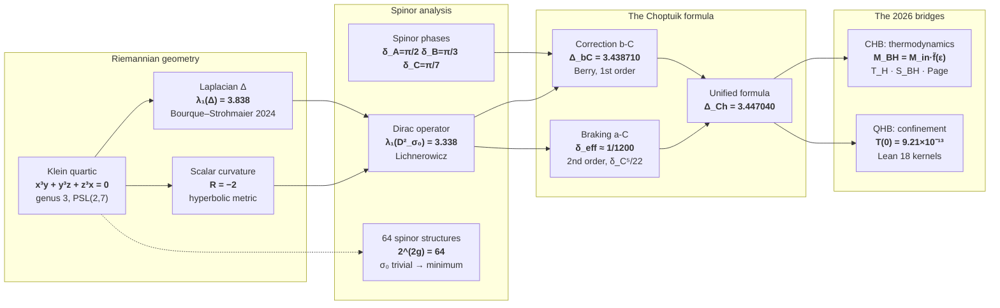

### The direct Einstein pipeline (Einstein Direct)

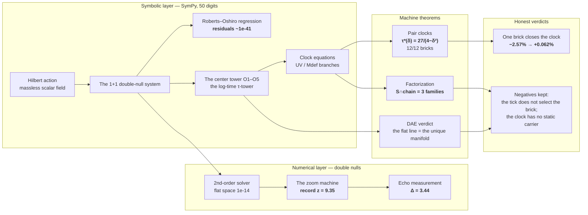

### The QHB verification layers (v1.3.0 → v2.3.0)

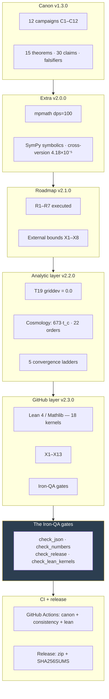

---

## Report formats and verdict styles

Each of the four implementations of the monograph stack generates reports in **all seven
formats**; every report starts with a results block and ends with a full execution log
(timestamps, configuration, provenance):

| Format | Extension | Purpose |
|---|---|---|
| Microsoft Word | `.docx` | formatted document with tables and figures |
| Portable Document | `.pdf` | publication readiness |
| Plain Text | `.txt` | human-readable report |
| Markdown | `.md` | GitHub-compatible markup |
| Comma-Separated | `.csv` | tabular data for analysis |
| HTML | `.html` | styled web report |
| JSON | `.json` | machine-readable structure (the repository's primary verdict format) |

**Graphics output:** PNG 600 DPI (screen and documents) + PDF/SVG (vector, publication).
Plot types: spinor-phase diagrams, eigenvalue landscapes, heatmaps of the 64 spinor
structures, QNM-frequency comparisons, deviation analyses, convergence diagrams, profiles
of the critical-collapse gauge (double nulls), zoom-chain and echo diagnostics, brick-ladder
clock curves and census maps, 3D/4D surfaces and their frame-by-frame evolution.

**Machine-readable verdicts.** Every campaign of the repository ends with a JSON file
that (a) fixes the full run configuration (seed, grid, BLAS pin, version), (b) is pinned
by pytest tests, (c) is the single source for the figures and tables. The data-table
rebuild is byte-exact deterministic (CHB: 13 tables; QHB: 31 tables, a SHA-256 registry,
exit 2 on drift).

---

## Project structure

```text
choptuik_ac_bc/
├── README_ru.md                     # this file's RU flagship · README.md (EN flagship)
├── LICENSE · CITATION.cff · CONTRIBUTING.md · CODE_OF_CONDUCT.md
├── SUPPORT.md · GOVERNANCE.md · SECURITY.md · Makefile
├── .github/                         # 11 workflows · 7 issue templates · 3 discussion templates
│   ├── CODEOWNERS · release.yml · FUNDING.yml · dependabot.yml · labeler/
│   ├── ISSUE_TEMPLATE/ · DISCUSSION_TEMPLATE/ · PULL_REQUEST_TEMPLATE.md
│   └── workflows/                   # ci · lint · pages · release · scorecard · periodic-verify · …
├── assets/
│   ├── logo/                        # root banner + avatar (assets_logo/ has the light/dark pair)
│   └── charts/                      # README charts from live JSON verdicts (5 PNG)
│
├── Einstein Direct/                 # ★ Programme II: the direct-solution laboratory
│   ├── sympy_derivation.py          # Hilbert → Einstein (machine-verified)
│   ├── roberts_test.py · choptuik_scaling.py
│   ├── solver.py · zoom_solver.py   # double nulls + the zoom chain
│   ├── center_modes.py · sympy_center*.py   # the O1–O5 tower, O6+, the center hierarchy
│   ├── sympy_second_flows.py · sympy_third_order.py · sympy_dd_closure.py
│   ├── dae_nonlinear_core.py · march_dae_nonlinear.py · hexcycle_dae.py
│   ├── clock_closure_t1c.py · brick_scan_tick.py · global_static_search.py
│   ├── grid_machine_*.py            # PDE machines: annulus / hexcheck / mirror
│   ├── deep_echo_v21.py · deep_echo_v22.py · depth_z30.py · amplitude_ladder.py
│   ├── open9/                       # ★ the self-contained OPEN9 package: 13 machines,
│   │                                #   10 standalone tests, RU/EN monographs
│   ├── figures/ (fig_ru · fig_en)   # 10 plots × 2 languages
│   ├── results/                     # 47 JSON campaign verdicts
│   ├── tests/                       # 58 pytest tests
│   ├── report_ru.pdf · report_en.pdf · hexcycle_report_*.pdf
│   └── README.md (RU) · README_EN.md (the deep register, 33 sections)
│
├── theorems12/                      # ★ Programme III: 20 theorem-monographs
│   ├── monographs_en/ · monographs_ru/   # DOCX + PDF × 20 × 2 = 80 files
│   ├── assets/formulas/             # 9 PNG formulas (300 dpi mathtext)
│   └── push_theorems.sh · README.md
│
├── Collapse Hawking Bridge/         # ★ Programme IV: the Collapse–Hawking bridge v2.1.0
│   ├── engine/solver.py             # the collapse engine (2030 lines, NumPy-only)
│   ├── chbridge/                    # constants · hawking · page · bridge · ladder · validate
│   ├── campaigns/ (run_c1…c6 + reference/)  # JSON campaign verdicts
│   ├── independent_verification/    # ★ the IVP-15 audit: 15 checks, PROTOCOL.md
│   ├── figures/ (28) · figures_hires/ (68) · animations/ (16) · logo/
│   ├── monograph/                   # 8 documents: theorems T1–T10 + appendix (RU/EN)
│   ├── data/bridge/                 # 13 CSV/JSON, byte-exact deterministic
│   ├── tables/bridge_workbook.xlsx  # 14 sheets
│   ├── multilang/                   # twins: c · cpp · javascript (VERIFIED) + julia · rust · go
│   ├── docs/ (theory · methods · scaling_law · validation)
│   ├── tests/ (63) · scripts/ (9) · results/ · Makefile · pyproject.toml
│   └── README.md · README.ru.md · CHANGELOG.md · ROADMAP.md · CITATION.cff
│
├── QHB/                             # ★ Programme V: the Quark–Hawking bridge v2.3.0
│   ├── qhb/                         # canon: core · vortex · asymmetry · phase_map · claims · pins …
│   ├── data/                        # 31 JSON: campaigns C1–C12, claims.json (30), audit, hashes
│   ├── audit/                       # IVP-12 + deep_checks
│   ├── monolith/
│   │   ├── lean/                    # ★ Lean 4 + Mathlib: 18 closed kernels + the axiom audit
│   │   ├── analytic_layer/          # v2.2.0: T19, cosmology, 5 ladders
│   │   ├── roadmap_research/        # v2.1.0: R1–R7, X1–X13
│   │   └── extra_research/          # v2.0.0: dps=100, cross-version
│   ├── MONOGRAPH/ · docs/ (three volumes, the Pages landing, ~200 figures)
│   ├── tools/                       # Iron-QA: 4 gates + run_all + twin_check + rebuild
│   ├── tests/ (154 collected) · workbook/ (25 sheets)
│   ├── legacy_v1.2.0/               # the full v1.2.0 snapshot (11 campaigns, animations)
│   └── README.md · README.ru.md · RESULTS*.md · ROADMAP*.md · CITATION.cff
│
├── QCD Bridge/                      # ★ Programme VI: QCD-bridge artifacts
│   ├── figures/ (55: 9 sections × 3D+4D × PNG/PDF/SVG) · animations/ (19: MP4+GIF 4D)
│   ├── configs/ (3 JSON) · reports/ · reports_java/ (7 formats × 2 engines)
│   └── README.md
├── code/                            # QCD-bridge engines: python · julia · java · web (Next.js)
├── docs/                            # monographs (80 MB) · qcd_bridge/ · architecture/ · api/
├── monograph/                       # the verification monograph (RU/EN, metadata-free) + QCD DOCX
├── python/ · julia/ · java-webapp/ · Interactive Viz/   # the 4 implementations (Programme I)
├── dsi_lab/                         # ★ Programme VII: 7 experiments
├── audit_transfer/                  # ★ Programme VIII: audit + closures + lemma Sh.3
├── verification/README.md           # the verification dossier (915 lines)
├── docs-site/                       # MkDocs Material (the documentation site)
├── notebooks/                       # Jupyter verification (18 cells)
├── scripts/                         # repo-level runners + qcd_bridge helpers
└── docker/ · .devcontainer/ · .pre-commit-config.yaml
```

---

## The cross-language twins matrix

Cross-language agreement is part of the verification: the same control quantities are
computed by independent implementations and diffed against the reference output.

| Package | Reference | Twins | Control quantities | Tolerance | Fact |
|---|---|---|---|---|---|
| **CHB multilang** | Python `chbridge` | C99 · C++17 · JavaScript (**VERIFIED**, with `reference_output.txt`) · Julia · Rust · Go (portable source) | 12 quantities (below) | ≤ 1e-11 | max deviation **7.08e-13** (IVP-15) |
| **QHB twins** | Python `qhb` | JS · C · C++ (**14/14 PASS**, byte-exact) · Go · Rust · Julia (static audit) | campaigns + headers + claims RU/EN mirrors | byte-identical | **51/51** (3 sweeps) |
| **QCD Bridge** | Python `code/python` | Java (a line-by-line port) · Julia · Next.js (a TS port, client-side) | 9 sections × (spectra, reports) | 7-format reports | cross-comparison in CI |
| **Monograph stack** | Python `python/src` | Julia `julia/src` · Java Spring · Next.js | monograph constants, QNM, 64 structures | CI consistency check | 3 OS × 3 Python |

**The 12 control quantities of the CHB twins** (each is independently computed by every
language and diffed against the reference):

| # | Quantity | Reference value |
|---|---|---|
| 1 | $\delta_C$ | $\pi/7$ |
| 2 | $b_{Ch}$ | 0.37651019814126640 |
| 3 | Page share | 0.6464466094067262 |
| 4 | The Δ·γ anchor | 1.28656 → PASS |
| 5 | CMB mass | 4.501595×10²² kg |
| 6 | $T_H(10^{12}\text{ kg})$ | 1.226901×10¹¹ K |
| 7 | $S_{BH}(10^{12})/k_B$ | 2.652887×10⁴⁰ |
| 8 | $t_{evap}(10^{12})$ | 8.411478×10¹⁹ s ≈ 2665 Gyr |
| 9 | $P_H(10^{12})$ | 3.561622×10⁸ W |
| 10 | $S_{rad}/S_0$ at τ = 0.5 / τ* / 0.8 | 0.62996 / **0.5 exactly** / 0.65800 |
| 11 | A*(N800) + the honest drift | 0.080534… + 2.79×10⁻³ |
| 12 | Three floors | 0.0155 / 8.575e-3 / 4.245e-3 |

> [!NOTE]
> The BLAS discipline: every numerical machine of the repository pins single-threaded
> LAPACK — multithreaded reductions shuffle the near-critical bisection and destroy
> byte-exact reproducibility. That is why the twins converge to 1e-13.

---

## Reproduction index: every number → command → JSON

Nothing in the tables above is taken on faith. Every headline claim is mapped to one
command and one JSON file; the pytest suite re-checks the theorem statements
automatically. All machines pin BLAS to 1 thread and write the full run configuration
into the JSON next to the results.

<details>
<summary><b>▲ Einstein Direct — 27 entries (expand)</b></summary>

| Claim | Reproduce | Machine output |
|---|---|---|
| Hilbert action → Einstein equations, residuals ≈ 10⁻⁴¹ | `python3 sympy_derivation.py` | `results/derivation_results.json` |
| Regression on the exact solution (Roberts–Oshiro) | `python3 roberts_test.py` | `results/roberts_test.json` |
| Critical amplitude A* = 0.0805333, an honest scaling floor | `python3 choptuik_scaling.py --n-bisect 1200` | `results/choptuik_scaling.json` |
| Exact spectrum {0, −1, −1, −2, −3}; window τ ≤ 27/80 | `python3 center_modes.py` | `results/center_modes.json` |
| Depth record z = 9.35; the Thorne link 0.3% | `python3 grid_machine_annulus.py` | `results/grid_machine_annulus.json` |
| Echo period Δ ≈ 3.44 in the data | zoom campaign + annulus fits | `results/zoom_campaign_regular.json` |
| Nonlinear DAE verdict (the flat line = the unique manifold) | `python3 march_dae_nonlinear.py` | `results/march_dae_nonlinear.json` |
| The compensated book = the static backbone of the figure cycle | `python3 hexcycle_dae.py` | `results/hexcycle_dae.json` |
| The clock-pair theorem (base + one brick, exact) | `python3 clock_closure_t1c.py` | `results/clock_closure_t1c.json` |
| Brick ladder: 12/12 clocks, the tick is not monotone, phantom scan | `python3 brick_scan_tick.py` (~6 min) | `results/brick_scan_tick.json` |
| Global static census: factorization + 0 new branches | `python3 global_static_search.py` (~1 min) | `results/global_static_search.json` |
| The 3rd-order weight rule; Jordan-2 annihilation | `python3 sympy_third_order.py` · `python3 march_delta_mono.py` | `results/third_order_tables.json` · `march_delta_mono.json` |
| The quadratic pencil M(λ); δ_mono = 0 linearly | `python3 sympy_second_flows.py` | `results/second_flows_exact.json` |
| The spinor ladder π/15, π/30 | `python3 spinor_ladder.py` | `results/spinor_ladder.json` |
| OPEN9 №1…№9 (barrier · √ε · γ estimators · mirror · O7 · pole · 1/r · Lyapunov · Krawczyk) | `python3 brick_selection.py` · `finite_amplitude_mono.py` · `echo_fit_global.py` · `mirror_ring_v2.py` · `sympy_center_o7.py` · `puiseux_soft_pole.py` · `m1_tracker.py` · `lyapunov_center.py` · `krawczyk_census.py` | `results/q1…q9_*.json` |
| v20a: the amplitude ladder is honestly negative | `python3 amplitude_ladder.py` | `results/v20a_amplitude_ladder.json` |
| v20b: the certificate z ≥ 30 + the floor budget | `python3 depth_z30.py` | `results/v20b_depth_z30.json` |
| v21: the window-policy wall z = 7.20, 0 invasions | `python3 deep_echo_v21.py` (~3 min) | `results/v21_deep_echo.json` + `v21_checkpoints.json` |
| v22: the root-anchor breakthrough z = 8.56, the 4th peak | `python3 deep_echo_v22.py` (several min) | `results/v22_v_budget.json` + `v22_checkpoints.json` |
| **All of the above at once** | `python3 -m pytest tests/ -q` | **58 passed** |

</details>

<details>
<summary><b>▲ Collapse Hawking Bridge — campaigns and audit (expand)</b></summary>

| Claim | Reproduce | Machine output |
|---|---|---|
| Convergence orders 2.031/2.093; A*(N800) = 0.08053436 | `python3 campaigns/run_c1.py` (~48 s) | `campaigns/reference/c1_verdict.json` |
| The f̃(ε) bifurcation, ε½ = 4.8598e-3; slowdown b = −0.0334 | `python3 campaigns/run_c2.py` (~24 s) | `campaigns/reference/c2_verdict.json` |
| The Δ·γ anchor = 1.28656 ∈ 1.27±0.05; engine-negative | `python3 campaigns/run_c3.py` (~14 s) | `campaigns/reference/c3_verdict.json` |
| The floor ladder ≈ (13±1)/N; γ_eff = 0.0410 → 0.0605 | `python3 campaigns/run_c3b.py` (~334 s) | `campaigns/reference/c3b_verdict.json` |
| The drift law T10: κ* = 2728.60, s = 413.8; extrapolation REJECTED | `python3 campaigns/run_c6_drift.py` (~2 s) | `campaigns/reference/c6_drift_verdict.json` |
| 7/7 mpmath checks (50 digits) | `python3 -m chbridge.validate` | console output |
| Byte-exact rebuild of the 13 data tables | `python3 scripts/rebuild_data.py` (~2 s) | `data/bridge/*` |
| 63 tests pin the C2/C3b/C6 verdicts and constants | `python3 -m pytest tests/ -q` | **63 passed** |
| The full IVP-15 audit (35–45 min; fast: `IVP_FAST=1`) | `bash independent_verification/RUN_ALL.sh` | `independent_verification/results/*.json` |
| Cross-language twins (12 quantities × 3 languages, diff ≤ 1e-11) | `node multilang/javascript/bridge.mjs` · `g++ -O2 -std=c++17 multilang/cpp/bridge.cpp && ./a.out` · `gcc -O2 -std=c99 multilang/c/bridge.c -lm && ./a.out` | `multilang/*/reference_output.txt` |

</details>

<details>
<summary><b>▲ QHB — 12 campaigns, audit, Iron-QA (expand)</b></summary>

| Claim | Reproduce | Machine output |
|---|---|---|
| C1–C12 in full (campaigns + the 30-claim registry) | `cd QHB && make all` or `python3 tools/run_all.py` | `data/c1…c12_*.json` + `data/claims.json` |
| Independent re-derivation of 12 headline numbers | `python3 audit/audit_ivp.py` | `data/audit_ivp12.json` (12/12 PASS) |
| 100-digit pins and extra checks | `python3 audit/deep_checks_extra.py` | `data/deep_checks*.json` |
| Twin control RU/EN (14 pairs × 3 sweeps) | `python3 tools/twin_check.py` | `data/twins.json` (51/51) |
| Byte-exact determinism of 31 tables | `python3 tools/rebuild_data.py` | `data/rebuild_hashes.json` (0 drift) |
| Iron-QA gates | `python3 tools/check_json.py` · `check_numbers.py` · `check_release.py` · `check_lean_kernels.py` | exit 0 |
| The analytic layer v2.2.0 (T19, cosmology, ladders) | `python3 monolith/analytic_layer/qhb_v220_t19.py` · `qhb_v220_cosmo.py` · `qhb_v220_ladders.py` | `monolith/analytic_layer/v220_*.json` |
| Lean verification of 18 kernels | `cd monolith/lean && lake build && lake env lean QHB_AxiomAudit.lean` | no `sorryAx` |
| 154 collected tests | `python3 -m pytest tests/ -q` | **154 passed** |

</details>

<details>
<summary><b>▲ The remaining packages (expand)</b></summary>

| Package | Command | Result |
|---|---|---|
| python/ (monograph) | `cd python && python3 -m pytest tests/ -q` | 78 passed |
| julia/ (monograph) | `julia --project=julia --check-bounds=yes -e 'using Pkg; Pkg.test()'` | 16 testsets |
| dsi_lab | `cd dsi_lab && make test && make run` | 7 JSON verdicts |
| audit_transfer | `python3 audit_transfer/python/run_all.py` | `results/*.json` (4 files) |
| QCD Bridge | `cd code/python && python3 run.py --config "../../QCD Bridge/configs/verify_all.json"` | 7-format reports |
| docs-site | `cd docs-site && mkdocs serve` | local site :8000 |

</details>

---

## The honesty ledger: proven / confirmed / rejected / retracted

The single cross-programme ledger of the key verdicts. Negative results and public
retractions are first-class parts of the programme:

| Verdict | Statement | Where |
|---|---|---|
| **Proven (exact)** | Pair clocks: $\tau^*(\delta)=27/(4-\delta^2)$ on 12/12 bricks | ED v17/v18, theorems12 №1–2 |
| **Proven (exact)** | Factorization: $S\cap chain$ = exactly three families; census: 0 new branches | ED v18, theorems12 №3, №9 |
| **Proven (exact)** | The linear world annihilates exactly: the nilpotent Jordan-2, $\delta_{mono}<3\cdot10^{-14}$ | ED v14, theorems12 №5 |
| **Proven (exact)** | The identity $\tau^*(\delta_C)=1323/(196-\pi^2)=\tau^*_{T1c}$; the 45/8 pole — artifact | ED OPEN9 №5–6 |
| **Proven (barrier)** | Algebraic books cannot select π/7 (the elimination ideal is empty; π/7 is transcendental) | ED OPEN9 №1, theorems12 №10 |
| **Proven (exact)** | CHB: Page τ* = 1−2^(−3/2); CMB contact 4.5016e22 kg; $S_{rad}(\tau^*)/S_0=1/2$; the drift law T10 | CHB theorems T1–T3, T9–T10 |
| **Proven (exact)** | QHB: T1 gap, T7 Fermat, T11 vortex, T14 worst-drop = 2, T19 splitting (Mathlib) | QHB Lean 18 kernels |
| **Confirmed** | One brick closes ln τ* to +0.062% | ED v11/v17 |
| **Confirmed** | The echo Δ ≈ 3.44 in the data; the Thorne link 0.3%; z = 9.35 | ED v6.1/v6 |
| **Confirmed** | The depth wall is window-policy sensitive (z 1.78 → 7.20, 0 invasions) | ED v21 |
| **Confirmed** | CHB: the floor ≈ (13±1)/N (independently: p = 0.879±0.050, R²=0.993); the A* drift 2.79e-3 is honest | CHB C3b + IVP-12 |
| **Confirmed** | QHB: T(0) = 9.21e-13 — the confinement gate; 369/369 and 81/81 OPEN | QHB C7/C9/C1 |
| **Rejected** | The tick does NOT select the brick (minimum k = 12) | ED v18 |
| **Rejected** | Non-stationary static branches outside x* (0/300 starts; the census is exact) | ED v17/v18 |
| **Rejected** | Linear dynamics reproduces the phantom gap (3.0e-3 ≫ the bound 1e-14) | ED v13–v14 |
| **Rejected** | DSS for the 4th-peak quartet: Δ_eff = 0.611±0.446, 3.44 excluded at 6.3σ | ED v22 |
| **Rejected** | CHB: γ at the half-percent level on the current grid (the floor dominates); the √ε-law (dsi_lab exp1) | CHB C3b, dsi_lab |
| **Retracted** | v16 "static backbone" (unpinned T0h → trivial captures) — ERRATUM [A0] | ED v17 |
| **Retracted** | The absolute r_max numbers of v17 [C3] (the method was basis-dependent) — ERRATUM v18 | ED v18 |
| **Retracted** | The "converged" A* = 1.06e-6 reference (CHB F-1); the T20 monotonicity sign (QHB erratum v2.3.0) | CHB v2.0.1 · QHB v2.3.0 |

---

## Roadmap

<details open>
<summary><b>◈ Einstein Direct — the short list after OPEN9 v19–v22</b></summary>

1. **v23** — the full junk-gated protocol on the adopted root-anchor policy: echo trains
   long enough for the 5th peak and a clean DSS test of Δ ≈ 3.44;
2. a thin k1 sweep (0.50–0.70) and the combined "root anchor + truncated ahead" policy —
   depth beyond 8.56 (the root floor);
3. a clean measurement of $\Delta_{eff}$ (the current 0.611±0.446 is compatible with zero);
4. percent-level γ at z ≥ 30 — recalculation of the budget chain from the new 8.56 base;
5. the exponent p of the amplitude ladder on a developed echo train — the discriminator
   (Jordan-2 √ε vs the b₂ exit p = 1 vs the Lyapunov p = 2) is falsifiable and unmeasured;
6. the W2-ring data channel — the PDE d-junk floor still blocks the decomposition
   M1/ξ² + M3/ξ³ (the mirror-pair protocol is ready);
7. the π/30 phantom — after the zero result of №1 exactly two candidates survive: the
   finite amplitude of the monodromy and the Berry-link holonomy.

</details>

<details>
<summary><b>◈ Collapse Hawking Bridge — stage 5+ (from ROADMAP.md)</b></summary>

- **C4 (ringdown)** and **C5 (multi-family universality of f̃)**: a second impulse profile
  will turn the bifurcation curve "from a measurement into a universality claim";
- engine modernization / AMR grids — lifting the (13±1)/N floor;
- finalizing the QNM channel (a roadmap campaign; the constant `qnm_rel_shift` is already
  pinned by a test).

</details>

<details>
<summary><b>◈ QHB — candidates (no promises, falsifier-first)</b></summary>

- executable verification of the Go/Rust/Julia twins (currently portable source + static
  audit);
- closing the similarity anchor (lemmas B/C) without anchor axioms;
- new X-rows of external bounds (X14+) as publications appear.

</details>

> [!NOTE]
> The QHB roadmap policy is "falsifier first": every item starts from the falsifier of the
> corresponding claim, not from a confirmation. Statuses (exact / measured / honest-negative)
> are never upgraded without a closed kernel or an exact symbolic derivation.

---

## GitHub features of this repository

The repository uses nearly the full platform arsenal. This is the map of what is enabled
where (useful as a checklist when forking/cloning):

| Feature | State | Where |
|---|---|---|
| **README formatting** | Mermaid (mindmap + flowchart + timeline), KaTeX ($$…$$), alerts `[!NOTE]/[!TIP]/[!IMPORTANT]/[!WARNING]`, `<details>`, `<picture>` dark/light, HTML tables, anchors, badge wall (40+ badges) | this file |
| **Actions (11 workflows)** | CI matrix 3 OS × 3 Python, lint, Pages, Release (sigstore), Scorecard, periodic-verify, stale, greeting, labeler, link-check, verify-audit-transfer | [`.github/workflows/`](.github/workflows/) |
| **Issue templates (7)** | Bug Report / Feature Request / Research Question (YAML) + New Surface / Verification Discrepancy (MD), blank issues disabled, contact links to Discussions | [`.github/ISSUE_TEMPLATE/`](.github/ISSUE_TEMPLATE/) |
| **Discussion templates (3)** | New Mathematical Result · Q&A · Verification Discrepancy Report | [`.github/DISCUSSION_TEMPLATE/`](.github/DISCUSSION_TEMPLATE/) |
| **PR template** | change-type checkboxes + a "Verification Impact" block (4 levels of verification impact + Changed Constants) | [`.github/PULL_REQUEST_TEMPLATE.md`](.github/PULL_REQUEST_TEMPLATE.md) |
| **Release notes config** | auto-categories of releases (breaking / theorems / campaigns / docs / infra) — moved to `.github/release.yml` where GitHub reads it | [`.github/release.yml`](.github/release.yml) |
| **CODEOWNERS** | the single owner of all paths | [`CODEOWNERS`](CODEOWNERS) |
| **SUPPORT / GOVERNANCE** | where to get help; the sole-maintainer model | [`SUPPORT.md`](SUPPORT.md) · [`GOVERNANCE.md`](GOVERNANCE.md) |
| **CONTRIBUTING / Code of Conduct** | contribution guidelines; community standards | [`CONTRIBUTING.md`](CONTRIBUTING.md) · [`CODE_OF_CONDUCT.md`](CODE_OF_CONDUCT.md) |
| **FUNDING** | GitHub Sponsors + Zenodo/DOI | [`.github/FUNDING.yml`](.github/FUNDING.yml) |
| **CITATION.cff** | machine-readable citation (enables the "Cite this repository" button) | [`CITATION.cff`](CITATION.cff) |
| **Zenodo DOI** | versioned snapshots of every release | [10.5281/zenodo.15152720](https://doi.org/10.5281/zenodo.15152720) |
| **SECURITY.md** | the security policy (computational errors → a Verification Discrepancy issue) | [`SECURITY.md`](SECURITY.md) |
| **GitHub Pages** | the MkDocs Material site + the online demo | [wild8highlander.github.io/choptuik_ac_bc](https://wild8highlander.github.io/choptuik_ac_bc/) |
| **Dependabot** | 5 ecosystems: pip ×2, npm (Interactive Viz), maven, github-actions | [`.github/dependabot.yml`](.github/dependabot.yml) |
| **Auto-labels** | path-based + title-based configs | [`.github/labeler/`](.github/labeler/) |
| **Code quality** | pre-commit (15 hooks), markdownlint config (`.markdownlint.jsonc` + `.markdownlintignore`), Codecov (80%), editorconfig | [`.pre-commit-config.yaml`](.pre-commit-config.yaml) |
| **Containers** | Dev Container (4 languages) + Docker Compose (3 services) | [`.devcontainer/`](.devcontainer/) · [`docker/`](docker/) |
| **.zenodo.json** | machine-readable deposit metadata | [`.zenodo.json`](.zenodo.json) |
| **Social preview** | use `assets/logo/choptyuk_banner_dark.png` (Settings → Social preview); the round avatar source is `assets/logo/choptyuk_avatar_1024.png` | `assets/logo/` |
| **Suggested topics** | `gravitation`, `numerical-relativity`, `critical-phenomena`, `qcd`, `lean4`, `julia`, `numpy`, `verification` | Settings → General → Topics |

---

## Quick start

### 1. The Einstein Direct verification suite (fast, seconds)

```bash
cd "Einstein Direct"
python3 -m pip install numpy scipy sympy matplotlib pytest
python3 -m pytest tests/ -q
# 58 passed (21 core + 22 OPEN9 + 4 v20 + 5 v21 + 6 v22)
```

The fully offline version without repository paths:

```bash
cd "Einstein Direct/open9" && python3 -m pytest tests/test_open9_standalone.py -q   # 10 passed, ~3 s
```

### 2. Collapse Hawking Bridge

```bash
cd "Collapse Hawking Bridge"
python3 -m pip install -e ".[dev]"
make test        # 63 passed
make validate    # 7/7 mpmath checks
make data        # the byte-exact rebuild of the 13 tables
make c1 c2 c3 c3b c6   # the campaigns
```

### 3. QHB (canonical + Lean)

```bash
cd QHB && make all       # campaigns C1–C12 + registry + audit
python3 -m pytest tests/ -q    # 154 collected
cd monolith/lean && lake build && lake env lean QHB_AxiomAudit.lean   # 18 kernels
```

### 4. The monograph stack (4 implementations)

```bash
cd python && pip install -r requirements.txt && python run.py          # the CLI menu
julia --project=julia -e 'using Pkg; Pkg.instantiate()' && julia --project=julia run.jl
cd java-webapp && mvn clean package && java -jar target/*.jar          # :8080
cd "Interactive Viz" && npm install && npm run dev                     # :3000
```

**Online demo**: <https://wild8highlander.github.io/choptuik_ac_bc/>

### 5. On a phone (Termux/Android)

The science works fully offline: `Einstein Direct/open9` (10 standalone tests ~3 s) and
the `depth_z30.py` / `amplitude_ladder.py` machines (~1–2 min each). Publishing from a
phone goes through the push kit with step-by-step instructions
(`INSTRUKCIYA_Termux_RU.md`: pkg setup, creating a PAT, a 7-step push cycle with a
token preflight check).

### 6. Python / Julia / Java requirements at a glance

| Stack | Minimum | Where the pins live |
|---|---|---|
| Python | 3.10+, numpy≥1.24, scipy≥1.10, mpmath≥1.3 | [`python/requirements.txt`](python/requirements.txt) · `Einstein Direct` deps inline |
| Julia | 1.9+ (Project compat `julia = "1.9"`), JSON, Plots | [`julia/Project.toml`](julia/Project.toml) |
| Java | 17+, Maven, Spring Boot 3 | [`java-webapp/pom.xml`](java-webapp/pom.xml) |
| Node | 20 LTS, Next.js 15 (dashboard) / Next.js 16 (code/web) | [`Interactive Viz/package.json`](Interactive%20Viz/package.json) · [`code/web/package.json`](code/web/package.json) |
| Lean | 4.21.0 + Mathlib (toolchain pinned) | [`QHB/monolith/lean/lean-toolchain`](QHB/monolith/lean/lean-toolchain) |

> [!TIP]
> The Docker variant of the whole stack: `docker compose -f docker/docker-compose.yml up`
> — all three services come up (verify + viz + webapp). Or open the repository in VS Code
> with Dev Containers — the whole environment configures itself.

---

## FAQ

<details>
<summary><b>Q: What does the name choptuik_ac_bc mean?</b></summary>

**A:** The name points to two families of Choptuik critical-collapse constants linked by
the septinial family of spinor phases: **a_c** (the critical amplitude $A^*$, whose ladder
is measured by the engines) and **b_c** (the constant $b_{Ch}=1-\cos(2\pi/7)$ — the
septinial-sector hypothesis about mass scaling). Both constants are honestly present in
the repository: the A* ladder as a measured quantity with the (13±1)/N floor, the b_Ch
constant as an exact identity with a 0.67% gap to the literature γ.
</details>

<details>
<summary><b>Q: How does the "direct Einstein" differ from the monograph line?</b></summary>

**A:** The monograph line computes *spectral* invariants (the Klein quartic, the Dirac
operator) and builds corrections to them. The direct programme derives the *classical*
Einstein equations from the Hilbert action and evolves them numerically — without spinor
hypotheses; the spinor structure appears there only as a symbolic tower over the center
(the O1–O5 hierarchy) and is checked for compatibility with the data. Both lines converge
on the constant $b_{Ch}$ and the Δ·γ anchor.
</details>

<details>
<summary><b>Q: Why do the tests "pin" numbers instead of checking physics?</b></summary>

**A:** The pins are a regression contract: deterministic machines (BLAS = 1 thread, fixed
seeds) must reproduce the committed JSON to a given tolerance. Any deviation — a signal of
non-determinism, an environment change, or an error — fails CI. The physical statements
are checked not by tests but by machines (SymPy factorizations, Krawczyk interval
censuses, blind IVP audits); the tests only fix the verdicts.
</details>

<details>
<summary><b>Q: Which parts can be trusted, and which are hypotheses?</b></summary>

**A:** The layers of credibility: **(1) exact symbolic results** (SymPy in Q(√3)/Q(π),
Lean/Mathlib — theorems T1–T20, the pair clocks, the factorizations); **(2) deterministic
measurements** with budgets (A*, the floor, the echo, the QHB gap); **(3) literature
comparisons** (γ_Ch, Δ ≈ 3.44 — not fits); **(4) hypotheses** (the QNM factor, strong CP,
the septinial hypothesis) — always labelled and equipped with falsifiers. The registry is
in the [honesty ledger](#the-honesty-ledger-proven--confirmed--rejected--retracted).
</details>

<details>
<summary><b>Q: How fast can I check "everything at once"?</b></summary>

**A:** `pytest` over the three packages: Einstein Direct (~10 s, 58 tests), CHB (~1 s, 63),
QHB (~5 s, 154) — plus the 7/7 mpmath validations of CHB and the QHB Iron-QA. The full
C1–C6 campaign of CHB — ~7 minutes; the IVP-15 audit — 35–45 minutes (there is
`IVP_FAST=1`); the ED zoom campaigns — minutes; the SymPy derivation from the Hilbert
action — 1.9 s.
</details>

<details>
<summary><b>Q: Why is the repository so large (369 MB)?</b></summary>

**A:** The lion's share is the monographs (DOCX with embedded 600-DPI figures — up to
24 MB each), 513 PNG (including 68 hi-res 4440×2880) and 46 animations. All of these are
committed artifacts: reproducible by scripts from the JSON, but committed intentionally so
that every number and every picture in the README is available without running the
machines.
</details>

<details>
<summary><b>Q: How do I contribute if this is a single-author repository?</b></summary>

**A:** The most valuable contribution is **reproducing** the numbers (the Verification
Discrepancy template) and independent re-checks of the machines. The process is in
[CONTRIBUTING.md](CONTRIBUTING.md), the governance model is in
[GOVERNANCE.md](GOVERNANCE.md), help is in [SUPPORT.md](SUPPORT.md). PRs pass the same CI
and the CODEOWNERS review.
</details>

<details>
<summary><b>Q: Why is the main README in Russian, not English?</b></summary>

**A:** The author is a Russian speaker, and the flagship README is written in his working
language ([`README_ru.md`](README_ru.md)); this English file is the international
showcase. Inside the packages the convention is reversed:
[`README.md`](Collapse%20Hawking%20Bridge/README.md) — EN,
[`README.ru.md`](Collapse%20Hawking%20Bridge/README.ru.md) — the RU mirror; the scientific
terms in both languages are unified by the glossary below.
</details>

<details>
<summary><b>Q: Can I use this in my own work?</b></summary>

**A:** Viewing, citing and academic reference — yes ([LICENSE](LICENSE), Isaev
Proprietary). Copying, modification, distribution and commercial use — only with the
author's written permission. For citing individual packages use their own `CITATION.cff`
(the "Cite this repository" button on GitHub reads the root file automatically).
</details>

---

## Glossary of programme terms

| Term | Meaning |
|---|---|
| **Septinial family** | the triple of spinor phases $\pi/2,\ \pi/3,\ \pi/7$ from which all correction quanta of the programme are derived |
| **Berry quantum / braking quantum** | the 1st and 2nd orders of the correction to the spectral level: $\beta(d)=d^2/2$ and $\alpha(d)=d^5/22$ |
| **Brick** | an independent choice of the spinor "brick" with phase $\delta_k=\pi/k$; the brick ladder δ₂…δ₁₄ |
| **Tick** | a finite-amplitude perturbation "tick" of the clock; its non-monotonicity in δ is an honest negative |
| **Book** | an algebraic relation between the tower variables (e.g. the UV and Mdef books); a "compensated book" is a consistent set |
| **The O1–O5 tower** | the hierarchy of central amplitudes derivable from the center equations; continued by the log-time τ-tower |
| **The clock τ\*** | the log-period of self-similarity (CSS) — the common cycle time; the subject of the clock-pair theorem |
| **Zoom / zoom machine** | regridding near the center that multiplies the effective resolution by the factor 2^z; z is the depth |
| **Echo Δ** | the log-period of the repetition of curvature spikes in the critical regime; the reference is 3.44±0.02 |
| **Floor** | the lower limit of the measurable mass on a fixed grid: $\lfloor M\rfloor\approx(13\pm1)/N$ |
| **Wall** | the principled limit of the zoom-machine depth; types: junk wall, v-budget, root floor |
| **Double nulls** | the characteristic coordinates (u, v) with the metric $ds^2=-\alpha^2du\,dv+r^2d\Omega^2$ |
| **CSS / DSS** | continuously / discretely self-similar solutions — the regime of critical collapse; DSS gives the echo periodicity |
| **Falsifier** | a one-line observation that would refute a statement; a mandatory field of every QHB claim |
| **Claim** | a registered statement of the QHB registry with a status (exact / measured-law / honest-negative / hypothesis / comparison) and a budget |
| **IVP** | Independent Verification Protocol — a blind check whose source of truth is outside the committed results (IVP-15 CHB, IVP-12 QHB) |
| **Iron-QA** | the QHB gates: check_json / check_numbers / check_release / check_lean_kernels — CI fails on any violation |
| **Closed kernel (Lean)** | a theorem proven in Lean 4/Mathlib without `sorry` and axioms; 18 kernels in total |
| **Twin** | an independent implementation of a package in another language computing the same control quantities |
| **ERRATUM** | a formal public retraction of an erroneous verdict in the honesty ledgers (5 retractions in the repository's history) |
| **Anchors, never fits** | the motto of the discipline: literature values are anchors for comparison, never fit targets |

---

## All animations of the repository

| Plot | Format | Languages | What it shows | Where |
|---|---|---|---|---|
| **anim_01_evaporation** | GIF + MP4 h264 | RU · EN | the Page transition: M(t) = M₀(1−t/t_evap)^(1/3), the phase changes exactly at τ* = 1−2^(−3/2) | [CHB/ru](Collapse%20Hawking%20Bridge/animations/ru/) · [en](Collapse%20Hawking%20Bridge/animations/en/) |
| **anim_02_bifurcation** | GIF + MP4 | RU · EN | the birth of the f̃(ε) bifurcation over 13 committed runs + the line ε½ = 4.86e-3 | same |
| **anim_03_slowdown** | GIF + MP4 | RU · EN | the critical slowdown v_qmax along ln ε, the fit v = a + b·ln ε (b = −0.0334) | same |
| **anim_04_floor_law** | GIF + MP4 | RU · EN | three per-grid floors (0.0155 / 8.575e-3 / 4.245e-3) land one after another + the (13±1)/N guide | same |
| **fig_s1…s9_*_4d_anim** | GIF + MP4 | EN | the 9 QCD-bridge sections in 4D evolution (O_χ spectrum → RMT sweep → K3 ladder → … → the jet bridge) | [QCD Bridge/animations](QCD%20Bridge/animations/) |
| **3 legacy QHB animations** | GIF + MP4 | RU · EN | the gap, the phase map, the tunnelling window of the v1.2.0 edition | [QHB/legacy_v1.2.0/animations](QHB/legacy_v1.2.0/animations/) |

All animations are deterministic (`FuncAnimation`, no RNG), generated by scripts from
committed data (`make_animations.py` CHB; `generate_animations_4d.py` QCD Bridge) and do
not depend on the local environment. Total: **23 GIF + 23 MP4 = 46 files**.

---

## Citation

If you use this code in research, please cite:

```bibtex
@book{isaev2024spinor,
  title     = {Spinor corrections b-C and a-C and the solution of the Choptyuk problem},
  author    = {Isaev, Ishak Khamzatovich},
  year      = {2024},
  address   = {Nalchik, Kabardino-Balkarian Republic},
  note      = {Monograph with verified computational implementations}
}
```

For the verification programme — the bilingual verification monograph:

```bibtex
@unpublished{isaev2026verification,
  title     = {What was verified, how, and with what verdict: the complete honest account of the verification programme},
  author    = {Isaev, Ishak Khamzatovich},
  year      = {2026},
  note      = {Bilingual RU/EN verification monograph, metadata-free edition; in this repository}
}
```

For individual packages — their own `CITATION.cff`:
[`Collapse Hawking Bridge/CITATION.cff`](Collapse%20Hawking%20Bridge/CITATION.cff) ·
[`QHB/CITATION.cff`](QHB/CITATION.cff). The **"Cite this repository"** button on GitHub
reads the root [`CITATION.cff`](CITATION.cff) automatically.

Zenodo DOI: [10.5281/zenodo.15152720](https://doi.org/10.5281/zenodo.15152720) ·
machine-readable metadata: [`CITATION.cff`](CITATION.cff).

---

## License & authorship

**Isaev Proprietary License** — see [LICENSE](LICENSE): you may view and cite the work
for academic reference, but you may NOT copy, modify, distribute, or use it commercially
without the author's written permission. This is a **single-author repository** — all
research, code, verification campaigns and documentation are the work of
Ishak Khamzatovich Isaev ([@wild8highlander](https://github.com/wild8highlander));
governance model: [GOVERNANCE.md](GOVERNANCE.md) · support: [SUPPORT.md](SUPPORT.md) ·
contributing: [CONTRIBUTING.md](CONTRIBUTING.md) · conduct: [CODE_OF_CONDUCT.md](CODE_OF_CONDUCT.md).

---

## Acknowledgments

- **Bourque & Strohmaier (2024)** — for the rigorous computation of λ₁(Δ) on the Klein quartic
- **Choptuik (1993)** and the critical-collapse community — Gundlach, Garfinkle, Duncan,
  Brady, Hirschmann, Hod — for the phenomenology the programme attacks from first principles
- **Gundlach & Hodgson** — for the reference echo period 3.44 ± 0.02
- **Thorne** (the hoop conjecture, the mass route) and **Misner–Sharp** — the mass
  identities, machine-derived in the fundamentals campaign
- **The LIGO/Virgo Collaboration** — for the gravitational-wave observational data
- **The PSL(2,7) group** and its role in the classification of spinor structures
- **The Sakharov conditions** — the lens through which the monodromy and the phase
  structure of the tower are read
- **The SymPy · NumPy · mpmath · Julia · Lean 4 / Mathlib communities** — for the tools
  without which machine verification would be impossible

---

<p align="center"><sub>
🇷🇺 <b>Full README (Russian, flagship):</b> <a href="README_ru.md">README_ru.md</a> — mind maps, animations, all 20 theorems, campaign ledgers, GitHub features map.
·
<a href="#top"></a>
</sub></p>
