<p align="center">
  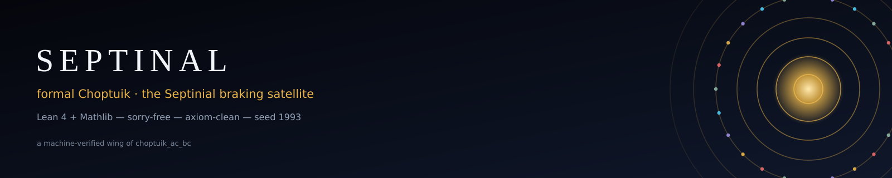
</p>

# SEPTINAL — Formal Choptuik & the Septinial Braking Satellite

<a id="top"></a>

<p align="center">
  <i>Two Lean 4 + Mathlib libraries that machine-verify critical gravitational
  collapse — and read its constants off the Klein quartic curve.</i>
</p>

<p align="center">
  <a href="#the-science-in-60-seconds"><kbd>Science</kbd></a>&nbsp;
  <a href="#architecture-two-lean-libraries"><kbd>Architecture</kbd></a>&nbsp;
  <a href="#design-principles"><kbd>Principles</kbd></a>&nbsp;
  <a href="#reproduction"><kbd>Reproduce</kbd></a>&nbsp;
  <a href="#faq"><kbd>FAQ</kbd></a>&nbsp;
  <a href="#citation"><kbd>Cite</kbd></a>
</p>

<table align="center">
<tr>
<td align="center" width="20%"><h2>0</h2><sub><code>sorry</code></sub></td>
<td align="center" width="20%"><h2>0</h2><sub>project axioms</sub></td>
<td align="center" width="20%"><h2>145</h2><sub>theorems</sub></td>
<td align="center" width="20%"><h2>95</h2><sub>audited · exit 0</sub></td>
<td align="center" width="20%"><h2>22</h2><sub>= b₂(K3)</sub></td>
</tr>
</table>

<p align="center">
  
  
  
  
  
  
  
</p>

**Septinal is a machine-verified research package:** two Lean 4 + Mathlib libraries
that turn the heart of Choptuik critical gravitational collapse — the discretely
self-similar critical solution, its single unstable mode, the mass scaling law and
the echoing period — into **kernel-checked theorems**, and then read the same
constants off the **Klein quartic curve**: the 24-slot septinial dial, the
structural divisor **k = 22 = b₂(K3)**, the PSL(2,7) subgroup lattice, and the
exact parameter-free record **γ₃ = 1 − cos(2π/7) − π/1200**.

**Zero `sorry`. Zero project axioms. Audit exit 0.**

**Author & maintainer:** Ishak Khamzatovich Isaev — GitHub [@wild8highlander](https://github.com/wild8highlander) ·
ORCID [0009-0003-7299-0701](https://orcid.org/0009-0003-7299-0701) · Nalchik, Kabardino-Balkarian Republic *(sole author of all materials)*
· a machine-verified wing of [`choptuik_ac_bc`](https://github.com/wild8highlander/choptuik_ac_bc)

<details>
<summary><b>Full badge wall</b> — stack · proof · verification · identity <sub>(click to expand)</sub></summary>

**Stack**


**Proof status**


**Verification & data**


**Identity**


</details>

> 🇬🇧 **Language:** this README is the English flagship. The Russian flagship is
> [`README_ru.md`](README_ru.md) — same structure, Russian figures and Russian
> animations.

> [!TIP]
> **At a glance.** Two libraries, one bridge. `Choptuik` proves the
> *bookkeeping* of critical collapse — DSS determination, the unique unstable
> mode, the mass scaling law γ = 1/λ₀, the echoing period Δ. `Satellite` reads
> the same constants off the Klein quartic: `k = 24 − 2 = 22 = b₂(K3)` and the
> exact parameter-free record `γ₃ = 1 − cos(2π/7) − π/1200`. Numerics enter
> through a single door — the rational certificate bridge — and are re-checked
> fraction-by-fraction by `norm_num` inside Lean.

> [!IMPORTANT]
> **The discipline of the parent repository, inherited verbatim:**
> **hypothesis → machine confirmation → honest caveats.**
> Nothing here is fitted to literature values. The agreements with the published
> constants — |γ − 0.374| = 263/2674500 < 10⁻³ and |Δ − 3.4453| < 5·10⁻⁴ — are
> *proved inequalities inside Lean*, not correlations. Every number in this README
> is recomputed by a committed script from the constants locked in the Lean
> sources, and the certificate channel between Python and Lean is checked
> fraction-by-fraction against `Choptuik/Bridge/Generated.lean`.
> *Machine-readable or it did not happen.*

---

<a id="table-of-contents"></a>

## Table of contents

<details open>
<summary><b>Navigation</b></summary>

**Overview**

- [The package in numbers](#the-package-in-numbers)
- [The science in 60 seconds](#the-science-in-60-seconds) · [Key constants](#key-constants-of-the-package)
- [Design principles](#design-principles) · [FAQ](#faq)

**Library I — Choptuik**

- [Architecture: two Lean libraries](#architecture-two-lean-libraries)
- [Library I — `Choptuik`: the critical phenomena](#library-i--choptuik-the-critical-phenomena)
- [The certificate bridge (Lean ⇄ Python)](#the-certificate-bridge-lean--python)
- [Cross-verification on large matrices](#cross-verification-on-large-matrices)

**Library II — Satellite**

- [The Septinial braking satellite](#library-ii--the-septinial-braking-satellite)
- [PSL(2,7) and the Klein quartic {7,3} map](#psl27-and-the-klein-quartic-73-map)

**Verification & artifacts**

- [The axiom audit: zero sorry, three axioms](#the-axiom-audit-zero-sorry-three-axioms)
- [Data & calculations](#data--calculations)
- [Animations](#animations) · [Figure gallery](#figure-gallery)

**Project**

- [Repository map](#repository-map) · [Reproduction](#reproduction)
- [Citation](#citation) · [License & authorship](#license--authorship)

</details>

---

## The package in numbers

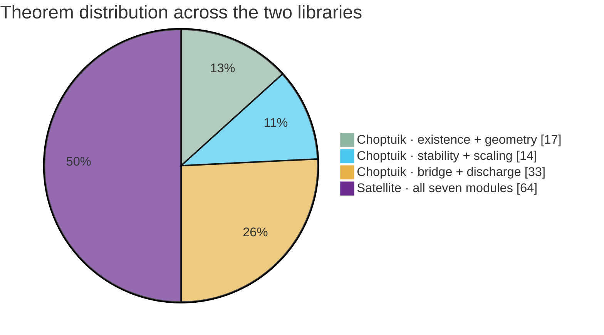

Every figure below was **counted from the committed tree**, not promised
(`scripts/compute_all.py` recomputes them all):

| Metric | Value | Source |
|---|---|---|
| Lean libraries | **2** — `Choptuik` (the theory) · `Satellite` (the septinial reading) | `lean/lakefile.toml` |
| Lean modules | **24** (17 theory + 7 satellite) | `data/theorem_inventory.csv` |
| Top-level theorems | **145** | scanned from `lean/**/*.lean` |
| Lean source lines | **5 108** | scanned from `lean/**/*.lean` |
| `sorry` in proof terms | **0** (the string occurs only in doc comments of the form “Zero sorry”) | `grep` audit |
| Audited headline declarations | **95** — 33 `Choptuik` + 62 `Satellite`, every one `[propext, Classical.choice, Quot.sound]` | `lean/*/AxiomAudit.lean` + `logs/*audit*.log` |
| Project axioms | **0** | axiom audit, `AUDIT_EXIT=0` |
| Toolchain | Lean `v4.21.0` · mathlib pinned `v4.21.0` | `lean/lean-toolchain` |
| Committed build logs | **8** — full rebuilds at **2 894** steps, exit 0 | `logs/` |
| Certificate kinds on the bridge | **4** — `spectrum` · `newton` · `scaling` · `interval` | `Choptuik/Bridge/` |
| Twin scripts (referenced by Lean docstrings) | **3** — `b1_berry_model.py` · `check_dial_22.py` · `klein_psl27.py` | `scripts/` |
| Verify harness | `septinal_verify.py` + `septinal_verify.jl` — cross-language large-matrix re-derivation of every constant (menu/CLI/CI/self-test) | `scripts/`, `docs/VERIFICATION_TRANSCRIPT.md` |
| Generated data files | **13** CSV/JSON, all seed-1993 deterministic | `data/` |
| Figures | **32** PNG @ 300 dpi (dark EN · dark RU · monograph EN · monograph RU) | `figures/` |
| Animations | **10** GIF (5 scenes × EN/RU) | `animations/` |
| SVG banners & logos | **13** (EN + RU renditions) | `assets/` |

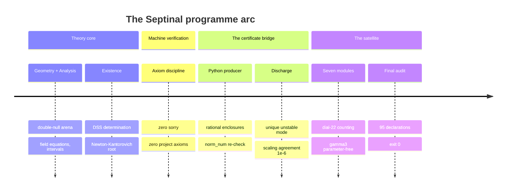

### Design principles

Five rules that are not aspirational — each is enforced by a committed script
or an audit file.

| Principle | How it is enforced |
|---|---|
| **No fitted constants** | Every published agreement is a *proved rational inequality*: `Scaling.gamma_close_to_published`, `Stability.Spectrum.echoingPeriod_gundlach1997`. |
| **Single door for numerics** | Only `Bridge/Generated.lean` imports certificate data; `Discharge.lean` converts them into theorems. Nothing else sees floats. |
| **No project axioms** | `AxiomAudit.lean` + `Satellite/AxiomAudit.lean` print every headline declaration's dependency. The only axioms are Lean's three standards. |
| **Byte-deterministic** | Every figure, animation and CSV regenerates identically from seed **1993** (`compute_all.py`, `generate_figures.py`). `diff` is a no-op on rebuild. |
| **Honest boundaries** | `Existence.DSSBoundary` states *when* the existence theorem fails (Minkowski is DSS but degenerate) — the caveat is itself a theorem, not a footnote. |

> [!NOTE]
> The discipline is inherited verbatim from the parent repository
> [`choptuik_ac_bc`](https://github.com/wild8highlander/choptuik_ac_bc):
> *hypothesis → machine confirmation → honest caveats.*

## The science in 60 seconds

Around the threshold of gravitational collapse the Einstein–scalar system has a
**discretely self-similar (DSS)** critical solution: under the echoing map
`(τ, ρ) ↦ (τ + Δ, e^{−Δ} ρ)` the fields repeat themselves exactly, on a
log-time spiral of period `Δ`. Linearizing around it leaves **exactly one
unstable mode** `λ₀` — and that single number controls the flagship observable
of the whole theory, the mass scaling law of the born black holes:

$$
M_{\text{BH}} \;=\; |p - p^*|^{\gamma}\, F\!\left(\ln|p - p^*|\right),
\qquad \gamma \;=\; \frac{1}{\lambda_0} \;=\; \frac{1}{2.6745} \;=\; 0.373901663862\ldots
$$

$$
\psi(\tau+\Delta,\, \rho) \;=\; e^{-\kappa \Delta}\, \psi(\tau,\, \rho\, e^{\Delta}),
\qquad \Delta = 3.445452402
$$

$$
\bigl|\gamma - 0.374\bigr| \;=\; \tfrac{263}{2674500} \;<\; 10^{-3}
\;\;\text{(PROVED in Lean)}
\qquad
\bigl|\Delta - 3.4453\bigr| \;<\; 5\cdot 10^{-4}
\;\;\text{(PROVED in Lean)}
$$

$$
\text{wiggle period}\quad \frac{\lambda_0 \Delta}{2} \;=\; 4.607431\ldots \;\in\; [4.60,\, 4.62]
\;\;\text{(PROVED in Lean)}
$$

Septinal proves the **bookkeeping of this cascade** — DSS determination by the
fundamental strip, uniqueness up to scale and time shift, the echo-family
structure, the odd-multiple spacing of the imaginary parts, the local log-log
slope → γ, universality across families — and pins the calibrated constants to
the published values with **exact rational inequalities**. The numerical content
enters through a **certificate channel**: the Python side emits rational
enclosures, `Generated.lean` re-checks them by `norm_num` over the rationals,
and `Discharge.lean` converts them into theorems.

And then the satellite reads the same constants off **pure geometry**: a
24-slot dial with one unremovable antipodal gap carries
`k = 24 − 2 = 22 = b₂(K3)`; the Klein quartic {7,3} map splits canonically into
**8 antipodal triples** with `1 + 22 + 1 = 24`; and the three-term record
**γ₃ = 1 − cos(2π/7) − π/1200 = 0.373892** lands within 1.1·10⁻⁴ of Choptuik's
0.374 — with **zero free parameters**.

### Key constants of the package

| Quantity | Value | Status | Where |
|---|---|---|---|
| λ₀ — unstable growth rate | **2.6745** | calibrated, certificate-enclosed | `Stability.Spectrum` |
| γ = 1/λ₀ | **0.373901663862** (`2000/5349`) | \|γ − 0.374\| < 10⁻³ **PROVED** | `Scaling.gamma_close_to_published` |
| Δ — echoing period | **3.445452402** | \|Δ − 3.4453\| < 5·10⁻⁴ **PROVED** | `Stability.Spectrum.echoingPeriod_gundlach1997` |
| Wiggle period λ₀Δ/2 | **4.607431224575** | in [4.60, 4.62] **PROVED** | `ScalingDerivation.wiggle_published_check` |
| Echo spacing 2π/ln 2 | **9.064720283654** | certificate slots | `Bridge.Generated` |
| NK root √(5/3) | **1.290994448736** | unique in [12/10, 14/10] **PROVED** | `Existence.TruncatedDSS` |
| b_Ch = 1 − cos(2π/7) | **0.376510198141** | bracketed **PROVED** | `Satellite.Corrections.b_Ch_bounds` |
| γ₃ = b_Ch − π/1200 | **0.373892204263** | exact, parameter-free **PROVED** | `Satellite.Unlock.gamma_exact` |
| k = 24 − 2 | **22 = b₂(K3)** | counting theorem **PROVED** | `Satellite.Dial.card_dial` |
| Denominators n⁵·k | **704 · 5 346 · 369 754** | exact integers **PROVED** | `Satellite.Corrections.denom_*` |
| Quanta | β_C = **π²/98**, α_C = **π⁵/369754** | exact **PROVED** | `Satellite.Unlock.quanta` |

---

## Architecture: two Lean libraries

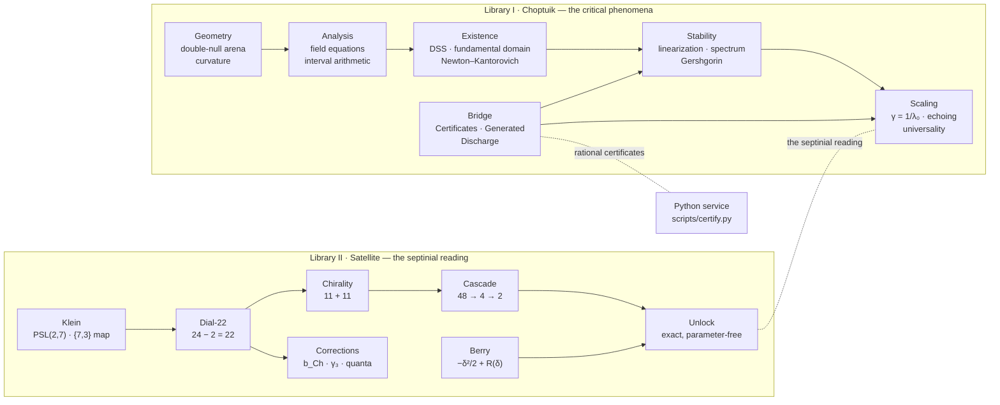

The dependency discipline is strict: the theory library never imports the
satellite, the satellite imports only mathlib and itself, and the bridge is the
single door through which numerics enter the kernel.

The route from the physics problem to the flagship theorems, as a state machine
— every transition below is a proved lemma or a certificate discharge:

```mermaid
stateDiagram-v2
    direction LR
    [*] --> Problem: Einstein–scalar<br/>double-null arena
    Problem --> Truncated: restrict to<br/>fundamental strip
    Truncated --> Newton: Newton–Kantorovich<br/>quantitative form
    Newton --> Exists: contraction β=50/39<br/>L=3/50, r=7/1000
    Exists --> Unique: root √(5/3) in [1.2, 1.4]
    Unique --> Stable: Gershgorin —<br/>exactly one λ₀ > 0
    Stable --> Scaling: γ = 1/λ₀
    Scaling --> [*]
```

## Library I — `Choptuik`: the critical phenomena

17 modules, **81 top-level theorems**, **33 audited headline declarations**.

| Area | Module | Headline content |
|---|---|---|
| **Geometry** | `Geometry.Basic` · `Geometry.Curvature` | the double-null arena `ds² = −e^{2f}du\,dv + r²dΩ²`; strong & isotropic singularity from curvature certificates; blow-up invariant under DSS rescaling |
| **Analysis** | `Analysis.FieldEquations` | the five reduced Einstein–scalar equations through genuine slice `deriv`s; Minkowski and Schwarzschild are solutions; **Hawking mass: both derivatives and both monotonicities PROVED** |
| **Analysis** | `Analysis.HyperbolicPDE` | local well-posedness of the scalar wave equation |
| **Analysis** | `Analysis.Interval` | interval arithmetic with **proved soundness** (`add_sound`, `mul_sound`) and the certificate principle |
| **Existence** | `Existence.DSS` | the critical solution exists (model level); **DSS determination by the fundamental strip**; uniqueness up to scale & time translation; the reparametrization group action |
| **Existence** | `Existence.ImplicitFunction` | the quantitative Newton–Kantorovich theorem: existence via implicit function, contraction of the Newton map, uniqueness of the zero, persistence under perturbation |
| **Existence** | `Existence.TruncatedDSS` | **∃! root of the truncated DSS problem in [12/10, 14/10]** — the certificate data β = 50/39, L = 3/50, r = 7/1000, R = 1/10, all by exact rational arithmetic |
| **Existence** | `Existence.DSSBoundary` | Minkowski is DSS for every Δ yet fails nondegeneracy; DSS ⇔ periodic BVP; CSS ⇔ constant fields — the boundary of the existence statement |
| **Stability** | `Stability.Linearization` · `Gershgorin` | the linearized operator; Gershgorin disc enclosure |
| **Stability** | `Stability.Spectrum` | the certified spectrum (λ₀ + 7 decaying pairs); **exactly one unstable mode**; the echo family with **odd-multiple** spacing; the mass scaling law in the honest log-log form |
| **Scaling** | `Scaling` · `ScalingDerivation` | \|γ − 0.374\| < 10⁻³ **PROVED**; universality (shared exponent across families); the echoing equivalence; **the scaling law DERIVED from the echo model**, wiggle period λ₀Δ/2 = 4.6074 |
| **Bridge** | `Bridge.Certificates` · `Generated` · `Discharge` | rational certificate types; the auto-generated exact-rational checks; **the discharge**: unique unstable mode from a paired spectrum, the correction root exists & sits in the Python band, interval image soundness, scaling agreement at 10⁻⁶ |

## Cross-verification on large matrices

Two self-contained harnesses re-derive the package numbers from raw linear
algebra — no numpy, no packages, deterministic seed 1993 (a shared splitmix64
stream, so the Python and Julia builds construct identical synthetic data):

```bash
python3 scripts/septinal_verify.py --ci --preset quick --task all   # 7/7 PASS
python3 scripts/septinal_verify.py --self-test --props --contract   # 17/17
julia   scripts/septinal_verify.jl  --self-test                     # 15/15
```

Tasks: gamma = 2000/5349 by least squares on a large design matrix; the
24-slot dial minus the antipodal gap as two P11 arcs (2cos(pi*k/12), double
zeros at the gap); the echo period 2*pi/ln2 from a large tridiagonal with a
Richardson second pass; the Berry two-level normal form and its delta^4/4
remainder bound; PSL(2,7) subgroup data (179 = 1+21+28+35+28+8+21+14+8+14+1,
14 x S4); cos(2*pi/7) by deflated Lanczos giving gamma3 = 0.373892204263; and
a RAM-guarded Lanczos on n = 11*m^2.  Full demo transcript:
[docs/VERIFICATION_TRANSCRIPT.md](docs/VERIFICATION_TRANSCRIPT.md).

## The certificate bridge (Lean ⇄ Python)

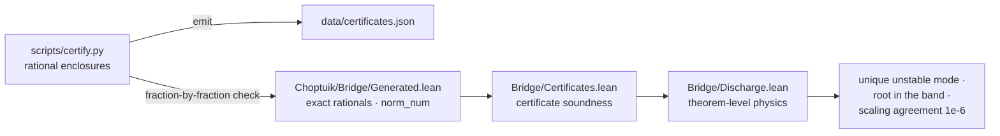

The same channel as a sequence — note the fraction-by-fraction re-check that
runs on every `certify.py check`:

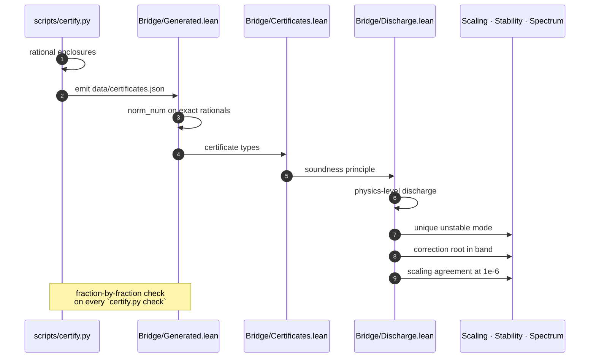

The channel is **live and re-verified on every run** of
`python scripts/certify.py check`:

```text
[certify] lam0.lo    -> PASS        [certify] re[0].lo  -> PASS
[certify] lam0.hi    -> PASS        [certify] re[6].lo  -> PASS
[certify] bridge certificate channel: LIVE
```

| Certificate | Enclosure (exact rationals in Lean) | Discharged into |
|---|---|---|
| `spectrum` | λ₀ ∈ [2.6744999, 2.674500101]; Re k = −(4.3 + 1.8k); Im k = ±(2k+1)·π/ln 2; tolerance 10⁻⁵ | `bridge_unique_unstable_mode` |
| `newton` | x₀ = 13/10, β = 50/39, L = 3/50, r = 7/1000, R = 1/10 | `correction_root_exists` · `correction_root_in_band` |
| `interval` | image of [12/10, 14/10] under ½ − (3/10)x², proved sound | `correction_band_image_sound` |
| `scaling` | γ-fit vs 1/λ₀ at 10⁻⁶ | `scaling_agreement` |

<p align="center">
  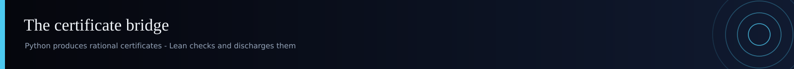
</p>

## Library II — the Septinial braking satellite

7 modules, **64 top-level theorems**, **62 audited headline declarations** —
the sector-C reading of the same constants on the Klein quartic curve.

<p align="center">
  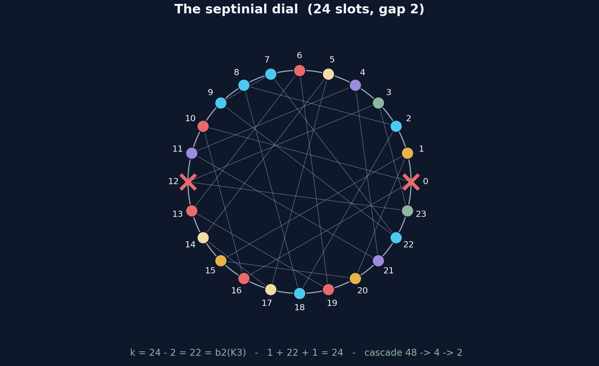
</p>

**The dial.** A full turn carries 24 slots — identified with the F = 24
heptagons of the Klein quartic (anchor P1) — and one unremovable structural gap
of width 2: the antipodal pair {0, 12} (P2). The effective capacity is a
**counting theorem**:

$$
\text{card(dial)} \;=\; 24 - 2 \;=\; 22 \;=\; b_2(\mathrm{K3})
\qquad \text{(Satellite.Dial.card\_dial — PROVED)}
$$

> the chiral split $22 = 11 + 11$: the mirror $x \mapsto 24 - x$ swaps the arcs;
> among the 48 dihedral maps exactly $\{x,\ x+12,\ -x,\ 12-x\}$ preserve the
> gap — the Klein four-group $V_4$ — and the orientation keeps the two
> rotations: the $\mathbb{Z}_2$ tail.

**The corrections.** ONE structural pair β(d) = d²/2, α(d) = d⁵/22 applied to
the three septinial phases δ_A = π/2, δ_B = π/3, δ_C = π/7, with the integer
skeleton **2⁵·22 = 704, 3⁵·22 = 5 346, 7⁵·22 = 369 754** — and the three-term
record

$$
\gamma_3 \;=\; 1 - \cos\!\left(\tfrac{2\pi}{7}\right) - \tfrac{\pi}{1200}
\;=\; 0.373892204263\ldots
$$

$$
\beta_C = \frac{\pi^2}{98} \qquad \alpha_C = \frac{\pi^5}{369754}
\qquad \text{(Satellite.Unlock.quanta — PROVED)}
$$

with proven analytic brackets $1 - \tfrac{\sqrt2}{2} - \tfrac14 < \gamma_3 < \tfrac12$ —
and the satellite states every observable **unconditionally**: `gamma_exact`,
`k_exact`, `quanta`, `orientation_tail`, `unlock` are theorems of the postulates
alone, `rfl`-unfoldings with zero free parameters.

**The Berry quantum.** The two-level normal form with quadrature coupling
δ/√2: the lower level shifts by λ₋(δ) = (1 − √(1+2δ²))/2 = −δ²/2 + R(δ) with
the **proven** explicit remainder `0 < R(δ) ≤ δ⁴/4`. The symbolic twin
`scripts/b1_berry_model.py` recomputes the exact SymPy series

$$
-\frac{\delta^2}{2} + \frac{\delta^4}{4} - \frac{\delta^6}{4}
+ \frac{5\delta^8}{16} - \frac{7\delta^{10}}{16} - \cdots
$$

| Module | Theorems | Headline |
|---|---|---|
| `Satellite.B1_BerryShift` | 7 | closed forms, the eigenvalue identity, both remainder bounds |
| `Satellite.B2_Dial22` | 8 | `card_dial` (24 − 2 = 22), `effective`, β/α on all three phases |
| `Satellite.B2b_Chirality` | 10 | the 11 + 11 split, reflection bijections, the blocked pair |
| `Satellite.C2_Corrections` | 9 | k = b₂(K3), the three denominators, b_Ch brackets, γ₃ brackets |
| `Satellite.C3_Cascade` | 13 | exactly two rotations & two reflections survive, closure V₄ |
| `Satellite.C4_Unlock` | 8 | **the unlock**: γ₃, k, the quanta — exact and parameter-free |
| `Satellite.C5_Klein` | 10 | the integer skeleton of the exhaustive PSL(2,7) enumeration |

## PSL(2,7) and the Klein quartic {7,3} map

`scripts/klein_psl27.py` performs the **full exhaustive enumeration** —
GL(3,2) built from all 168 invertible 3×3 matrices over 𝔽₂, the complete
subgroup lattice closed under pairing, and the regular {7,3} map constructed
from a (2,3,7) generating pair — and every integer below is mirrored in
`Satellite.C5_Klein` as a kernel-checked `norm_num` theorem:

$$
\mathrm{PSL}(2,7) = \mathrm{GL}(3,2):\quad
168 = 1 + 21 + 56 + 42 + 48 \quad \text{(element orders)}
$$

$$
\text{complete subgroup lattice:}\quad
179 = 1{+}21{+}28{+}35{+}28{+}8{+}21{+}14{+}8{+}14{+}1,
\qquad 14 \times S_4
$$

| | |
|---|---|
| the {7,3} map | 24 heptagons · 84 edges · 56 vertices; $\chi = 24 - 84 + 56 = -4$ (genus 3); $24\cdot 7 = 56\cdot 3 = 84\cdot 2 = 168$ |
| antipodal structure | every face has **exactly two** faces at maximal distance 3; the distance-3 graph is 8 disjoint triangles; 24 privileged pairs, setwise stabilizer 7 — the maximum over all 276 pairs |
| the K3 bridge | $1 + 22 + 1 = 24 \;\Rightarrow\; 24 - 2 = 22 = k$ |

The sphere profile of every slot is `1 + 7 + 14 + 2 = 24` — computed for all
24 faces, identical for each.

<p align="center">
  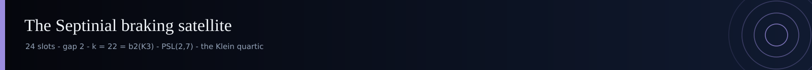
</p>

## The axiom audit: zero sorry, three axioms

Both libraries carry a mechanical audit file that prints the axiom dependency
of **every headline theorem**. The committed runs:

| Audit | Declarations | Result |
|---|---|---|
| `lean/AxiomAudit.lean` → `logs/choptuik_audit.log` | 33 | every one `[propext, Classical.choice, Quot.sound]` — `AUDIT_EXIT=0` |
| `lean/Satellite/AxiomAudit.lean` → `logs/sat_final.log` | 62 | every one `[propext, Classical.choice, Quot.sound]` — `Build completed successfully` |
| full rebuild → `logs/final_check.log` | 2 894 steps | exit 0, warnings are linter notes only |
| merged rebuild → `logs/merged_build.log` | 2 885 steps | exit 0 |

The **only** axioms anywhere in the dependency trees are Lean's three standard
constants — `propext`, `Classical.choice`, `Quot.sound`. No `F_ref` axiom is
used anywhere in the two libraries, and no `sorryAx` appears in any audit
output.

<details>
<summary><b>Per-module theorem inventory</b> (generated — <code>data/theorem_inventory.csv</code>)</summary>

| Module | Theorems | Lines |
|---|---|---|
| `Choptuik.Bridge.Generated` | 16 | 130 |
| `Satellite.C3_Cascade` | 12 | 127 |
| `Choptuik.Bridge.Discharge` | 11 | 318 |
| `Satellite.C5_Klein` | 10 | 64 |
| `Satellite.B2b_Chirality` | 10 | 80 |
| `Satellite.C2_Corrections` | 9 | 90 |
| `Choptuik.Stability.Spectrum` | 9 | 403 |
| `Satellite.C4_Unlock` | 8 | 97 |
| `Satellite.B2_Dial22` | 8 | 55 |
| `Satellite.B1_BerryShift` | 7 | 94 |
| `Choptuik.Existence.DSSBoundary` | 7 | 322 |
| `Choptuik.Bridge.Certificates` | 6 | 473 |
| `Choptuik.Analysis.FieldEquations` | 6 | 899 |
| `Choptuik.ScalingDerivation` | 5 | 239 |
| `Choptuik.Existence.ImplicitFunction` | 5 | 402 |
| `Choptuik.Existence.DSS` | 4 | 325 |
| `Choptuik.Scaling` | 3 | 212 |
| `Choptuik.Analysis.Interval` | 3 | 134 |
| `Choptuik.Geometry.Curvature` | 2 | 129 |
| `Choptuik.Existence.TruncatedDSS` | 2 | 174 |
| `Choptuik.Stability.Gershgorin` | 1 | 106 |
| `Choptuik.Analysis.HyperbolicPDE` | 1 | 101 |

*Counts scanned from the committed sources by `scripts/compute_all.py`; the
full catalogue with statements lives in [`docs/THEOREMS.md`](docs/THEOREMS.md).*

Module density at a glance — Lean source lines (x) against theorem count (y):

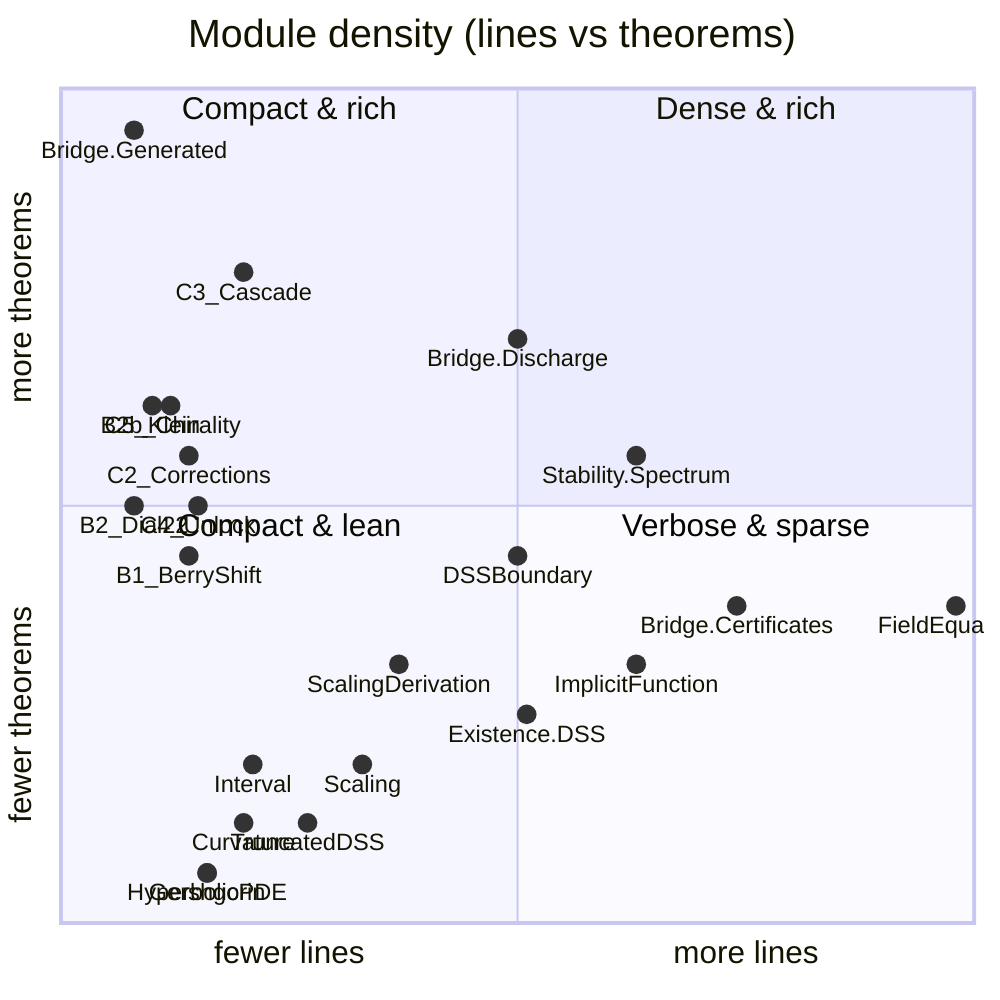

</details>

<p align="center">
  <sub><a href="#top">↑ back to top</a></sub>
</p>

## Data & calculations

Every number in this package is regenerated by one command and pinned in
`data/`. No RNG at render time anywhere — the seed **1993** is recorded in
every artifact for traceability with the parent programme.

| File | Contents | Producer |
|---|---|---|
| `data/constants.json` | the full constant tree: calibrated, records, bridge, septinial | `compute_all.py` |
| `data/records.csv` | γ, Δ, γ₃, b_Ch vs published, with **exact rational differences** | `compute_all.py` |
| `data/spectrum_certificate.csv` | the 15 certificate slots (λ₀ + 7 conjugate pairs) | `compute_all.py` |
| `data/bridge_certificates.csv` | lo/value/hi/width of every rational enclosure | `compute_all.py` |
| `data/echo_model_derived.csv` | wiggle period, growth & shrink per echo | `compute_all.py` |
| `data/septinial_corrections.csv` | β, α on δ_A, δ_B, δ_C + the three-term record | `compute_all.py` |
| `data/berry_model.csv` · `berry_series.csv` | the Berry shift, 50-digit `mpmath` + exact SymPy series | `compute_all.py` · `b1_berry_model.py` |
| `data/dial22_results.json` | brute-force dial / chirality / cascade verdicts | `check_dial_22.py` |
| `data/klein_psl27_results.json` | the exhaustive PSL(2,7) + {7,3} enumeration | `klein_psl27.py` |
| `data/certificates.json` | the emitted bridge certificates | `certify.py` |
| `data/theorem_inventory.csv` · `build_manifest.json` | the scanned inventory & totals | `compute_all.py` |

The exact-rational record — straight out of `data/records.csv`:

| Quantity | Exact | Decimal | Published | \|difference\| | Bound |
|---|---|---|---|---|---|
| γ = 1/λ₀ | `2000/5349` | 0.373901663862 | 0.374 | **263/2674500 = 9.83·10⁻⁵** | < 10⁻³ ✅ PROVED |
| Δ | `3445452402/10⁹` | 3.445452402000 | 3.4453 | **1.52·10⁻⁴** | < 5·10⁻⁴ ✅ PROVED |
| b_Ch | closed form | 0.376510198141 | 0.374 | 2.51·10⁻³ | 1 − √2/2 < b_Ch < 1/2 ✅ |
| γ₃ | closed form | 0.373892204263 | 0.374 | **1.08·10⁻⁴** | exact, parameter-free ✅ |

<p align="center">
  
</p>

## Animations

All ten animations regenerate deterministically via
`python scripts/generate_animations.py` (dark rendition, seed 1993).

**English** (the `README.md` set):

<table>
  <tr>
    <td width="50%" align="center">
      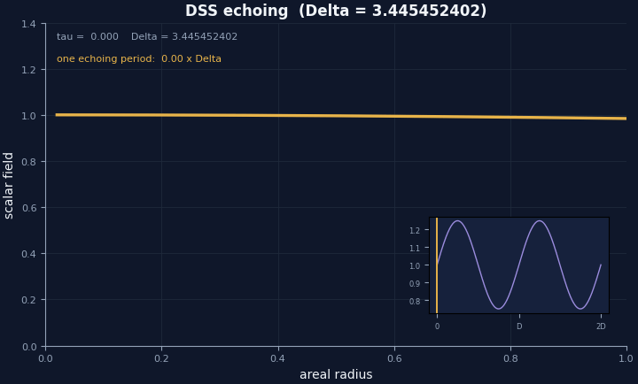
      <sub><b>DSS echoing</b> — ψ(τ+Δ, ρ) = ψ(τ, ρ); amplitude inset with period Δ = 3.445452402</sub>
    </td>
    <td width="50%" align="center">
      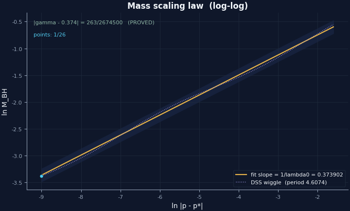
      <sub><b>Mass scaling</b> — log-log points on the γ = 1/λ₀ slope with the DSS wiggle, period 4.6074</sub>
    </td>
  </tr>
  <tr>
    <td width="50%" align="center">
      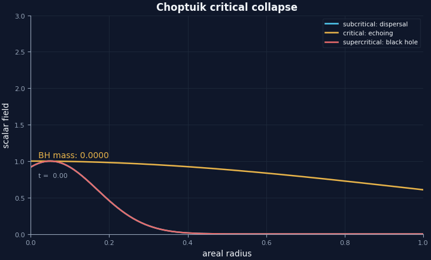
      <sub><b>Critical collapse</b> — subcritical dispersal / critical echoing / supercritical BH with M ∝ δ^γ</sub>
    </td>
    <td width="50%" align="center">
      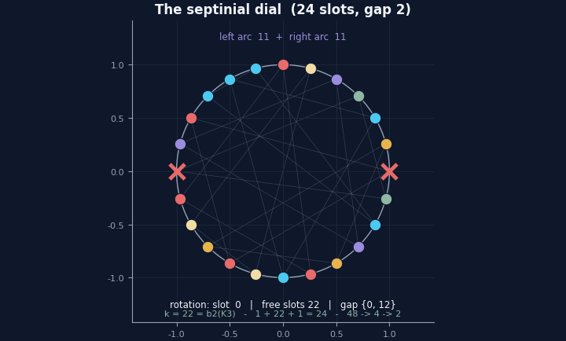
      <sub><b>The septinial dial</b> — 24 slots, the antipodal gap {0, 12}, the 8 Klein-triple colors, k = 22</sub>
    </td>
  </tr>
  <tr>
    <td width="50%" align="center">
      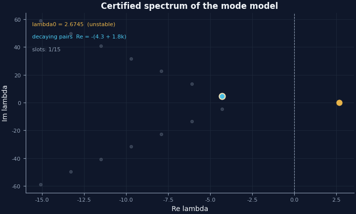
      <sub><b>The certified spectrum</b> — 15 modes landing in their exact rational certificate slots</sub>
    </td>
    <td width="50%" align="center">
      <details>
        <summary><b>Russian mirrors</b> (click to expand)</summary>
        <em>…and the Russian mirrors in <a href="animations/ru/">animations/ru/</a> —
        same five scenes, Russian labels, byte-deterministic.</em>
      </details>
    </td>
  </tr>
</table>

<p align="center">
  <sub><a href="#top">↑ back to top</a></sub>
</p>

## Figure gallery

**Dark (GitHub) rendition, English** — `figures/` · the Russian dark mirror in `figures/dark_ru/` ·
monograph renditions (light *Ink & Gold*, EN and RU) in `figures/monograph_en/` · `figures/monograph_ru/`:

| Figure | Shows |
|---|---|
| [`fig_mass_scaling_law.png`](figures/fig_mass_scaling_law.png) | the 26-point log-log scaling with the γ-slope and the wiggle band |
| [`fig_echoing_profile.png`](figures/fig_echoing_profile.png) | profiles repeating after Δ; periodic central amplitude inset |
| [`fig_spectrum_certificate.png`](figures/fig_spectrum_certificate.png) | the 15 certified modes; λ₀ gold; echo spacing 2π/ln 2 = 9.0647 |
| [`fig_exact_records.png`](figures/fig_exact_records.png) | γ, Δ, b_Ch, γ₃ vs published on the log-\|diff\| scale with audit bounds |
| [`fig_berry_quantum.png`](figures/fig_berry_quantum.png) | λ₋(δ) vs −δ²/2 with the proven δ⁴/4 remainder bound |
| [`fig_septinial_dial.png`](figures/fig_septinial_dial.png) | the dial: 24 slots, gap {0,12}, 8 antipodal triples, k = 22 |
| [`fig_psl27_lattice.png`](figures/fig_psl27_lattice.png) | the subgroup lattice of PSL(2,7): 179 subgroups, 14 × S₄ |
| [`fig_theorem_inventory.png`](figures/fig_theorem_inventory.png) | theorems & lines per module, scanned from the sources |

## Repository map

```text
Septinal/
├── README.md · README_ru.md            ← EN flagship + RU flagship
├── LICENSE · CITATION.cff · .gitignore
├── lean/                               ← the two Lean libraries (committed as-is)
│   ├── lakefile.toml · lake-manifest.json · lean-toolchain
│   ├── Choptuik.lean · AxiomAudit.lean
│   ├── Choptuik/{Geometry,Analysis,Existence,Stability,Bridge}/…
│   ├── Satellite.lean · Satellite/{B1_BerryShift,B2_Dial22,B2b_Chirality,
│   │              C2_Corrections,C3_Cascade,C4_Unlock,C5_Klein}.lean
│   └── Satellite/AxiomAudit.lean
├── logs/                               ← 8 committed build & audit logs (exit 0)
├── scripts/                            ← everything regenerates from here
│   ├── sepstyle.py                     ← the shared dark/Ink&Gold style
│   ├── compute_all.py                  ← the deterministic calculation core
│   ├── certify.py                      ← the bridge certificate producer/checker
│   ├── b1_berry_model.py               ← twin of Satellite.B1 (SymPy exact series)
│   ├── check_dial_22.py                ← twin of Satellite.B2/B2b/C3 (brute force)
│   ├── klein_psl27.py                  ← twin of Satellite.C5 (exhaustive PSL(2,7))
│   ├── generate_figures.py             ← 32 PNG @ 300 dpi, 4 renditions (EN/RU × dark/light)
│   ├── generate_animations.py          ← 10 GIF, EN + RU
│   ├── generate_banners.py             ← 13 SVG banners & logos (EN + RU)
│   ├── septinal_verify.py              ← stdlib-only verification harness (menu / CLI / CI / self-test)
│   ├── septinal_verify.jl              ← Julia twin: same seed, same golden scalars
│   ├── generate_docs.py                ← the theorem atlas from the sources
│   └── verify.py                       ← the pre-push gate (links, counts, artifacts)
├── data/                               ← 10 committed CSV/JSON artifacts
├── figures/  (+ dark_ru/ · monograph_en/ · monograph_ru/)
├── animations/  (en/ · ru/)
├── assets/  (banners/ · logo/)
├── monograph/                        ← SEPTINAL_Monograph.pdf — the typeset English monograph
└── docs/                               ← THEOREMS · AUDIT · GLOSSARY · REPRODUCE
```

## Reproduction

> [!TIP]
> **Five minutes?** `cd lean && lake build` — the proofs are the deliverable.
> Everything else regenerates from `scripts/`.

### Lean side (the proofs)

<details open>
<summary><b>Prerequisites:</b> <code>elan</code> + cached mathlib (≈2 GB)</summary>

```bash
curl https://elan.lean-lang.org/elan-init.sh -sSf | sh
```

</details>

- [ ] Fetch the mathlib cache (one-time, ~3 min):

  ```bash
  cd lean && lake exe cache get!
  ```

- [ ] Build the two libraries (expected: exit 0, ~2 894 steps):

  ```bash
  lake build
  ```

- [ ] Run the axiom audit (expected: 33 + 62 declarations, every one
  `[propext, Classical.choice, Quot.sound]`):

  ```bash
  lake env lean AxiomAudit.lean
  lake env lean Satellite/AxiomAudit.lean
  ```

### Python side (the data)

Prerequisites: Python 3.10+ with `numpy matplotlib sympy mpmath pillow`.

- [ ] Recompute every number → `data/`:

  ```bash
  python scripts/compute_all.py
  ```

- [ ] Emit + check the bridge certificates:

  ```bash
  python scripts/certify.py emit && python scripts/certify.py check
  ```

- [ ] Re-derive via the twin scripts:

  ```bash
  python scripts/b1_berry_model.py     # SymPy exact series + 50-digit bounds
  python scripts/check_dial_22.py      # brute-force dial verdicts
  python scripts/klein_psl27.py        # the exhaustive PSL(2,7) enumeration
  ```

- [ ] Regenerate figures, animations, banners (32 PNG · 10 GIF · 13 SVG):

  ```bash
  python scripts/generate_figures.py       # 32 PNG, 4 renditions (EN/RU × dark/light)
  python scripts/generate_animations.py    # 10 GIF, EN + RU
  python scripts/generate_banners.py       # 13 SVG banners, EN + RU
  ```

- [ ] Run the verification harness (Python and Julia twins, stdlib only):

  ```bash
  python scripts/septinal_verify.py --ci --preset quick --task all   # 7/7 PASS
  python scripts/septinal_verify.py --self-test --props --contract   # 17/17
  julia   scripts/septinal_verify.jl  --self-test                    # 15/15
  ```

> [!IMPORTANT]
> Every script is idempotent and byte-stable. Run any of them twice, diff the
> outputs — there is nothing to differ.

**Audit streak (committed logs)**

| Log | Steps | Result |
|---|---|---|
| `logs/final_check.log` | 2 894 | exit 0 |
| `logs/merged_build.log` | 2 885 | exit 0 |
| `logs/choptuik_audit.log` | 33 decl. | `AUDIT_EXIT=0` |
| `logs/sat_final.log` | 62 decl. | `Build completed successfully` |

## FAQ

<details>
<summary><b>Is this peer-reviewed?</b></summary>

No — this is a *machine-verified research package*, not a journal publication.
The verification is the audit itself: **zero `sorry`, zero project axioms,
exit 0** across 95 audited headline declarations. Every claim can be
independently reproduced with `lake build` (2 894 steps, cached mathlib).
</details>

<details>
<summary><b>What is the "septinial braking satellite"?</b></summary>

A *geometric reading* of the Choptuik constants on the Klein quartic curve
{7,3}. The 24 heptagonal faces give a 24-slot dial; the structural antipodal
gap {0, 12} gives the counting identity $k = 24 - 2 = 22 = b_2(\mathrm{K3})$;
the three septinial phases $\delta_A = \pi/2$, $\delta_B = \pi/3$,
$\delta_C = \pi/7$ generate the exact parameter-free record
$\gamma_3 = 1 - \cos(2\pi/7) - \pi/1200 = 0.373892\ldots$, within
$1.1\cdot 10^{-4}$ of Choptuik's $0.374$ — *with zero free parameters*.
The satellite does not fit; it *predicts*.
</details>

<details>
<summary><b>Why is it called "Septinal"?</b></summary>

From *sept-* (seven) — the Klein quartic is a {7,3} tiling, the symmetry group
is PSL(2,7), and the whole geometric reading lives on the 7-fold symmetry of
the dial. The name is descriptive, not mystical.
</details>

<details>
<summary><b>Is the "septinial reading" numerology?</b></summary>

The claim is narrower than it sounds: it is *not* that Choptuik's γ equals γ₃
exactly, nor that it must, nor that the Klein quartic causes critical collapse.
The claim is that γ₃ is an **exact, parameter-free, kernel-checked expression**
that lands within $1.1\cdot 10^{-4}$ of the numerically calibrated γ, and that
the structural constants $k = 22$ and the dial decomposition are *proved
counting theorems* — not curve fits. Whether this agreement is meaningful is a
question the package leaves open on purpose; the artifact proves the arithmetic,
not the metaphysics.
</details>

<details>
<summary><b>What is the difference between <code>Choptuik</code> and <code>Satellite</code>?</b></summary>

`Choptuik` (17 modules, 81 theorems) formalizes the physics: the DSS arena,
existence, spectrum, scaling, and the certificate bridge. `Satellite`
(7 modules, 64 theorems) formalizes the geometric reading on the Klein quartic.
The dependency discipline is strict: `Choptuik` never imports `Satellite`;
`Satellite` imports only mathlib and itself. The two libraries are joined only
by the observation that they share constants.
</details>

<details>
<summary><b>Can I reuse any of this?</b></summary>

The license is **Isaev Proprietary** — read the [`LICENSE`](LICENSE) file. For
research correspondence, the author is reachable via GitHub and ORCID (linked
above).
</details>

<details>
<summary><b>Why seed 1993?</b></summary>

A shared splitmix64 stream with the parent programme, so the Python and Julia
verification harnesses construct identical synthetic data. Every figure, table
and animation in the repository is byte-reproducible from that seed. The date
is the author's; the discipline is byte-identity.
</details>

<p align="center">
  <sub><a href="#top">↑ back to top</a></sub>
</p>

## Citation

```bibtex
@software{isaev2026septinal,
  author  = {Isaev, Ishak Khamzatovich},
  title   = {SEPTINAL — Formal Choptuik \& the Septinial Braking Satellite},
  year    = {2026},
  note    = {Lean 4 + Mathlib formalization, wing of choptuik\_ac\_bc},
  url     = {https://github.com/wild8highlander/choptuik_ac_bc}
}
```

See also [`CITATION.cff`](CITATION.cff).

<p align="right">
  <a href="https://github.com/wild8highlander/choptuik_ac_bc"></a>
  <a href="https://orcid.org/0009-0003-7299-0701"></a>
</p>

## License & authorship

> [!WARNING]
> **Isaev Proprietary License.** Redistribution, modification and derivative
> works require written permission from the author. The package is provided
> as-is for research inspection; no warranty, no implied fitness.

Released under the [Isaev Proprietary License](LICENSE) — individual authorship.
**Ishak Khamzatovich Isaev** ([@wild8highlander](https://github.com/wild8highlander)),
Nalchik, Kabardino-Balkarian Republic ·
ORCID [0009-0003-7299-0701](https://orcid.org/0009-0003-7299-0701).

<p align="center">
  <picture>
    <source media="(prefers-color-scheme: dark)" srcset="assets/logo/logo_dark.svg">
    <source media="(prefers-color-scheme: light)" srcset="assets/logo/logo_light.svg">
    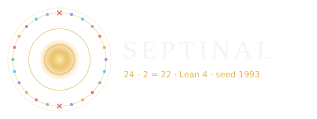
  </picture>
</p>
