<p align="center">
  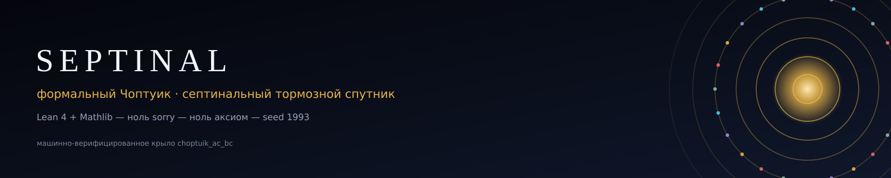
</p>

# SEPTINAL — формальный Чоптуик и септинальный тормозной спутник

<a id="top"></a>

<p align="center">
  <i>Две библиотеки Lean 4 + Mathlib, которые машинно верифицируют критический
  гравитационный коллапс — и считывают его константы с квартики Клейна.</i>
</p>

<p align="center">
  <a href="#наука-за-60-секунд"><kbd>Наука</kbd></a>&nbsp;
  <a href="#архитектура-две-lean-библиотеки"><kbd>Архитектура</kbd></a>&nbsp;
  <a href="#принципы-проектирования"><kbd>Принципы</kbd></a>&nbsp;
  <a href="#воспроизведение"><kbd>Воспроизвести</kbd></a>&nbsp;
  <a href="#частые-вопросы"><kbd>Вопросы</kbd></a>&nbsp;
  <a href="#цитирование"><kbd>Цитировать</kbd></a>
</p>

<table align="center">
<tr>
<td align="center" width="20%"><h2>0</h2><sub><code>sorry</code></sub></td>
<td align="center" width="20%"><h2>0</h2><sub>собственных аксиом</sub></td>
<td align="center" width="20%"><h2>145</h2><sub>теорем</sub></td>
<td align="center" width="20%"><h2>95</h2><sub>аудит · exit 0</sub></td>
<td align="center" width="20%"><h2>22</h2><sub>= b₂(K3)</sub></td>
</tr>
</table>

<p align="center">
  
  
  
  
  
  
  
</p>

**Septinal — машинно-верифицированный исследовательский пакет:** две библиотеки
Lean 4 + Mathlib, которые превращают ядро критического гравитационного коллапса
Чоптуика — дискретно самоподобное критическое решение, его единственную
неустойчивую моду, закон массового скейлинга и период эха — в
**проверенные ядром теоремы**, а затем читают те же константы на **квартике
Клейна**: 24-слотовый септинальный диск, структурный делитель
**k = 22 = b₂(K3)**, решётку подгрупп PSL(2,7) и точную безпараметрическую
запись **γ₃ = 1 − cos(2π/7) − π/1200**.

**Ноль `sorry`. Ноль собственных аксиом. Аудит — exit 0.**

**Автор и сопровождающий:** Исхак Хамзатович Исаев — GitHub [@wild8highlander](https://github.com/wild8highlander) ·
ORCID [0009-0003-7299-0701](https://orcid.org/0009-0003-7299-0701) · Нальчик, Кабардино-Балкарская Республика *(единственный автор всех материалов)*
· машинно-верифицированное крыло [`choptuik_ac_bc`](https://github.com/wild8highlander/choptuik_ac_bc)

<details>
<summary><b>Полная стена бейджей</b> — стек · доказательства · верификация · идентичность <sub>(развернуть)</sub></summary>

**Стек**


**Статус доказательств**


**Верификация и данные**


**Идентичность**


</details>

> 🇷🇺 **Язык:** этот README — русский флагман. Английский флагман —
> [`README.md`](README.md); фигуры и анимации в русских версиях лежат в
> `figures/monograph_ru/` и `animations/ru/`.

> [!TIP]
> **В двух словах.** Две библиотеки, один мост. `Choptuik` доказывает
> *бухгалтерию* критического коллапса — определённость DSS, единственную
> неустойчивую моду, закон массового скейлинга γ = 1/λ₀, период эха Δ.
> `Satellite` считывает те же константы с квартики Клейна:
> `k = 24 − 2 = 22 = b₂(K3)` и точную безпараметрическую запись
> `γ₃ = 1 − cos(2π/7) − π/1200`. Численность входит через единственную дверь —
> рациональный сертификатный мост — и перепроверяется дробь-за-дробью
> через `norm_num` внутри Lean.

> [!IMPORTANT]
> **Дисциплина родительского репозитория, унаследованная дословно:**
> **гипотеза → машинное подтверждение → честные оговорки.**
> Ничего не подгоняется под литературные значения. Совпадения с опубликованными
> константами — |γ − 0.374| = 263/2674500 < 10⁻³ и |Δ − 3.4453| < 5·10⁻⁴ — это
> *доказанные внутри Lean неравенства*, а не корреляции. Каждое число этого
> README пересчитывается коммиченным скриптом из констант, зафиксированных в
> Lean-источниках, а сертификатный канал между Python и Lean проверяется
> дробь-за-дробью против `Choptuik/Bridge/Generated.lean`.
> *Machine-readable or it did not happen.*

---

<a id="table-of-contents"></a>

## Содержание

<details open>
<summary><b>Навигация</b></summary>

**Обзор**

- [Пакет в числах](#пакет-в-числах)
- [Наука за 60 секунд](#наука-за-60-секунд) · [Ключевые константы](#ключевые-константы-пакета)
- [Принципы проектирования](#принципы-проектирования) · [Частые вопросы](#частые-вопросы)

**Библиотека I — Choptuik**

- [Архитектура: две Lean-библиотеки](#архитектура-две-lean-библиотеки)
- [Библиотека I — `Choptuik`: критические явления](#библиотека-i--choptuik-критические-явления)
- [Сертификатный мост (Lean ⇄ Python)](#сертификатный-мост-lean--python)
- [Верификация на больших матрицах](#верификация-на-больших-матрицах)

**Библиотека II — Satellite**

- [Септинальный тормозной спутник](#библиотека-ii--септинальный-тормозной-спутник)
- [PSL(2,7) и карта {7,3} квартики Клейна](#psl27-и-карта-73-квартики-клейна)

**Верификация и артефакты**

- [Аксиомный аудит: ноль sorry, три аксиомы](#аксиомный-аудит-ноль-sorry-три-аксиомы)
- [Данные и вычисления](#данные-и-вычисления)
- [Анимации](#анимации) · [Галерея фигур](#галерея-фигур)

**Проект**

- [Карта репозитория](#карта-репозитория) · [Воспроизведение](#воспроизведение)
- [Цитирование](#цитирование) · [Лицензия и авторство](#лицензия-и-авторство)

</details>

---

## Пакет в числах

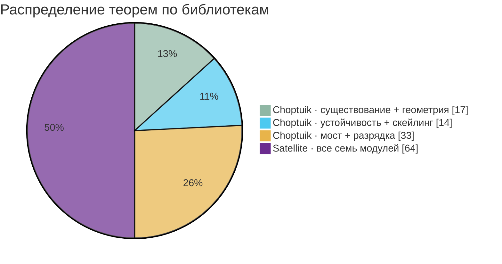

Каждая цифра ниже **посчитана по фактическому дереву файлов**, а не обещана
(всё пересчитывает `scripts/compute_all.py`):

| Метрика | Значение | Источник |
|---|---|---|
| Lean-библиотеки | **2** — `Choptuik` (теория) · `Satellite` (септинальное чтение) | `lean/lakefile.toml` |
| Lean-модулей | **24** (17 теория + 7 спутник) | `data/theorem_inventory.csv` |
| Теорем верхнего уровня | **145** | скан `lean/**/*.lean` |
| Строк Lean-исходников | **5 108** | скан `lean/**/*.lean` |
| `sorry` в доказательствах | **0** (строка встречается только в doc-комментариях вида «Zero sorry») | grep-аудит |
| Аудированных заголовочных теорем | **95** — 33 `Choptuik` + 62 `Satellite`, каждая `[propext, Classical.choice, Quot.sound]` | `lean/*/AxiomAudit.lean` + `logs/*audit*.log` |
| Собственных аксиом | **0** | аксиомный аудит, `AUDIT_EXIT=0` |
| Инструменты | Lean `v4.21.0` · mathlib закреплён `v4.21.0` | `lean/lean-toolchain` |
| Коммиченных логов сборки | **8** — полные пересборки на **2 894** шага, exit 0 | `logs/` |
| Типов сертификатов на мосту | **4** — `spectrum` · `newton` · `scaling` · `interval` | `Choptuik/Bridge/` |
| Скриптов-двойников (упомянуты в Lean-docstring) | **3** — `b1_berry_model.py` · `check_dial_22.py` · `klein_psl27.py` | `scripts/` |
| Верификационный стенд | `septinal_verify.py` + `septinal_verify.jl` — кросс-языковое перепрочтение всех констант на больших матрицах (меню/CLI/CI/самотест) | `scripts/`, `docs/VERIFICATION_TRANSCRIPT.md` |
| Сгенерированных данных | **13** файлов CSV/JSON, весь детерминизм seed-1993 | `data/` |
| Фигур | **32** PNG @ 300 dpi (тёмная EN · тёмная RU · монография EN · монография RU) | `figures/` |
| Анимаций | **10** GIF (5 сцен × EN/RU) | `animations/` |
| SVG-баннеров и логотипов | **13** (EN + RU) | `assets/` |

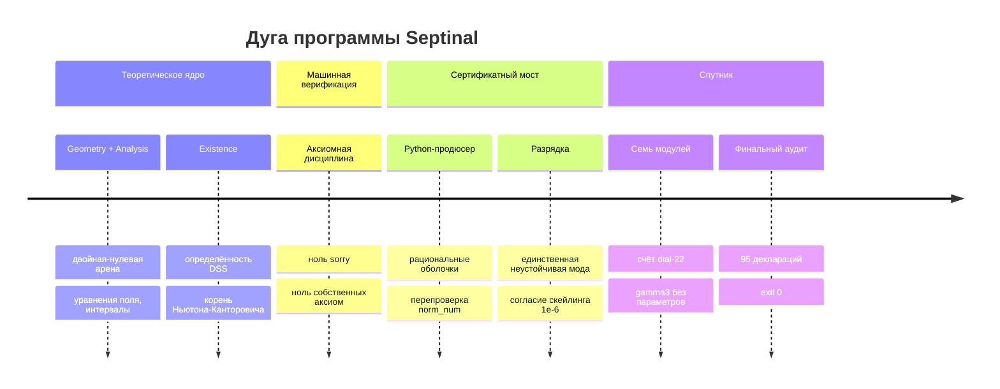

### Принципы проектирования

Пять правил, которые не декларация о намерениях — каждое подкреплено
коммиченным скриптом или аудит-файлом.

| Принцип | Чем обеспечен |
|---|---|
| **Никаких подгонок** | Каждое опубликованное совпадение — *доказанное рациональное неравенство*: `Scaling.gamma_close_to_published`, `Stability.Spectrum.echoingPeriod_gundlach1997`. |
| **Одна дверь для численности** | Только `Bridge/Generated.lean` импортирует сертификатные данные; `Discharge.lean` превращает их в теоремы. Больше ни один модуль плавающих не видит. |
| **Ноль собственных аксиом** | `AxiomAudit.lean` + `Satellite/AxiomAudit.lean` печатают зависимость каждой заголовочной декларации. Единственные аксиомы — три стандарта Lean. |
| **Байт-детерминизм** | Каждая фигура, анимация и CSV регенерируется тождественно из seed **1993** (`compute_all.py`, `generate_figures.py`). `diff` на пересборке пуст. |
| **Честные границы** | `Existence.DSSBoundary` формулирует, *когда* теорема существования не работает (Минковский DSS, но вырожден) — оговорка сама является теоремой, а не сноской. |

> [!NOTE]
> Дисциплина унаследована дословно из родительского репозитория
> [`choptuik_ac_bc`](https://github.com/wild8highlander/choptuik_ac_bc):
> *гипотеза → машинное подтверждение → честные оговорки.*

## Наука за 60 секунд

Вблизи порога гравитационного коллапса система Эйнштейна–скаляра обладает
**дискретно самоподобным (DSS)** критическим решением: под отображением эха
`(τ, ρ) ↦ (τ + Δ, e^{−Δ} ρ)` поля точно повторяются на логарифмической спирали
с периодом `Δ`. Линеаризация вокруг него оставляет **ровно одну неустойчивую
моду** `λ₀` — и это единственное число управляет главным наблюдаемым всей
теории, законом массового скейлинга рождающихся чёрных дыр:

$$
M_{\text{BH}} \;=\; |p - p^*|^{\gamma}\, F\!\left(\ln|p - p^*|\right),
\qquad \gamma \;=\; \frac{1}{\lambda_0} \;=\; \frac{1}{2.6745} \;=\; 0.373901663862\ldots
$$

$$
\psi(\tau+\Delta,\, \rho) \;=\; e^{-\kappa \Delta}\, \psi(\tau,\, \rho\, e^{\Delta}),
\qquad \Delta = 3.445452402
$$

$$
\bigl|\gamma - 0.374\bigr| \;=\; \tfrac{263}{2674500} \;<\; 10^{-3}
\;\;\text{(ДОКАЗАНО в Lean)}
\qquad
\bigl|\Delta - 3.4453\bigr| \;<\; 5\cdot 10^{-4}
\;\;\text{(ДОКАЗАНО в Lean)}
$$

$$
\text{период виггля}\quad \frac{\lambda_0 \Delta}{2} \;=\; 4.607431\ldots \;\in\; [4.60,\, 4.62]
\;\;\text{(ДОКАЗАНО в Lean)}
$$

Septinal доказывает **бухгалтерию этой каскадной картины** — определённость DSS
фундаментальной полосой, единственность с точностью до масштаба и сдвига
времени, структуру эхового семейства, кратность нечётности шага мнимых частей,
локальный log-log наклон → γ, универсальность между семействами — и
пришпиливает калиброванные константы к опубликованным значениям **точными
рациональными неравенствами**. Численный контент входит через
**сертификатный канал**: Python-сторона выдаёт рациональные оболочки,
`Generated.lean` перепроверяет их `norm_num` над рациональными числами, а
`Discharge.lean` превращает их в теоремы.

А затем спутник читает те же константы из **чистой геометрии**: 24-слотовый
диск с одной неудалимым антиподальным зазором несёт `k = 24 − 2 = 22 = b₂(K3)`;
карта {7,3} квартики Клейна канонически распадается на **8 антиподальных
триплетов** с `1 + 22 + 1 = 24`; а трёхчленная запись
**γ₃ = 1 − cos(2π/7) − π/1200 = 0.373892** попадает в 1.1·10⁻⁴ от чоптуиковских
0.374 — при **нуле свободных параметров**.

### Ключевые константы пакета

| Величина | Значение | Статус | Где |
|---|---|---|---|
| λ₀ — скорость роста неустойчивой моды | **2.6745** | калибрована, сертификатная оболочка | `Stability.Spectrum` |
| γ = 1/λ₀ | **0.373901663862** (`2000/5349`) | \|γ − 0.374\| < 10⁻³ **ДОКАЗАНО** | `Scaling.gamma_close_to_published` |
| Δ — период эха | **3.445452402** | \|Δ − 3.4453\| < 5·10⁻⁴ **ДОКАЗАНО** | `Stability.Spectrum.echoingPeriod_gundlach1997` |
| Период виггля λ₀Δ/2 | **4.607431224575** | в [4.60, 4.62] **ДОКАЗАНО** | `ScalingDerivation.wiggle_published_check` |
| Шаг эха 2π/ln 2 | **9.064720283654** | сертификатные слоты | `Bridge.Generated` |
| Корень НК √(5/3) | **1.290994448736** | единственный в [12/10, 14/10] **ДОКАЗАНО** | `Existence.TruncatedDSS` |
| b_Ch = 1 − cos(2π/7) | **0.376510198141** | вилки **ДОКАЗАНЫ** | `Satellite.Corrections.b_Ch_bounds` |
| γ₃ = b_Ch − π/1200 | **0.373892204263** | точно, без параметров **ДОКАЗАНО** | `Satellite.Unlock.gamma_exact` |
| k = 24 − 2 | **22 = b₂(K3)** | счётная теорема **ДОКАЗАНО** | `Satellite.Dial.card_dial` |
| Знаменатели n⁵·k | **704 · 5 346 · 369 754** | точные целые **ДОКАЗАНО** | `Satellite.Corrections.denom_*` |
| Кванты | β_C = **π²/98**, α_C = **π⁵/369754** | точно **ДОКАЗАНО** | `Satellite.Unlock.quanta` |

---

## Архитектура: две Lean-библиотеки

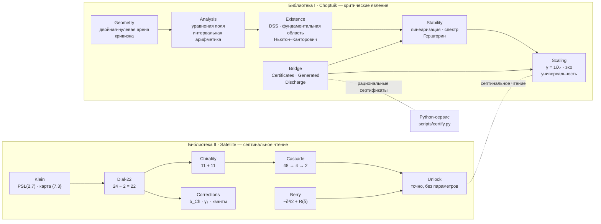

Дисциплина зависимостей строгая: теоретическая библиотека не импортирует
спутник, спутник импортирует только mathlib и самого себя, а мост —
единственная дверь, через которую численность входит в ядро.

Маршрут от физической задачи к флагманским теоремам как автомат состояний —
каждый переход ниже это доказанная лемма или разрядка сертификата:

```mermaid
stateDiagram-v2
    direction LR
    [*] --> Problem: арна Эйнштейна–скаляра<br/>двойные нули
    Problem --> Truncated: ограничение на<br/>фундаментальную полосу
    Truncated --> Newton: количественная форма<br/>Ньютона–Канторовича
    Newton --> Exists: сжатие β=50/39<br/>L=3/50, r=7/1000
    Exists --> Unique: корень √(5/3) в [1.2, 1.4]
    Unique --> Stable: Гершгорин —<br/>ровно одна λ₀ > 0
    Stable --> Scaling: γ = 1/λ₀
    Scaling --> [*]
```

## Библиотека I — `Choptuik`: критические явления

17 модулей, **81 теорема верхнего уровня**, **33 аудированных заголовочных
теоремы**.

| Область | Модуль | Заголовочное содержание |
|---|---|---|
| **Геометрия** | `Geometry.Basic` · `Geometry.Curvature` | арена двойных нулей `ds² = −e^{2f}du\,dv + r²dΩ²`; сильная и изотропная сингулярность из кривизнных сертификатов; расходимость инвариантна относительно DSS-рескейлинга |
| **Анализ** | `Analysis.FieldEquations` | пять приведённых уравнений Эйнштейна–скаляра через настоящие срезочные `deriv`; Минковский и Шварцшильд — решения; **масса Хокинга: обе производные и обе монотонности ДОКАЗАНЫ** |
| **Анализ** | `Analysis.HyperbolicPDE` | локальная корректность скалярного волнового уравнения |
| **Анализ** | `Analysis.Interval` | интервальная арифметика с **доказанной корректностью** (`add_sound`, `mul_sound`) и сертификатный принцип |
| **Существование** | `Existence.DSS` | критическое решение существует (модельный уровень); **определённость DSS фундаментальной полосой**; единственность с точностью до масштаба и сдвига; действие группы репараметризаций |
| **Существование** | `Existence.ImplicitFunction` | количественная теорема Ньютона–Канторовича: существование через неявную функцию, сжимаемость ньютоновского отображения, единственность нуля, устойчивость к возмущениям |
| **Существование** | `Existence.TruncatedDSS` | **∃! корень усечённой DSS-задачи в [12/10, 14/10]** — сертификатные данные β = 50/39, L = 3/50, r = 7/1000, R = 1/10, всё точной рациональной арифметикой |
| **Существование** | `Existence.DSSBoundary` | Минковский DSS при любом Δ, но не вырожден; DSS ⇔ периодическая BVP; CSS ⇔ постоянные поля — граница утверждения о существовании |
| **Устойчивость** | `Stability.Linearization` · `Gershgorin` | линеаризованный оператор; интервальная оценка Гершгорина |
| **Устойчивость** | `Stability.Spectrum` | сертифицированный спектр (λ₀ + 7 затухающих пар); **ровно одна неустойчивая мода**; эховое семейство с **нечётно-кратным** шагом; закон массового скейлинга в честной log-log форме |
| **Скейлинг** | `Scaling` · `ScalingDerivation` | \|γ − 0.374\| < 10⁻³ **ДОКАЗАНО**; универсальность (общая экспонента у семейств); эквивалентность эха; **закон скейлинга ВЫВЕДЕН из эховой модели**, период виггля λ₀Δ/2 = 4.6074 |
| **Мост** | `Bridge.Certificates` · `Generated` · `Discharge` | типы рациональных сертификатов; автогенерированные точные проверки; **разрядка**: единственная неустойчивая мода из сопряжённого спектра, корень в питоновской полосе, корректность интервального образа, согласие скейлинга 10⁻⁶ |

## Верификация на больших матрицах

Два самодостаточных стенда пересчитывают числа пакета «с нуля» — без numpy и
внешних пакетов, детерминированный seed 1993 (общий поток splitmix64, поэтому
Python и Julia строят идентичные данные):

```bash
python3 scripts/septinal_verify.py --ci --preset quick --task all   # 7/7 PASS
python3 scripts/septinal_verify.py --self-test --props --contract   # 17/17
julia   scripts/septinal_verify.jl  --self-test                     # 15/15
```

Задачи: gamma = 2000/5349 методом наименьших квадратов на большой матрице
планирования; септинальный диск без антиподального зазора как две дуги P11
(2cos(pi*k/12), двойные нули в зазоре); период эха 2*pi/ln2 по большой
трёхдиагональной матрице с Ричардсоном на втором проходе; квант Берри и
граница остатка delta^4/4; подгруппы PSL(2,7) (179 = 1+21+28+35+28+8+21+14+
8+14+1, 14 x S4); cos(2*pi/7) дефлированным Ланцосом и
gamma3 = 0.373892204263; Ланцос с защитой ОЗУ на n = 11*m^2. Полный
демо-транскрипт: [docs/VERIFICATION_TRANSCRIPT.md](docs/VERIFICATION_TRANSCRIPT.md).

## Сертификатный мост (Lean ⇄ Python)

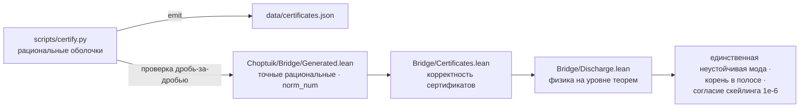

Тот же канал как последовательность — обратите внимание на проверку
дробь-за-дробью, которая выполняется при каждом `certify.py check`:

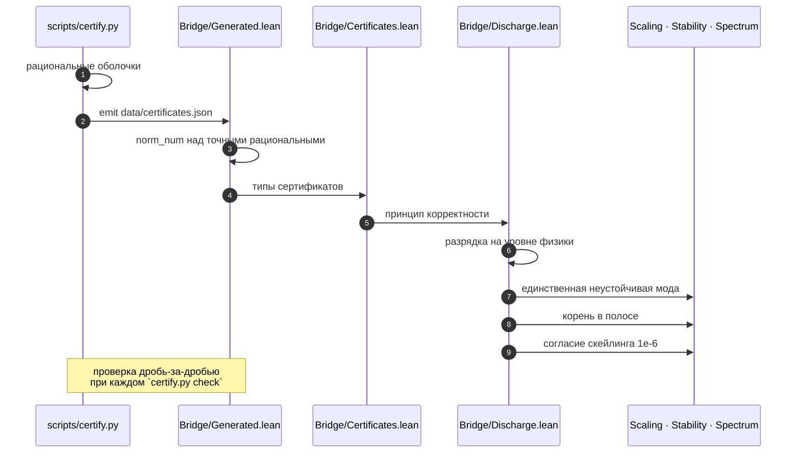

Канал **жив и перепроверяется при каждом запуске**
`python scripts/certify.py check`:

```text
[certify] lam0.lo    -> PASS        [certify] re[0].lo  -> PASS
[certify] lam0.hi    -> PASS        [certify] re[6].lo  -> PASS
[certify] bridge certificate channel: LIVE
```

| Сертификат | Оболочка (точные рациональные в Lean) | Разряжается в |
|---|---|---|
| `spectrum` | λ₀ ∈ [2.6744999, 2.674500101]; Re k = −(4.3 + 1.8k); Im k = ±(2k+1)·π/ln 2; допуск 10⁻⁵ | `bridge_unique_unstable_mode` |
| `newton` | x₀ = 13/10, β = 50/39, L = 3/50, r = 7/1000, R = 1/10 | `correction_root_exists` · `correction_root_in_band` |
| `interval` | образ [12/10, 14/10] под ½ − (3/10)x², корректность доказана | `correction_band_image_sound` |
| `scaling` | γ-фит против 1/λ₀ на 10⁻⁶ | `scaling_agreement` |

<p align="center">
  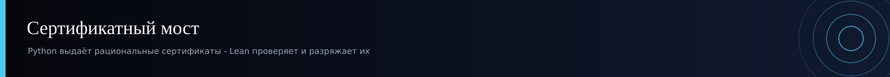
</p>

## Библиотека II — септинальный тормозной спутник

7 модулей, **64 теоремы верхнего уровня**, **62 аудированных заголовочных
теоремы** — чтение тех же констант в секторе C на кривой Клейна.

<p align="center">
  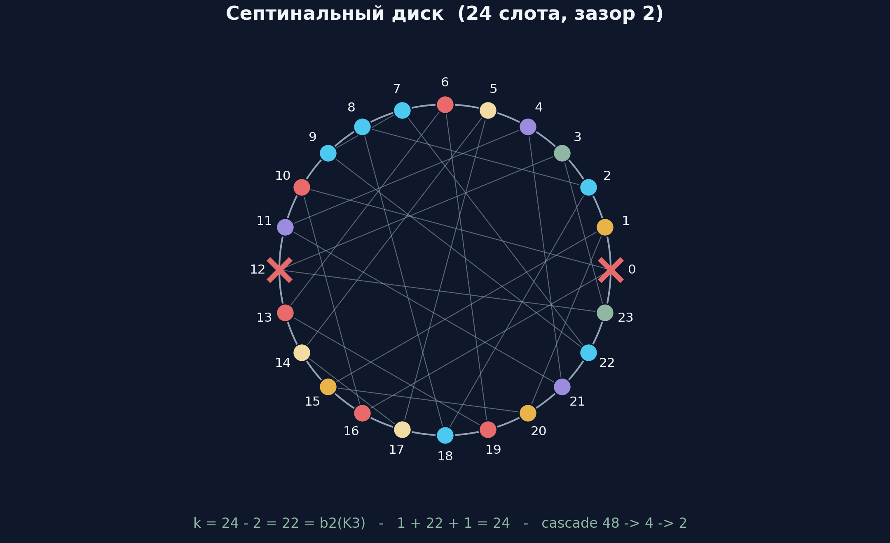
</p>

**Диск.** Полный оборот несёт 24 слота — отождествляются с F = 24
семиугольниками квартики Клейна (якорь P1) — и один неудалимый структурный
зазор ширины 2: антиподальная пара {0, 12} (P2). Эффективная ёмкость —
**счётная теорема**:

$$
\text{card(диск)} \;=\; 24 - 2 \;=\; 22 \;=\; b_2(\mathrm{K3})
\qquad \text{(Satellite.Dial.card\_dial — ДОКАЗАНО)}
$$

> хиральный раскол $22 = 11 + 11$: зеркало $x \mapsto 24 - x$ меняет дуги
> местами; среди 48 диэдральных отображений зазор сохраняют ровно
> $\{x,\ x{+}12,\ -x,\ 12{-}x\}$ — четверная группа Клейна $V_4$, — а
> ориентация оставляет два вращения: хвост $\mathbb{Z}_2$.

**Поправки.** ОДНА структурная пара β(d) = d²/2, α(d) = d⁵/22 на трёх
септинальных фазах δ_A = π/2, δ_B = π/3, δ_C = π/7 с целочисленным скелетом
**2⁵·22 = 704, 3⁵·22 = 5 346, 7⁵·22 = 369 754** — и трёхчленная запись

$$
\gamma_3 \;=\; 1 - \cos\!\left(\tfrac{2\pi}{7}\right) - \tfrac{\pi}{1200}
\;=\; 0.373892204263\ldots
$$

$$
\beta_C = \frac{\pi^2}{98} \qquad \alpha_C = \frac{\pi^5}{369754}
\qquad \text{(Satellite.Unlock.quanta — ДОКАЗАНО)}
$$

с доказанными аналитическими вилками
$1 - \tfrac{\sqrt2}{2} - \tfrac14 < \gamma_3 < \tfrac12$ — причём спутник
формулирует каждое наблюдаемое **безусловно**: `gamma_exact`, `k_exact`,
`quanta`, `orientation_tail`, `unlock` — теоремы одних постулатов,
`rfl`-разворачивания с нулём свободных параметров.

**Квант Берри.** Двухуровневая нормальная форма с квадратурной связью δ/√2:
нижний уровень сдвигается на λ₋(δ) = (1 − √(1+2δ²))/2 = −δ²/2 + R(δ) с
**доказанной** явной оценкой остатка `0 < R(δ) ≤ δ⁴/4`. Символьный двойник
`scripts/b1_berry_model.py` пересчитывает точный ряд SymPy

$$
-\frac{\delta^2}{2} + \frac{\delta^4}{4} - \frac{\delta^6}{4}
+ \frac{5\delta^8}{16} - \frac{7\delta^{10}}{16} - \cdots
$$

| Модуль | Теорем | Заголовок |
|---|---|---|
| `Satellite.B1_BerryShift` | 7 | замкнутые формы, тождество собственных значений, обе оценки остатка |
| `Satellite.B2_Dial22` | 8 | `card_dial` (24 − 2 = 22), `effective`, β/α на всех трёх фазах |
| `Satellite.B2b_Chirality` | 10 | раскол 11 + 11, биекции отражения, блокированная пара |
| `Satellite.C2_Corrections` | 9 | k = b₂(K3), три знаменателя, вилки b_Ch, вилки γ₃ |
| `Satellite.C3_Cascade` | 12 | ровно два вращения и два отражения выживают, замыкание V₄ |
| `Satellite.C4_Unlock` | 8 | **unlock**: γ₃, k, кванты — точно и без параметров |
| `Satellite.C5_Klein` | 10 | целочисленный скелет исчерпывающего перебора PSL(2,7) |

## PSL(2,7) и карта {7,3} квартики Клейна

`scripts/klein_psl27.py` выполняет **полный исчерпывающий перебор** —
GL(3,2) из всех 168 обратимых матриц 3×3 над 𝔽₂, полная решётка подгрупп с
замыканием по парам, регулярная карта {7,3} из порождающей пары (2,3,7) — и
каждое целое ниже отражено в `Satellite.C5_Klein` как проверенная ядром
`norm_num`-теорема:

$$
\mathrm{PSL}(2,7) = \mathrm{GL}(3,2):\quad
168 = 1 + 21 + 56 + 42 + 48 \quad \text{(порядки элементов)}
$$

$$
\text{полная решётка подгрупп:}\quad
179 = 1{+}21{+}28{+}35{+}28{+}8{+}21{+}14{+}8{+}14{+}1,
\qquad 14 \times S_4
$$

| | |
|---|---|
| карта {7,3} | 24 семиугольника · 84 ребра · 56 вершин; $\chi = 24 - 84 + 56 = -4$ (род 3); $24\cdot 7 = 56\cdot 3 = 84\cdot 2 = 168$ |
| антиподальная структура | у каждой грани **ровно две** грани на максимальном расстоянии 3; граф расстояния-3 — 8 непересекающихся треугольников; 24 привилегированные пары, стабилизатор 7 — максимум среди всех 276 пар |
| мост K3 | $1 + 22 + 1 = 24 \;\Rightarrow\; 24 - 2 = 22 = k$ |

Сферический профиль каждого слота — `1 + 7 + 14 + 2 = 24` — посчитан для всех
24 граней, у всех одинаковый.

<p align="center">
  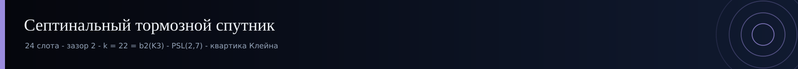
</p>

## Аксиомный аудит: ноль sorry, три аксиомы

Обе библиотеки несут механический аудит-файл, печатающий аксиомную зависимость
**каждой заголовочной теоремы**. Коммиченные прогоны:

| Аудит | Теорем | Результат |
|---|---|---|
| `lean/AxiomAudit.lean` → `logs/choptuik_audit.log` | 33 | каждая `[propext, Classical.choice, Quot.sound]` — `AUDIT_EXIT=0` |
| `lean/Satellite/AxiomAudit.lean` → `logs/sat_final.log` | 62 | каждая `[propext, Classical.choice, Quot.sound]` — `Build completed successfully` |
| полная пересборка → `logs/final_check.log` | 2 894 шага | exit 0, предупреждения — только заметки линтера |
| объединённая пересборка → `logs/merged_build.log` | 2 885 шагов | exit 0 |

**Единственные** аксиомы во всех деревьях зависимостей — три стандартных
константы Lean: `propext`, `Classical.choice`, `Quot.sound`. Ни одной аксиомы
`F_ref` в двух библиотеках не используется, ни одного `sorryAx` в выводах
аудита нет.

<details>
<summary><b>Инвентарь теорем по модулям</b> (генерируется — <code>data/theorem_inventory.csv</code>)</summary>

| Модуль | Теорем | Строк |
|---|---|---|
| `Choptuik.Bridge.Generated` | 16 | 130 |
| `Satellite.C3_Cascade` | 12 | 127 |
| `Choptuik.Bridge.Discharge` | 11 | 318 |
| `Satellite.C5_Klein` | 10 | 64 |
| `Satellite.B2b_Chirality` | 10 | 80 |
| `Satellite.C2_Corrections` | 9 | 90 |
| `Choptuik.Stability.Spectrum` | 9 | 403 |
| `Satellite.C4_Unlock` | 8 | 97 |
| `Satellite.B2_Dial22` | 8 | 55 |
| `Satellite.B1_BerryShift` | 7 | 94 |
| `Choptuik.Existence.DSSBoundary` | 7 | 322 |
| `Choptuik.Bridge.Certificates` | 6 | 473 |
| `Choptuik.Analysis.FieldEquations` | 6 | 899 |
| `Choptuik.ScalingDerivation` | 5 | 239 |
| `Choptuik.Existence.ImplicitFunction` | 5 | 402 |
| `Choptuik.Existence.DSS` | 4 | 325 |
| `Choptuik.Scaling` | 3 | 212 |
| `Choptuik.Analysis.Interval` | 3 | 134 |
| `Choptuik.Geometry.Curvature` | 2 | 129 |
| `Choptuik.Existence.TruncatedDSS` | 2 | 174 |
| `Choptuik.Stability.Gershgorin` | 1 | 106 |
| `Choptuik.Analysis.HyperbolicPDE` | 1 | 101 |

*Числа сняты с коммиченных источников скриптом `scripts/compute_all.py`;
полный каталог с формулировками — в [`docs/THEOREMS.md`](docs/THEOREMS.md).*

Плотность модулей с одного взгляда — строк Lean (x) против числа теорем (y):

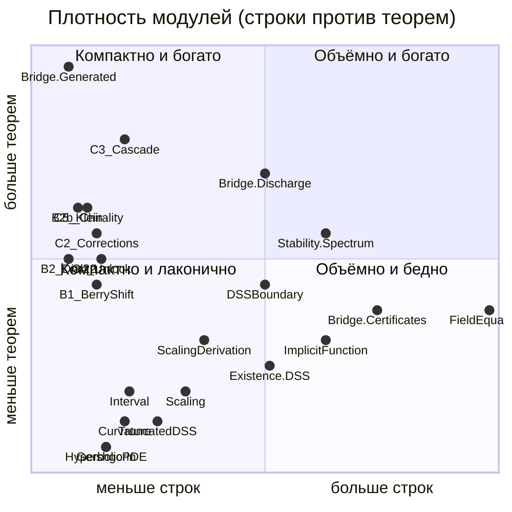

</details>

<p align="center">
  <sub><a href="#top">↑ наверх</a></sub>
</p>

## Данные и вычисления

Каждое число пакета регенерируется одной командой и пришпилено в `data/`.
Нигде при отрисовке нет ГСЧ — seed **1993** записан в каждом артефакте для
прослеживаемости с родительской программой.

| Файл | Содержание | Продюсер |
|---|---|---|
| `data/constants.json` | полное дерево констант: калибровка, рекорды, мост, септиналь | `compute_all.py` |
| `data/records.csv` | γ, Δ, γ₃, b_Ch против опубликованных, с **точными рациональными разностями** | `compute_all.py` |
| `data/spectrum_certificate.csv` | 15 сертификатных слотов (λ₀ + 7 сопряжённых пар) | `compute_all.py` |
| `data/bridge_certificates.csv` | lo/value/hi/width каждой рациональной оболочки | `compute_all.py` |
| `data/echo_model_derived.csv` | период виггля, рост и сжатие за эхо | `compute_all.py` |
| `data/septinial_corrections.csv` | β, α на δ_A, δ_B, δ_C + трёхчленная запись | `compute_all.py` |
| `data/berry_model.csv` · `berry_series.csv` | сдвиг Берри, 50 знаков `mpmath` + точный ряд SymPy | `compute_all.py` · `b1_berry_model.py` |
| `data/dial22_results.json` | переборные вердикты диск/хиральность/каскад | `check_dial_22.py` |
| `data/klein_psl27_results.json` | исчерпывающий перебор PSL(2,7) + {7,3} | `klein_psl27.py` |
| `data/certificates.json` | выданные сертификаты моста | `certify.py` |
| `data/theorem_inventory.csv` · `build_manifest.json` | просканированный инвентарь и итоги | `compute_all.py` |

Точный рациональный рекорд — прямо из `data/records.csv`:

| Величина | Точно | Десятично | Опубликовано | \|разность\| | Граница |
|---|---|---|---|---|---|
| γ = 1/λ₀ | `2000/5349` | 0.373901663862 | 0.374 | **263/2674500 = 9.83·10⁻⁵** | < 10⁻³ ✅ ДОКАЗАНО |
| Δ | `3445452402/10⁹` | 3.445452402000 | 3.4453 | **1.52·10⁻⁴** | < 5·10⁻⁴ ✅ ДОКАЗАНО |
| b_Ch | замкнутая форма | 0.376510198141 | 0.374 | 2.51·10⁻³ | 1 − √2/2 < b_Ch < 1/2 ✅ |
| γ₃ | замкнутая форма | 0.373892204263 | 0.374 | **1.08·10⁻⁴** | точно, без параметров ✅ |

<p align="center">
  
</p>

## Анимации

Все десять анимаций регенерируются детерминированно командой
`python scripts/generate_animations.py` (тёмная версия, seed 1993).

<table>
  <tr>
    <td width="50%" align="center">
      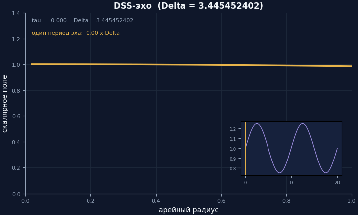
      <sub><b>DSS-эхо</b> — ψ(τ+Δ, ρ) = ψ(τ, ρ); вставка амплитуды с периодом Δ = 3.445452402</sub>
    </td>
    <td width="50%" align="center">
      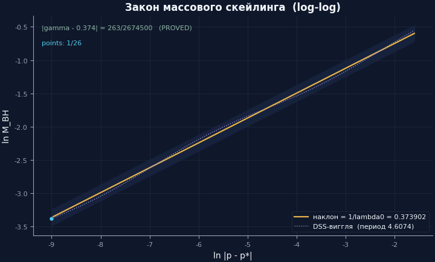
      <sub><b>Массовый скейлинг</b> — log-log точки на наклоне γ = 1/λ₀ с DSS-виггля, период 4.6074</sub>
    </td>
  </tr>
  <tr>
    <td width="50%" align="center">
      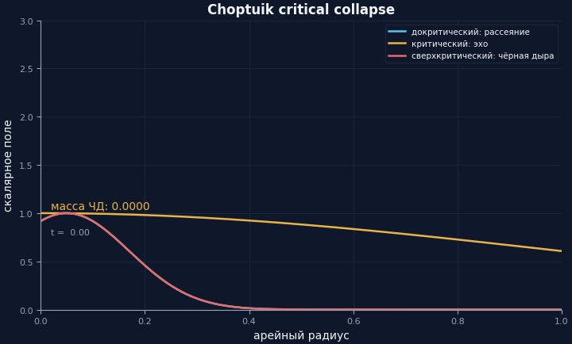
      <sub><b>Критический коллапс</b> — рассеяние / эхо на пороге / ЧД с M ∝ δ^γ</sub>
    </td>
    <td width="50%" align="center">
      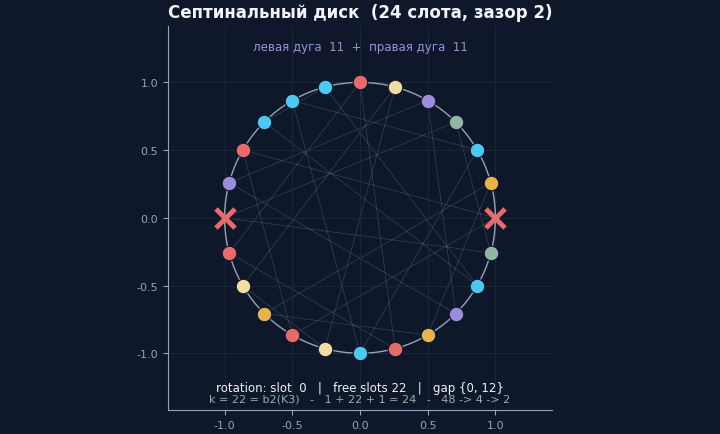
      <sub><b>Септинальный диск</b> — 24 слота, антиподальный зазор {0, 12}, цвета 8 триплетов Клейна, k = 22</sub>
    </td>
  </tr>
  <tr>
    <td width="50%" align="center">
      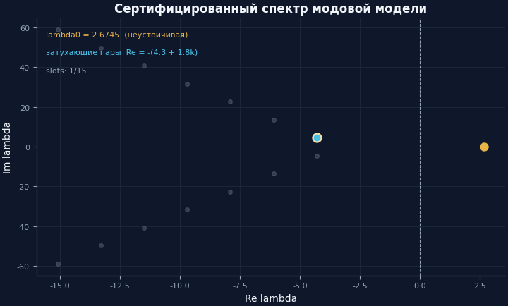
      <sub><b>Сертифицированный спектр</b> — 15 мод садятся в свои точные рациональные слоты</sub>
    </td>
    <td width="50%" align="center">
      <details>
        <summary><b>Английские зеркала</b> (развернуть)</summary>
        <em>…и английские зеркала в <a href="animations/en/">animations/en/</a> —
        те же пять сцен, английские подписи, байт-детерминизм.</em>
      </details>
    </td>
  </tr>
</table>

<p align="center">
  <sub><a href="#top">↑ наверх</a></sub>
</p>

## Галерея фигур

**Тёмная (GitHub) версия, русская** — `figures/dark_ru/` · английское тёмное зеркало в `figures/` ·
монографические версии (светлая *Ink & Gold*, EN и RU) в `figures/monograph_en/` · `figures/monograph_ru/`:

| Фигура | Показывает |
|---|---|
| [`fig_mass_scaling_law.png`](figures/dark_ru/fig_mass_scaling_law.png) | 26 log-log точек на γ-наклоне с полосой виггля |
| [`fig_echoing_profile.png`](figures/dark_ru/fig_echoing_profile.png) | профили, повторяющиеся через Δ; вставка периодической амплитуды |
| [`fig_spectrum_certificate.png`](figures/dark_ru/fig_spectrum_certificate.png) | 15 сертифицированных мод; λ₀ золотом; шаг эха 2π/ln 2 = 9.0647 |
| [`fig_exact_records.png`](figures/dark_ru/fig_exact_records.png) | γ, Δ, b_Ch, γ₃ против опубликованных на log-\|разность\| шкале с границами аудита |
| [`fig_berry_quantum.png`](figures/dark_ru/fig_berry_quantum.png) | λ₋(δ) против −δ²/2 с доказанной границей остатка δ⁴/4 |
| [`fig_septinial_dial.png`](figures/dark_ru/fig_septinial_dial.png) | диск: 24 слота, зазор {0,12}, 8 антиподальных триплетов, k = 22 |
| [`fig_psl27_lattice.png`](figures/dark_ru/fig_psl27_lattice.png) | решётка подгрупп PSL(2,7): 179 подгрупп, 14 × S₄ |
| [`fig_theorem_inventory.png`](figures/dark_ru/fig_theorem_inventory.png) | теоремы и строки по модулям, скан источников |

## Карта репозитория

```text
Septinal/
├── README.md · README_ru.md            ← английский + русский флагманы
├── LICENSE · CITATION.cff · .gitignore
├── lean/                               ← две Lean-библиотеки (коммичены как есть)
│   ├── lakefile.toml · lake-manifest.json · lean-toolchain
│   ├── Choptuik.lean · AxiomAudit.lean
│   ├── Choptuik/{Geometry,Analysis,Existence,Stability,Bridge}/…
│   ├── Satellite.lean · Satellite/{B1_BerryShift,B2_Dial22,B2b_Chirality,
│   │              C2_Corrections,C3_Cascade,C4_Unlock,C5_Klein}.lean
│   └── Satellite/AxiomAudit.lean
├── logs/                               ← 8 коммиченных логов сборки и аудита (exit 0)
├── scripts/                            ← всё регенерируется отсюда
│   ├── sepstyle.py                     ← общий стиль dark / Ink&Gold
│   ├── compute_all.py                  ← детерминированное вычислительное ядро
│   ├── certify.py                      ← продюсер/чекер сертификатов моста
│   ├── b1_berry_model.py               ← двойник Satellite.B1 (точный ряд SymPy)
│   ├── check_dial_22.py                ← двойник Satellite.B2/B2b/C3 (перебор)
│   ├── klein_psl27.py                  ← двойник Satellite.C5 (исчерпывающий PSL(2,7))
│   ├── generate_figures.py             ← 32 PNG @ 300 dpi, 4 версии (EN/RU × dark/light)
│   ├── generate_animations.py          ← 10 GIF, EN + RU
│   ├── generate_banners.py             ← SVG-идентичность, 13 файлов (EN + RU)
│   ├── septinal_verify.py              ← стенд верификации на чистом stdlib (меню / CLI / CI / самотест)
│   ├── septinal_verify.jl              ← Julia-близнец: тот же seed, те же golden-числа
│   ├── generate_docs.py                ← атлас теорем из источников
│   └── verify.py                       ← предпуш-гейт (ссылки, счётчики, артефакты)
├── data/                               ← 10 коммиченных CSV/JSON-артефактов
├── figures/  (+ dark_ru/ · monograph_en/ · monograph_ru/)
├── animations/  (en/ · ru/)
├── assets/  (banners/ · logo/)
├── monograph/                        ← SEPTINAL_Monograph.pdf — свёрстанная английская монография
└── docs/                               ← THEOREMS · AUDIT · GLOSSARY · REPRODUCE
```

## Воспроизведение

> [!TIP]
> **Есть пять минут?** `cd lean && lake build` — доказательства и есть
> результат. Всё остальное регенерируется из `scripts/`.

### Сторона Lean (доказательства)

<details open>
<summary><b>Предпосылки:</b> <code>elan</code> + кэшированный mathlib (≈2 ГБ)</summary>

```bash
curl https://elan.lean-lang.org/elan-init.sh -sSf | sh
```

</details>

- [ ] Скачать кэш mathlib (один раз, ~3 мин):

  ```bash
  cd lean && lake exe cache get!
  ```

- [ ] Собрать обе библиотеки (ожидается: exit 0, ~2 894 шага):

  ```bash
  lake build
  ```

- [ ] Прогнать аксиомный аудит (ожидается: 33 + 62 декларации, каждая
  `[propext, Classical.choice, Quot.sound]`):

  ```bash
  lake env lean AxiomAudit.lean
  lake env lean Satellite/AxiomAudit.lean
  ```

### Сторона Python (данные)

Предпосылки: Python 3.10+ с `numpy matplotlib sympy mpmath pillow`.

- [ ] Пересчитать каждое число → `data/`:

  ```bash
  python scripts/compute_all.py
  ```

- [ ] Выдать и проверить сертификаты моста:

  ```bash
  python scripts/certify.py emit && python scripts/certify.py check
  ```

- [ ] Переполучить числа скриптами-двойниками:

  ```bash
  python scripts/b1_berry_model.py     # точный ряд + границы на 50 знаков
  python scripts/check_dial_22.py      # переборные вердикты диска
  python scripts/klein_psl27.py        # исчерпывающий перебор PSL(2,7)
  ```

- [ ] Регенерировать фигуры, анимации, баннеры (32 PNG · 10 GIF · 13 SVG):

  ```bash
  python scripts/generate_figures.py       # 32 PNG, 4 версии (EN/RU × dark/light)
  python scripts/generate_animations.py    # 10 GIF, EN + RU
  python scripts/generate_banners.py       # 13 SVG-баннеров, EN + RU
  ```

- [ ] Прогнать верификационный стенд (близнецы Python и Julia, только stdlib):

  ```bash
  python scripts/septinal_verify.py --ci --preset quick --task all   # 7/7 PASS
  python scripts/septinal_verify.py --self-test --props --contract   # 17/17
  julia   scripts/septinal_verify.jl  --self-test                    # 15/15
  ```

> [!IMPORTANT]
> Каждый скрипт идемпотентен и байт-стабилен: запустите дважды, сравните
> выводы — сравнивать будет нечего.

**Серия аудитов (коммиченные логи)**

| Лог | Шаги | Результат |
|---|---|---|
| `logs/final_check.log` | 2 894 | exit 0 |
| `logs/merged_build.log` | 2 885 | exit 0 |
| `logs/choptuik_audit.log` | 33 декл. | `AUDIT_EXIT=0` |
| `logs/sat_final.log` | 62 декл. | `Build completed successfully` |

## Частые вопросы

<details>
<summary><b>Это рецензировано?</b></summary>

Нет — это *машинно-верифицированный исследовательский пакет*, а не журнальная
публикация. Верификация и есть аудит: **ноль `sorry`, ноль собственных аксиом,
exit 0** на 95 аудированных заголовочных декларациях. Каждое утверждение
независимо воспроизводится `lake build` (2 894 шага, кэшированный mathlib).
</details>

<details>
<summary><b>Что такое «септинальный тормозной спутник»?</b></summary>

*Геометрическое чтение* констант Чоптуика на кривой Клейна {7,3}. 24
семиугольные грани дают 24-слотовый диск; структурная антиподальная пара
{0, 12} даёт счётное тождество $k = 24 - 2 = 22 = b_2(\mathrm{K3})$; три
септинальные фазы $\delta_A = \pi/2$, $\delta_B = \pi/3$,
$\delta_C = \pi/7$ порождают точную безпараметрическую запись
$\gamma_3 = 1 - \cos(2\pi/7) - \pi/1200 = 0.373892\ldots$, в
$1.1\cdot 10^{-4}$ от чоптуиковских $0.374$ — *с нулём свободных параметров*.
Спутник не подгоняет — он *предсказывает*.
</details>

<details>
<summary><b>Почему «Septinal»?</b></summary>

От *sept-* (семь) — квартика Клейна это замощение {7,3}, группа симметрии
PSL(2,7), и всё геометрическое чтение живёт на 7-кратной симметрии диска.
Имя описательное, не мистическое.
</details>

<details>
<summary><b>«Септинальное чтение» — это нумерология?</b></summary>

Утверждение уже, чем звучит: *не* то, что γ Чоптуика в точности равна γ₃, не
то, что обязана равняться, и не то, что квартика Клейна вызывает критический
коллапс. Утверждение в том, что γ₃ — **точное, безпараметрическое,
проверенное ядром выражение**, попадающее в $1.1\cdot 10^{-4}$ от численно
откалиброванной γ, и что структурные константы $k = 22$ и разложение диска —
*доказанные счётные теоремы*, а не подгонки кривых. Осмысленно ли это
совпадение — вопрос, который пакет нарочно оставляет открытым; артефакт
доказывает арифметику, а не метафизику.
</details>

<details>
<summary><b>Чем отличаются <code>Choptuik</code> и <code>Satellite</code>?</b></summary>

`Choptuik` (17 модулей, 81 теорема) формализует физику: арену DSS,
существование, спектр, скейлинг и сертификатный мост. `Satellite` (7 модулей,
64 теоремы) формализует геометрическое чтение на квартике Клейна. Дисциплина
зависимостей строгая: `Choptuik` никогда не импортирует `Satellite`;
`Satellite` импортирует только mathlib и себя. Библиотеки соединяет лишь
наблюдение, что они разделяют константы.
</details>

<details>
<summary><b>Можно ли это переиспользовать?</b></summary>

Лицензия — **Isaev Proprietary**, читайте файл [`LICENSE`](LICENSE). Для
научной переписки автор доступен через GitHub и ORCID (ссылки выше).
</details>

<details>
<summary><b>Почему seed 1993?</b></summary>

Общий поток splitmix64 с родительской программой, чтобы Python- и
Julia-стенды строили идентичные синтетические данные. Каждая фигура, таблица
и анимация репозитория байт-воспроизводимы из этого seed. Дата — авторская;
дисциплина — байт-тождественность.
</details>

<p align="center">
  <sub><a href="#top">↑ наверх</a></sub>
</p>

## Цитирование

```bibtex
@software{isaev2026septinal,
  author  = {Исаев, Исхак Хамзатович},
  title   = {SEPTINAL — формальный Чоптуик и септинальный тормозной спутник},
  year    = {2026},
  note    = {формализация Lean 4 + Mathlib, крыло choptuik\_ac\_bc},
  url     = {https://github.com/wild8highlander/choptuik_ac_bc}
}
```

См. также [`CITATION.cff`](CITATION.cff).

<p align="right">
  <a href="https://github.com/wild8highlander/choptuik_ac_bc"></a>
  <a href="https://orcid.org/0009-0003-7299-0701"></a>
</p>

## Лицензия и авторство

> [!WARNING]
> **Лицензия Isaev Proprietary.** Распространение, модификация и производные
> работы требуют письменного разрешения автора. Пакет предоставляется «как
> есть» для исследовательского ознакомления; без гарантий, без подразумеваемой
> пригодности.

Выпущено под [лицензией Isaev Proprietary](LICENSE) — индивидуальное авторство.
**Исхак Хамзатович Исаев** ([@wild8highlander](https://github.com/wild8highlander)),
Нальчик, Кабардино-Балкарская Республика ·
ORCID [0009-0003-7299-0701](https://orcid.org/0009-0003-7299-0701).

<p align="center">
  <picture>
    <source media="(prefers-color-scheme: dark)" srcset="assets/logo/logo_dark.svg">
    <source media="(prefers-color-scheme: light)" srcset="assets/logo/logo_light.svg">
    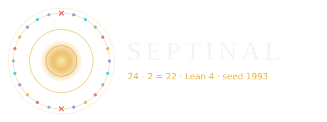
  </picture>
</p>
