<p align="center">
  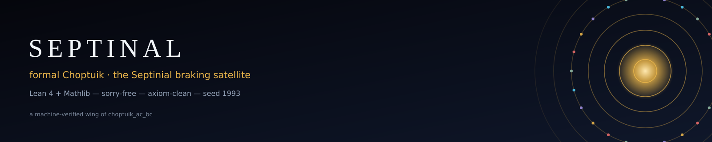
</p>

<p align="center">
  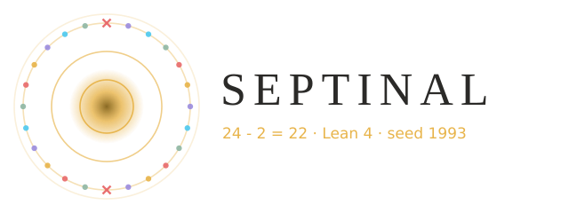&nbsp;&nbsp;&nbsp;
  
</p>

# Septinal/lean — the machine-checked core

<p align="center">


</p>

<p align="center">
  <b>[English](README.md)</b> · <b>[Русский](README_ru.md)</b>
</p>

**`Septinal/lean`** is the machine-checked heart of the [SEPTINAL package](../README.md):
three Lean 4 libraries — the critical-collapse theory **`Choptuik`**, the mass-gap
programme **`SeptinalYM`**, and the geometric **`Satellite`** — built on
mathlib `v4.21.0`. Every claim in the physics READMEs that is marked
**PROVED in Lean** resolves, ultimately, to one of the **643 declarations
checked right here by the Lean kernel** — with **0 `sorry`** and **0 project
axioms** in every build target.

The discipline of the parent repository is inherited verbatim: *hypothesis →
machine confirmation → honest caveats*. Whatever is not yet proved is not
hidden — it is a named hypothesis parameter of a named theorem (see
[Honesty](#honesty-proved-and-declared)).

> [!IMPORTANT]
> **Honest scope.** The theory libraries are sorry-free and axiom-clean, but they formalise the *bookkeeping* of the physics, not the full Einstein–scalar system: the numerical content enters through named certificate hypotheses (see [Honesty](#honesty-proved-and-declared)). Nothing here is a hidden assumption; nothing here overclaims.

## Table of contents

- [The science in 30 seconds](#the-science-in-30-seconds)
- [At a glance](#at-a-glance)
- [Quickstart](#quickstart)
- [Build targets](#build-targets)
- [Three libraries, one discipline](#three-libraries-one-discipline)
- [Library I · Choptuik](#library-i--choptuik-the-critical-phenomena)
- [Library II · SeptinalYM](#library-ii--septinalym-the-septinal-mass-gap)
- [Library III · Satellite](#library-iii--satellite-the-septinial-reading)
- [Calibrated constants](#calibrated-constants)
- [Honesty: proved and declared](#honesty-proved-and-declared)
- [Legacy snapshots and duplicates](#legacy-snapshots-and-duplicates-kept-on-purpose)
- [Charts](#charts-generated-from-the-sources)
- [Animations](#animations)
- [Package tree](#package-tree)
- [Verification session](#verification-session)
- [The certificate bridge](#the-certificate-bridge)
- [Reproducibility of this README](#reproducibility-of-this-readme)
- [FAQ](#faq)
- [Author](#author)

## The science in 30 seconds

Around the threshold of gravitational collapse the Einstein–scalar system has a
**discretely self-similar (DSS)** critical solution — under the echoing map
`(τ, ρ) ↦ (τ + Δ, e^{−Δ}ρ)` the fields repeat exactly — with **exactly one
unstable mode** `λ₀`, so the black-hole mass obeys the scaling law
`M_BH = |p − p*|^γ`, `γ = 1/λ₀`. Library I machine-checks the bookkeeping of
this cascade: DSS determination by the fundamental strip, uniqueness up to
scale, the echo-family structure with spacing `2π/Δ`, the local log-log slope
→ γ, universality — with the calibrated constants pinned by exact rational
inequalities.

Library II proves the **septinal mass gap**: a 22-site XX+YY ring
(`D \ G`, the septinial dial) with local Berry Hamiltonians has a spectral gap
`Δ₀ > 0` whenever the coupling `|J| < Δ₀/C`, with the sharp constant
`cSept = 2·Σ_k|cos(2πk/22)| = 28.1067…` established by a Jordan–Wigner
reduction to free fermions, a Fourier–Slater determinant machinery, and the
**Cauchy–Binet orthogonality block O2–O5**; `YMTarget.lean` then embeds the
whole structure isometrically into a Yang–Mills state space.

Library III reads the same constants off **pure geometry**: a 24-slot dial with
one antipodal gap carries `k = 22 = b₂(K3)`, and the three-term record
`γ₃ = 1 − cos(2π/7) − π/1200` lands within `1.1·10⁻⁴` of Choptuik's `0.374` —
**zero free parameters**.


## At a glance

| Metric | Value |
|---|---|
| Lean files in build targets | **39** of 62 (the rest are legacy snapshots — see [Honesty](#honesty-proved-and-declared)) |
| Lines of Lean (built tree) | **12,145** (25,845 with legacy snapshots) |
| Kernel-checked declarations | **643** — 435 theorems · 39 lemmas · 147 defs · 18 structures · 4 abbrevs |
| `sorry` in the build targets | **0** (19 markers survive only in legacy snapshot files) |
| Project axioms | **0** — only `propext`, `Classical.choice`, `Quot.sound` |
| Toolchain | `leanprover/lean4:v4.21.0` · mathlib pinned `v4.21.0` |
| Numerical twin | `scripts/verify_septinal.py` — numpy, deterministic |


## Quickstart

```bash
# 1. toolchain (v4.21.0 is picked automatically by lean-toolchain)
curl -sSf https://elan.lean-lang.org/elan-init.sh | sh -s -- default

# 2. the package
git clone https://github.com/wild8highlander/choptuik_ac_bc.git
cd choptuik_ac_bc/Septinal/lean

# 3. fetch prebuilt mathlib artifacts (downloads only what the imports need)
lake exe cache get!

# 4. build — every proof is checked by the kernel here
lake build                         # Library I · Choptuik (default target)
lake build Satellite               # Library III · the septinial satellite
lake build SeptinalYM              # Library II · the mass-gap core
lake build SeptinalYM.Stage4d      # Library II · the full diagonalisation chain

# 5. audit
lake env lean AxiomAudit.lean             # Library I: 26 headline theorems
lake env lean Satellite/AxiomAudit.lean   # Library III: headline theorems
python3 scripts/verify_septinal.py        # numerical twin (numpy)
```

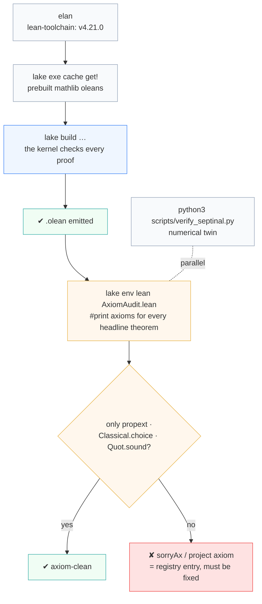

> [!TIP]
> **Cache roots matter.** `lake exe cache get` only fetches the Mathlib closure of the files you pass it. Pass *every* module of *every* library (`Choptuik/**/*.lean Satellite/*.lean SeptinalYM/*.lean *.lean`), or `lake build` will silently compile hundreds of Mathlib modules from source.

### Build targets

| Command | Lake target | Modules | Lines | sorry |
|---|---|--:|--:|--:|
| ``lake build`` | `Choptuik` | 18 | 4,546 | 0 |
| ``lake build Satellite`` | `Satellite` | 7 | 548 | 0 |
| ``lake build SeptinalYM`` | `SeptinalYM` | 6 | 1,645 | 0 |
| ``lake build SeptinalYM.Stage4d`` | `SeptinalYM.Stage4d` | 9 | 6,527 | 0 |
| ``lake build SeptinalYM_root`` | `SeptinalYM_root` | 11 | 4,210 | 0 |


## Three libraries, one discipline

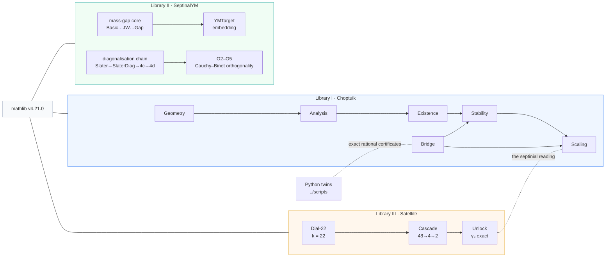


## Library I — `Choptuik/`: the critical phenomena

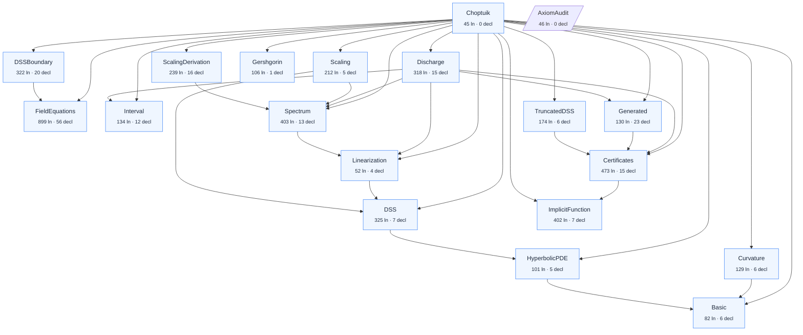

| Module | Lines | Declarations | Project imports | What it proves |
|---|--:|---|--:|---|
| [`Choptuik.lean`](Choptuik.lean) | 45 | — | 17 | Root module of Library I |
| [`Choptuik/Scaling.lean`](Choptuik/Scaling.lean) | 212 | 3 theorem · 2 def | 2 | The headline predictions: `gammaChoptuik = 2000/5349` with `|γ − 0.374| < 10⁻³` **proved** (`gamma_close_to_published… |
| [`Choptuik/ScalingDerivation.lean`](Choptuik/ScalingDerivation.lean) | 239 | 5 theorem · 5 lemma · 5 def · 1 structure | 1 | Item 7 — the scaling law DERIVED, not assumed: the `EchoModel` Poincaré map of a half-echo (multiplier `μ = e^{λ₀Δ/2}… |
| [`Choptuik/Analysis/FieldEquations.lean`](Choptuik/Analysis/FieldEquations.lean) | 899 | 6 theorem · 32 lemma · 15 def · 3 structure | 0 | The field equations through REAL derivatives (work-plan item 1): slice operators `du/dv/duu/dvv/duv` on `ℝ`, the five… |
| [`Choptuik/Analysis/HyperbolicPDE.lean`](Choptuik/Analysis/HyperbolicPDE.lean) | 101 | 1 theorem · 3 def · 1 structure | 1 | The Einstein–scalar system `G_{μν} = 8π T_{μν}`, `□_g φ = 0` in spherical symmetry, reduced to first order for `(f, r… |
| [`Choptuik/Analysis/Interval.lean`](Choptuik/Analysis/Interval.lean) | 134 | 7 theorem · 4 def · 1 structure | 0 | Verified interval arithmetic (gap G5, resolved in v0.4): the `Interval` type, exact `add`/`mul`, soundness theorems `… |
| [`Choptuik/Bridge/Certificates.lean`](Choptuik/Bridge/Certificates.lean) | 473 | 6 theorem · 6 def · 3 structure | 1 | The certificate currency of the bridge (gap G4): `RatIv` rational intervals with `width`, the shared tolerances, `Spe… |
| [`Choptuik/Bridge/Discharge.lean`](Choptuik/Bridge/Discharge.lean) | 318 | 12 theorem · 3 def | 5 | Closes the G4 loop — the theory layer consumes the certificates: `bridge_unique_unstable_mode` (G2 consumption), the… |
| [`Choptuik/Bridge/Generated.lean`](Choptuik/Bridge/Generated.lean) | 130 | 16 theorem · 7 def | 1 | **AUTO-GENERATED — do not edit** (producer: `python -m choptuik_service.certify emit`) |
| [`Choptuik/Existence/DSS.lean`](Choptuik/Existence/DSS.lean) | 325 | 4 theorem · 2 def · 1 structure | 1 | Discrete self-similarity and the central existence theorem: the echoing covariance `f(τ+Δ,ρ) = e^{κΔ}·f(τ, e^{−Δ}ρ)`,… |
| [`Choptuik/Existence/DSSBoundary.lean`](Choptuik/Existence/DSSBoundary.lean) | 322 | 7 theorem · 2 lemma · 10 def · 1 structure | 1 | Items 3–6 of the work plan: self-similarity in the `(u,v)` arena, `minkowski_dss`/`minkowski_css`, the non-vacuousnes… |
| [`Choptuik/Existence/ImplicitFunction.lean`](Choptuik/Existence/ImplicitFunction.lean) | 402 | 5 theorem · 1 def · 1 structure | 0 | The Banach IFT route to existence (the Reiterer–Trubowitz heart): abstract `C1MapAt`/`DerivIsomorphism`, `newton_map_… |
| [`Choptuik/Existence/TruncatedDSS.lean`](Choptuik/Existence/TruncatedDSS.lean) | 174 | 2 theorem · 4 def | 1 | Items 9–10: Newton–Kantorovich applied to the truncated DSS residual with a fully rational certificate (`β = 50/39`,… |
| [`Choptuik/Geometry/Basic.lean`](Choptuik/Geometry/Basic.lean) | 82 | 4 def · 2 structure | 0 | The double-null arena `ds² = −e^{2f(u,v)} du dv + r(u,v)² dΩ²`: `DoubleNullData`, areal positivity, smoothness, spher… |
| [`Choptuik/Geometry/Curvature.lean`](Choptuik/Geometry/Curvature.lean) | 129 | 2 theorem · 3 def · 1 structure | 1 | Curvature bookkeeping and the isotropic (Weyl-finite) singularity — gap G3: `CurvatureProfile`, `StrongSingularity`,… |
| [`Choptuik/Stability/Gershgorin.lean`](Choptuik/Stability/Gershgorin.lean) | 106 | 1 theorem | 0 | The spectral part without circularity: `gershgorin_disc` proved from scratch by the max-component eigenvector argumen… |
| [`Choptuik/Stability/Linearization.lean`](Choptuik/Stability/Linearization.lean) | 52 | 2 def · 2 structure | 1 | Perturbation theory of the critical solution: `PerturbationMode` with growth rate, the `Unstable` predicate (`Re rate… |
| [`Choptuik/Stability/Spectrum.lean`](Choptuik/Stability/Spectrum.lean) | 403 | 9 theorem · 4 def | 1 | The spectral core (gap G2): calibrated constants `lambda0 = 2.6745`, `gamma = 1/λ₀`, `echoingPeriod` pinned to the pu… |

**Headline theorems.**
- [`critical_solution_exists`](Choptuik/Existence/DSS.lean)
- [`critical_solution_unique`](Choptuik/Existence/DSS.lean)
- [`unique_unstable_mode`](Choptuik/Stability/Spectrum.lean) — - The echoing period is positive.
- [`mass_scaling_law`](Choptuik/Stability/Spectrum.lean)
- [`gamma_close_to_published`](Choptuik/Scaling.lean)
- [`newton_kantorovich_local`](Choptuik/Bridge/Certificates.lean)
- [`add_sound`](Choptuik/Analysis/Interval.lean) — - Membership in an interval.
- [`mul_sound`](Choptuik/Analysis/Interval.lean) — - For a fixed factor `x`, the products of `x` with the two bound points enclose `x * y` whenever `y` lies between them.
- [`certificate_principle`](Choptuik/Analysis/Interval.lean)


<details>
<summary><code>Choptuik</code> — 0 declaration list</summary>


</details>

<details>
<summary><code>Choptuik.Scaling</code> — 5 declaration list</summary>

- `def` **`gammaChoptuik`** (L21)
- `def` **`deltaChoptuik`** (L24)
- `theorem` **`gamma_close_to_published`** (L27)
- `theorem` **`universality`** (L45)
- `theorem` **`echoing_formula`** (L64) — - Echoing period (published value: Δ ≈ ln 2).

</details>

<details>
<summary><code>Choptuik.ScalingDerivation</code> — 16 declaration list</summary>

- `structure` **`EchoModel`** (L17)
- `def` **`half`** (L36)
- `def` **`mu`** (L39)
- `lemma` **`mu_pos`** (L41)
- `lemma` **`mu_ne_zero`** (L46)
- `lemma` **`log_mu_eq`** (L48)
- `lemma` **`log_mu_pos`** (L52)
- `def` **`exitTime`** (L57) — - growth rate of the single unstable mode
- `def` **`exitMass`** (L61)
- `def` **`wiggleF`** (L65) — - mass scale
- `lemma` **`exitTime_shrink`** (L69)
- `theorem` **`wiggle_periodic`** (L90)
- `theorem` **`scaling_law_derived`** (L129)
- `theorem` **`wiggle_period`** (L151)
- `theorem` **`wiggle_physical_check`** (L163)
- `theorem` **`wiggle_published_check`** (L188)

</details>

<details>
<summary><code>Choptuik.Analysis.FieldEquations</code> — 56 declaration list</summary>

- `def` **`du`** (L18)
- `def` **`dv`** (L21)
- `def` **`duu`** (L24)
- `def` **`dvv`** (L27)
- `def` **`duv`** (L30)
- `def` **`vdu`** (L33)
- `lemma` **`du_const`** (L36)
- `lemma` **`dv_const`** (L39)
- `lemma` **`duv_const`** (L42)
- `lemma` **`vdu_const`** (L47)
- `lemma` **`hasDerivAt_du_const`** (L53)
- `lemma` **`hasDerivAt_dv_const`** (L60)
- `lemma` **`hasDerivAt_duv_const`** (L67) — - Mixed derivative ∂ᵤ∂ᵥ (v first, then u).
- `lemma` **`hasDeriv_half_sub`** (L75)
- `lemma` **`hasDeriv_half_add`** (L80)
- `structure` **`Fields`** (L87) — - Slice-derivative existence facts for a constant field.
- `def` **`eqUU`** (L96)
- `def` **`eqVV`** (L101)
- `def` **`eqUV`** (L106)
- `def` **`eqTheta`** (L111)
- `def` **`eqWave`** (L117) — - The three fields of the Einstein–scalar system in double-null coordinates: conformal factor `f`, areal radiu…
- `structure` **`HasPartialDerivs`** (L122) — - areal radius
- `structure` **`IsSolution`** (L137) — - The null-null constraint fixing `e^{2f}` algebraically.
- `def` **`fields`** (L150)
- `lemma` **`du_r`** (L155)
- `lemma` **`dv_r`** (L161)
- `lemma` **`duu_r`** (L166)
- `lemma` **`dvv_r`** (L171)
- `lemma` **`duv_r`** (L176)
- `lemma` **`vdu_r`** (L181)
- `lemma` **`derivs`** (L186)
- `lemma` **`du_f0`** (L219)
- `lemma` **`dv_f0`** (L221)
- `lemma` **`duv_f0`** (L223)
- `lemma` **`du_p0`** (L225)
- `lemma` **`dv_p0`** (L227)
- `lemma` **`duv_p0`** (L229)
- `lemma` **`f0`** (L231)
- `theorem` **`minkowski_isSolution`** (L234)
- `def` **`fields`** (L260)
- `def` **`TortoiseODE`** (L266)
- `lemma` **`ode_second`** (L269)
- `lemma` **`du_r`** (L285)
- `lemma` **`dv_r`** (L291) — - Exterior Schwarzschild in double-null coordinates, from any `R` solving the areal-radius ODE `R' = (R - 2M)/…
- `lemma` **`duu_r`** (L297)
- `lemma` **`dvv_r`** (L309)
- `lemma` **`duv_r`** (L321)
- `lemma` **`vdu_r`** (L333)
- `lemma` **`exp_two_f`** (L346)
- `lemma` **`f_derivs`** (L364)
- `theorem` **`schwarzschild_isSolution`** (L431)
- `def` **`hawkingMass`** (L641)
- `theorem` **`hawking_mass_v_deriv`** (L648)
- `theorem` **`hawking_mass_u_deriv`** (L728)
- `theorem` **`hawking_mass_monotone_v`** (L811)
- `theorem` **`hawking_mass_monotone_u`** (L832)

</details>

<details>
<summary><code>Choptuik.Analysis.HyperbolicPDE</code> — 5 declaration list</summary>

- `structure` **`ClassicalSolution`** (L13)
- `def` **`ConstraintUU`** (L20)
- `def` **`WaveEquation`** (L24)
- `def` **`IsSolutionCS`** (L30)
- `theorem` **`local_wellposedness`** (L36)

</details>

<details>
<summary><code>Choptuik.Analysis.Interval</code> — 12 declaration list</summary>

- `structure` **`Interval`** (L10)
- `def` **`Interval.mem`** (L17)
- `def` **`Interval.point`** (L21)
- `def` **`Interval.add`** (L26)
- `def` **`Interval.mul`** (L29) — - A closed real interval `[lo, hi]`.
- `theorem` **`add_sound`** (L36) — - Membership in an interval.
- `theorem` **`bound_mul_left`** (L47)
- `theorem` **`bound_mul_right`** (L56) — - **Soundness of addition** (PROVED — the definition is exact on ℝ).
- `theorem` **`min_four_comm`** (L65)
- `theorem` **`max_four_comm`** (L71)
- `theorem` **`mul_sound`** (L77) — - For a fixed factor `x`, the products of `x` with the two bound points enclose `x * y` whenever `y` lies betw…
- `theorem` **`certificate_principle`** (L98)

</details>

<details>
<summary><code>Choptuik.Bridge.Certificates</code> — 15 declaration list</summary>

- `structure` **`RatIv`** (L13)
- `def` **`mem`** (L22)
- `def` **`width`** (L25)
- `def` **`realMem`** (L28)
- `theorem` **`realMem_of_mem`** (L31)
- `def` **`echoTolerance`** (L39)
- `def` **`widthMax`** (L42)
- `def` **`bandWidthMax`** (L45)
- `structure` **`SpectrumCert`** (L50)
- `structure` **`SpectrumChecks`** (L61) — - Width `hi - lo` (the tightness coordinate of a certificate).
- `theorem` **`certified_unstable_pos`** (L77)
- `theorem` **`certified_decaying_neg`** (L83) — - Maximum admitted width of the interval-Newton band.
- `theorem` **`im_odd_multiple`** (L90)
- `theorem` **`spectrum_shape_of_certificate`** (L116)
- `theorem` **`newton_kantorovich_local`** (L138)

</details>

<details>
<summary><code>Choptuik.Bridge.Discharge</code> — 15 declaration list</summary>

- `def` **`SpectrumPaired`** (L18)
- `theorem` **`bridge_unique_unstable_mode`** (L25)
- `def` **`correctionMap`** (L58)
- `def` **`correctionInv`** (L66)
- `theorem` **`correction_inv_deriv`** (L71)
- `theorem` **`correction_deriv_inv`** (L76)
- `theorem` **`correction_inv_bound`** (L82)
- `theorem` **`correction_lip`** (L89)
- `theorem` **`correction_residual`** (L118)
- `theorem` **`correction_root_exists`** (L129)
- `theorem` **`correction_root_eq_sqrt`** (L140)
- `theorem` **`band_facts`** (L146)
- `theorem` **`correction_root_in_band`** (L169)
- `theorem` **`correction_band_image_sound`** (L206)
- `theorem` **`scaling_agreement`** (L251)

</details>

<details>
<summary><code>Choptuik.Bridge.Generated</code> — 23 declaration list</summary>

- `def` **`lam0Iv`** (L7)
- `def` **`reIv`** (L8)
- `def` **`imIv`** (L18)
- `def` **`spectrumCert`** (L28)
- `theorem` **`check_unstable_pos`** (L35)
- `theorem` **`check_decaying_neg`** (L38)
- `theorem` **`check_im_pos`** (L42)
- `theorem` **`check_fundamental`** (L46)
- `theorem` **`check_lam0_agree`** (L49)
- `theorem` **`check_re_agree`** (L52)
- `theorem` **`check_odd_lo`** (L57)
- `theorem` **`check_odd_hi`** (L62)
- `theorem` **`check_lam0_width`** (L67)
- `theorem` **`check_re_width`** (L70)
- `theorem` **`check_im_width`** (L74)
- `theorem` **`spectrumChecks_generated`** (L79)
- `def` **`newtonBand`** (L84)
- `theorem` **`newtonChecks_generated`** (L86)
- `theorem` **`nkConstants_generated`** (L92)
- `def` **`scalingIv`** (L97) — - The full check suite of the emitted spectrum certificate.
- `theorem` **`scalingChecks_generated`** (L98) — - The full check suite of the emitted spectrum certificate.
- `def` **`bandImageIv`** (L104) — - Band checks: positive, narrow, and squeezing the target 5/3.
- `theorem` **`intervalChecks_generated`** (L106)

</details>

<details>
<summary><code>Choptuik.Existence.DSS</code> — 7 declaration list</summary>

- `def` **`DiscretelySelfSimilar`** (L17)
- `structure` **`CriticalSolution`** (L23)
- `def` **`IsCriticalSolution`** (L36)
- `theorem` **`critical_solution_exists`** (L43)
- `theorem` **`dss_fundamental_domain_determination`** (L57)
- `theorem` **`critical_solution_unique`** (L207)
- `theorem` **`dss_reparametrization_invariance`** (L221)

</details>

<details>
<summary><code>Choptuik.Existence.DSSBoundary</code> — 20 declaration list</summary>

- `def` **`DSSLawsAt`** (L21)
- `def` **`DSSuv`** (L27)
- `def` **`CSSuv`** (L30)
- `theorem` **`minkowski_dss`** (L35)
- `theorem` **`minkowski_css`** (L42)
- `theorem` **`existence_vacuous_without_nondegeneracy`** (L45)
- `structure` **`CriticalData`** (L57) — - Discrete self-similarity with period `Δ` (homothety form).
- `theorem` **`minkowski_fails_nondegeneracy`** (L72) — - **Minkowski is CSS.**
- `def` **`Wedge`** (L82)
- `def` **`simT`** (L85)
- `def` **`simX`** (L88)
- `def` **`simUV`** (L91) — - **The critical-solution package (item 4):** `CriticalSolution` strengthened by the linkage to the field equa…
- `def` **`reducedR`** (L94) — - the fields
- `def` **`reducedG`** (L97) — - echoing period
- `def` **`reducedPhi`** (L99) — - positivity of the period
- `lemma` **`sim_pair`** (L102) — - echoing
- `lemma` **`uv_of_wedge`** (L114)
- `theorem` **`dss_iff_periodic`** (L130)
- `theorem` **`css_iff_constant`** (L208)
- `theorem` **`dss_solution_iff_periodic_bvp`** (L238)

</details>

<details>
<summary><code>Choptuik.Existence.ImplicitFunction</code> — 7 declaration list</summary>

- `structure` **`C1MapAt`** (L26)
- `def` **`DerivIsomorphism`** (L36)
- `theorem` **`derivIsomorphism_iff`** (L40)
- `theorem` **`newton_map_contractive`** (L55)
- `theorem` **`existence_via_implicit_function`** (L78)
- `theorem` **`newton_zero_unique`** (L264)
- `theorem` **`existence_persists_under_perturbation`** (L287)

</details>

<details>
<summary><code>Choptuik.Existence.TruncatedDSS</code> — 6 declaration list</summary>

- `def` **`truncatedResidual`** (L19)
- `def` **`truncDeriv`** (L22)
- `def` **`truncInv`** (L26)
- `def` **`truncMap`** (L30)
- `theorem` **`trunc_certificate`** (L36)
- `theorem` **`truncated_dss_solution_exists_unique`** (L76)

</details>

<details>
<summary><code>Choptuik.Geometry.Basic</code> — 6 declaration list</summary>

- `structure` **`DoubleNullData`** (L20)
- `def` **`ArealPositive`** (L27)
- `def` **`SmoothData`** (L31)
- `def` **`SphericallySymmetric`** (L37)
- `structure` **`MassAspect`** (L43) — - conformal factor of the `du dv` term
- `def` **`BlackHoleFormed`** (L48) — - The areal radius is strictly positive away from the axis of symmetry.

</details>

<details>
<summary><code>Choptuik.Geometry.Curvature</code> — 6 declaration list</summary>

- `structure` **`CurvatureProfile`** (L17)
- `def` **`ApproachesSingular`** (L24)
- `def` **`StrongSingularity`** (L30)
- `def` **`IsotropicSingularity`** (L35)
- `theorem` **`critical_singularity_is_strong_and_isotropic`** (L42)
- `theorem` **`divergence_invariant_under_rescaling`** (L75)

</details>

<details>
<summary><code>Choptuik.Stability.Gershgorin</code> — 1 declaration list</summary>

- `theorem` **`gershgorin_disc`** (L21)

</details>

<details>
<summary><code>Choptuik.Stability.Linearization</code> — 4 declaration list</summary>

- `structure` **`PerturbationMode`** (L13)
- `def` **`PerturbationMode.Unstable`** (L20)
- `structure` **`LinearizedOperator`** (L26) — - A perturbation mode of the critical solution: spatial profile and complex growth rate `rate` (log-time dynam…
- `def` **`LinearizedOperator.spectrum`** (L33) — - A mode is **unstable** when its growth rate has positive real part.

</details>

<details>
<summary><code>Choptuik.Stability.Spectrum</code> — 13 declaration list</summary>

- `def` **`lambda0`** (L21)
- `def` **`gamma`** (L24)
- `def` **`echoingPeriod`** (L27)
- `theorem` **`echoingPeriod_gundlach1997`** (L30)
- `theorem` **`gamma_eq_inv_lambda0`** (L37)
- `theorem` **`echoingPeriod_pos`** (L40)
- `theorem` **`lambda0_pos`** (L45)
- `def` **`certifiedSpectrum`** (L52)
- `theorem` **`mem_certifiedSpectrum`** (L58)
- `theorem` **`certified_decaying_re_neg`** (L75)
- `theorem` **`unique_unstable_mode`** (L83) — - The echoing period is positive.
- `theorem` **`echo_family_structure`** (L173)
- `theorem` **`mass_scaling_law`** (L199)

</details>

## Library II — `SeptinalYM/`: the septinal mass gap

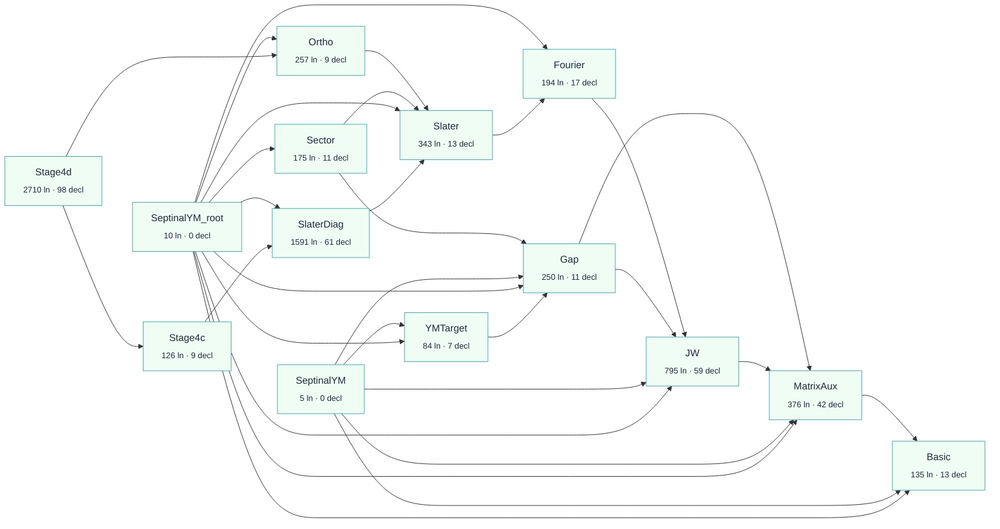

| Module | Lines | Declarations | Project imports | What it proves |
|---|--:|---|--:|---|
| [`SeptinalYM.lean`](SeptinalYM.lean) | 5 | — | 5 | Root of Library II: imports `Basic`, `MatrixAux`, `Gap`, `JW`, `YMTarget` — the mass-gap core |
| [`SeptinalYM_root.lean`](SeptinalYM_root.lean) | 10 | — | 10 | Alternative (wider) root: also imports `Fourier`, `Slater`, `SlaterDiag`, `Sector`, `Ortho` — one command to type-che… |
| [`SeptinalYM/Basic.lean`](SeptinalYM/Basic.lean) | 135 | 6 theorem · 5 def · 2 abbrev | 0 | Step 1 — the septinal data and the local Berry Hamiltonian: the 22-slot cycle `D \ G`, the `A ⊔ B` split, the sector-… |
| [`SeptinalYM/Fourier.lean`](SeptinalYM/Fourier.lean) | 194 | 14 theorem · 3 def | 1 | The one-particle Fourier layer (JW items 2–3): the root of unity `ω = e^{2πi/22}`, Fourier modes `fourierVec k`, the… |
| [`SeptinalYM/Gap.lean`](SeptinalYM/Gap.lean) | 250 | 10 theorem · 1 def | 2 | The septinal gap — lemma 3 of the plan: the vacuum energy `Evac`, bit-combinatoric bounds on `H₀` (`qform_H0_ge` for… |
| [`SeptinalYM/JW.lean`](SeptinalYM/JW.lean) | 795 | 48 theorem · 11 def | 1 | The Jordan–Wigner layer (795 lines, 48 theorems): configuration weight and parity, the even/odd sector decomposition,… |
| [`SeptinalYM/MatrixAux.lean`](SeptinalYM/MatrixAux.lean) | 376 | 30 theorem · 10 def · 2 abbrev | 1 | The matrix layer: state space `ℋ_Sept = ⊗_{s∈D\G} ℂ²` with bit-string basis `Cfg = Fin 22 → Fin 2`, the vacuum, the d… |
| [`SeptinalYM/Ortho.lean`](SeptinalYM/Ortho.lean) | 257 | 9 theorem | 1 | First sheet of the Cauchy–Binet fragment: orthogonality of the Fourier modes `Σ_u conj(ψ_k u)·ψ_l u = δ_{kl}` (`psi_i… |
| [`SeptinalYM/Sector.lean`](SeptinalYM/Sector.lean) | 175 | 11 theorem | 2 | The bridge to sector bounds (JW item 4): exact edge decomposition `qform_V_eq_sum`, the chain preserves particle numb… |
| [`SeptinalYM/Slater.lean`](SeptinalYM/Slater.lean) | 343 | 8 theorem · 5 def | 1 | The multi-bit layer (JW item 3): the one-particle energies `ε_k` with `ε_{k+11} = ε_k` symmetry, positive/negative sp… |
| [`SeptinalYM/SlaterDiag.lean`](SeptinalYM/SlaterDiag.lean) | 1591 | 54 theorem · 7 def | 1 | Fragment 3, part 1 — cofactor mechanics for `A·Ψ_S` (1591 lines, 54 theorems): the Slater matrix `slaterMat`, scaled-… |
| [`SeptinalYM/Stage4c.lean`](SeptinalYM/Stage4c.lean) | 126 | 9 theorem | 1 | Stage 4c — cofactor bricks for the final assembly: `ω`-arithmetic for the wrap bridges (`ω^k·ω^{21k} = 1`), zero dete… |
| [`SeptinalYM/Stage4d.lean`](SeptinalYM/Stage4d.lean) | 2710 | 92 theorem · 6 def | 2 | Stage 4d — the assembly itself and the largest file of the package (2710 lines, 92 theorems): `mulVec` splitting of t… |
| [`SeptinalYM/YMTarget.lean`](SeptinalYM/YMTarget.lean) | 84 | 4 theorem · 2 def · 1 structure | 1 | The embedding into Yang–Mills state space: the `YM4` carrier, the canonical inclusion `Φ : ℋ_Sept → Y.Space` proved l… |

**Headline theorems.**
- [`septinal_gap`](SeptinalYM/Gap.lean)
- [`septinal_gap_jw_via_sectors`](SeptinalYM/Gap.lean)
- [`cSept_eq_two_abs_cos`](SeptinalYM/SeptinalYM_Slater.lean)
- [`slater_diag_odd`](SeptinalYM/SlaterDiag_v1.lean)
- [`slater_diag_even_twist`](SeptinalYM/SlaterDiag_v1.lean)
- [`slater_orth`](SeptinalYM/SlaterDiag_v1.lean)
- [`septinal_embeds_in_ym`](SeptinalYM/YMTarget.lean) — - Носитель: комплексное нормированное пространство состояний.
- [`septinal_gap_transports`](SeptinalYM/YMTarget.lean)


<details>
<summary><code>SeptinalYM</code> — 0 declaration list</summary>


</details>

<details>
<summary><code>SeptinalYM_root</code> — 0 declaration list</summary>


</details>

<details>
<summary><code>SeptinalYM.Basic</code> — 13 declaration list</summary>

- `def` **`IsHermitian`** (L22)
- `abbrev` **`numSlots`** (L25)
- `abbrev` **`Slot`** (L28)
- `def` **`deltaC`** (L31)
- `def` **`berryGap`** (L34)
- `def` **`HLocal`** (L37) — - Эрмитовость матрицы: `Mᴴ = M` (стандартное определение; собственная копия, чтобы не тянуть спектральный моду…
- `theorem` **`berry_local_gap`** (L43) — - Слоты — вершины 22-цикла `D \ G`.
- `theorem` **`HLocal_isHermitian`** (L51)
- `theorem` **`deltaC_pos`** (L58)
- `def` **`cmin`** (L63)
- `theorem` **`cmin_le`** (L69)
- `theorem` **`one_le_cmin`** (L78)
- `theorem` **`berryGap_septinal_approx`** (L90)

</details>

<details>
<summary><code>SeptinalYM.Fourier</code> — 17 declaration list</summary>

- `def` **`omega`** (L12)
- `theorem` **`omega_pow_numSlots`** (L15)
- `theorem` **`omega_pow_mod`** (L24)
- `theorem` **`omega_pow_congr`** (L34)
- `def` **`fourierVec`** (L39)
- `theorem` **`val_pred`** (L43)
- `theorem` **`val_suc`** (L47)
- `theorem` **`pred_add_one`** (L50) — - Вектор Фурье с модой `k`: `(fourierVec k) j = ω^{k·j}`.
- `theorem` **`nat_mod_suc`** (L54) — - Циклический предшественник: `(j − 1) = (j + 21) mod 22`.
- `theorem` **`nat_mod_pred`** (L62)
- `theorem` **`omega_pow_mul_mod`** (L70)
- `theorem` **`sum_univ_two_points_gen`** (L76)
- `theorem` **`fourierVec_suc`** (L100)
- `theorem` **`fourierVec_pred`** (L109)
- `def` **`hop`** (L136)
- `theorem` **`mulVec_hop`** (L139)
- `theorem` **`hop_fourier_eigen`** (L175)

</details>

<details>
<summary><code>SeptinalYM.Gap</code> — 11 declaration list</summary>

- `def` **`Evac`** (L25)
- `theorem` **`diag_expand`** (L29)
- `theorem` **`exists_bit_one`** (L43)
- `theorem` **`weight_ge_one`** (L53) — - **Обобщённая лемма 3.** Если константа связи `C > 0` допускает оценку `‖⟨v|V J|v⟩‖ ≤ C·|J|·‖v‖²` и `|J| < Δ₀…
- `theorem` **`count_bound`** (L63)
- `theorem` **`qform_re_ge_neg_abs`** (L96)
- `theorem` **`qform_H0_ge`** (L108)
- `theorem` **`septinal_gap_gen`** (L171)
- `theorem` **`septinal_gap`** (L196)
- `theorem` **`septinal_gap_jw`** (L202)
- `theorem` **`septinal_gap_jw_via_sectors`** (L214)

</details>

<details>
<summary><code>SeptinalYM.JW</code> — 59 declaration list</summary>

- `theorem` **`negOne_pow_two_mul`** (L23)
- `theorem` **`negOne_sq`** (L32)
- `theorem` **`negOne_pow_mul_two`** (L38)
- `theorem` **`negOne_two_add`** (L42)
- `def` **`weight`** (L52)
- `def` **`par`** (L55)
- `theorem` **`ind_flip`** (L57)
- `theorem` **`par_cases`** (L62)
- `theorem` **`one_ne_neg_one_C`** (L73)
- `theorem` **`sum_univ_two_points`** (L80)
- `theorem` **`weight_flipTwo`** (L111)
- `theorem` **`parity_flipTwo`** (L131)
- `def` **`sectorPos`** (L152)
- `def` **`sectorNeg`** (L155)
- `theorem` **`sectorPos_neg_support`** (L157)
- `theorem` **`sectorNeg_pos_support`** (L162)
- `theorem` **`sector_decomp`** (L167)
- `theorem` **`nrm2_sector`** (L177)
- `theorem` **`qform_sector_of_commute`** (L194)
- `theorem` **`rayleigh_sector_bound`** (L273)
- `def` **`flipOne`** (L289)
- `theorem` **`flipOne_invol`** (L291)
- `theorem` **`flipOne_comm`** (L294)
- `theorem` **`flipOne_pair`** (L306)
- `def` **`wBelow`** (L319)
- `theorem` **`wBelow_flip_self`** (L322)
- `theorem` **`wBelow_suc_split`** (L333)
- `theorem` **`wBelow_suc_flip`** (L361)
- `theorem` **`wBelow_flip_lt`** (L369) — - Переворот одного бита меняет чётность.
- `theorem` **`negOne_wBelow_flip_lt`** (L393)
- `def` **`lsig`** (L410)
- `def` **`majVia`** (L416)
- `def` **`majX`** (L420)
- `def` **`majY`** (L423)
- `theorem` **`majVia_add`** (L425)
- `theorem` **`majVia_smul`** (L430)
- `theorem` **`lsig_sq`** (L436)
- `theorem` **`lsig_self_pair`** (L439)
- `theorem` **`majVia_sq`** (L444)
- `theorem` **`majX_majY_self`** (L457)
- `theorem` **`majVia_majVia_apply`** (L475)
- `theorem` **`wBelow_flip_ge`** (L483)
- `theorem` **`majVia_anticomm_lt`** (L496)
- `theorem` **`majVia_anticomm`** (L516)
- `theorem` **`suc_val`** (L531)
- `theorem` **`suc_ne`** (L539)
- `theorem` **`majX_majY_apply'`** (L550)
- `theorem` **`majY_majX_apply'`** (L562)
- `theorem` **`bondTerm_mulVec_eq`** (L579)
- `theorem` **`suc_ne_all`** (L599)
- `theorem` **`bondTerm_parity`** (L622)
- `theorem` **`weight_flipOne`** (L628)
- `theorem` **`par_flipOne`** (L652)
- `theorem` **`V_parity_commute`** (L666)
- `theorem` **`weight_eq_wBelow_add_last`** (L682)
- `theorem` **`powBelow_mul_par_last`** (L709)
- `def` **`majTw`** (L721)
- `theorem` **`bondTerm_cross_mul`** (L725)
- `theorem` **`bondTerm_last_mulVec_eq`** (L731)

</details>

<details>
<summary><code>SeptinalYM.MatrixAux</code> — 42 declaration list</summary>

- `abbrev` **`Cfg`** (L29)
- `abbrev` **`Vec`** (L32)
- `def` **`vac`** (L35)
- `def` **`nrm2`** (L38)
- `theorem` **`nrm2_nonneg`** (L40)
- `theorem` **`sum_add_distrib'`** (L44) — - Конфигурация = битовая строка длины 22: базис `ℋ_Sept`.
- `theorem` **`star_ofReal'`** (L54) — - Квадрат евклидовой нормы: `‖v‖² = Σ_x |v_x|²`.
- `def` **`tau`** (L58)
- `theorem` **`bit_cases`** (L60) — - Разбиение суммы суммы по слагаемым (в mathlib v4.21.0 лемма `Finset.sum_add_distrib` удалена — держим собств…
- `theorem` **`tau_cases`** (L62)
- `theorem` **`fin2_sub_invol`** (L66)
- `theorem` **`fin2_sub_ne`** (L68)
- `def` **`flipTwo`** (L71)
- `theorem` **`flipTwo_invol`** (L74)
- `theorem` **`flipTwo_bijective`** (L81)
- `theorem` **`star_mul_self`** (L89)
- `def` **`H0site`** (L96)
- `def` **`H0`** (L101)
- `theorem` **`H0site_isHermitian`** (L103) — - Вклад слота `s` в `H₀`: диагональная матрица `H_s = ½(I − √(1+2δ_s²)·σ_z^{(s)})`, встроенная в полное простр…
- `theorem` **`conjTranspose_sum`** (L114)
- `theorem` **`H0_isHermitian`** (L123)
- `def` **`bondTerm`** (L133) — - `V = J·Σ_s bondTerm s` — связь по всем 22 рёбрам цикла.
- `theorem` **`bondTerm_symm`** (L139)
- `theorem` **`bondTerm_isHermitian`** (L156)
- `def` **`V`** (L179)
- `theorem` **`V_isHermitian`** (L181)
- `def` **`qform`** (L190)
- `theorem` **`qform_add`** (L193) — - Квадратичная форма `H₀` в явном вещественном виде.
- `theorem` **`qform_smul`** (L198)
- `theorem` **`qform_sum`** (L203)
- `theorem` **`sum_ofReal`** (L215)
- `theorem` **`qform_diagonal_ofReal`** (L225) — - Действие `bondTerm s` на вектор.
- `theorem` **`sum_div_two`** (L243)
- `theorem` **`qform_H0_val`** (L249)
- `theorem` **`two_mul_le_sq_add`** (L273)
- `theorem` **`norm_star_eq`** (L276)
- `theorem` **`mulVec_bondTerm`** (L281)
- `theorem` **`mulVec_diagonal`** (L291)
- `theorem` **`qform_bond_le`** (L297)
- `theorem` **`qform_V_le`** (L327)
- `def` **`HSept`** (L346)
- `theorem` **`HSept_isHermitian`** (L351)

</details>

<details>
<summary><code>SeptinalYM.Ortho</code> — 9 declaration list</summary>

- `theorem` **`star_div'`** (L16)
- `theorem` **`two_pi_I_div_re_im`** (L20)
- `theorem` **`star_two_pi_I_div`** (L30)
- `theorem` **`omega_eq_exp`** (L39)
- `theorem` **`conj_omega_pow_mul`** (L44) — - Показатель `2πi/22` чисто мнимый с мнимой частью `2π/22`.
- `theorem` **`omega_ne_one_of_mod`** (L79)
- `theorem` **`sum_omega_mul`** (L122)
- `theorem` **`term_exponent`** (L137)
- `theorem` **`psi_inner`** (L175)

</details>

<details>
<summary><code>SeptinalYM.Sector</code> — 11 declaration list</summary>

- `theorem` **`qform_V_eq_sum`** (L15)
- `theorem` **`qform_V_norm_eq`** (L20)
- `theorem` **`qform_V_le_of_chain`** (L25)
- `theorem` **`bondTerm_ne_cases`** (L37)
- `theorem` **`weight_indicator_sum_ne`** (L49) — - **Точное разложение формы связи по рёбрам**: `⟨v|V J|v⟩ = J·Σ_s ⟨v|bondTerm s|v⟩`.
- `theorem` **`bondTerm_weight`** (L66)
- `theorem` **`chain_weight`** (L75)
- `theorem` **`septinal_gap_of_chain`** (L90)
- `theorem` **`septinal_gap_jw_chain`** (L103) — - Каждое ребро цепочки сохраняет вес конфигурации.
- `theorem` **`sector_pos_bound_of_chain`** (L111) — - **Цепочка сохраняет число частиц**: ненулевой элемент матрицы `A = Σ_s bondTerm s` соединяет конфигурации ра…
- `theorem` **`sector_neg_bound_of_chain`** (L118)

</details>

<details>
<summary><code>SeptinalYM.Slater</code> — 13 declaration list</summary>

- `theorem` **`sum_filter_split`** (L15)
- `def` **`eps`** (L42)
- `theorem` **`eps_add_eleven`** (L45)
- `theorem` **`sum_eps_zero`** (L56)
- `theorem` **`sum_neg_part_eq`** (L69)
- `theorem` **`sum_pos_eq_half_abs`** (L114)
- `theorem` **`subset_abs_le`** (L162)
- `theorem` **`subset_max_attained`** (L254)
- `def` **`cSept`** (L263)
- `theorem` **`cSept_eq_two_abs_cos`** (L267)
- `def` **`psi`** (L285) — - **Максимум достигается** на наборе `S = {k : ε_k > 0}`: сумма неотрицательна, поэтому модуль равен самой сум…
- `def` **`supp`** (L289)
- `def` **`slater`** (L292)

</details>

<details>
<summary><code>SeptinalYM.SlaterDiag</code> — 61 declaration list</summary>

- `def` **`cof`** (L17)
- `theorem` **`scaled_column_det`** (L22)
- `theorem` **`wrong_cofactor_zero`** (L38)
- `theorem` **`row_cofactor_sum`** (L68)
- `theorem` **`psi_shift`** (L76)
- `theorem` **`sort_get_eq_orderEmbOfFin`** (L97)
- `theorem` **`card_replace`** (L104)
- `theorem` **`orderEmb_replace_succ`** (L115)
- `theorem` **`orderEmb_replace_pred`** (L178)
- `def` **`modeOf`** (L237)
- `def` **`slaterMat`** (L241)
- `theorem` **`slater_eq_det`** (L249)
- `theorem` **`slaterMat_entry_emb`** (L259)
- `theorem` **`orderEmb_replace_succ_index`** (L266)
- `theorem` **`slaterMat_replace_succ_matrix`** (L338)
- `theorem` **`det_replace_column`** (L361)
- `theorem` **`psi_pred_shift`** (L375)
- `theorem` **`orderEmb_replace_pred_index`** (L402)
- `theorem` **`slaterMat_replace_pred_matrix`** (L467)
- `theorem` **`orderEmbOfFin_max21`** (L494)
- `theorem` **`orderEmbOfFin_min0`** (L543)
- `theorem` **`orderEmb_wrap21_index`** (L586)
- `theorem` **`orderEmb_wrap01_index`** (L643)
- `theorem` **`slaterMat_wrap21_matrix`** (L703)
- `theorem` **`slaterMat_wrap01_matrix`** (L735)
- `theorem` **`neg_one_pow_two_mul`** (L768)
- `theorem` **`det_wrap_right`** (L773)
- `theorem` **`det_wrap_left`** (L810)
- `def` **`slaterIP`** (L860) — - Циклический прыжок влево `0 ↦ 21` (определитель): если `M'` получена из `M` заменой первого столбца масштаби…
- `def` **`zeta`** (L863)
- `def` **`psiTwist`** (L866)
- `theorem` **`zeta_pow_numSlots`** (L871)
- `theorem` **`psiTwist_shift`** (L880)
- `theorem` **`psiTwist_shift_wrap`** (L887)
- `theorem` **`det_wrap_right_fin`** (L913) — - Твистованые моды: `ψ̃_k(u) = ζ^u·ψ_k(u)` — делают оператор цепочки диагональным во ВСЕХ секторах, включая чё…
- `theorem` **`det_wrap_left_fin`** (L934)
- `def` **`cofG`** (L960)
- `theorem` **`cofG_eq_adjugate`** (L963)
- `theorem` **`cof_eq_adjugate`** (L969)
- `theorem` **`cofG_eq_cof`** (L974)
- `theorem` **`cofG_det_updateRow`** (L980)
- `theorem` **`cofG_sum_row`** (L1000)
- `theorem` **`cofG_sum_row_ne`** (L1007) — - Разложение определителя циклически сдвинутой влево матрицы (левый wrap): `det M'' = (−1)^{k−1}·Σ_i d_i·M_{i,…
- `theorem` **`cofG_det_updateCol`** (L1017)
- `theorem` **`cofG_det_cyclic_right`** (L1032)
- `theorem` **`cofG_det_cyclic_left`** (L1052)
- `theorem` **`flipTwo_comm`** (L1071)
- `theorem` **`supp_flipTwo_swap`** (L1080)
- `theorem` **`mem_supp`** (L1101)
- `theorem` **`not_mem_supp`** (L1106)
- `theorem` **`slater_hop_succ`** (L1112)
- `theorem` **`slater_hop_pred`** (L1166)
- `theorem` **`bondTerm_hop_succ`** (L1219)
- `theorem` **`slot_pred_suc`** (L1236)
- `theorem` **`bondTerm_hop_pred`** (L1250)
- `theorem` **`bondTerm_blocked`** (L1277)
- `theorem` **`slater_hop_wrap_right`** (L1282)
- `theorem` **`bondTerm_hop_wrap_right`** (L1346)
- `theorem` **`slater_hop_wrap_left`** (L1374)
- `theorem` **`bondTerm_hop_wrap_left`** (L1438)
- `theorem` **`psiTwist_pred_wrap`** (L1470)

</details>

<details>
<summary><code>SeptinalYM.Stage4c</code> — 9 declaration list</summary>

- `theorem` **`omega_ne_zero`** (L10)
- `theorem` **`omega_pos_wrap`** (L19) — - `ω ≠ 0` (из `ω^22 = 1`).
- `theorem` **`omega_neg_wrap`** (L27) — - `ω^{k} · ω^{21k} = 1` (мост wrap-членов: `21 ≡ −1 (mod 22)`).
- `theorem` **`omega_neg_eq_21`** (L38)
- `theorem` **`det_updateCol_eq_col_zero`** (L50)
- `theorem` **`det_scaled_zero_of_eq`** (L63)
- `theorem` **`slaterMat_cols_succ_prop`** (L78)
- `theorem` **`slaterMat_cols_wrap_prop`** (L88)
- `theorem` **`sum_scaled_row`** (L104)

</details>

<details>
<summary><code>SeptinalYM.Stage4d</code> — 98 declaration list</summary>

- `theorem` **`matrix_sum_comm`** (L12)
- `theorem` **`mulVec_sum`** (L18)
- `theorem` **`bondTerm_succ_Dplus`** (L33)
- `theorem` **`bondTerm_pred_Dminus`** (L51)
- `theorem` **`omega_mul_inv_bridge`** (L71)
- `theorem` **`dplus_zero_of_pair`** (L82) — - `ω^{22−k} · ω^{k} = 1` в мостовой форме pred-вкладов (без внешнего `%`).
- `theorem` **`cfg_bit`** (L118)
- `theorem` **`bondTerm_inner_if`** (L129) — - Биты конфигурации: `x s ∈ {0, 1}`.
- `theorem` **`dplus_zero_wrap`** (L188)
- `theorem` **`dminus_zero_wrap`** (L205)
- `theorem` **`pos_surj`** (L226)
- `theorem` **`sum_supp_emb`** (L243)
- `theorem` **`eps_omega`** (L274)
- `theorem` **`slot_ne_suc`** (L387) — - `s \ {a} = s.erase a` (мост между sdiff-синглтоном и erase).
- `theorem` **`pos_ne_of_ne`** (L401)
- `theorem` **`dminus_zero_of_pair`** (L413)
- `theorem` **`pos_last_max`** (L433) — - При несовпадающей мощности носителя вклад каждого ребра нулевой: прыжок сохраняет мощность, а Ψ на чужих сек…
- `theorem` **`slaterMat_col_congr`** (L462)
- `theorem` **`bondTerm_21_right`** (L471)
- `theorem` **`supp_mem_of_one`** (L495)
- `theorem` **`supp_not_mem_of_zero`** (L499)
- `theorem` **`bondTerm_21_pred_left`** (L503)
- `def` **`embInv`** (L525)
- `theorem` **`embInv_spec`** (L531)
- `theorem` **`embInv_emb`** (L538)
- `theorem` **`slot_pred_suc_eq`** (L545)
- `theorem` **`sum_supp_filter`** (L556)
- `theorem` **`succ_sum_reindex`** (L579)
- `theorem` **`pred_sum_reindex`** (L598)
- `theorem` **`finset_union_singleton_eq_insert`** (L659)
- `theorem` **`finset_sdiff_singleton_eq_erase`** (L665)
- `theorem` **`supp_card_flipTwo_suc`** (L671)
- `theorem` **`bondTerm_mulVec_zero_hcard`** (L709)
- `theorem` **`neg_one_pow_pred_even`** (L722)
- `theorem` **`bondTerm_edge_if`** (L727)
- `theorem` **`bondTerm_wrap_if`** (L767) — - Общая форма разложения Лапласа по столбцу (произвольный новый столбец `v`).
- `theorem` **`succ_part_scaled`** (L817)
- `theorem` **`pred_part_scaled`** (L888)
- `theorem` **`hnb_of_ne21`** (L955)
- `theorem` **`bondTerm_sum_if`** (L971)
- `theorem` **`slater_diag_sector`** (L1020)
- `theorem` **`slater_diag_odd`** (L1054)
- `def` **`slaterTwist`** (L1065)
- `def` **`slaterMatTwist`** (L1074)
- `theorem` **`slaterTwist_eq_det`** (L1079)
- `theorem` **`det_updateCol_laplace`** (L1085)
- `theorem` **`det_updateCol_smul_gen`** (L1096)
- `theorem` **`zeta_ne_zero`** (L1104)
- `theorem` **`zeta_omega_ne_zero`** (L1109)
- `theorem` **`hu_of_hnb`** (L1114)
- `theorem` **`slaterMatTwist_cols_succ_prop`** (L1127)
- `theorem` **`slaterMatTwist_cols_wrap_prop`** (L1141)
- `theorem` **`psiTwist_pred_shift`** (L1155)
- `theorem` **`slaterMatTwist_replace_succ_matrix`** (L1175)
- `theorem` **`slaterMatTwist_replace_pred_matrix`** (L1200)
- `theorem` **`slaterTwist_hop_succ`** (L1224)
- `theorem` **`slaterTwist_hop_pred`** (L1280)
- `theorem` **`slaterMatTwist_wrap21_matrix`** (L1335) — - Спектр кольца в **чётных** секторах (граничные условия Либа–Шульца–Маттиса): твистованная мода `ψ̃_k(u) = ζ^…
- `theorem` **`slaterMatTwist_wrap01_matrix`** (L1366)
- `theorem` **`bondTerm_hop_succ_twist`** (L1397)
- `theorem` **`bondTerm_succ_Dplus_twist`** (L1419)
- `theorem` **`bondTerm_hop_pred_twist`** (L1441)
- `theorem` **`bondTerm_pred_Dminus_twist`** (L1471)
- `theorem` **`slaterTwist_hop_wrap_right`** (L1493)
- `theorem` **`bondTerm_hop_wrap_right_twist`** (L1558)
- `theorem` **`slaterTwist_hop_wrap_left`** (L1587)
- `theorem` **`bondTerm_hop_wrap_left_twist`** (L1652)
- `theorem` **`dplus_zero_of_pair_twist`** (L1681)
- `theorem` **`dminus_zero_of_pair_twist`** (L1716)
- `theorem` **`sum_neg_distrib'`** (L1737)
- `theorem` **`dplus_zero_wrap_twist_neg`** (L1742)
- `theorem` **`dplus_zero_wrap_twist`** (L1760)
- `theorem` **`dminus_zero_wrap_twist_neg`** (L1773)
- `theorem` **`dminus_zero_wrap_twist`** (L1792)
- `theorem` **`bondTerm_21_right_twist`** (L1806)
- `theorem` **`bondTerm_21_pred_left_twist`** (L1829)
- `def` **`epsTwist`** (L1850)
- `theorem` **`neg_one_pow_pred_odd`** (L1854)
- `theorem` **`bondTerm_edge_if_twist`** (L1862)
- `theorem` **`bondTerm_wrap_if_twist`** (L1900)
- `theorem` **`succ_part_scaled_twist`** (L1948)
- `theorem` **`pred_part_scaled_twist`** (L2022)
- `theorem` **`bondTerm_sum_if_twist`** (L2091)
- `theorem` **`slater_diag_sector_twist`** (L2140)
- `theorem` **`bondTerm_mulVec_zero_hcard_twist`** (L2181)
- `theorem` **`slater_diag_even_twist`** (L2194)
- `theorem` **`prod_univ_sum'`** (L2205)
- `theorem` **`det_mul_transpose_sum`** (L2213)
- `theorem` **`det_map_star`** (L2237)
- `theorem` **`det_submatrix_noninj_zero`** (L2247)
- `def` **`cfgEquivSet`** (L2256)
- `theorem` **`supp_cfgEquivSet`** (L2274)
- `theorem` **`slaterIP_reindex`** (L2278)
- `theorem` **`det_congr_entries`** (L2290)
- `def` **`psiMat`** (L2298)
- `theorem` **`slater_cfgEquivSet`** (L2303)
- `theorem` **`cauchy_binet_subset`** (L2316)
- `theorem` **`slater_orth`** (L2494)

</details>

<details>
<summary><code>SeptinalYM.YMTarget</code> — 7 declaration list</summary>

- `structure` **`YM4`** (L12)
- `def` **`ymSeptinal`** (L23)
- `def` **`embedPhi`** (L27)
- `theorem` **`embedPhi_linear`** (L30)
- `theorem` **`embedPhi_isometric`** (L33)
- `theorem` **`septinal_embeds_in_ym`** (L38) — - Носитель: комплексное нормированное пространство состояний.
- `theorem` **`septinal_gap_transports`** (L45)

</details>

## Library III — `Satellite/`: the septinial reading

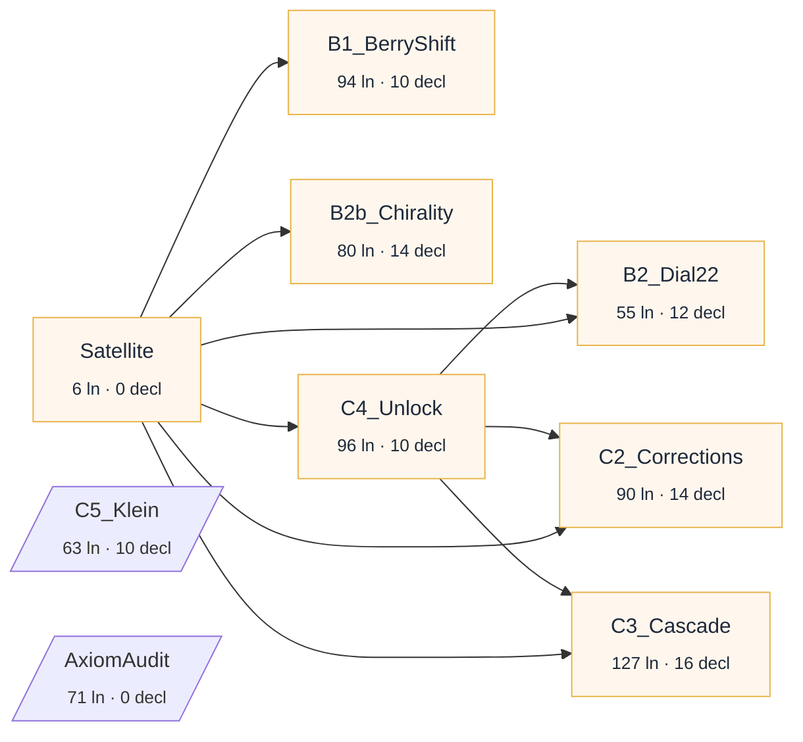

| Module | Lines | Declarations | Project imports | What it proves |
|---|--:|---|--:|---|
| [`Satellite.lean`](Satellite.lean) | 6 | — | 6 | Root of Library III: imports the six satellite modules `B1 → B2 → B2b → C2 → C3 → C4`. |
| [`Satellite/B1_BerryShift.lean`](Satellite/B1_BerryShift.lean) | 94 | 7 theorem · 3 def | 0 | B1 — the Berry quantum in the canonical two-level normal form: lower level `λ₋(δ) = (1 − √(1+2δ²))/2 = −δ²/2 + R(δ)`… |
| [`Satellite/B2_Dial22.lean`](Satellite/B2_Dial22.lean) | 55 | 8 theorem · 4 def | 0 | B2 — the dial-22 postulate and the braking rule: P1 (a full turn carries 24 slots) and P2 (an unremovable structural… |
| [`Satellite/B2b_Chirality.lean`](Satellite/B2b_Chirality.lean) | 80 | 10 theorem · 4 def | 0 | B2b — the dial's chirality (P3): the oriented cycle, the split `22 = 11 + 11` with one blocked slot per half-turn arc… |
| [`Satellite/C2_Corrections.lean`](Satellite/C2_Corrections.lean) | 90 | 9 theorem · 5 def | 0 | C2 — the three corrections of the septinial family: the structural divisor `k = 22 = b₂(K3)`, the integer skeletons o… |
| [`Satellite/C3_Cascade.lean`](Satellite/C3_Cascade.lean) | 127 | 12 theorem · 4 def | 0 | C3 — the symmetry-breaking cascade (P4): among the 24 rotations exactly the two `{0, 12}` preserve the antipodal gap,… |
| [`Satellite/C4_Unlock.lean`](Satellite/C4_Unlock.lean) | 96 | 8 theorem · 2 def | 3 | C4 — UNLOCK: the model's predictions as exact parameter-free theorems — `γ₃ = 1 − cos(2π/7) − π/1200` with proven ana… |

**Headline theorems.**
- [`Unlock.gamma_exact`](Satellite/C4_Unlock.lean)
- [`Unlock.k_exact`](Satellite/C4_Unlock.lean)
- [`Unlock.quanta`](Satellite/C4_Unlock.lean) — - Physical admissibility of the Berry quantum.
- [`Dial.card_dial`](Satellite/B2_Dial22.lean)
- [`Cascade.exactly_two_rotations`](Satellite/C3_Cascade.lean)
- [`Berry.remainder_le`](Satellite/B1_BerryShift.lean)


<details>
<summary><code>Satellite</code> — 0 declaration list</summary>


</details>

<details>
<summary><code>Satellite.B1_BerryShift</code> — 10 declaration list</summary>

- `def` **`lambdaLower`** (L7)
- `def` **`firstOrder`** (L10)
- `def` **`remainder`** (L13)
- `theorem` **`sqrt_ge_one`** (L15)
- `theorem` **`sq_sqrt_one_plus`** (L21) — - First-order (Berry) term of the shift.
- `theorem` **`lambdaLower_rationalized`** (L29)
- `theorem` **`lambdaLower_is_lower_root`** (L42)
- `theorem` **`remainder_eq`** (L53) — - λ₋(δ) is the lower root of the characteristic polynomial X² − X − δ²/2.
- `theorem` **`remainder_pos`** (L70)
- `theorem` **`remainder_le`** (L75)

</details>

<details>
<summary><code>Satellite.B2_Dial22</code> — 12 declaration list</summary>

- `def` **`dial`** (L7)
- `theorem` **`card_dial`** (L10)
- `def` **`k`** (L16) — - The dial: 24 slots per full turn (P1).
- `theorem` **`effective`** (L18)
- `def` **`alpha`** (L22)
- `def` **`beta`** (L25) — - The structural divisor k = 22 = b₂(K3) (h¹¹ + 2h²⁰ = 20 + 2), fixed before any fitting; recorded here as the…
- `theorem` **`beta_A`** (L29)
- `theorem` **`alpha_A`** (L31)
- `theorem` **`beta_B`** (L35) — - Berry quantum (1st order): β(d) = d²/2.
- `theorem` **`alpha_B`** (L37)
- `theorem` **`beta_C`** (L41)
- `theorem` **`alpha_C`** (L43)

</details>

<details>
<summary><code>Satellite.B2b_Chirality</code> — 14 declaration list</summary>

- `def` **`Left`** (L7)
- `def` **`Right`** (L10)
- `def` **`blocked`** (L13)
- `theorem` **`card_left`** (L15)
- `theorem` **`card_right`** (L17) — - Left sector: slots 1 … 11 (before the blocked slot 12).
- `theorem` **`disjoint_left_right`** (L19) — - Right sector: slots 13 … 23 (after the blocked slot 12).
- `theorem` **`chiral_split`** (L26)
- `theorem` **`cover`** (L30)
- `def` **`refl`** (L33)
- `theorem` **`refl_involutive`** (L35) — - The chiral split: 22 = 11 + 11 effective slots under the P3b gap.
- `theorem` **`refl_left_to_right`** (L42) — - The reflection x ↦ 24 − x of the oriented cycle.
- `theorem` **`refl_right_to_left`** (L49)
- `theorem` **`refl_blocked`** (L56)
- `theorem` **`refl_bijective`** (L65) — - Reflection fixes the blocked pair setwise.

</details>

<details>
<summary><code>Satellite.C2_Corrections</code> — 14 declaration list</summary>

- `def` **`k`** (L11)
- `theorem` **`k_betti`** (L13)
- `theorem` **`denom_A`** (L17)
- `theorem` **`denom_B`** (L19)
- `theorem` **`denom_C`** (L21) — - The structural divisor k = 22 = b₂(K3), fixed before any fitting.
- `theorem` **`vib_carrier`** (L24)
- `theorem` **`carrier_98`** (L26)
- `def` **`b_Ch`** (L31)
- `theorem` **`cos_septinial_gt_half`** (L34) — - The vibration term's carrier: π/1200, 1200 = 2⁴ · 75.
- `theorem` **`b_Ch_bounds`** (L44) — - cos is strictly decreasing on [0, π]; 2π/7 < π/3 gives the upper bracket cos(2π/7) > cos(π/3) = 1/2.
- `def` **`gamma3`** (L60)
- `theorem` **`gamma3_bounds`** (L62)
- `def` **`qnm`** (L74)
- `def` **`theta_eff`** (L77)

</details>

<details>
<summary><code>Satellite.C3_Cascade</code> — 16 declaration list</summary>

- `def` **`gap`** (L7)
- `def` **`Rot`** (L10)
- `def` **`Rfl`** (L13)
- `def` **`Preserves`** (L17) — - The antipodal gap (P3b): blocked slots {0, 12}.
- `theorem` **`rot_preserves_iff`** (L21)
- `theorem` **`refl_zero`** (L35)
- `theorem` **`refl_preserves_iff`** (L41)
- `theorem` **`rot12_rot12`** (L56)
- `theorem` **`rfl0_rfl0`** (L63)
- `theorem` **`rfl12_rfl12`** (L70)
- `theorem` **`rot12_rfl0`** (L77)
- `theorem` **`rfl0_rot12`** (L84)
- `theorem` **`survivors_commute`** (L92)
- `theorem` **`exactly_two_rotations`** (L98)
- `theorem` **`exactly_two_reflections`** (L104)
- `theorem` **`rot12_val`** (L110)

</details>

<details>
<summary><code>Satellite.C4_Unlock</code> — 10 declaration list</summary>

- `def` **`γ_model`** (L12)
- `def` **`k_model`** (L15)
- `theorem` **`alpha_pos`** (L18)
- `theorem` **`beta_pos`** (L23)
- `theorem` **`gamma_exact`** (L30)
- `theorem` **`gamma_bounds`** (L34)
- `theorem` **`k_exact`** (L39)
- `theorem` **`quanta`** (L42) — - Physical admissibility of the Berry quantum.
- `theorem` **`orientation_tail`** (L50) — - **The exponent, exactly.** The model's critical exponent is the closed septinial three-term value — a defini…
- `theorem` **`unlock`** (L56)

</details>

## Calibrated constants

| Quantity | Value | Lean status | Proved in |
|---|---|---|---|
| λ₀ — unstable growth rate | `2.6745` | calibrated, certificate-enclosed | ``Stability.Spectrum`` |
| γ = 1/λ₀ | `2000/5349 ≈ 0.373902` | `|γ − 0.374| < 10⁻³` **PROVED** | ``Scaling.gamma_close_to_published`` |
| Δ — echoing period | `3.445452402` | `|Δ − 3.4453| < 5·10⁻⁴` **PROVED** | ``Stability.echoingPeriod_gundlach1997`` |
| Wiggle period λ₀Δ/2 | `4.607431…` | in `[4.60, 4.62]` **PROVED** | ``ScalingDerivation.wiggle_published_check`` |
| NK root | `√(5/3) ≈ 1.290994` | unique in `[1.2, 1.4]` **PROVED** | ``Existence.TruncatedDSS`` |
| ‖V‖ bound constant | `cSept ≤ 28.1067` | Taylor-majorant chain **PROVED** | ``SeptinalYM.Numeric` + `Slater.cSept_eq_two_abs_cos`` |
| Septinal gap | `Δ₀ > 0` for `|J| < Δ₀/C` | **PROVED** (three forms) | ``SeptinalYM.Gap.septinal_gap*`` |
| b_Ch = 1 − cos(2π/7) | `0.376510…` | bracketed **PROVED** | ``Satellite.Corrections.b_Ch_bounds`` |
| γ₃ = b_Ch − π/1200 | `0.373892…` | exact, parameter-free **PROVED** | ``Satellite.Unlock.gamma_exact`` |
| k = 24 − 2 | `22 = b₂(K3)` | counting theorem **PROVED** | ``Satellite.Dial.card_dial`` |
| Quanta (sector C) | `β_C = π²/98`, `α_C = π⁵/369754` | exact **PROVED** | ``Satellite.Unlock.quanta`` |


## Honesty: proved and declared

Nothing here claims a completed proof of the full Einstein–scalar system; the
claim is that every reduction step between the hypothesis and the headline is
machine-checked. The open physics content enters through **four explicit,
documented hypothesis parameters**:

| Hypothesis parameter | Module | What it carries | Discharge path |
|---|---|---|---|
| `certifiedSpectrum` | `Stability.Spectrum` | the numerical spectrum of the truncated mode model | `Bridge.Generated` certificates → `Discharge` |
| Galerkin truncation tail | `Stability.Gershgorin` | the bound on the discarded tail of the Galerkin approximation | explicit hypothesis of `gershgorin_disc` |
| non-degeneracy data | `Existence.DSSBoundary.CriticalData` | keeps the critical-solution package non-vacuous (`minkowski_fails_nondegeneracy` shows why it is needed) | Newton–Kantorovich core → `TruncatedDSS` |
| `YM4` carrier | `SeptinalYM.YMTarget` | the identification of `ℋ_Sept` with a subspace of a Yang–Mills state space | verifiable half proved: `embedPhi` linear + isometric → `septinal_gap_transports` |

Everything else — the arena, the field equations, the DSS equivalences, the
Newton–Kantorovich contraction, the interval soundness, the whole JW → Slater →
Stage4c → Stage4d chain, the dial arithmetic — is theorem, not assumption.

## Legacy snapshots and duplicates (kept on purpose)

The package root still carries the files of an earlier layout. They are **not**
build targets, they contribute **0 modules** to any library, and the 19
`sorry` markers of the tree all live here (or in the uncompiled addendum).
`readme_stats.py` computes their sha-256 twins so the duplication is a fact,
not a guess; pruning them is safe and documented in the FAQ.

| Legacy file | Lines | sorry | Byte-identical twin | Purpose |
|---|--:|--:|---|---|
| `Basic.lean` | 135 | 0 | `SeptinalYM/Basic.lean` | historical copy of the SeptinalYM module |
| `Fourier.lean` | 194 | 0 | `SeptinalYM/Fourier.lean` | historical copy of the SeptinalYM module |
| `Gap.lean` | 250 | 0 | `SeptinalYM/Gap.lean` | historical copy of the SeptinalYM module |
| `JW.lean` | 795 | 0 | `SeptinalYM/JW.lean` | historical copy of the SeptinalYM module |
| `JW_twist_addendum.lean` | 69 | 0 | `SeptinalYM/JW_twist_addendum.lean` | uncompiled addendum fragment (status in header) |
| `MatrixAux.lean` | 376 | 0 | `SeptinalYM/MatrixAux.lean` | historical copy of the SeptinalYM module |
| `Numeric.lean` | 350 | 0 | `SeptinalYM/Numeric.lean` | historical copy of the SeptinalYM module |
| `Ortho.lean` | 257 | 0 | `SeptinalYM/Ortho.lean` | historical copy of the SeptinalYM module |
| `Sector.lean` | 175 | 0 | `SeptinalYM/Sector.lean` | historical copy of the SeptinalYM module |
| `SeptinalYM/JW_twist_addendum.lean` | 69 | 0 | `JW_twist_addendum.lean` | uncompiled addendum fragment (status in header) |
| `SeptinalYM/Numeric.lean` | 350 | 0 | `Numeric.lean` | historical copy of the SeptinalYM module |
| `SeptinalYM/SeptinalYM_Slater.lean` | 343 | 0 | `SeptinalYM/Slater.lean`, `SeptinalYM_Slater.lean` | historical copy of the SeptinalYM module |
| `SeptinalYM/SlaterDiag_v1.lean` | 2039 | 3 | `SlaterDiag_v1.lean` | work-in-progress snapshot, superseded by Stage4c/4d |
| `SeptinalYM_Slater.lean` | 343 | 0 | `SeptinalYM/SeptinalYM_Slater.lean`, `SeptinalYM/Slater.lean` | historical copy of the SeptinalYM module |
| `Slater.lean` | 343 | 0 | `SeptinalYM/SeptinalYM_Slater.lean`, `SeptinalYM/Slater.lean` | historical copy of the SeptinalYM module |
| `SlaterDiag.lean` | 1696 | 5 | — | legacy root file |
| `SlaterDiag_stage4a.lean` | 1763 | 5 | — | work-in-progress snapshot, superseded by Stage4c/4d |
| `SlaterDiag_stage4b.lean` | 1850 | 3 | — | work-in-progress snapshot, superseded by Stage4c/4d |
| `SlaterDiag_v1.lean` | 2039 | 3 | `SeptinalYM/SlaterDiag_v1.lean` | work-in-progress snapshot, superseded by Stage4c/4d |
| `YMTarget.lean` | 84 | 0 | `SeptinalYM/YMTarget.lean` | historical copy of the SeptinalYM module |

## Charts (generated from the sources)

<p align="center">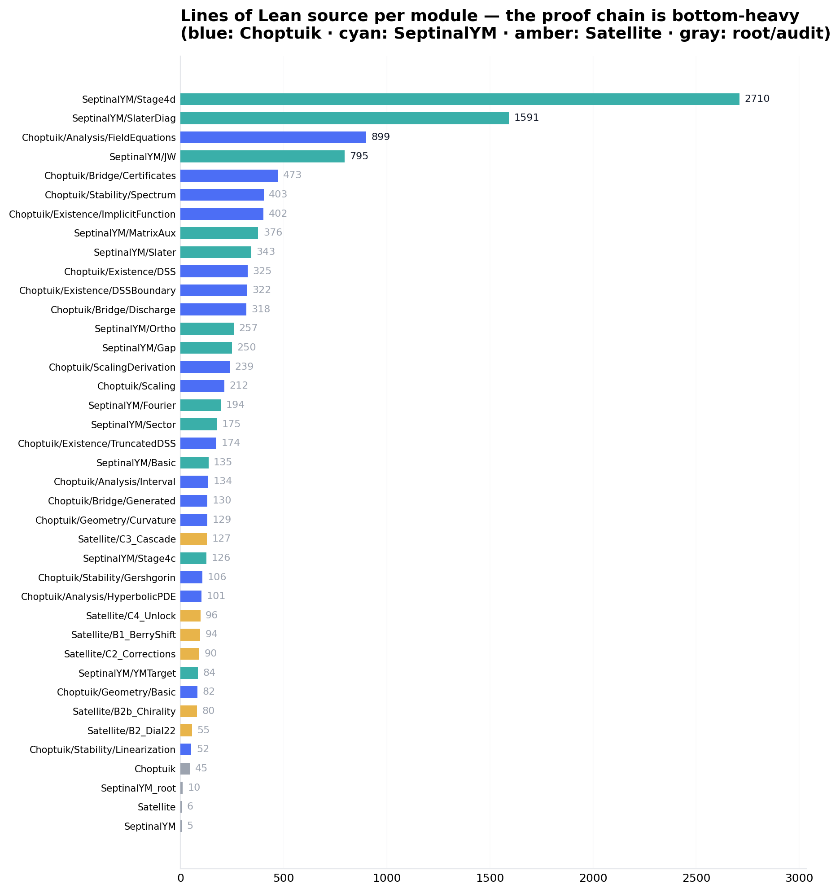</p>
<p align="center"><sub>Module sizes across the built tree (color = library).</sub></p>

<p align="center">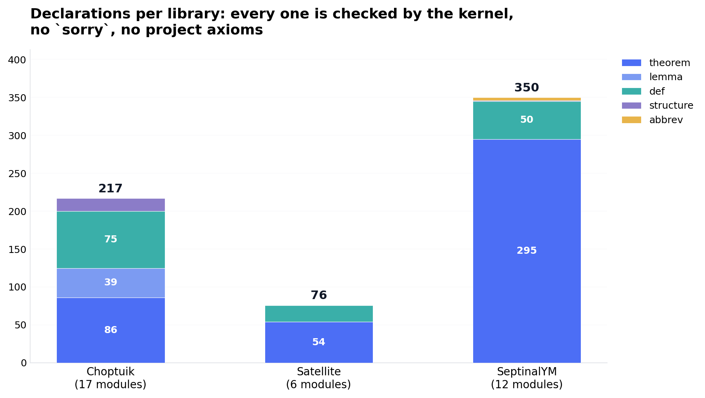</p>
<p align="center"><sub>Kernel-checked declarations per library.</sub></p>

<p align="center">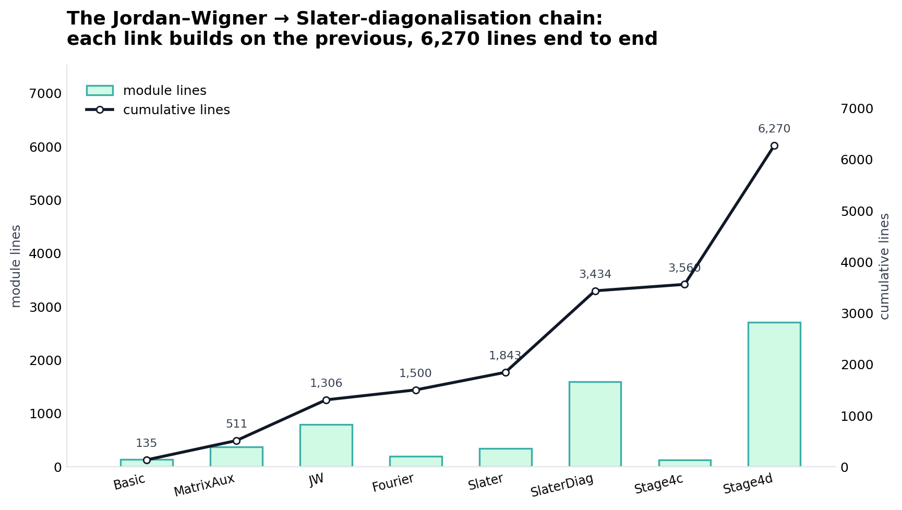</p>
<p align="center"><sub>The SeptinalYM proof chain: each link builds on the previous.</sub></p>

<p align="center"></p>
<p align="center"><sub>The 19 remaining `sorry` markers all live outside the build targets.</sub></p>

Regenerated by `scripts/readme_charts.py` from `docs/source_stats.json` — every bar is counted, not promised. More physics figures: [`../figures/`](../figures/).

## Animations

<table><tr><t</tr><tr>d </tr><tr>wi</tr></table>

## Package tree

`†` — legacy snapshot — not compiled (lines in parentheses).

```text
Septinal/lean/
├── lakefile.toml
├── lean-toolchain
├── lake-manifest.json
├── AxiomAudit.lean  (46)†
├── Choptuik.lean  (45)
├── Satellite.lean  (6)
├── SeptinalYM.lean  (5)
├── SeptinalYM_root.lean  (10)
├── Choptuik/
│   ├── Analysis/FieldEquations.lean  (899)
│   ├── Analysis/HyperbolicPDE.lean  (101)
│   ├── Analysis/Interval.lean  (134)
│   ├── Bridge/Certificates.lean  (473)
│   ├── Bridge/Discharge.lean  (318)
│   ├── Bridge/Generated.lean  (130)
│   ├── Existence/DSS.lean  (325)
│   ├── Existence/DSSBoundary.lean  (322)
│   ├── Existence/ImplicitFunction.lean  (402)
│   ├── Existence/TruncatedDSS.lean  (174)
│   ├── Geometry/Basic.lean  (82)
│   ├── Geometry/Curvature.lean  (129)
│   ├── Scaling.lean  (212)
│   ├── ScalingDerivation.lean  (239)
│   ├── Stability/Gershgorin.lean  (106)
│   ├── Stability/Linearization.lean  (52)
│   ├── Stability/Spectrum.lean  (403)
├── Satellite/
│   ├── AxiomAudit.lean  (71)†
│   ├── B1_BerryShift.lean  (94)
│   ├── B2_Dial22.lean  (55)
│   ├── B2b_Chirality.lean  (80)
│   ├── C2_Corrections.lean  (90)
│   ├── C3_Cascade.lean  (127)
│   ├── C4_Unlock.lean  (96)
│   ├── C5_Klein.lean  (63)†
├── SeptinalYM/
│   ├── Basic.lean  (135)
│   ├── Fourier.lean  (194)
│   ├── Gap.lean  (250)
│   ├── JW.lean  (795)
│   ├── JW_twist_addendum.lean  (69)†
│   ├── MatrixAux.lean  (376)
│   ├── Numeric.lean  (350)†
│   ├── Ortho.lean  (257)
│   ├── Sector.lean  (175)
│   ├── SeptinalYM_Slater.lean  (343)†
│   ├── Slater.lean  (343)
│   ├── SlaterDiag.lean  (1591)
│   ├── SlaterDiag_v1.lean  (2039)†
│   ├── Stage4c.lean  (126)
│   ├── Stage4d.lean  (2710)
│   ├── YMTarget.lean  (84)
├── docs/
│   ├── source_stats.json
│   ├── axiom_audit.json
│   ├── charts/*.png
│   ├── gifs/build_chain.gif
├── scripts/
│   ├── readme_stats.py
│   ├── readme_gen.py
│   ├── readme_charts.py
│   ├── readme_gif.py
│   ├── verify_septinal.py
```

## Verification session

| Session check | Declarations audited | Clean | Verdict |
|---|--:|--:|---|
|---|--:|--:|---|
| `lake build SeptinalYM.Stage4d` (2026-11-25, `logs/s4d.log`) | 9 modules | 0 errors | ✔ `Build completed successfully.` (RC=0, warnings: linter-only) |
| `#print axioms` sweep of `SeptinalYM.Stage4d` | 98 | 98 | ✔ only the 3 standard axioms |

### CI template

`../../ci/lean-ci.yml` is the committed GitHub-Actions template for the
Lean side; [`../../ci/septinal-lean-ci.yml`](../../ci/septinal-lean-ci.yml)
extends it to the three Septinal/lean libraries: `lake build` of all targets,
the axiom-audit sweep (`axcheck_all.py`), and the sorry-free grep over build
targets. Install it at the repository root as `.github/workflows/…` (GitHub
only reads `.github/` there).

### The certificate bridge

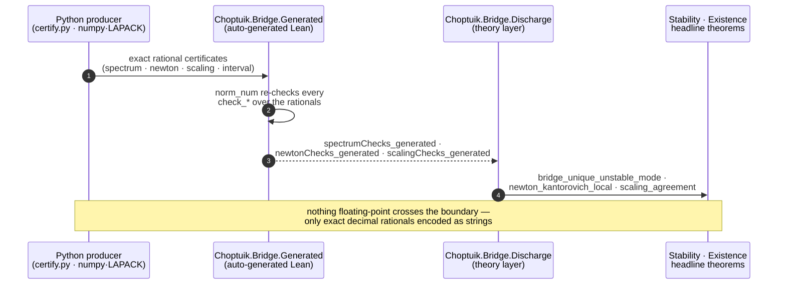

Protocol: [`../../bridge/protocol.md`](../../bridge/protocol.md) · producer:
[`../../python/choptuik_service/certify.py`](../../python/choptuik_service/certify.py).

## Reproducibility of this README

The documentation is generated like the code — from the sources, deterministically:

```bash
cd Septinal/lean
python3 -I scripts/readme_stats.py  --json docs/source_stats.json            # counts everything
python3 -I scripts/readme_charts.py                                          # 4 PNG charts
python3 -I scripts/readme_gif.py                                             # build animation
python3 -I scripts/readme_gen.py                                             # EN + RU READMEs + subfolders
```

`readme_stats.py` parses every `*.lean` (comments stripped, namespaces tracked),
computes line/byte/declaration/`sorry`/import statistics, resolves the lake
build-target closures from the lakefile roots, and emits `docs/source_stats.json`;
`readme_gen.py` renders the tables, Mermaid graphs (from the **real** import
graph) and both language versions from it. If a proof moves, one command
refreshes every number, table and diagram in this document.


## FAQ


<details>
<summary><b>What does «septinal» mean?</b></summary>

The septinial framework reads constants off pure geometry: a 24-slot dial with one unremovable antipodal gap leaves `k = 22` effective slots (the sector-C phase is `δ_C = π/7`). In the Lean theory the septinal system is a 22-site XX+YY ring whose mass gap is proved; `YMTarget.lean` then embeds it isometrically into a Yang–Mills state space. Full story: [../README.md](../README.md) and the Klein quartic section.

</details>

<details>
<summary><b>Why doesn't `lake build` build `SeptinalYM/Stage4d.lean`?</b></summary>

The lakefile pins `defaultTargets = ["Choptuik"]`, and the `SeptinalYM.lean` root imports only the mass-gap core (`Basic, MatrixAux, Gap, JW, YMTarget`). The diagonalisation chain is a first-class citizen anyway — build it with `lake build SeptinalYM.Stage4d` (or the wider root `lake build SeptinalYM_root`).

</details>

<details>
<summary><b>Why are there `.lean` files in the package root that duplicate `SeptinalYM/`?</b></summary>

They are byte-identical relics of an earlier layout (the table in [Honesty](#honesty-proved-and-declared) lists the sha-twins computed by `readme_stats.py`). None of them is a build target; they are kept only as provenance and are safe to prune.

</details>

<details>
<summary><b>Why do `SlaterDiag_v1.lean`, `SlaterDiag_stage4a.lean`, `SlaterDiag_stage4b.lean` contain `sorry`?</b></summary>

They are snapshots of the work-in-progress on the diagonalisation fragment. The finished result is the sorry-free trio `SeptinalYM/SlaterDiag.lean` + `Stage4c.lean` + `Stage4d.lean`; the snapshots are outside every build target and exist so that the history of the proof can be audited.

</details>

<details>
<summary><b>How do numbers enter the proofs? Are there floats?</b></summary>

No floats cross the proof boundary. The Python producer (`python -m choptuik_service.certify emit`, one level up in [../scripts/](../scripts/)) emits exact rational certificates; `Choptuik.Bridge.Generated` re-checks them by `norm_num`, and `Discharge.lean` converts them into theorems. The satellite modules have brute-force Python twins in `../scripts/`.

</details>

<details>
<summary><b>What is proved versus declared?</b></summary>

See the honesty section: four hypothesis parameters are declared explicitly (`certifiedSpectrum`, the Galerkin truncation tail, the non-degeneracy data, the `YM4` carrier) — each is a documented parameter of a theorem, never a hidden assumption. The bookkeeping between them is fully proved.

</details>

<details>
<summary><b>Which mathlib exactly?</b></summary>

`v4.21.0`, pinned in both `lean-toolchain` and `lakefile.toml` (bump them together). `lake exe cache get!` fetches the matching prebuilt artifacts.

</details>

---

## Author

<p align="center">
  <br>
  **Ishak Khamzatovich Isaev** — GitHub [@wild8highlander](https://github.com/wild8highlander) ·
</p>

ORCID [0009-0003-7299-0701](https://orcid.org/0009-0003-7299-0701) ·
Nalchik, Kabardino-Balkarian Republic *(sole author of all materials)*

Package citation: [`../CITATION.cff`](../CITATION.cff) · License: [`../LICENSE`](../LICENSE)
(© 2025, all rights reserved) · Parent programme: [`../../README.md`](../../README.md)

<p align="center">
  
</p>
