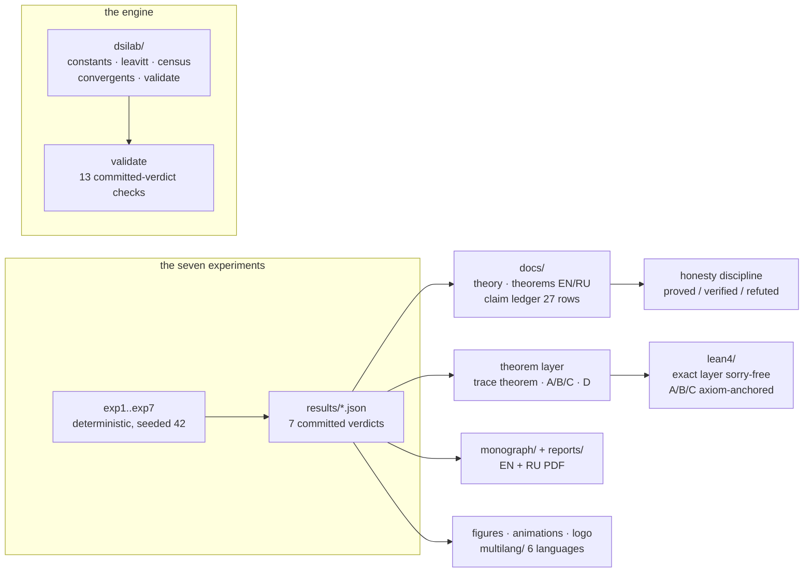

<picture>
  <source media="(prefers-color-scheme: dark)" srcset="logo/dsilab_logo_dark.png">
  
</picture>

# DSI Laboratory — dynamics of invariants

**A self-contained package of seven deterministic experiments on the
open problems of the b–C/a–C spinor-correction framework: the Kunz
defect and its theorems, the census attack on DSI-4, the Hurwitz-tower
audit, the falsifiable QNM overtone law, and the QCD-bridge centering.**

[](CHANGELOG.md)
[](tests/)
[](#verification-in-one-command)
[](docs/theorems.md)
[](docs/theorems.md)
[](lean4/README.md)
[](multilang/README.md)
[](monograph/README.md)
[](docs/methods.md)
[](../LICENSE)
[](pyproject.toml)

Author: **Ishak Khamzatovich Isaev** (Nalchik, Kabardino-Balkarian
Republic, Russian Federation) · Package version: **2.0.0** ·
This edition: the *professional build* — the reusable engine package
`dsilab/`, the Lean 4 theorem layer, the six-language core, the logo
and avatars, the launch animations, the bilingual monograph, the claim
ledger and the logged verification runs.

> [!TIP]
> **Читать по-русски:** [README.ru.md](README.ru.md) — полный зеркальный
> документ.

---

## Table of contents

1. [What this is](#what-this-is)
2. [The one-sentence summary](#the-one-sentence-summary)
3. [The seven experiments](#the-seven-experiments)
4. [The theorem layer](#the-theorem-layer)
5. [Quick start](#quick-start)
6. [Repository layout](#repository-layout)
7. [Verification in one command](#verification-in-one-command)
8. [The engine package](#the-engine-package)
9. [Lean 4 formalization](#lean-4-formalization)
10. [The core in six languages](#the-core-in-six-languages)
11. [Logo, avatars, animations](#logo-avatars-animations)
12. [Monograph and docs](#monograph-and-docs)
13. [The honesty discipline](#the-honesty-discipline)
14. [Logs](#logs)
15. [Citation and license](#citation-and-license)

## What this is

`dsi_lab` is deliberately standalone: no imports from the parent
repository, fixed seeds, everything reproducible with one command, and
every verdict committed as a JSON file that a fresh run must reproduce
to ~1e-13. Where the parent monographs *state* the framework, this
package *stress-tests* its inputs: which of them can be derived, which
are observations, and which are refuted by the package's own data.

Two corrections were produced **by** the experiments and are kept as
first-class results: finding **D1** (the repository's Hurwitz row
(g = 14, n = 11) is impossible — 1092 is not divisible by 11; the
correct group is PSL(2,13)) and finding **E1** (the trace identity
tr(Q_K3 ⊕ M_F) = 32 exists only after centering ⟨λ⟩). The package
practices the same honesty policy as the monographs: proved / verified
numerically / refuted are always distinguished, and every claim has an
address in the [claim ledger](docs/claim_ledger.md).



## The one-sentence summary

> Everything the package claims is machine-committed, seed-reproducible,
> and addressed in a claim ledger — **including the honest negatives**
> (the sofic √ε-law is refuted; the repo's own Hurwitz row was
> impossible and was corrected by the package).

## The seven experiments

| # | file | target | key result |
|---|------|--------|------------|
| 1 | `exp1_sh3_bridge.py` | Open problem Ш.3(iii): trace bridge | Trace theorem confirmed (n = 7..12, gap ≤ 5.9e-8); Cuntz tree F = n+2 exact; the sofic √ε-law **refuted** by data |
| 2 | `exp2_dsi4.py` | DSI-4: c_K3 = 27/672 | 9/224 is a convergent of CF [0;24,1,8], rank #1 for q ≤ 2000; Gaussian mass 0.0499 |
| 3 | `exp3_hurwitz.py` | Hurwitz tower | **Finding D1**: the repository row (g=14, n=11) is inconsistent (1092 not divisible by 11); the correct group is PSL(2,13); prediction Δ_Ch(π/13) = 3.3672 |
| 4 | `exp4_qnm.py` | QNM catalogue | 10 events; overtone detectability 0.84σ at Cosmic Explorer; falsifiable \|Δf_n/f_n\| = const = 8.3857e-5 |
| 5 | `exp5_qcd.py` | QCD bridge | **Finding E1**: tr(Q_K3⊕M_F) = 32 requires centering ⟨λ⟩; afterwards slope −0.99 (~1/N); κT-sweep: BF(GUE) up to 1165 |
| 6 | `exp6_census_224.py` | Why the denominator 224 = 4·56? | Explicit {7,3} census from GL(3,2): V=56, E=84, F=24, 7F=3V=2E=168; **uniqueness lemma** for 9/224; **degeneracy theorem**: branches c(g) coincide only at g=3 |
| 7 | `exp7_e1_threshold.py` | Threshold e ≥ 1 | **Theorems A/B/C proven and verified** (identity 5.9e-16 over 24000 pairs); ladder 5/7 → 1 → 2 is a theorem; carrier-isometric constructions cannot realize the Ш.3(iii) bridge |

## The theorem layer

The full statements with proofs live in
[`docs/theorems.md`](docs/theorems.md) (EN) and
[`docs/theorems.ru.md`](docs/theorems.ru.md) (RU); the Lean 4
counterparts in [`lean4/`](lean4/README.md). The spine:

| # | theorem | status |
|---|---------|--------|
| T1 | Sharp trace theorem: F ≥ 5n/7, e ≥ 5/7 (equality only off-class) | proved + verified (gap ≤ 5.92e-8) |
| T2 | Trimmed Kunz tree: F = n + 2 exactly | proved + verified |
| T3 | Weighted tree: no weighting beats the trim; 549/49 at c²=4/7, k=3 | proved + verified |
| T4 | **Theorem A**: partial isometries ⇒ e ≥ 1 (identity at 5.9e-16) | proved + verified |
| T5 | **Theorem B**: P+Q ≤ I ⇒ F = n + 2·rank(I−P−Q) | proved + verified |
| T6 | **Theorem C**: unitary pairs ⇒ F = 2n exactly | proved + verified |
| T7 | **Corollary D**: inf e = 1 on the class; Ш.3(iii) dead for isometric transports | proved (Lean-derived) |
| T8 | Sofic √ε-law | **refuted** (data kept) |
| T9 | {7,3} census: 7F = 3V = 2E = 168, χ = −4 | proved (Lean, sorry-free) |
| T10 | Uniqueness lemma: 9/224 unique in the census budget | proved + verified |
| T11 | Degeneracy theorem: branches coincide only at g = 3 | proved |
| T12 | **Finding D1**: (g=14, n=11) impossible → PSL(2,13) | proved (correction) |
| T13 | Falsifiable law \|Δf_n/f_n\| = 8.3857e-5 | verified, falsifiable |
| T14 | **Finding E1**: tr = 32 requires centering | verified (correction) |

## Quick start

```bash
cd dsi_lab
python3 -m pip install -r requirements.txt

python3 -m pytest tests/ -q     # 51 fast theorem checks (~2 min)
python3 -m dsilab.validate      # audit the 13 committed verdicts
python3 run_all.py              # all 7 experiments (~5–15 min)
python3 run_all.py 2 6 7        # subset of experiments
python3 run_all.py --list       # list experiments
python3 fig_choptuik.py         # summary figure only
```

Makefile shortcuts (the same commands and more):

```bash
make test         # pytest suite
make validate     # committed-verdict audit
make run          # all 7 experiments + the summary figure
make quick        # fastest subset: experiments 2, 6, 7
make verify       # test + validate + run (full verification)
make figures      # regenerate the summary figure
make logo         # logo (light/dark) + avatars
make animations   # 8 animations (en/ru, gif+mp4)
make monograph    # rebuild the EN/RU PDFs (tectonic)
make multilang    # build & run the C/C++/JS twins, diff outputs
make lint         # ruff + black --check
make lint-mypy    # mypy
make clean
```

## Repository layout

| path | contents |
|------|----------|
| `run_all.py` | orchestrator: all experiments, subset selection, `--list` |
| `exp1…exp7*.py` | the seven deterministic experiments |
| `fig_choptuik.py` | summary Choptuik figure |
| `figlabels.py` | bilingual figure labels (en/ru) |
| [`dsilab/`](dsilab/README.md) | the engine package: constants, leavitt, census, convergents, validate |
| [`lean4/`](lean4/README.md) | Lean 4 + Mathlib formalization of the theorem layer |
| [`multilang/`](multilang/README.md) | the exact core in C, C++, JS (byte-identical), Rust, Go, Julia |
| [`logo/`](logo/README.md) | theme-aware logo + avatars (generated) |
| [`animations/`](animations/README.md) | 4 animations × en/ru × (MP4 + GIF) (generated) |
| [`docs/`](docs/README.md) | theory, theorems EN/RU, methods, claim ledger |
| [`monograph/`](monograph/README.md) | the EN/RU monographs (PDF + LaTeX) |
| [`reports/`](reports/README.md) | the compiled short reports (PDF + DOCX, EN/RU) |
| [`logs/`](logs/README.md) | logged verification runs with sha256 stamps |
| `tests/` | pytest suite: 51 checks (package, theorems, smoke) |
| `results/` | seven committed JSON verdicts |
| `fig_en/`, `fig_ru/` | 16 ready-made figures per language |
| `Makefile` · `pyproject.toml` · `requirements.txt` · `CITATION.cff` · `VERSION` · `CHANGELOG.md` | the plumbing |

## Verification in one command

```bash
make verify          # = test + validate + run, deterministic
bash scripts/run_logged.sh   # the same, logged into logs/ with sha256
```

After the run, `git diff --stat results/` must be empty for the
committed seeds — if it is not, the difference **is** the finding and
the package asks for a new claim-ledger row, not a re-seed.

## The engine package

[`dsilab/`](dsilab/README.md) extracts the reusable mathematics so the
theorems have one canonical implementation:

```python
from dsilab import kunz_tree_trimmed, census_identity
kunz_tree_trimmed(2)   # (7, 9.0)   — theorem B, exact F = n + 2
census_identity()      # {'V': 56, 'E': 84, 'F': 24, ..., 'chi': -4}
```

`python3 -m dsilab.validate` re-derives every committed verdict from
the JSON payloads alone — it never recomputes, it checks that the
committed numbers say what this README says they say (13/13 PASS).

## Lean 4 formalization

[`lean4/`](lean4/README.md) formalizes the exact stratum sorry-free:
the census arithmetic, the CF identity 9/224 = [0; 24, 1, 8], the
ladder 5/7 < 1 ≤ 1 + 2/n ≤ 2, the scaled-permutation minimum
7(4/7)² − 8(4/7) + 3 = 5/7, and the weighted-tree value 549/49.
Theorems A/B/C are axiom-anchored to the numerical verification, and
corollary D is *derived* from theorem A — a real proof.

## The core in six languages

[`multilang/`](multilang/README.md) rewrites the exact core (ten
checks: b_Ch, the CF identities, the census, theorems A/B/C on explicit
matrices, the weighted tree, the ladder) in C, C++, JavaScript,
Rust, Go and Julia. The compiled twins print **byte-identical output**
(`c/reference_output.txt`); each exits 0 on 10/10 PASS.

## Logo, avatars, animations

- [`logo/`](logo/README.md) — the Ink & Gold emblem (heptagon {7},
  the convergent ladder 1/24 → 1/25 → 9/224, the e-ladder), light/dark
  PNG 600 dpi + SVG, plus square 1024 px avatars.
- [`animations/`](animations/README.md) — the four launch animations:
  the convergent ladder, the e-ladder theorem, the {7,3} census, the
  falsifiable overtone law — en/ru, MP4 + GIF, rendered from the
  committed verdicts.

## Monograph and docs

- [`monograph/`](monograph/README.md) — **The DSI Laboratory: Dynamics
  of Invariants for the b–C/a–C Framework** (EN + RU PDFs, Tectonic).
- [`docs/`](docs/README.md) — theory, the theorem layer with proofs
  (EN/RU), methods (determinism, tolerances), and the claim ledger
  (27 rows: proved / verified / refuted / hypothesis / open).
- [`reports/`](reports/README.md) — the earlier short reports
  (attack + open problems, EN/RU, PDF + DOCX).

## The honesty discipline

The package keeps the monograph discipline: **proved** (exact
arithmetic), **verified** (machine-precision, seeded), **refuted**
(kept publicly — the sofic √ε-law, the repo's Hurwitz row) and
**hypothesis** (labeled assumptions: the b₂ pattern, V_T, DSI-4 as an
observation) are always distinguished. Findings D1 and E1 are
corrections *produced by* the package. The ledger moves one step at a
time and refutations never leave it.

## Logs

[`logs/`](logs/README.md) keeps the logged verification runs:
`bash scripts/run_logged.sh` runs `make verify`, stamps the log with
the UTC time, git SHA, tool versions and the sha256 of every
`results/*.json`, so any future run can be compared byte-for-byte.

## Citation and license

Cite the package via [`CITATION.cff`](CITATION.cff) (BibTeX via the
GitHub "Cite this repository" button):

> Isaev, I. K. (2026). *DSI Laboratory: Dynamics of Invariants for the
> b–C/a–C Framework* (Version 2.0.0) [Computer software].
> https://github.com/wild8highlander/choptuik_ac_bc

License: the parent repository's Isaev Proprietary License
([LICENSE](../LICENSE)). The package is part of the `choptuik_ac_bc`
project and shares its authorship and terms.
