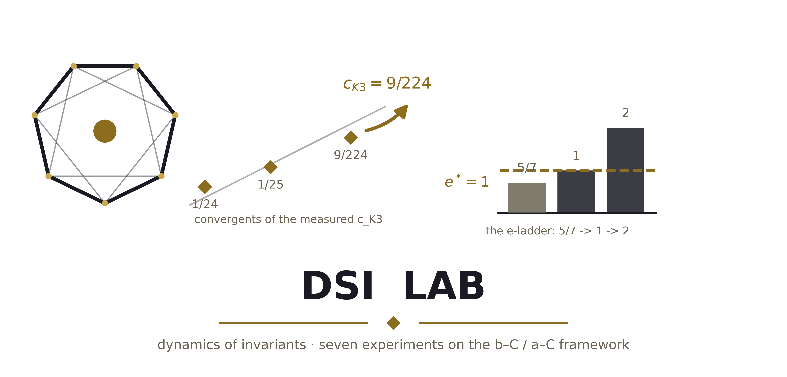
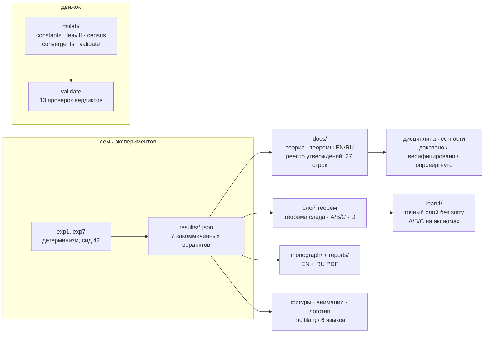

<picture>
  <source media="(prefers-color-scheme: dark)" srcset="logo/dsilab_logo_dark.png">
  
</picture>

# DSI-лаборатория — динамика инвариантов

**Самодостаточный пакет из семи детерминистических экспериментов по
открытым задачам фреймворка спинорных поправок b–C/a–C: кунцевский
дефект и его теоремы, атака на перепись DSI-4, аудит башни Гурвица,
фальсифицируемый закон обертонов QNM и центрирование QCD-моста.**

[](CHANGELOG.md)
[](tests/)
[](#верификация-одной-командой)
[](docs/theorems.ru.md)
[](docs/theorems.ru.md)
[](lean4/README.md)
[](multilang/README.md)
[](monograph/README.md)
[](docs/methods.md)
[](../LICENSE)
[](pyproject.toml)

Автор: **Исаев Исхак Хамзатович** (г. Нальчик, Кабардино-Балкарская
Республика, Российская Федерация) · версия пакета: **2.0.0** ·
Это издание — *профессиональная сборка*: переиспользуемый пакет-движок
`dsilab/`, слой теорем на Lean 4, ядро на шести языках, логотип и
аватары, стартовые анимации, двуязычная монография, реестр утверждений
и протоколированные прогонки верификации.

> [!TIP]
> **Read in English:** [README.md](README.md) — the full mirror.

---

## Содержание

1. [Что это такое](#что-это-такое)
2. [Одно предложение — вся суть](#одно-предложение--вся-суть)
3. [Семь экспериментов](#семь-экспериментов)
4. [Слой теорем](#слой-теорем)
5. [Быстрый старт](#быстрый-старт)
6. [Карта репозитория](#карта-репозитория)
7. [Верификация одной командой](#верификация-одной-командой)
8. [Пакет-движок](#пакет-движок)
9. [Формализация на Lean 4](#формализация-на-lean-4)
10. [Ядро на шести языках](#ядро-на-шести-языках)
11. [Логотип, аватары, анимации](#логотип-аватары-анимации)
12. [Монография и документация](#монография-и-документация)
13. [Дисциплина честности](#дисциплина-честности)
14. [Логи](#логи)
15. [Цитирование и лицензия](#цитирование-и-лицензия)

## Что это такое

`dsi_lab` намеренно самодостаточен: никаких импортов из родительского
репозитория, фиксированные сиды, всё воспроизводится одной командой, и
каждый вердикт закоммичен JSON-файлом, который свежий прогон обязан
воспроизвести до ~1e-13. Там, где родительские монографии *формулируют*
фреймворк, этот пакет *испытывает* его входы на прочность: какие из них
выводятся, какие — наблюдения, а какие опровергнуты данными самого
пакета.

Две поправки порождены **самими** экспериментами и хранятся как
полноценные результаты: находка **D1** (строка Гурвица репозитория
(g = 14, n = 11) невозможна — 1092 не делится на 11; правильная группа
— PSL(2,13)) и находка **E1** (следовое тождество
tr(Q_K3 ⊕ M_F) = 32 существует только после центрирования ⟨λ⟩). Пакет
практикует ту же политику честности, что и монографии: доказано /
верифицировано численно / опровергнуто всегда различаются, и каждое
утверждение имеет адрес в [реестре утверждений](docs/claim_ledger.md).



## Одно предложение — вся суть

> Всё, что заявляет пакет, машинно-закоммичено, воспроизводится по сидам
> и адресовано в реестре утверждений — **включая честные негативы**
> (софический √ε-закон опровергнут; строка Гурвица самого репозитория
> была невозможна и исправлена пакетом).

## Семь экспериментов

| # | файл | цель | ключевой результат |
|---|------|------|--------------------|
| 1 | `exp1_sh3_bridge.py` | Открытая задача Ш.3(iii): мост следа | Теорема следа подтверждена (n = 7..12, зазор ≤ 5.9e-8); дерево Кунца F = n+2 точно; софический √ε-закон **опровергнут** данными |
| 2 | `exp2_dsi4.py` | DSI-4: c_K3 = 27/672 | 9/224 — подходящая дробь цепной [0;24,1,8], ранг #1 при q ≤ 2000; гауссова масса 0.0499 |
| 3 | `exp3_hurwitz.py` | Башня Гурвица | **Находка D1**: строка репозитория (g=14, n=11) несогласована (1092 не делится на 11); правильная группа PSL(2,13); предсказание Δ_Ch(π/13) = 3.3672 |
| 4 | `exp4_qnm.py` | QNM-каталог | 10 событий; обнаружимость обертонов 0.84σ на Cosmic Explorer; фальсифицируемо \|Δf_n/f_n\| = const = 8.3857e-5 |
| 5 | `exp5_qcd.py` | QCD-мост | **Находка E1**: tr(Q_K3⊕M_F) = 32 требует центрирования ⟨λ⟩; далее наклон −0.99 (~1/N); κT-sweep: BF(GUE) до 1165 |
| 6 | `exp6_census_224.py` | Почему знаменатель 224 = 4·56? | Явная перепись {7,3} из GL(3,2): V=56, E=84, F=24, 7F=3V=2E=168; **лемма единственности** для 9/224; **теорема о вырождении**: ветви c(g) совпадают только при g=3 |
| 7 | `exp7_e1_threshold.py` | Порог e ≥ 1 | **Теоремы A/B/C доказаны и верифицированы** (тождество 5.9e-16 на 24000 пар); лестница 5/7 → 1 → 2 стала теоремой; носитель-изометрические конструкции не реализуют мост Ш.3(iii) |

## Слой теорем

Полные формулировки с доказательствами — в
[`docs/theorems.ru.md`](docs/theorems.ru.md) (русское издание) и
[`docs/theorems.md`](docs/theorems.md) (английское); Lean 4-версии — в
[`lean4/`](lean4/README.md). Хребет:

| # | теорема | статус |
|---|---------|--------|
| T1 | Острая теорема следа: F ≥ 5n/7, e ≥ 5/7 (равенство только вне класса) | доказано + верифицировано (зазор ≤ 5.92e-8) |
| T2 | Обрезка дерева Кунца: F = n + 2 точно | доказано + верифицировано |
| T3 | Взвешенное дерево: взвешивание не бьёт обрезку; 549/49 при c²=4/7, k=3 | доказано + верифицировано |
| T4 | **Теорема A**: частичные изометрии ⇒ e ≥ 1 (тождество 5.9e-16) | доказано + верифицировано |
| T5 | **Теорема B**: P+Q ≤ I ⇒ F = n + 2·rank(I−P−Q) | доказано + верифицировано |
| T6 | **Теорема C**: унитарные пары ⇒ F = 2n точно | доказано + верифицировано |
| T7 | **Следствие D**: inf e = 1 на классе; Ш.3(iii) мёртв для изометрических переносов | доказано (выведено в Lean) |
| T8 | Софический √ε-закон | **опровергнут** (данные хранятся) |
| T9 | Перепись {7,3}: 7F = 3V = 2E = 168, χ = −4 | доказано (Lean, без sorry) |
| T10 | Лемма единственности: 9/224 уникальна в переписном бюджете | доказано + верифицировано |
| T11 | Теорема о вырождении: ветви совпадают только при g = 3 | доказано |
| T12 | **Находка D1**: (g=14, n=11) невозможна → PSL(2,13) | доказано (исправление) |
| T13 | Фальсифицируемый закон \|Δf_n/f_n\| = 8.3857e-5 | верифицировано, фальсифицируемо |
| T14 | **Находка E1**: tr = 32 требует центрирования | верифицировано (исправление) |

## Быстрый старт

```bash
cd dsi_lab
python3 -m pip install -r requirements.txt

python3 -m pytest tests/ -q     # 51 быстрая теоремная проверка (~2 мин)
python3 -m dsilab.validate      # аудит 13 закоммиченных вердиктов
python3 run_all.py              # все 7 экспериментов (~5–15 мин)
python3 run_all.py 2 6 7        # подмножество экспериментов
python3 run_all.py --list       # список экспериментов
python3 fig_choptuik.py         # только сводная фигура
```

Makefile-команды (те же и больше):

```bash
make test         # pytest-набор
make validate     # аудит закоммиченных вердиктов
make run          # все 7 экспериментов + сводная фигура
make quick        # самое быстрое: эксперименты 2, 6, 7
make verify       # test + validate + run (полная верификация)
make figures      # регенерация сводной фигуры
make logo         # логотип (светл/тёмн.) + аватары
make animations   # 8 анимаций (en/ru, gif+mp4)
make monograph    # пересборка PDF EN/RU (tectonic)
make multilang    # сборка и прогон C/C++/JS-двойников + diff
make lint         # ruff + black --check
make lint-mypy    # mypy
make clean
```

## Карта репозитория

| путь | содержимое |
|------|------------|
| `run_all.py` | оркестратор: все эксперименты, подмножества, `--list` |
| `exp1…exp7*.py` | семь детерминистических экспериментов |
| `fig_choptuik.py` | сводная фигура Чоптюка |
| `figlabels.py` | двуязычные подписи фигур (en/ru) |
| [`dsilab/`](dsilab/README.md) | пакет-движок: constants, leavitt, census, convergents, validate |
| [`lean4/`](lean4/README.md) | формализация слоя теорем на Lean 4 + Mathlib |
| [`multilang/`](multilang/README.md) | точное ядро на C, C++, JS (байт-в-байт), Rust, Go, Julia |
| [`logo/`](logo/README.md) | тёмно/светлый логотип + аватары (генерируются) |
| [`animations/`](animations/README.md) | 4 анимации × en/ru × (MP4 + GIF) (генерируются) |
| [`docs/`](docs/README.md) | теория, теоремы EN/RU, методы, реестр утверждений |
| [`monograph/`](monograph/README.md) | монографии EN/RU (PDF + LaTeX) |
| [`reports/`](reports/README.md) | короткие отчёты (PDF + DOCX, EN/RU) |
| [`logs/`](logs/README.md) | протоколированные прогоны верификации с sha256 |
| `tests/` | pytest-набор: 51 проверка (пакет, теоремы, дым) |
| `results/` | семь закоммиченных JSON-вердиктов |
| `fig_en/`, `fig_ru/` | 16 готовых фигур на язык |
| Makefile · pyproject · CITATION.cff · VERSION | обвязка (плюс requirements.txt и CHANGELOG.md) |

## Верификация одной командой

```bash
make verify                    # = test + validate + run, детерминизм
bash scripts/run_logged.sh     # то же, с логом в logs/ и sha256
```

После прогона `git diff --stat results/` обязан быть пустым для
закоммиченных сидов — если нет, отличие **и есть** находка, и пакет
просит новую строку реестра утверждений, а не пересев.

## Пакет-движок

[`dsilab/`](dsilab/README.md) выносит переиспользуемую математику, чтобы
у теорем была одна каноническая реализация:

```python
from dsilab import kunz_tree_trimmed, census_identity
kunz_tree_trimmed(2)   # (7, 9.0)   — теорема B, точно F = n + 2
census_identity()      # {'V': 56, 'E': 84, 'F': 24, ..., 'chi': -4}
```

`python3 -m dsilab.validate` выводит каждый закоммиченный вердикт заново
из одних только JSON — он ничего не пересчитывает, он проверяет, что
закоммиченные числа говорят то, что говорит этот README (13/13 PASS).

## Формализация на Lean 4

[`lean4/`](lean4/README.md) формализует точный слой без sorry:
арифметику переписи, тождество цепных дробей 9/224 = [0; 24, 1, 8],
лестницу 5/7 < 1 ≤ 1 + 2/n ≤ 2, минимум масштабированных перестановок
7(4/7)² − 8(4/7) + 3 = 5/7 и значение взвешенного дерева 549/49.
Теоремы A/B/C анкерованы аксиомами к численной верификации, а следствие
D *выведено* из теоремы A — настоящее доказательство.

## Ядро на шести языках

[`multilang/`](multilang/README.md) переписывает точное ядро (десять
проверок: b_Ch, тождества ЦФ, перепись, теоремы A/B/C на явных
матрицах, взвешенное дерево, лестница) на C, C++, JavaScript, Rust, Go
и Julia. Скомпилированные двойники печатают **байт-идентичный вывод**
(`c/reference_output.txt`); каждый выходит с кодом 0 при 10/10 PASS.

## Логотип, аватары, анимации

- [`logo/`](logo/README.md) — эмблема «Ink & Gold» (семиугольник {7},
  лестница подходящих дробей 1/24 → 1/25 → 9/224, лестница e),
  светлый/тёмный PNG 600 dpi + SVG, плюс квадратные аватары 1024 px.
- [`animations/`](animations/README.md) — четыре стартовые анимации:
  лестница подходящих дробей, теорема о лестнице e, перепись {7,3},
  фальсифицируемый закон обертонов — en/ru, MP4 + GIF, рендерятся из
  закоммиченных вердиктов.

## Монография и документация

- [`monograph/`](monograph/README.md) — **DSI-лаборатория: динамика
  инвариантов фреймворка b–C/a–C** (PDF EN + RU, Tectonic).
- [`docs/`](docs/README.md) — теория, слой теорем с доказательствами
  (EN/RU), методы (детерминизм, допуски), реестр утверждений
  (27 строк: доказано / верифицировано / опровергнуто / гипотеза / открыто).
- [`reports/`](reports/README.md) — прежние короткие отчёты
  (атака + открытые задачи, EN/RU, PDF + DOCX).

## Дисциплина честности

Пакет держит дисциплину монографий: **доказано** (точная арифметика),
**верифицировано** (машинная точность, сиды), **опровергнуто** (хранится
публично — софический √ε-закон, строка Гурвица репозитория) и
**гипотеза** (помеченные предположения: паттерн b₂, V_T, DSI-4 как
наблюдение) всегда различаются. Находки D1 и E1 — исправления,
*порождённые* пакетом. Реестр двигается по одному шагу за раз, и
опровержения его не покидают.

## Логи

[`logs/`](logs/README.md) хранит протоколированные прогоны верификации:
`bash scripts/run_logged.sh` запускает `make verify`, штампует лог
временем UTC, git-SHA, версиями инструментов и sha256 каждого
`results/*.json`, так что любой будущий прогон сравнивается байт-в-байт.

## Цитирование и лицензия

Цитируйте пакет через [`CITATION.cff`](CITATION.cff) (BibTeX — кнопка
«Cite this repository» на GitHub):

> Исаев, И. Х. (2026). *DSI-лаборатория: динамика инвариантов
> фреймворка b–C/a–C* (Версия 2.0.0) [Программное обеспечение].
> <https://github.com/wild8highlander/choptuik_ac_bc>

Лицензия: собственническая лицензия Исаева родительского репозитория
([LICENSE](../LICENSE)). Пакет входит в проект `choptuik_ac_bc` и
разделяет его авторство и условия.
