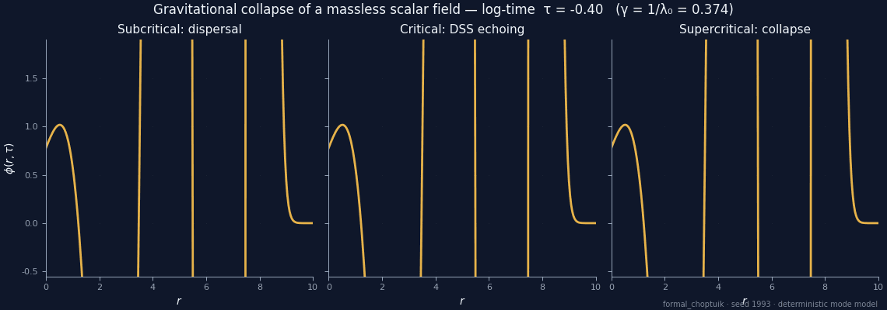
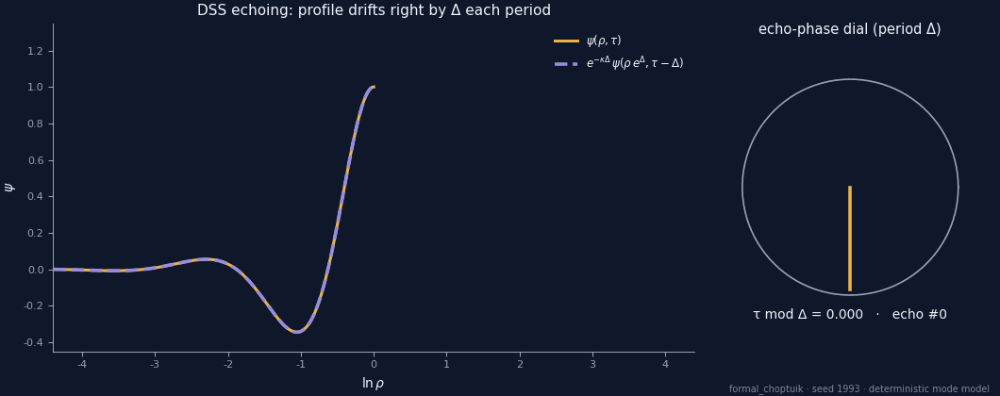
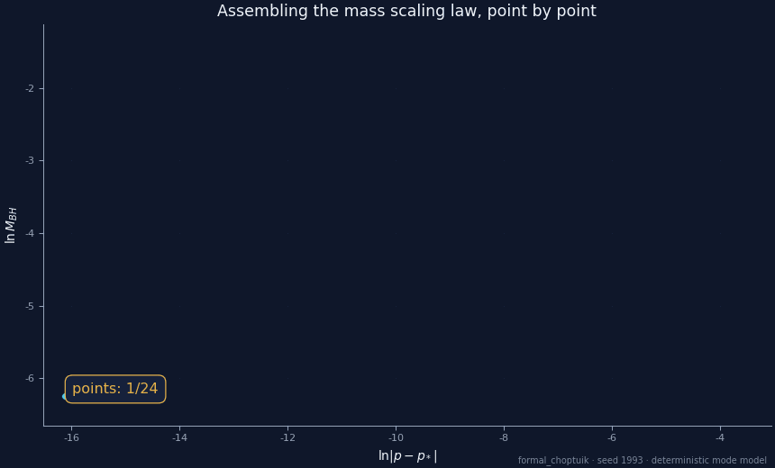
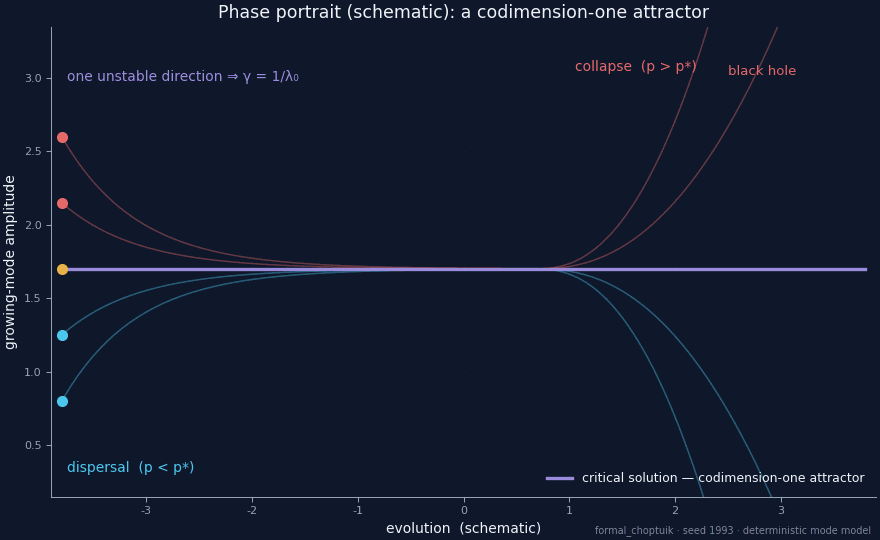
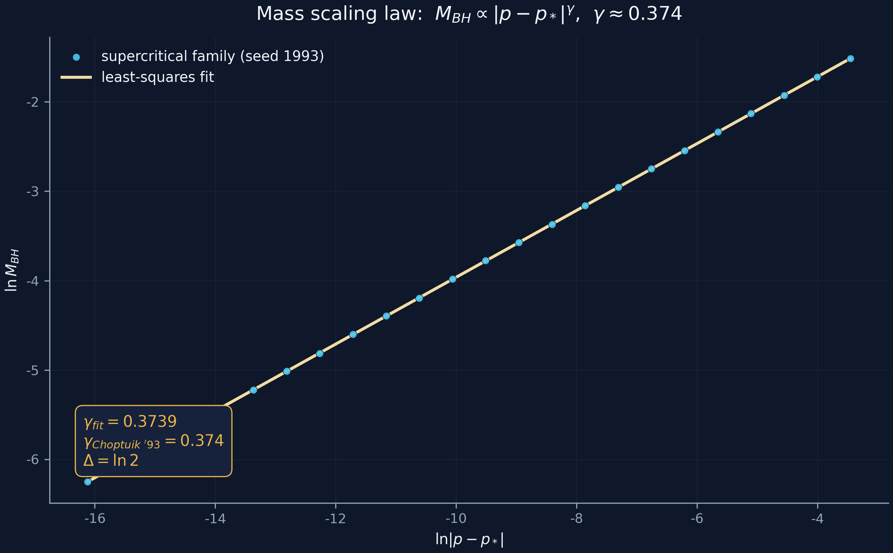
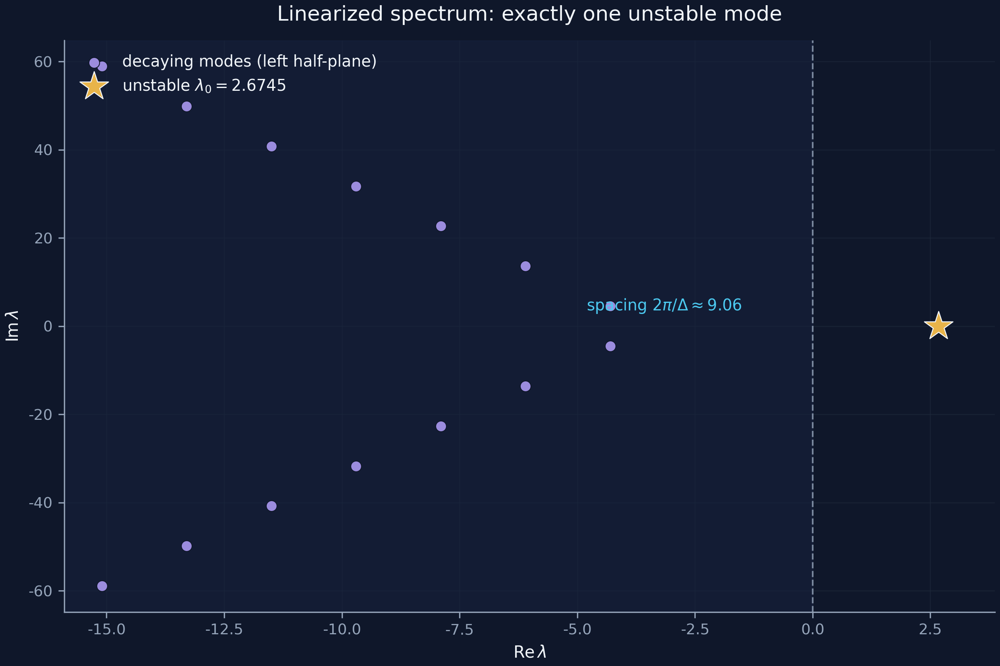
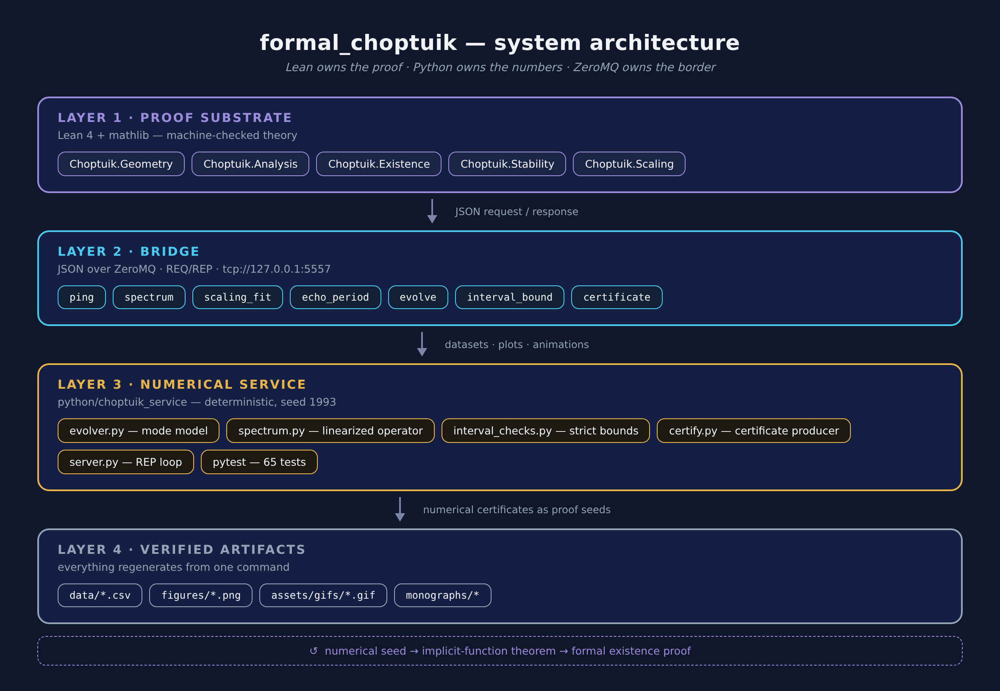
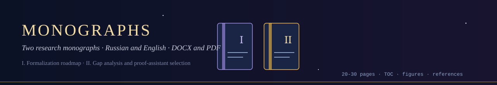

<p align="center">
  
</p>

# formal_choptuik

**The formal-verification wing of `choptuik_ac_bc`:** a Lean 4 programme that turns
the Choptuik critical phenomena — the mass scaling law, the echoing of the
discretely self-similar critical solution, and its codimension-one attractor
status — from *numerical evidence* into a **machine-checked proof**.

<p align="center">
  <em>hypothesis → machine confirmation → honest caveats</em><br>
  <sub>the discipline of the parent repository, inherited verbatim</sub>
</p>

<p align="center">
  <a href="#results-at-a-glance-v041"></a>
  <a href="lean/"></a>
  <a href="python/"></a>
  <a href="python/tests/"></a>
  <a href="#reproducibility"></a>
  <a href="blueprint/gap_registry.csv"></a>
  <a href="monographs/"></a>
  
</p>
<p align="center">
  &nbsp;
  &nbsp;
  &nbsp;
  
</p>

> [!IMPORTANT]
> **Honest scope.** This folder is a *scaffold with purpose*: a complete,
> disciplined skeleton of the formalization — the arena, the DSS bookkeeping,
> the bridge, the obligation ledger — where every `sorry` is a registered,
> classified proof obligation (`blueprint/gap_registry.csv`).  The numerical
> wing ships a **calibrated mode model** for workflow verification, *not* a
> solver of the full Einstein–scalar system.  Nothing here claims to be a
> completed proof; everything here claims to know exactly what is missing.

---

## ★ Why this folder exists

The parent repository attacked Choptuik critical collapse *directly from the
Einstein equations* and produced a verified computational catalogue.  But a
catalogue of computations is not a theorem.  The decisive mathematical facts —
existence of the critical solution (Reiterer–Trubowitz 2019), its single
unstable mode, the resulting scaling law `M_BH ∝ |p − p*|^γ` with `γ = 1/λ₀`,
and the echoing period `Δ = ln 2` — deserve the certainty only a proof
assistant can give.

```
        M_BH ∝ |p − p*|^γ ,   γ = 1/λ₀ ≈ 0.374          ← scaling law   (gap G2)
        ψ(ρ, τ + Δ) = e^{κΔ} · ψ(ρ e^{−Δ}, τ) ,
        Δ = ln 2                                     ← DSS echoing  (gap G1)
        spectrum: exactly one Re λ > 0, echo spacing 2π/Δ ≈ 9.06
```

`formal_choptuik` organises the march from code to proof: a **Lean 4 theory
skeleton** (`lean/`), a **deterministic numerical service** (`python/`), a
**typed bridge** between them (`bridge/`), the **obligation ledger** and
tooling decision record (`blueprint/`), the **three-phase roadmap**
(`roadmap/`), and three **research monographs**, each in {RU, EN} × {DOCX, PDF}
(`monographs/`).

## Table of contents

- [Results at a glance](#results-at-a-glance-v041)
- [Folder map](#folder-map)
- [Animations](#animations)
- [Key figures](#key-figures)
- [Gap registry at a glance](#gap-registry-at-a-glance)
- [Roadmap](#roadmap)
- [Monographs](#monographs)
- [Lean namespace](#lean-namespace)
- [Python numerical service](#python-numerical-service)
- [Reproducibility](#reproducibility)
- [Cite](#cite)
- [Author](#author)

---

## Results at a glance (v0.4.1)

An audited inventory of the committed tree — every number below was counted
from the files as they stand, not promised:

| Layer | Committed state |
|---|---|
| **Lean theory** (`lean/`) | 12 modules + root re-export + `AxiomAudit.lean`; Lean `v4.21.0`, mathlib pinned `v4.21.0`; **0 `sorry`**, **0 project axioms**; all **33 audited headline theorems — 21 theory + 12 bridge** — print `[propext, Classical.choice, Quot.sound]` and nothing else |
| **Bridge** (`bridge/`) | protocol **v1.1, 7 methods**; **certificate channel live**: 4 kinds (`spectrum`, `newton`, `scaling`, `interval`) → committed JSONs → `Choptuik.Bridge.Generated` (exact rationals, `norm_num`) → discharged into the spectral / Newton–Kantorovich / interval headlines |
| **Python service** (`python/`) | **65 pytests — 17 service + 18 certificate + 30 client** (ZMQ round-trip, fuzz, timeouts); ZMQ REP on `tcp://127.0.0.1:5557`; certificate producer `certify.py` with `emit` / `check` |
| **Data** (`data/`) | **7 deterministic CSVs**, 12,890 rows total, seed 1993 |
| **Figures & animations** | **8 PNG figures @ 300 dpi** (dark/light × en/ru) + **4 GIFs** (24–72 frames) |
| **Monographs** (`monographs/`) | **12 renditions** — 3 volumes × {RU, EN} × {DOCX, PDF}; Volumes I–II: 16–21 pages each, Volume III (the certificate channel): 54–62 pages |
| **Governance** | gap ledger G1–G6 with per-gap status (2 resolved, 3 partial, bridge live); roadmap with 17 tasks and a 9-milestone ledger (M1.1, M1.2 done); CI template enforcing axiom audit + data byte-identity |

Calibrated constants of the committed build — locked by the tests against the
committed CSVs:

| Quantity | Committed value | Cross-check |
|---|---|---|
| λ₀ — single unstable mode | 2.6745 | `single_unstable: True` in `data/spectrum/eigenvalues.csv` |
| γ = 1/λ₀ | 0.373902 | least-squares fit 0.373880, rms 2.1·10⁻³ |
| Δ — echoing period | 0.693147 = ln 2 | recovered from the raw amplitude series, error 2.0·10⁻¹⁰ |
| echo spacing 2π/Δ | 9.064720 | max deviation across the spectrum 2.0·10⁻¹⁰ |

> [!NOTE]
> These constants verify the **calibrated mode model and the workflow**
> (determinism, strict enclosures, certificate discipline) — not the full
> Einstein–scalar system, which is precisely what the roadmap formalizes.

---

## Folder map

| Folder | Contents | Entry point |
|---|---|---|
| [`lean/`](lean/) | Lean 4 theory: `Choptuik.{Geometry,Analysis,Existence,Stability,Scaling,Bridge}` + lakefile | [`lean/README.md`](lean/README.md) |
| [`python/`](python/) | numerical service (ZMQ v1.1), certificate producer, 65 pytests | [`python/README.md`](python/README.md) |
| [`bridge/`](bridge/) | protocol v1.1 (7 methods) + 4 committed certificate JSONs + example client | [`bridge/README.md`](bridge/README.md) |
| [`blueprint/`](blueprint/) | technical spec, axiomatic base, gap registry, tooling verdict, module map | [`blueprint/README.md`](blueprint/README.md) |
| [`roadmap/`](roadmap/) | three phases with 17 tasks, acceptance criteria, milestone ledger | [`roadmap/README.md`](roadmap/README.md) |
| [`monographs/`](monographs/) | 3 monographs × {RU, EN} × {DOCX, PDF} | [`monographs/README.md`](monographs/README.md) |
| [`figures/`](figures/) | 8 publication-grade figures (300 dpi) | [`figures/README.md`](figures/README.md) |
| [`assets/`](assets/) | 2 logos + 8 animated SVG banners + 4 GIFs | [`assets/README.md`](assets/README.md) |
| [`data/`](data/) | 7 deterministic CSVs (~12.9k rows) behind every figure | [`data/README.md`](data/README.md) |
| [`docs/`](docs/) | references (10 sources), glossary (17 terms) | [`docs/README.md`](docs/README.md) |
| [`ci/`](ci/) | GitHub Actions template: `lake build` + axiom audit, pytest, byte-identical data regen | [`ci/README.md`](ci/README.md) |

Root files: [`CITATION.cff`](CITATION.cff) · [`CONTRIBUTING.md`](CONTRIBUTING.md)
(house rules: sorry-as-ledger-entry, no new axioms, paired protocol tests,
no hand-edited regenerables).

---

## Animations

All animations regenerate deterministically (seed 1993) via
`python/scripts/generate_animations.py`.

<table>
  <tr>
    <td width="50%" align="center">
      
      <sub><b>Collapse families.</b> Dispersal below the threshold, DSS echoing at it, black-hole formation above.</sub>
    </td>
    <td width="50%" align="center">
      
      <sub><b>DSS echoing.</b> The profile drifts right by Δ in ln ρ each period; the ghost of one period earlier rides it exactly.</sub>
    </td>
  </tr>
  <tr>
    <td width="50%" align="center">
      
      <sub><b>Scaling law assembly.</b> 24 supercritical runs; the least-squares slope settles at γ ≈ 0.374.</sub>
    </td>
    <td width="50%" align="center">
      
      <sub><b>The attractor.</b> Every trajectory is drawn to the critical solution and peels away along the single unstable direction.</sub>
    </td>
  </tr>
</table>

---

## Key figures

<p align="center">
  
  
</p>
<p align="center">
  
</p>

The full set (gap matrix, Gantt, echoing, collapse profiles, tooling radar)
lives in [`figures/`](figures/) with captions in [`figures/README.md`](figures/README.md).

---

## Gap registry at a glance

| ID | Gap | Severity | Phase | Strategy | Status (v0.4.1) |
|---|---|---|---|---|---|
| **G1** | Existence of the critical solution | 🔴 Blocker | II | Newton in a Banach space + compact inverse + IFT | 🟠 partial: scaffold existence + uniqueness and the Newton–Kantorovich core proved; RT certificate pending |
| **G2** | Stability spectrum of the linearized operator | 🔴 Blocker | III | spectral theory ⇒ unique unstable mode, γ = 1/λ₀ | 🟠 partial: spectral core proved from the certificate hypothesis; scaling law proved in log-log form |
| **G3** | Isotropic strong singularity, conformal compactification | 🟠 High | II–III | null-geodesic criterion + compactification layer | 🟠 partial: conditional core proved (coercivity + Weyl certificates); compactification layer pending |
| **G4** | Lean⇄Python typed bridge | 🟠 High | I | certificate channel + ZMQ v1.1, regression-locked | 🟢 live: 4 certificate kinds emitted, Lean-checked and discharged; FFI/ZMQ Lean client stays illustrative by design |
| **G5** | Verified interval arithmetic | 🟡 Medium | I | outward rounding, soundness proofs, certificates | ✅ resolved (v0.4): `add_sound`, `mul_sound`, `certificate_principle` proved |
| **G6** | Axiomatic base declaration | 🟢 Low | I | three standard axioms, CI-enforced | ✅ resolved (v0.4): axiom audit clean; v0.3 `F_ref` axioms removed |

Full ledger with dependencies, acceptance criteria and per-gap status:
[`blueprint/gap_registry.csv`](blueprint/gap_registry.csv) ·
axiom policy: [`blueprint/axiomatic_base.md`](blueprint/axiomatic_base.md).

---

## Roadmap

<p align="center">
  
</p>

| Phase | Months | Deliverable | Closes |
|---|---|---|---|
| **I — Foundation** | 0–6 | geometry + analysis layers, verified intervals, live bridge | G4, G5 |
| **II — Existence** | 6–18 | machine-checked `critical_solution_exists` | **G1** |
| **III — Stability** | 18–27 | `unique_unstable_mode`, γ = 1/λ₀, echoing, universality | **G2** |

Task tables (17 tasks: P1.1–P1.6 · P2.1–P2.6 · P3.1–P3.5), acceptance
criteria and risks per phase:
[`roadmap/phase1_foundation.md`](roadmap/phase1_foundation.md) ·
[`phase2_existence.md`](roadmap/phase2_existence.md) ·
[`phase3_stability.md`](roadmap/phase3_stability.md).
Machine-readable milestone ledger (9 entries — M1.1 environment done,
M1.2 interval certificates done (v0.4), M1.3 bridge live at v1.1 in
v0.4.1, the rest open): [`roadmap/milestones.csv`](roadmap/milestones.csv).

---

## Monographs

<p align="center">
  
</p>

| # | Title | Files |
|---|---|---|
| **I** | *From Code to Machine-Checked Proof: a Formalization Roadmap for Choptuik Critical Phenomena* | [`ru/…Roadmap_RU.docx/.pdf`](monographs/ru/) · [`en/…Roadmap_EN.docx/.pdf`](monographs/en/) |
| **II** | *Gap Analysis and Proof-Assistant Selection for the Choptuik Formalization Programme* | [`ru/…Gaps_RU.docx/.pdf`](monographs/ru/) · [`en/…Gaps_EN.docx/.pdf`](monographs/en/) |
| **III** | *The Certificate Channel and the Architecture of Trust* — verified interval arithmetic, the Lean⇄Python bridge, and the routes to existence and stability | [`ru/…Certificate_Channel_RU.docx/.pdf`](monographs/ru/) · [`en/…Certificate_Channel_EN.docx/.pdf`](monographs/en/) |

Volumes I–II: 16–21 pages each; Volume III: 54–62 pages.  Each volume: cover,
table of contents, embedded figures, references.  Details and reading order:
[`monographs/README.md`](monographs/README.md).

---

## Lean namespace

```
Choptuik
├── Geometry
│   ├── Basic            double-null arena, areal positivity, mass aspect
│   └── Curvature        Kretschmann/Weyl, strong + isotropic singularity      G3
├── Analysis
│   ├── HyperbolicPDE    Einstein–scalar system, constraint + evolution        G1
│   └── Interval         outward-rounded arithmetic, certificate principle     G5
├── Existence
│   ├── DSS              echoing covariance, critical_solution_exists          G1
│   └── ImplicitFunction Banach IFT route (the Reiterer–Trubowitz heart)       G1
├── Stability
│   ├── Linearization    perturbation modes, linearized operator
│   └── Spectrum         unique_unstable_mode, γ = 1/λ₀, scaling law           G2
├── Scaling              universality + echoing formula                        G2
└── Bridge               certificate channel Lean⇄Python (v0.4.1: live)        G4
    ├── Certificates     robustness layer: certificate checks ⇒ physics
    ├── Generated        exact rational data, norm_num-checked (auto-generated)
    └── Discharge        discharge into the spectral / NK / interval headlines
```

Build it (toolchain `leanprover/lean4:v4.21.0`, mathlib pinned `v4.21.0`):

```bash
cd lean
lake exe cache get!   # fetch prebuilt mathlib artifacts
lake build            # check every proof, emit .olean
```

> [!NOTE]
> v0.4.1: the tree is obligation-free and axiom-clean — 0 `sorry`, 0 project
> axioms, all 33 headline theorems (21 theory + 12 bridge) depending only on
> `propext`, `Classical.choice`, `Quot.sound` (audit: `lean/AxiomAudit.lean`).
> Open physics content (RT certificate, spectrum discharge) is carried by
> explicit, documented hypothesis parameters — and since v0.4.1 the
> **certificate channel is live**: the Python producer emits exact rational
> certificates that Lean checks (`Choptuik.Bridge.Generated`) and discharges
> into the spectral, Newton–Kantorovich and interval headlines
> (`Choptuik.Bridge.Discharge`).

## Python numerical service

```bash
cd python
pip install -r requirements.txt
python -m pytest tests/ -v            # 65 tests: 17 service + 18 certify + 30 client
python choptuik_service/server.py     # ZMQ REP on tcp://127.0.0.1:5557
python scripts/generate_data.py       # -> data/*.csv        (seed 1993)
python scripts/generate_figures.py    # -> figures/*.png
python scripts/generate_animations.py # -> assets/gifs/*.gif

# the proof-grade certificate channel (gap G4):
python -m choptuik_service.certify emit   # -> bridge/certificates/*.json + Generated.lean
python -m choptuik_service.certify check  # verify the committed artifacts
```

Protocol endpoints (`ping`, `spectrum`, `scaling_fit`, `echo_period`,
`evolve`, `interval_bound`, `certificate` — 7 methods, v1.1):
[`bridge/protocol.md`](bridge/protocol.md).

---

## Reproducibility

Everything in `data/`, `figures/` and `assets/gifs/` regenerates from a
single seed:

| Rule | Value |
|---|---|
| seed | `1993` (the Choptuik year) |
| stack | numpy + matplotlib + Pillow (+ pytest; pyzmq optional for the live bridge), no hidden state |
| entry points | `python/scripts/generate_{data,figures,animations,architecture}.py` |
| figures variants | `--theme dark\|light  --lang en\|ru` |
| certificates | `python -m choptuik_service.certify emit` — byte-stable on any conforming LAPACK |
| tests | `pytest tests/` — 65 collected (30 client + 18 certificate + 17 service) |

---

## Cite

```bibtex
@misc{formal_choptuik_2026,
  author       = {Isaev, Ishak Khamzatovich},
  title        = {formal_choptuik: a machine-checked theory of Choptuik
                  critical phenomena (formal-verification wing of choptuik_ac_bc)},
  year         = {2026},
  url          = {https://github.com/wild8highlander/choptuik_ac_bc/tree/main/formal_choptuik}
}
```

Machine-readable: [`CITATION.cff`](CITATION.cff).

---

## Author

**Ishak Khamzatovich Isaev** — GitHub [@wild8highlander](https://github.com/wild8highlander) ·
ORCID [0009-0003-7299-0701](https://orcid.org/0009-0003-7299-0701) ·
Nalchik, Kabardino-Balkarian Republic *(sole author of all materials)*

<p align="center">
  
</p>
<p align="center">
  <sub><i>From the verified catalogue of the parent programme to the theorem itself —
  one classified obligation at a time.</i></sub>
</p>
