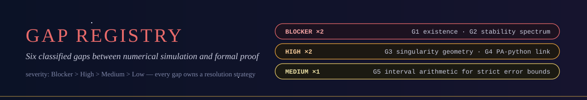

  

# blueprint/ — the constitution of the programme

Where decisions live so that code does not have to improvise: the
technical specification, the axiomatic base, the classified gap ledger,
the proof-assistant decision record, and the module map.

## Contents

| File | What it fixes |
|---|---|
| [`technical_specification.md`](technical_specification.md) | language, environment, module discipline, integration architecture, quality workflow |
| [`axiomatic_base.md`](axiomatic_base.md) | the three admissible axioms (`Classical.choice`, `propext`, `Quot.sound`), prohibition + CI enforcement of project axioms |
| [`gap_registry.csv`](gap_registry.csv) | **the obligation ledger**: G1–G6 with severity, dependencies, strategy, phase, status |
| [`tooling_decision_matrix.md`](tooling_decision_matrix.md) | Isabelle/HOL vs Coq/Rocq vs Lean 4 — scorecard, verdict, reopening conditions |
| [`module_map.md`](module_map.md) | module ↔ obligation ↔ gap ↔ phase; import graph; bridge consumption map |

## The two blockers, stated plainly

> **G1 — existence.**  No machine-checked proof yet exists that a smooth
> DSS solution of the spherically symmetric Einstein–scalar system exists.
> The Reiterer–Trubowitz result is computer-assisted, not machine-checked.
> Strategy: Newton correction in a Banach space of exponentially decaying
> sequences, compact inverse, implicit function theorem.  Phase II.

> **G2 — stability.**  No machine-checked proof that the linearized
> spectrum has exactly one positive eigenvalue with the rest in the left
> half-plane and echo spacing 2π/Δ.  Everything public about γ = 1/λ₀
> hangs on this spectrum.  Phase III.

Everything else (G3–G6) is enabling infrastructure.  A gap may be closed
only with: a discharged `sorry`, the printed axiom set, and the paired
test or numerical cross-check — recorded in the registry's `status`
column.

  

