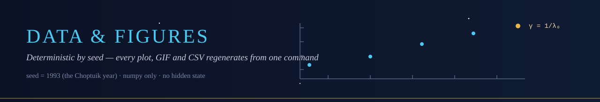

<p align="center">
  
</p>

# data/ — committed, deterministic, regenerable


The numbers behind every figure and every test.  Regenerate byte-identical
copies with `python scripts/generate_data.py` (fixed seed 1993; numpy
build noted in the repo release).

## Trees

```
data/
├── scaling/
│   ├── mass_scaling.csv          24 supercritical runs: p, M_BH, ln|p-p*|, ln M
│   ├── critical_exponents.csv    gamma/lambda_0/Delta: fit vs literature, sources
│   └── interval_certificate.csv  strict enclosures of the correction term & 1/lambda_0
├── spectrum/
│   └── eigenvalues.csv           15 eigenvalues: Re, Im, type, echo spacing check
├── echoing/
│   ├── echo_profile.csv          psi(ln rho, tau mod Delta) over 3 periods (8019 rows)
│   └── central_amplitude.csv     envelope + periodic modulation, 5 periods
└── collapse/
    └── field_profiles.csv        phi(r, tau) for sub/critical/super families
```

## Flagship values (as committed)

| Quantity | Value | Cross-check |
|---|---|---|
| γ (fit) | 0.373880 | γ = 1/λ₀ = 0.373902; Choptuik '93: 0.374 |
| λ₀ | 2.674500 | single unstable mode: True |
| Δ | 0.693147 | recovered from series: 0.693147 (= ln 2) |
| echo spacing | 2π/Δ = 9.064720 | max deviation in spectrum: 2.0·10⁻¹⁰ |

> [!NOTE]
> Provenance discipline: each CSV carries its generator
> (`python/scripts/generate_data.py`); every figure cites its CSV in
> [`figures/README.md`](../figures/README.md); every test in
> [`python/tests/`](../python/tests/) asserts against these values.
> No dataset without a regeneration path.

<p align="center">
  
</p>
