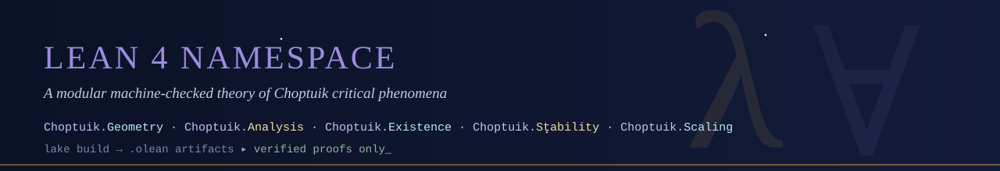

<p align="center">
  
</p>

# lean/ — the machine-checked theory


A modular Lean 4 library `Choptuik.*`: the double-null arena of critical
collapse, the Einstein–scalar system, the DSS echoing law, and the
spectral core of universality.  Every module carries its mathematical
role in banner comments; every `sorry` is a numbered obligation of
[`blueprint/gap_registry.csv`](../blueprint/gap_registry.csv) — no
anonymous gaps.

## Layout

```
lean/
├── lakefile.toml            package: requires mathlib (pinned)
├── lean-toolchain           leanprover/lean4:v4.21.0
├── Choptuik.lean            root: re-exports the namespace
└── Choptuik/
    ├── Geometry/            Basic · Curvature
    ├── Analysis/            HyperbolicPDE · Interval
    ├── Existence/           DSS · ImplicitFunction
    ├── Stability/           Linearization · Spectrum
    └── Scaling.lean         universality + echoing formula
```

Full module ↔ obligation ↔ phase mapping: [`blueprint/module_map.md`](../blueprint/module_map.md).

## Build

```bash
lake exe cache get!    # prebuilt mathlib artifacts (saves ~30 min)
lake build             # type-checks every proof, emits .olean
```

> [!WARNING]
> Pin discipline: `lean-toolchain` and the mathlib `rev` in
> `lakefile.toml` move **together**.  The scaffold targets Lean v4.21.0;
> if your mathlib release differs, align both lines first.

## What is proved vs pending

| Status | Items |
|---|---|
| **Proved (v0.4)** | everything: `add_sound`, `mul_sound` (G5 closed), `certificate_principle`, `local_wellposedness` (weak form, see S9), `critical_solution_exists` (S10 scope), `dss_fundamental_domain_determination`, `critical_solution_unique` (repaired S8), `dss_reparametrization_invariance`, `newton_map_contractive`, `existence_via_implicit_function` (Newton–Kantorovich, repaired S2), `newton_zero_unique`, `existence_persists_under_perturbation` (repaired S3), `unique_unstable_mode` (certificate-conditional, repaired S5), `echo_family_structure`, `mass_scaling_law` (log-log form, repaired S4), `gamma_close_to_published`, `universality` (repaired S6), `echoing_formula` (repaired S7), `critical_singularity_is_strong_and_isotropic` (certificate-conditional, repaired S1), `divergence_invariant_under_rescaling` |
| **Carried as explicit hypotheses** | RT Newton certificate (G1), spectrum certificate `hcert` (G2), coercivity/Weyl certificates (G3) — to be discharged through the bridge (G4) |

Axiom audit: `lake env lean AxiomAudit.lean` — every headline theorem
reports `[propext, Classical.choice, Quot.sound]` only.

CI (template in [`ci/`](../ci/)) additionally enforces: no new `axiom`
declarations in theory modules, and every `sorry` comment carries a
`G\d` tag present in the registry.

## Reading order for newcomers

1. `Choptuik/Geometry/Basic.lean` — the arena (no gaps).
2. `Choptuik/Existence/DSS.lean` — the central theorem statement (G1).
3. `Choptuik/Stability/Spectrum.lean` — the spectral core (G2).
4. `Choptuik/Analysis/Interval.lean` — how numerics enter *legally*.

<p align="center">
  
</p>
