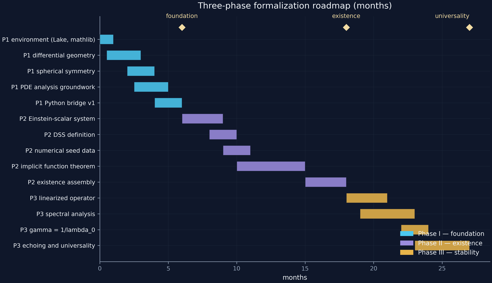

  

# roadmap/ — twenty-seven months, three phases, two blockers

The executable plan: each phase has tasks with months, acceptance
criteria, and named risks.  Durations are estimates for a single
experienced contributor working part-time with the parent programme.

| Phase | Window | Goal | Closes |
|---|---|---|---|
| **I — Foundation** | months 0–6 | arena + tools exist and are trusted | G4, G5 |
| **II — Existence** | months 6–18 | the critical solution is machine-checked | **G1** |
| **III — Stability** | months 18–27 | attractor status, γ = 1/λ₀, universality | **G2** |

  

## Phase documents

| File | Tasks | Acceptance highlights |
|---|---|---|
| [`phase1_foundation.md`](phase1_foundation.md) | P1.1–P1.6 | `Interval.mul_sound` proved; bridge round-trips; axiom audit clean |
| [`phase2_existence.md`](phase2_existence.md) | P2.1–P2.6 | `#print axioms critical_solution_exists` = 3 standard; Δ matches service to certified precision |
| [`phase3_stability.md`](phase3_stability.md) | P3.1–P3.5 | derived γ within 10⁻³ of published; numerics and proof cross-check |

## Milestone ledger

Machine-readable: [`milestones.csv`](milestones.csv) — nine milestones,
`M1.1` (environment) already **done**, the rest open.  A milestone flips
status only with its acceptance evidence committed.

  

